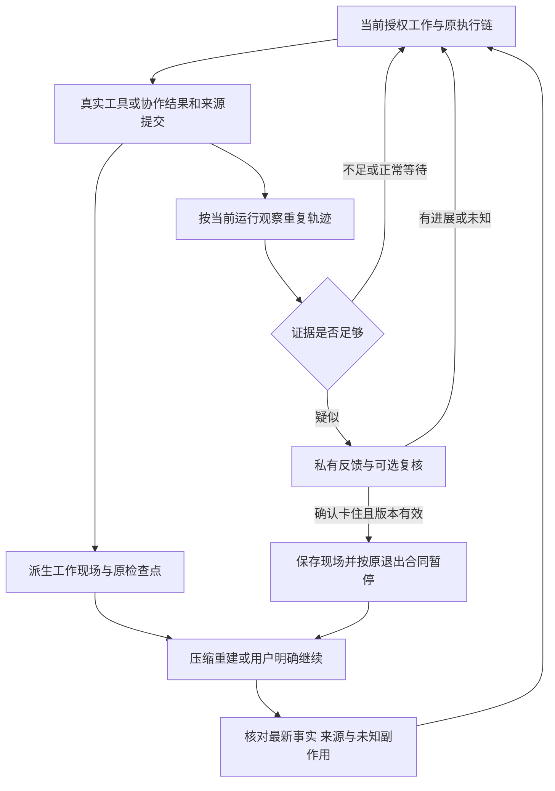

<!--
[INPUT]: 2026-10-26用户确认普通任务与Goal均默认持续执行、仅用户明确设置额度、按真实进展与完成证据决定状态；本轮修改并审阅文档，后续再实施。
[OUTPUT]: 无默认累计上限、显式额度来源、证据驱动状态、重复轨迹与工作现场设计；保留上一轮群调度源码候选，本轮文档review与实际进度唯一归第12节。
[POS]: 第27组唯一设计与实施交接文档；沿现有Work、上下文、执行事件及原聊天入口。
[PROTOCOL]: 一旦本文件变化，必须同步更新 Header，并上浮检查所属目录 .folder.md。
-->

# 长任务执行与工作现场恢复设计

更新：2026-10-26。

当前状态：上一轮按用户要求修改了群调度残留限制的源码和回归用例，尚未执行产品验证。本轮仅按用户最新确认修订并审阅设计文档；其余代码实施留待后续。源码修改、测试执行、真实模型效果和运行进程加载分别记录在第12节。

## 1. 用户决定与范围

- 普通任务、长任务与目标持续任务（Goal）都默认允许持续执行，不按累计模型调用数、工具步数、累计输出用量、运行总时长、群判断次数、接续代数或员工发言次数截断。不存在“普通任务默认受限、Goal 才能解除限制”的分流。
- 需要控制成本时，由用户明确设置额度；未设置就是无累计上限。执行状态由真实进展、重复轨迹、完成证据和用户停止决定，具体转换见第3节。
- 调用数、用量、运行时间和接续代数继续记录，服务于观察和归因；记录本身不产生停止条件。
- 用户明确设置的具体费用、次数或期限按原约定执行。系统不得把旧默认值、历史计数或诊断阈值解释成用户设置。
- 保留用户停止、权限撤销、员工/群删除、来源失效、真实进程退出与副作用回执核对。这些控制不依赖任务已经运行多久。
- 只参考 Cindy 的两项设计：识别反复调用却没有推进的轨迹；在压缩、重建或恢复时提供可核对的工作现场。
- 现有数字员工、独立工作区、私聊、群聊、自动化、Work、Run、成果和长期记忆继续沿原合同。不增加总览页面或另一套任务系统。
- 插件配置回流、跨引擎会话停泊、丰富插件界面、远程/手机端均不在本组范围。

本合同覆盖默认执行策略。后文有界观察窗口、证据长度、诊断请求的响应大小，只限制机制自身的资源使用，不能转化为业务任务执行上限。

## 2. 固定源码基线与限制来源

### 2.1 BOAI 已有基础

本组从 `origin/main` 的 `9831e2faa9a86ec9cc28ee7a764397034de64d6d` 建立独立 worktree。以下是该基线的源码事实，不表示用户当前进程已加载该版本。

- [work.ts](../../../packages/shared/src/domain/work.ts) 的 `WORK_EXECUTION_LIMITS` 已是 `steps: Infinity`、`modelCalls: null`、`outputTokens: null`。
- [work-budget.ts](../../../packages/runtime/src/modules/collaboration/work-budget.ts) 的新工作默认没有总截止时间；已有按版本与整组数值匹配的旧默认迁移，已有续额记录会跳过迁移。数值匹配不能证明设置来源，恰与旧默认相同的自定义值仍需按3.4核对，不能据此声称已满足完整来源合同。
- [Mastra engine](../../../packages/runtime/src/adapters/mastra/engine.ts) 使用上述步数配置，按宿主信号和正常模型终态运行，并保留每次追加请求的身份与计量。
- [ContextRepository](../../../packages/runtime/src/modules/contexts/context-repository.ts) 已有来源 hash、scopeVersion、revision、compact/rotate 提交和完成工具步骤检查点。
- [context-maintenance.ts](../../../packages/runtime/src/adapters/mastra/context-maintenance.ts) 已能生成有来源的交接摘要、补齐历史窗口覆盖并接续原工作。
- [NativeSessions](../../../packages/runtime/src/adapters/native-sessions.ts) 已按员工、聊天、配置和真实来源核验原生会话续用资格。
- [TaskResultRepository](../../../packages/runtime/src/modules/collaboration/task-result-repository.ts) 从原 Work/Run/文件和执行记录读取结果；[第26组05](../26.Workspace工程结构重构/05-任务结果闭环.md)拥有其读取合同。

### 2.2 上一轮已修改的残留限制

[group-scheduler.ts](../../../packages/runtime/src/group-scheduler.ts) 在上一轮修改前还包含：

- 判断追加请求达到 `max(12, 群成员数 × 4)` 后拒绝。
- 待派发判断达到相同阈值后跳过剩余员工。
- 接续事件达到三代后不再派发，并将轮次结束为 `budget_exhausted`。
- 同一员工本轮已发言两次后，不再排队、接受判断或接收后续投递。

这些是默认累计截断规则，上一轮源码候选已全部移除；不改成更大的数字，不增加另一种默认额度。`decisionCalls`、`modelCalls`、`generation` 和发言计数仍可保存，原事件身份、成员校验、去重、用户新消息优先、资源排队及自然结束机制保持。

判断次数是宿主参与判断的累计请求数，接续代数是群消息/交接事件的传播深度，均不等于员工内部工具步数。旧代码的部分例外按顺序协作模式区分，没有按 Goal 豁免；后续实现不得新增此类普通任务与 Goal 的限额差异。

Git 来源核对：

- 判断次数和三代接续阈值最早已存在于 2026-09-27 的根提交 [`b8d43c6e`](https://github.com/6owen/boai-agent/commit/b8d43c6e40265a4527e9303316341b1d1badc2b2)，当时位于 `src/runtime/group-scheduler.ts`。记录只能追到 `init`，不能据此确定最初由哪次对话产生。
- 2026-10-24 的 [`d0f75d7d`](https://github.com/6owen/boai-agent/commit/d0f75d7d784c13a5162a51a9fc10d29ecaabe28a) 移除了轮次总调用、累计输出和五分钟时限，但保留了判断次数、接续代数和员工发言限制。
- Workspace 迁移后源码归 `packages/runtime/src/`。上一轮修正保存在独立 worktree，不复制到 main，不把文件已改写成运行进程已更新。

### 2.3 Cindy 的参考边界

固定提交：`41281904b45376d78d5f5b1aa00c80bb33801dc8`。参考已读取的源码，不依赖后续 main 变化。

- [loop-guard.ts](https://github.com/makecindy/cindy/blob/41281904b45376d78d5f5b1aa00c80bb33801dc8/packages/maker-core/src/agents/shared/loop-guard.ts)：完整调用/结果指纹、重复和轮转观察、等待例外。
- [tool-loop-review.ts](https://github.com/makecindy/cindy/blob/41281904b45376d78d5f5b1aa00c80bb33801dc8/packages/maker-core/src/agents/shared/tool-loop-review.ts)：疑似轨迹异步复核、进行中模式变化和迟到结果失效。
- [botWorkingMemory.ts](https://github.com/makecindy/cindy/blob/41281904b45376d78d5f5b1aa00c80bb33801dc8/apps/desktop/src/main/maker-ipc/botWorkingMemory.ts)：目标线索、承诺、等待、纠正、近期完成与宿主真实状态分开组织。
- [agentHandoff.ts](https://github.com/makecindy/cindy/blob/41281904b45376d78d5f5b1aa00c80bb33801dc8/apps/desktop/src/main/maker-ipc/agentHandoff.ts)：有限工作摘录、来源定位和恢复时的交接组织。

采用检测与恢复思路，适配 BOAI 原有身份、事务、权限和执行记录。Cindy 的累计硬熔断、复核失败/超时即停止等策略不进入本组默认路径；本次也不以其产品宣传证明真实记忆或执行质量。

## 3. 长任务执行合同

### 3.1 继续与结束

- 当前授权范围内还有可执行工作时继续，不因累计次数、总耗时或总 token 触发默认失败。
- 目标完成按原 Work/成果核验收口；普通交流按真实回复和 pass 收口。没有新的可执行输入时自然静止，不制造事件或模型请求维持活跃。
- 等待用户、依赖结果或外部状态时保留原等待身份。资源席位不足时排队，不借排队时间制造任务过期。
- 有真实异常时记录明确原因和已完成部分；用户点击停止后立即关闭后续派发，实际进程退出确认后再释放其资源。
- 中断旧任务的启动恢复只做记录核对；用户明确继续或原授权的在途上下文维护才触发下一步。应用重启不自动重放旧输入或工具；其他独立获准的自动化仍沿原调度合同运行。

### 3.2 普通任务与 Goal 的共同策略

- 默认持续执行表示：在目标、输入与授权仍有效且有下一步可执行工作时，不受累计次数截断；不表示必须永远发起请求。
- 普通任务可以在一个运行内持续使用工具、压缩上下文和完成多步交付。普通对话没有待办工作时可自然回复结束，不要求建立 Goal 才能完成长任务。
- Goal 的区别是保存目标及跨轮继续依据。一轮回复结束不等于目标完成；后续是否继续由未完成工作和当前执行资格决定，不能依靠“第几轮”判断。
- 本组明确共同策略及现有 Work/继续入口的衔接，不新增一套 Goal 调度器，也不声称当前 BOAI 已实现所有外部 Agent 的 Goal 能力。用户在外部 Codex/Pi 中设目标不会覆盖 BOAI 内部执行规则。

### 3.3 按证据决定执行状态

以下是行为合同，落地时映射现有 Work/Run/Turn 状态，不另建平行状态真源。

- 持续执行：有可执行的下一步，或者获得新的有效来源、已验证结果、依赖推进或修订证据。进展不要求每个工具调用都立即产生交付物，也不设置“多久没有进展就停止”。
- 等待：当前依赖未就绪、用户问题未回答或资源尚未取得时，保留等待对象和唤醒条件。等待时长不构成失败，也不持续调用模型假装推进。
- 完成：对照原请求及最新纠正检查要求的成果、验证结果和交付回执。模型自报完成、发出最后一条消息、计数变大或队列为空，不能单独证明目标完成。
- 自然静止：普通交流已经答复且无后续工作时结束当前交流；有未完成目标但暂无动作时保存等待或具体阻塞，不能只因无人继续发言而把原目标标成完成，也不能凭空生成新交接。
- 疑似重复：按第4节先给证据反馈并允许调整；只有证据有效且确认卡住，才暂停受影响的执行路径并保存现场。重复次数只是形成候选的信号，不直接决定停止。
- 用户停止：用户的停止优先于后台继续、诊断或摘要结果；先禁止新的派发，再沿原取消/退出合同处理在途工作。继续须来自原明确继续入口。
- 明确额度用尽：仅在3.4所述用户设置确实存在且适用时停止新派发，保存未完成工作及实际用量；不标成完成，也不自动扩额。
- 真实执行异常、权限或来源失效：按原规则处理受影响操作，记录已完成部分与具体阻塞。可恢复的网络/服务问题不伪装成总任务额度失败；恢复也不变成无证据的无限重试。

异步结果提交前先核对用户停止、权限、来源和运行版本。诊断或完成判断均不能越过已失效的执行资格；已生效的用户额度按原作用域执行。

### 3.4 用户明确设置的额度

- 额度必须可追溯到可信的用户配置或明确指令，记录作用域、计量单位、数值、设置来源和版本。普通任务、Goal、原工作继续及自动化采用同一原则；模型、同伴和内部诊断不能自行设置或扩额。
- 未设置用持久协议的无上限表示；不得因字段缺失补入产品默认累计额度。用户明确设置的零额度仍是零，不能解释成无限。
- 运行轮换、上下文压缩、员工交接、重启或点击继续不重置同一作用域的累计用量。用户续额或取消限额沿原事务记录前后值，保留已发生用量和历史失败。
- 所有计入该作用域的实际付费调用共用计量，包括执行、判断、诊断复核和摘要维护；辅助请求不得另设隐形额度或绕过用户设置。达到明确额度后不为了生成现场再发付费请求，可先保存已有的权威记录。
- 旧数据迁移需要区分已证实的历史默认值、已证实的用户设置和来源未知。只有证实是系统旧默认的累计上限才可自动移除；数值恰好相同不足以证明来源。未知历史记录保留供核对，但不自动恢复旧任务；用户明确继续时，未证实为用户设置的旧值不能成为新的执行限额。
- 费用金额、请求次数、输出用量和期限不能互相冒充。沿用现有后端实际支持的设置与原生配置；不声称本机后端已受 BOAI 的 API 账本约束，不新增 BOAI 默认额度覆盖原生行为。精确金额限额若缺少价格或实时用量支持，应标明能力缺口，不能用猜测成本宣称已保证上限；本组不另建计费系统。

### 3.5 全链核对要求

后续实施复核私聊、普通群、组织群、自动化、原 Work 继续、API 与原生桥的入口，确认没有从另一层重新引入默认任务总额度。

- 旧默认额度只按可靠版本与完整旧配置识别；不把碰巧相同的自定义数值全部清空。来源不明时保留原记录和可核对状态，不擅自启动旧失败工作。
- 原始计数、真实用量、失败记录和未知回执不重置；迁移去除上限不等于任务自动恢复。
- 单请求网络错误、协议不完整、模型物理上下文上限、并发容量与进程排空要分别处理。不能用“连接超时”实现隐蔽的整个长任务超时，也不盲目把所有请求/协议保护改成无限重试。
- 上下文装不下时沿[第24组](../24.Mastra上下文容量与连续会话/README.md)分页、压缩或轮换；当前请求无法装入与任务累计用量过大必须分清。
- 用户明确约定的限额必须有可信的设置来源；模型文本、同伴消息、旧默认常量和内部诊断不能自行设限或扩额。

## 4. 原地打转识别

### 4.1 观察依据

检测器消费现有执行链的真实工具开始、完成、错误和等待事件，以及群调度已提交的判断、消息与定向交接事件；不执行工具，不创建 Work，不改变供应商返回值。

- 按员工、聊天、Work/Run、原生轮次或宿主运行代次隔离；同名工具在不同并行任务中不共享重复轨迹。
- 用真实 toolCallId 配对调用与完整结果。重复事件只观察一次，尚未完成、被取消或只有展示摘要的结果不能当作相同完整结果。
- 计算工具命名空间、稳定编码后的参数和结果指纹。稳定编码只消除对象键顺序等表示差异，不删除业务参数，不把不同路径、不同查询或不同文件版本合并。
- 完整结果可流式计算 hash；诊断仅保存有界、脱敏后的证据摘要和原事件引用，不能把大文件、图片字节或密钥复制进日志。
- 新的有效来源、结果版本、依赖进展和用户补充会改变观察依据。模型声称“有进展”本身不能清除完整的重复证据。
- 群协作单独按原群轮次/目标与事件来源观察，引用已提交消息、交接对象及对应成果/依赖版本；同一工具的员工级轨迹仍各自隔离。群内原本不可读的内容不得为诊断而扩权汇总。

### 4.2 疑似模式与误判控制

- 完全相同的调用和结果多次连续出现，可以形成候选。
- 少量相同调用长期轮转，且反复得到相同结果，可以形成候选。
- 群内即使没有工具调用，员工反复互相交接、复述相同结论且没有新依据，也可以形成候选；交接代数、措辞变化或新消息 ID 本身不构成进展证据。正常多轮讨论、有效修订和成果变化不能据此判停。
- 只有调用相同但输出正在变化，需要结合工具语义判断；日志增长、分页推进、外部任务状态变化都可能是实际进展。
- 等待、sleep、进程输出等待和已知状态轮询单独归类。轮询本身不构成循环证据，也不能被用来洗掉夹在两次等待之间的真实重复轨迹。
- 只读调查、推理耗时长、没有文件修改、单次失败、修正参数后再试，均不能单独证明原地打转。
- 并发结果乱序、子 Agent 和脚本内部短促重复必须按可观测的真实归属处理。仅凭两秒间隔等时间启发式不能直接判停。

初始可实验 Cindy 的连续重复、短窗口轮转和较长只读窗口。具体窗口是待校准的候选参数，不是上线后不可变的任务限额；不得恢复“同类错误三次就停止”或“累计调用三十次就停止”等默认策略。

### 4.3 从怀疑到处置

1. 正常观察：任务沿原执行路径运行。
2. 形成候选：保存模式指纹、近期原事件和候选生成时的运行/来源版本，合并同一模式的重复诊断请求。
3. 提醒调整：在下一次安全输入边界提供私有证据反馈，指出哪些调用和结果在重复，请员工更换查询、读取原件、核对假设或等待真正变化；不自动替员工执行新操作。
4. 可选复核：已有明确配置的模型可给出 `progressing`、`stuck` 或 `unknown`，并引用输入证据。未配置、不可达、超时、解析失败、引用不存在或无法对应当前证据，一律视为未知，业务任务保持原状态；没有有效复核时只观察和反馈，不自动暂停。
5. 恢复进展：发现新的有效证据，或已核验相关操作/结果确实改变而使原重复证据不再成立，作废旧复核和提醒；继续原工作。只更换消息 ID、时间戳、措辞或无关参数不能清除证据；不确定时保持观察。
6. 确认卡住：只有完整重复证据仍成立、员工已获知并尝试调整但仍回到同一模式、复核明确为 `stuck` 且引用与版本仍有效时，才允许暂停当前执行路径，并保存现场。暂停原因说明具体卡点，不能冒充额度耗尽或目标完成。

摘要证据不完整、后台脚本归属未知、用户操作尚在等待时，只诊断，不自动暂停。辅助模型无权改变目标、权限、预算或已完成事实。

### 4.4 并发、取消与副作用

- 任一诊断回包应用前复核 runId、工作/来源版本、运行代次和模式指纹。用户停止、新输入使候选过时、工作已结束、员工配置/权限变更时立即丢弃旧结论。
- 群层候选同时绑定群轮次、事件序列和参与者范围，回包时重新核对最新协作结果。暂停只作用于证据对应的重复派发路径，不能因一个员工卡住而停止无关员工或其他工作；单个员工运行结束也不能误标整个群目标完成。
- 一种模式只保留一个在途复核；无新证据不连续付费复核。同一模式的缓存失效由证据变化决定，不通过累计复核次数停止业务任务。
- 自动暂停先阻止后续派发，再按原运行取消/实际退出合同排空；不能因为检测器判停就提前释放命令、文件或原生进程占用。
- 结果未知的写入、发布、发送、付款等操作保留未知状态；诊断、换策略和恢复均不能自动重复它们。
- 新的检测器故障只影响诊断能力；原有用户停止、真实工具错误和权限拒绝仍由原链路处理。
- 诊断暂停后的继续先核对新输入、可用策略与阻塞条件，再进入原执行链。没有任何条件变化时不由后台自动“暂停→继续→再暂停”；用户明确继续可再次尝试，但不能仅因历史次数立即重停，也不能遗忘已知重复模式或未知副作用。

## 5. 工作现场投影

### 5.1 恢复时必须知道什么

每次恢复形成一份内部工作现场，至少包括：

- 当前目标：原始请求、当前有效补充、明确的完成标准和原消息定位。
- 约束与纠正：仍适用的格式、范围、路径、事实纠正，以及它替代了哪个旧要求。
- 已完成：原 Work 结果、正式成果版本和 hash、已确认工具效果及回执；未正式发布的本地准备文件单独标注。
- 进行中与等待：当前步骤、依赖、等待用户的问题、等待外部结果及其原身份。
- 未知与风险：已派发但结果未知的副作用，不能自动重复的操作，以及失效/需要重核的来源。
- 下一步：基于当前事实可推进的动作和需要先核对的内容；计划不写成已执行。

每个事实或语义条目关联原消息、Work/结果版本、产物版本或工具回执。模型提取内容应标为语义摘要，不能升级为宿主已核验事实。

### 5.2 复用已有数据

- Work、Run、产物、文件、调用回执和依赖状态由原仓库读取，恢复前重新核对。摘要不维护另一份任务状态。
- 当前目标、承诺、等待和纠正可从已授权消息与原 checkpoint 提取；优先在已有上下文维护调用中完成，不要求每步或每轮追加一次后台模型。
- 优先按需生成内部投影，将语义交接沿现有 `ContextRepository` 的 summary/source/CAS 合同保存，不新增独立工作现场数据库或 `working-memory.json` 真源。
- 若结构化持久字段确有必要，必须先补原 schema 的版本/旧记录读取和损坏保护，再实现迁移；不能直接向严格协议写入未知字段。
- 原执行事件/文件状态缺失时标未知。账本只承担来源引用和语义交接，不能用“成功命令名”推断文件已变更或已发布。

### 5.3 更新与注入时点

- 在真实步骤结果提交、等待状态保存、用户纠正生效后更新可派生事实。副作用回执先持久化，摘要失败不能使已完成结果消失。
- 在当前授权运行的上下文压缩/重建前，以及用户明确继续原任务时，组装最新现场与必要近期原文。
- 隔天继续先读最新授权和结果版本；同一现场 revision 不反复注入。普通短对话不为了形成现场而创建 Work。
- 发生崩溃、显式停止或应用重启后只核对和准备现场；真正执行继续沿原入口，不自动启动模型或重放旧工具。
- 原生执行器能观察到明确压缩/重建边界且有安全输入接口时接入；能力未知时保持原生恢复路径，不能为了注入交接强制重启健康线程。

### 5.4 一致性与来源失效

- 读取 Work/消息/结果时固定权威版本；摘要异步返回后以现有 revision、scopeVersion、来源 hash 与运行状态再次校验，CAS 成功才替换旧 checkpoint。
- 用户新纠正、来源撤权、忘记、消息清理、成员移除、文件或成果版本变化，使对应派生条目失效；禁止从旧摘要复活被删除/撤权内容。
- 摘要为空、失败、冲突或版本未知时保留旧有效 checkpoint，重新读取权威记录；不能静默提交空现场或抹掉新纠正。
- 工作事实以该员工当前真实可读范围生成，员工已有跨聊天记忆沿原策略召回；本组不新增默认私聊/群聊隔离，也不把群成员私有执行内容合并公开。
- 诊断暂停、普通恢复和摘要注入都不产生新的工具权限。历史授权与历史计划不能代替当前执行资格。

## 6. 执行与恢复的衔接

图中展示重复检测与恢复，完成、等待、用户停止、明确额度用尽及来源失效沿3.3处理。在途授权运行的容量维护可自行继续；停止、崩溃后的执行仍要求原有明确继续条件。未设置额度时，图中任何分支都不按累计步数、耗时或 token 数结束任务。

## 7. 产品呈现

- 沿原聊天的执行卡、执行详情和明确继续入口呈现。普通内部诊断和现场更新不刷聊天消息，不增加页面内状态提示或错误 Banner。
- 确认暂停时，原执行记录保存可解释原因：重复了哪些操作、有哪些已完成内容、哪一步需要调整；错误提醒沿统一 Sonner。
- 用户继续时，先核对原工作和未知操作，再执行下一步；保留旧失败过程和已交付文件。
- 不向用户暴露内部模式指纹、线程代次、维护事务或模型复核协议；需要排查时从原诊断记录读取。

## 8. 后续代码归属与实施顺序

### LT0：移除默认截断与验证旧数据边界

- 默认执行策略归 [work.ts](../../../packages/shared/src/domain/work.ts) 与 [work-budget.ts](../../../packages/runtime/src/modules/collaboration/work-budget.ts)；审查旧默认迁移和显式设置来源。
- 群判断、发言和派发归 [group-scheduler.ts](../../../packages/runtime/src/group-scheduler.ts)。上一轮已移除累计上限，完成情况仍按第12节实际验证范围阅读。
- 后续核对普通私聊、群/组织、自动化和继续入口，保留实际用量、用户停止、资源排队与来源门禁。
- 把3.4的设置来源、作用域、续额与旧数据核对列入实现；现有整组旧数值匹配不能代替来源证明。未设置额度的新任务必须直接采用无累计上限策略。

### LT1：先接只观察的重复轨迹

- 纯指纹和窗口规则放在 Runtime 内聚模块，消费现有工具和协作事件；调度器只适配已提交事件，不把算法写进 renderer、调度器或每个工具实现。
- 群层接入 [group-scheduler.ts](../../../packages/runtime/src/group-scheduler.ts) 的判断、消息与交接提交结果，覆盖不调用工具的互相空转；计数与 generation 不直接驱动暂停。
- API 接线落在 [Mastra engine](../../../packages/runtime/src/adapters/mastra/engine.ts)、[task-runtime](../../../packages/runtime/src/adapters/mastra/task-runtime.ts) 及原事件/Trace 入口；先验证真实调用与结果配对。
- 原生适配沿 [native-events](../../../packages/runtime/src/adapters/native-events.ts)、[native-conversation](../../../packages/runtime/src/adapters/native-conversation.ts) 做能力核对。只能读取展示摘要的后端先只观察，不能宣称满足自动暂停的完整证据条件。

### LT2：接入反馈、可选复核和可恢复暂停

- 复核沿已明确配置的连接、取消信号和真实调用计量；不硬编码辅助账号或静默更换模型。
- 暂停/继续复用现有 Work/Run 与原消息入口；若原继续入口不覆盖诊断暂停，扩展该入口的资格判断和来源校验，不另建按钮流程。
- 必须验证迟到结论、用户停止、并发员工和未知副作用后再启用自动暂停。

### LT3：生成并接入工作现场

- 派生读取复用 [TaskResultRepository](../../../packages/runtime/src/modules/collaboration/task-result-repository.ts)、[WorkRepository](../../../packages/runtime/src/modules/collaboration/work-repository.ts) 和原来源授权；避免复制第二套文件/结果校验。
- 语义交接与注入沿 [ContextRepository](../../../packages/runtime/src/modules/contexts/context-repository.ts) 和 [context-maintenance](../../../packages/runtime/src/adapters/mastra/context-maintenance.ts)，保留第24组原容量合同。
- Bobo 的 Memory 路径需核对实际最终 prompt，避免旧历史重新注入挤掉现场；原生按已验证的后端能力逐个接入，不统一改造成 Mastra 循环。

### LT4：真实任务与恢复效果验收

- 使用材料整理、报告初稿、明确反馈修订、隔天继续的完整任务；保留原始请求、真实纠正、效果回执与正式结果。
- 分别记录 API、Bobo、普通群、组织/自动化和原生的通过与未验范围；受控机制测试不能替代真实模型效果。
- 本组不恢复此前暂停的其他目标；具体模型调用、桌面/长时验证沿实施时授权和[共享开发流程](../../../.agents/skills/boai-dev-workflow/SKILL.md)。

## 9. 验收清单

以下均是合同和待验场景；第12节没有登记实际通过的，不得标成已验证。

- LT-01：默认 API 工作超过旧步数、调用数、累计输出和总时长阈值，仍按实际进展执行并完成；不通过加大限额实现。
- LT-02：群判断追加请求和新事件派发越过旧 `max(12, 人数×4)`，仍受理，不跳过剩余员工。
- LT-03：同两名员工进行十六步真实定向交接，每人超过两次、接续超过三代，原轮次完整交付；随后 pass 自然结束。
- LT-04：长任务/群接续中用户停止或定向停止，后续请求被拒，晚到结果不复活工作；其他员工按原授权继续。
- LT-05：连接/命令资源不足时排队且可取消，排队不触发总任务超时；真实进程未退出前不释放占用。
- LT-06：明确用户预算仍按原约定；精确旧默认迁移保留计数，自定义、续额、来源未知与未来版本分别核对，不自动恢复旧任务。
- LT-07：完全相同调用和结果、ABAB/多项轮转可形成候选；不同任务同名调用和重复事件不串线、不重复计数。
- LT-08：有效的新查询、分页、文件版本或依赖结果打破原模式；旧诊断结论不能中断新工作。
- LT-09：日志轮询、等待进程、慢推理、只读研究和脚本内有界重复不会因时间长、没改文件或相同输出被直接判停。
- LT-10：只有截断结果、调用结果未配对、原生信息缺失时降级为观察；诊断记录不泄露密钥或保存媒体原件。
- LT-11：辅助模型不可用、超时、返回坏格式、引用无效或 unknown 时任务继续；没有有效 stuck 复核不得自动暂停，不以诊断失败替代业务失败。
- LT-12：确认卡住前已提供具体重复证据和调整机会；暂停保存现场并等待实际退出，继续不重复已完成效果。
- LT-13：用户停止、新输入、成员移除、权限变更和工作结束后，迟到的复核或摘要均不可提交。
- LT-14：原生并发工具乱序、子 Agent 与后台脚本归属分别核对；未覆盖的后端不默认启用自动暂停。
- LT-15：压缩/重建后保留目标、最新纠正、已完成结果、等待、未知操作和下一步，并能定位原始来源。
- LT-16：隔天继续不复述过时方案；已完成准备工作和正式交付分清，用户纠正不能退回旧要求。
- LT-17：来源撤权、忘记、消息清理及文件/成果版本变化后，旧现场失效且不复活私有内容。
- LT-18：摘要失败、并发 CAS 冲突和提交中断保留权威记录及旧有效 checkpoint，不提交空摘要，不丢已完成工具回执。
- LT-19：崩溃、停止和两次重启后，同一中断旧任务零自动模型补跑、零副作用重放；明确继续复用原工作和最新授权，不影响其他独立获准的自动化。
- LT-20：普通聊天不为现场创建 Work；群中每位员工的现场沿各自来源装配，已有跨聊天记忆语义保持。
- LT-21：真实材料任务在长时执行、反馈修订与恢复后仍满足事实、范围和交付要求；单独报告质量偏差，不能用技术通过替代。
- LT-22：普通任务和目标持续任务在相同未设额条件下均能跨越旧阈值；切换名称、入口或运行轮次不会新增限额，也不能解除用户已设置的额度。
- LT-23：模型自报完成但缺少所要求的成果/回执时，不把目标标成完成；普通交流已经答复且无后续工作时，不生成空的继续请求。目标未完成但暂无动作时保留真实等待/阻塞。
- LT-24：显式零额度、续额、取消限额和跨员工/跨轮次累计分别验证；缺少设置的记录默认无限。来源未知旧记录不自动恢复，明确继续时也不得把未证实为用户设置的旧值作为新限额。
- LT-25：无工具调用的群内空转可被观察和复核；有效十六步及更长交接不因代数暂停，换措辞/消息 ID/时间戳不能单独洗掉真实重复证据。
- LT-26：诊断复核和摘要维护计入用户设置的原作用域；额度用尽后不再额外付费生成现场，已有回执仍能持久化，未知用量不伪装成零或精确金额。
- LT-27：用户停止优先于晚到的完成/复核；暂停后无条件变化不自动反复唤醒，明确继续不因历史重复次数立即重停，也不重放未知副作用；局部重复不停止无关员工或工作。

## 10. 验证方式

- 默认限额与取消回归复用 [native-output-budget.test.ts](../../../tests/native-output-budget.test.ts)、[service.test.ts](../../../tests/service.test.ts) 和原 Work/自动化测试，固定在旧阈值之外检验行为。
- 循环检测采用纯事件轨迹验证误判、事件乱序和跨运行隔离；集成验证需证明诊断本身没有执行或重放工具。
- 恢复机制复用 [context-repository.test.ts](../../../tests/context-repository.test.ts)、[mastra-context-continuity.test.ts](../../../tests/mastra-context-continuity.test.ts) 和实际原生恢复合同。
- 长时机制可用受控时钟和可解释轨迹验证，真实供应商任务单独记录实际时长与效果。测试样本跨过旧阈值不代表已证明任意长任务稳定。
- 仅文档链接、Header 和差异检查通过，不等于机制测试、UI、真实模型或应用进程验收通过。

## 11. 后续实施入口

本轮终点是修订并审阅文档。用户后续要求执行时，再读取本设计、第12节最新状态和实际源码，核对变更基线；按 LT0→LT1→LT2→LT3→LT4 分批推进，复用原测试/执行/交付链。

每批记录实际改动、测试执行、失败、已验证后端、未验范围与进程加载身份。推送、PR、合并和应用重启分别按用户授权办理，不因本设计存在而自动执行。

## 12. 唯一实际进度

### 2026-10-26：设计落地与默认限制修正

- 已完成：固定 BOAI/Cindy 源码核对、Git 历史追踪、用户范围与验收合同、独立 worktree 建立。
- 已修改源码：群判断累计次数的两个门禁、三代停止与不再派发分支、员工两次主动发言的判断/排队/派发门禁；计数、排序、去重与原取消/来源规则保留。
- 已修改回归源码：旧判断耗尽用例改为超过旧阈值仍完成；增加十六步定向群交接；判断和执行均超过旧调用阈值后仍能被用户取消。
- 原地打转识别：未实现、未启用，LT1/LT2 待后续。
- 工作现场投影：未实现、未启用，LT3 待后续；已有上下文能力保持其原专题实际状态。
- 轻量核对：3个修改的TypeScript文件通过语法解析；11份Markdown的Header、37个新增本地链接和1个章节锚点检查通过；Git差异空白检查通过。生产源码检索未再发现本轮移除的判断/发言/三代阈值；main中的group-scheduler.ts无本轮改动。
- 未执行：产品测试、构建、Electron、真实模型、长时运行与正在使用的进程加载核验；新增回归用例仅为已写入源码，不能记为通过。
- 交付：本地独立 worktree；未提交、未推送、未创建 PR、未合并，也未同步 main 或重启应用。

### 2026-10-26：用户原则确认后的文档修订与自审

- 本轮范围：只修改设计、目录入口和全局约定；上一轮调度器及回归源码候选保留，未继续实施产品功能。
- 已明确：普通任务、长任务与Goal默认策略相同；仅用户明确设额；执行状态由真实进展、重复轨迹、完成证据和用户停止决定。无默认累计上限不等于维持空请求或无条件重放。
- 自审修正一：补全显式额度的来源、作用域、零额度、续额和累计计量，诊断/摘要不能绕过用户额度；指出现有旧值匹配不足以证明设置来源，将来源核对列入LT0，不伪装成已实现。
- 自审修正二：补上无工具调用的群内重复交接观察，区分员工级与群级轨迹；消息ID、时间戳和改写措辞不单独证明进展，局部暂停不影响无关工作。
- 自审修正三：明确完成证据、自然静止与真实等待，避免把最后一条回复、空队列或一轮结束当作目标完成；也不为继续而制造新工作。
- 自审修正四：自动暂停须有有效stuck复核及匹配证据，未知/失败只诊断；用户停止和版本校验优先，继续不丢旧副作用记录，重启核对仅针对同一中断任务。
- 验收清单扩展为LT-01至LT-27；设计中的候选窗口、模型误判率和各原生后端可观测能力仍需实施后验证，文档自审不构成机制或真实模型验收。
- 本轮轻量检查通过：11份修改/新增Markdown的Header、38个新增本地链接、1个章节锚点、12节结构与27项验收编号，Git差异及新增文档空白检查；3份既有TypeScript候选的文件hash与本轮开始时一致。未运行产品测试、构建、桌面或真实模型。
- 后续入口：用户要求执行后从LT0继续，先核对上一轮源码候选与当前基线，再实现两项新机制。本轮未提交、未推送、未合并、未同步main、未重启应用。
