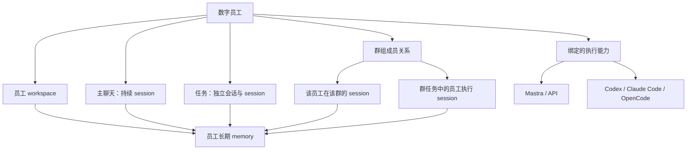

<!--
[INPUT]: 2026-11-06用户确认的员工一等公民、五步核心设计及完整测试要求；当前源码与既有专题合同。
[OUTPUT]: 用户确认的员工核心模型、五阶段职责/交付门槛和旧记忆实现的迁移差异。
[POS]: 第29组01-核心设计.md；设计、源码事实和实际验收分开记录。
[PROTOCOL]: 一旦本文件变化，必须同步更新Header，并上浮检查所属目录.folder.md。
-->

# 核心设计

## 1. 员工为一等公民

`Employee` 是稳定的产品身份。员工拥有配置、人格、workspace、长期memory、执行能力绑定、主聊天、任务和群组成员关系。用户始终创建和使用同一类数字员工；Mastra/API、Claude Code、Codex、OpenCode只是员工绑定的执行能力，不产生另一种员工产品。

员工主聊天只有持续使用的聊天入口，背后续接session。任务和群组有自己的会话入口，不把执行器品牌、run或subagent变成新的员工身份。

箭头表示归属或获准读写，不表示每段交流都应无条件转成长时记忆。

## 2. 对象与唯一职责

| 对象 | 稳定身份与归属 | 职责 |
| --- | --- | --- |
| Employee | employeeId | 员工身份、配置、能力、workspace和memory所有者 |
| Workspace | employeeId / workspaceRef | 员工工作资料、执行目录、产物和记忆的持久归属；任务子目录不产生新员工workspace |
| EmployeeMemory | employeeId + 来源/范围/版本 | 跨主聊天、任务、群组工作的长期知识；按授权与相关性召回 |
| Conversation | conversationId + 类型/参与者 | 主聊天、任务会话或群历史；保存真实作者、消息与来源 |
| Task | taskId + owner/assignments | 持久目标、要求、验收及产物；一个任务可由一个或多个员工承接 |
| SessionBinding | employeeId + conversationId + providerInstanceId | BOAI会话到执行器原生session/thread的持久映射及续接资格 |
| Run / Attempt | runId / attemptId | 一次获准执行及其尝试；不等于任务、消息或长期session |
| Assignment | taskId + employeeId | 多员工任务的参与职责、执行session与结果引用；不擅自复制成多个用户任务卡 |
| Handoff | handoffId + source/target | 工作交接内容、版本、来源、依赖和投递/接受/完成回执 |

这些是目标领域概念，不要求立即替换现有表名或创建一套平行真相。先映射现有Task、Work、AgentRun、Conversation和原生session记录，再确定增量迁移。

## 3. 会话与任务

| 场景 | 会话与session | 记忆归属 |
| --- | --- | --- |
| 员工主聊天 | 原主聊天持续续接 | 当前员工 |
| 员工任务 | 新任务建立独立会话/session；后续修改和继续复用 | 执行员工 |
| 群组聊天 | 一个共同群历史；每名员工分别续接自己的群内session | 各参与员工分别拥有 |
| 群组任务 | 独立任务会话；每名执行员工有自己的session或原生subagent关联 | 各执行员工分别拥有 |

“新任务新session”不表示同任务每条消息新建session。清空上下文、能力配置变化、原生续接失效等例外须有明确原因与记录。

任务可由原生subagent承接，但业务taskId保持稳定，并持久关联employeeId、父运行、原生subagent/session与结果。没有可恢复subagent能力时采用独立session；能力不足必须显式呈现，不假装可续接。

主聊天是IM，消息直接入历史。不同任务可以并发；同任务消息和执行遵守原持久顺序。主聊天不占用整名员工。任务状态沿现有五种协作标签，不作为执行门禁；真实Run、排队、审批和退出记录决定占用、停止与清理。

## 4. 员工长期memory

长期记忆的产品所有者固定为员工。该员工在主聊天、独立任务、群聊和群任务中实际获得且获准保留的信息，均可进入员工的长期记忆，并保留原会话和工作来源。

会话历史、执行器上下文与员工memory三者分离：历史保存发生过什么；session保存当前工作的执行上下文；memory保存值得跨工作使用的长期知识。任务活动查询、历史检索和memory召回都可以帮助回答，但验收必须标明实际使用路径。

记忆应归属于员工workspace并可定位、管理和导出其内容与来源。现有共库的员工命名空间是可复用基础，但不能只凭相同employeeId宣称物理存储已迁入workspace。是否保留共库、建立workspace持久索引或迁移存储，在实施时明确唯一权威；禁止维持两套不一致的在线记忆副本。

API路径优先复用既有Mastra Memory、Working Memory和OM；本机能力通过明确适配访问同一员工级记忆。厂商私有session/内部上下文仍由厂商管理，不复制或伪造内部推理。具体读写接法必须通过真实能力验证，本文不宣称已经实现。

群内共享消息与员工私人记忆分开。只记住员工实际参与或获得的内容；读取和使用遵守来源、成员、材料、适用范围和遗忘规则。离群、撤权、纠正、删除源或恢复备份后的行为须有可验证的失效规则。

## 5. 执行能力与运行管理

创建、配置、主聊天、任务和群协作的产品合同不因Agent厂商改变。Provider Adapter承接启动、能力探测、原生session、输入接受、事件、审批、取消与真实退出。Provider类型与账号/配置实例分开，实例间不共享可变session状态。

Orchestrator管理员工工作：解析命令目标、选择能力、续接/创建session、安排Run、限制冲突和并发、维护父子/依赖、记录状态与恢复。它不复制原生Agent的思考/工具循环，也不因更换执行器改变员工身份或任务归属。

运行可靠性随第一条闭环建设：稳定requestId/commandId、事务回执、应用ID与原生引用分离、实际退出屏障、迟到事件隔离、投递未知先核对。界面重连补快照/事件；宿主重启核对持久状态；原生进程异常按能力恢复。事件重放只重建状态，不重放外部副作用。

T3 Code可参考Adapter、执行图、快照游标、回执、待执行动作和handoff职责；参考实现不改变本组员工产品模型，也不自动证明BOAI已经具备同等能力。

## 6. 群组与员工交接

群组保存共同目标和共享历史，成员始终是原数字员工。群任务可由单员工或多员工执行；执行采用独立任务session，结果按明确taskId/assignmentId/来源回到群中，不能把相似文本或“最近一次运行”当关联依据。

context handoff首先服务员工A→员工B的协作：明确接手人、目标、约束、已完成结果、文件版本/hash、未完成项、来源和依赖。发送、接收、开始执行、交付分别留回执。重复交接不重复开工，失败依赖不伪装完成，源结果修订需要新版本。

群历史提供背景，handoff明确交接责任与当前工作状态。执行器切换可复用上下文传递能力，但优先验收群内员工交接；不把原生厂商切换当成整个产品主线。

## 7. 嵌入式稳定性工作

- 内置插件：允许集中硬编码接线，目标是易替换、故障局部化和可重试资源回收。
- 通用插件：沿已确定的通用包/Codex兼容方向，先Skills、MCP和资源；逐项声明hooks/UI等支持情况。
- 浏览器：员工/session/run租约、页面身份、登录共享规则、取消和真实关闭、来源与下载产物、动作未知不重放。
- 任务：稳定身份、独立session、并发与队列、编辑版本、审批、停止、结果、验收、清理与重启。

## 8. 五阶段与首条验收路径

固定模型 → 单员工闭环 → 统一执行能力与可靠性 → 群组闭环 → 持久员工交接。

| 阶段 | 需要产出的确定结果 | 验收门槛 |
| --- | --- | --- |
| 1 固定员工模型 | 现有实体/存储到Employee、workspace、memory、Conversation、Task、SessionBinding的映射；明确唯一权威和迁移例外 | M01–M08逐项有实现定位和缺口；不能仅改名即宣称闭环完成 |
| 2 单员工闭环 | 原主聊天与独立任务的身份/成果关联；员工记忆来源和重启后读取路径 | SINGLE-01同批贯穿通过，并补S02–S06并发、审批、修订与清理 |
| 3 统一执行能力 | 收敛Provider实例与能力接口；接入事件/回执/取消/恢复，每次替换保留原员工语义 | 每个支持后端分别通过适用P/R场景；未知投递不重发、退出前不释放 |
| 4 群组闭环 | 每员工群内session、独立群任务执行、结果回群与员工memory来源 | G01–G06，尤其回员工主聊天可查证本人群工作，不能仅凭群中有回复通过 |
| 5 持久交接 | 可恢复的交接对象、版本、依赖和四阶段回执 | H01–H05，交接后重启不重复开工、不读取错误成果版本 |

这些是分阶段交付条件；事件、取消和必要交接保护须随已有业务修复，不能等到后期才保证正确性。每阶段复用已有实现，优先补失败路径，再做为闭环所需的边界调整。浏览器和插件的变更随相关阶段进入B/P/R回归，持续使用另外累计L类证据。

首条路径：主聊天接受工作 → 同员工独立任务session完成 → 原主聊天继续 → 正确知道工作结果并能在重启后按来源回忆。详细输入与判定见02；本轮真实结果只写03。
