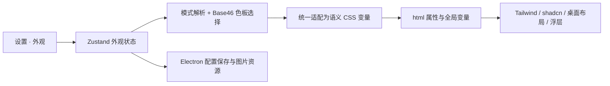

<!--
[OUTPUT]: 2026-10-22当前字体/应用Dock实现以20/21进度为准；21 §8新增托盘跟随应用图标方案，仅文档。
[OUTPUT]: 2026-10-20统一字体字号与应用图标分别由20/21承接；早期范围不排除新需求，两项尚未实施。
[INPUT]: 原外观规划与后续实施、Craft Scenic 增量。
[OUTPUT]: 历史规格与最新图片换肤入口；19的2026-10-16增量支持图片浅色/深色/系统模式，旧透明度叠加保持退役。
[POS]: 第3组原外观合同。
[PROTOCOL]: 一旦本文件变化，必须同步更新 Header，并上浮检查所属目录 .folder.md。
-->
> 2026-10-22：20字体字号与21应用/Dock切换已有实现，实际验收与剩余见各文§7。[21 §8](./21-macOS应用与Dock图标切换.md#8-应用图标与托盘联动2026-10-22仅文档)新增同一选择同步托盘的设计，尚未实施。以下2026-10-20“仅设计”为当时记录。

> 2026-10-20：新增 [20 全局字体与字号设置](./20-全局字体与字号设置.md) 与 [21 macOS应用与Dock图标切换](./21-macOS应用与Dock图标切换.md)，当前仅设计。下文字体不在当时范围的描述只针对早期主题项目；新的六项设置、全局字号统一管理与图标切换以20/21为准。当前源码基础见20第2节。

> 2026-10-15：背景图片实现改为直接迁入 Craft Scenic，全窗图片/玻璃与移除恢复见 [19](./19-Craft图片换肤迁入.md)。本页20%图片和旧透明度控件为历史方案。2026-10-16已取消有图强制深色，按19支持浅色/深色/系统选择。

# 外观设置与主题系统

> 2026-09-27 实施更新：本轮已交付的范围和验证以 [主题、外部 Agent 与自动化实现](../2.已实现功能与代码现状/16-主题外部Agent与自动化实现.md) 为准。下面保留规划时的基线与后续目标；“尚未实现/待实施/当前没有”等描述指规划当时。
日期：2026-09-27  
状态：后续开发设计，**尚未实现**。当前交付以 [v0.2.2 历史群聊与本轮边界](../2.已实现功能与代码现状/14-v0.2.2历史群聊与本轮边界.md) 为准；13、12 保留此前交付历史。开工顺序与共享契约依赖见 [本目录入口](./README.md)。

本文定义「设置 → 外观」的交互、Base46 主题、全局样式和背景图。前端目录、文件职责与迁移顺序见 [15 前端目录架构与迁移计划](./15-前端目录架构与迁移计划.md)。

## 1. 已确认范围与建议基线

用户已确认：

1. 设置页面增加「外观」，参考提供的设置截图。
2. 模式支持浅色 `light`、深色 `dark`、跟随设备 `system`。
3. 主题使用 Base46 配色体系。
4. 支持设置背景图片，并调整图片透明度。
5. 全局主题统一管理，参考 `landing-page/apps/web/src/styles` 的组织方式。
6. 前端采用 Vite、React、shadcn/ui、Tailwind CSS、Zustand 等技术，目录参照 landing-page 的分层方法。

以下默认值、控件布局、图片限制、主题目录和持久化协议属于**建议实施基线**，用于让后续开发有明确起点。

参考图保存在 [外观设置参考图](../../references/appearance/01-appearance-settings.png)。只借鉴设置分类、模式预览卡和主题选择结构。图中字体、字号、自定义强调色、任意颜色编辑、主题导入导出、账户和通知等，不自动进入本次范围。

### 当前代码与参考项目的事实

| 对象 | 已有能力 | 本次需要新增 |
| --- | --- | --- |
| boai-agent | React + Vite + Tailwind v4；`styles.css` 以固定浅色和少量变量实现桌面样式；`tailwind.config.ts` 主要配置 Iconify | 全局语义变量、三种模式、Base46 适配、背景图和 Zustand 外观状态 |
| landing-page | `styles/global.css` 聚合样式；shadcn 语义变量；`setups/theme.ts` 与 `stores/use-theme-store.ts` 实现浅色/深色/跟随系统 | **未发现 Base46 或背景图设置实现**，这些需要在 boai-agent 新建 |

landing-page 的 shadcn `style: base-nova` 是组件样式预设，**不是 Base46**。参考它的组织方法，不把两者混为一套主题系统。

## 2. 设置入口与页面

保留现有全局工具栏、窄导航和内容框。底部「设置」菜单增加「外观」直达入口；进入设置后，在内容框内使用分类导航与右侧设置内容，不占用员工/群详情面板。

```text
全局工具栏
窄导航 │ 设置分类        │ 外观
       │ 模型连接        │ 视觉风格
       │ 外观（选中）    │ 模式     [跟随设备] [浅色] [深色]
       │ 数据与备份      │ 主题     [色板预览 + 主题名称 ▾]
       │                │ 背景图片 [选择图片] [移除]
       │                │          [缩略图 + 文件名]
       │                │ 图片不透明度  ─────●──── 20%
       │                │                    [恢复默认外观]
```

- 设置分类只展示已实现功能；原模型连接、连接测试和备份能力继续可用。
- 模式用三张小型界面预览卡组成单选组，有中文标签、选中边框和可访问名称。卡片不依赖联网图片。
- 主题选择器显示名称、模式标记和少量代表色；选中即应用。主题较多时支持名称搜索。
- 窄窗口将设置分类折叠成顶部选择或可返回的分类页；不压缩控件到无法阅读。沿用 08 的 760px 窗口和 200% 缩放验收。
- 修改模式、主题和图片不透明度即时预览、自动保存，无额外「应用」按钮。只有落盘成功才显示「已保存」；失败时显示重试入口，不把临时预览说成保存成功。
- 外观自动保存与模型表单的显式保存分开。切换设置分类仍遵守现有未保存模型表单的离开保护。

## 3. 模式与 Base46 主题分别建模

### 3.1 模式

| 偏好 | 实际模式 | 设备变色时 |
| --- | --- | --- |
| `light` | 始终浅色 | 保持浅色 |
| `dark` | 始终深色 | 保持深色 |
| `system` | 使用设备当前模式 | 自动切换，不覆盖用户的 `system` 偏好 |

默认模式建议为 `system`。`resolvedMode` 只有 `light / dark`，是运行时结果，不作为持久化用户偏好。

Electron 主进程将偏好写入 `nativeTheme.themeSource`，读取 `shouldUseDarkColors` 解析模式，并订阅 `updated`。Renderer 接收解析结果，统一更新 `html.dark`、`data-theme="light|dark"` 与 `color-scheme`。不要同时建立主进程和 Renderer 两套相互写回的系统模式监听。此方案依据 [Electron nativeTheme](https://www.electronjs.org/docs/latest/api/native-theme)；具体接口以项目安装的 Electron 类型为准。

### 3.2 Base46 的使用边界

Base46 原项目面向 Neovim；主题包含 UI 色板 `base_30`、语法色板 `base_16` 和浅深类型。BoAI 引入其中的配色数据与命名，不运行 Lua、Neovim 高亮集成或主题脚本。见 [NvChad/base46](https://github.com/NvChad/base46)。

应用内保存经过校验的静态 TypeScript/JSON 色板，注册表至少包含：

```ts
type ThemeDefinition = {
  id: string
  name: string
  mode: 'light' | 'dark'
  family?: string
  base30: Base30Palette
  base16: Base16Palette
  semanticOverrides?: Partial<SemanticTokens>
  source: { kind: 'boai' | 'base46'; url?: string; revision?: string }
}
```

`Base30Palette`、`Base16Palette` 和 `SemanticTokens` 在实现时定义明确的键；颜色统一为完整 CSS 颜色值，导入原始色板时校验缺项和格式。上游转成本地数据后保留来源、固定版本与许可说明。不能把主题文件内任意代码当作可执行插件。

### 3.3 单模式色板如何与三种模式共存

Base46 的一个具体色板不一定同时有浅、深版本。**建议分别记住浅色主题和深色主题**，不靠反转颜色强行生成另一个模式：

```text
mode = system
themeIds.light = boai-light
themeIds.dark  = boai-dark

resolvedMode = light → 使用 themeIds.light
resolvedMode = dark  → 使用 themeIds.dark
```

- 显式浅色/深色时，主主题行只选择该模式可用的色板；修改不覆盖另一模式的选择。
- 「跟随设备」下，主题区域展示「浅色主题」「深色主题」两个选择项，并标明当前生效项。修改未生效项只保存该偏好，用局部色板预览展示效果。
- 同一主题家族可分组展示，但每个变体仍有独立 ID 和模式。只有深色版的主题只能用于深色偏好。
- 默认提供 `boai-light / boai-dark` 两个按 Base46 数据结构定义的产品色板；浅色延续 08 的中性灰白，深色另行校验。
- 候选预置可包括 GitHub、Catppuccin、Everforest、Gruvbox、Nord 等 Base46 色板；实际名单以完成转换、来源记录和对比度验收的注册表为准，不承诺完整搬入截图或上游全部主题。
- 未知 ID、色板损坏或模式不匹配，回退对应模式的 BoAI 默认主题，并说明回退原因；不改变用户选择的模式。

`data-theme` 沿用参考项目的浅深含义；新增 `data-theme-id` 表示具体色板。不要让一个属性同时承担模式和主题 ID。

## 4. 从色板到全局样式

用户操作的结果是全应用的颜色变量变化。Tailwind 配置与 CSS 定义样式规则，设置界面只切换运行时配置；不在用户点击时重写源码或重新构建 Tailwind。



### 4.1 分层与职责

| 层次 | 职责 |
| --- | --- |
| Base46 色板 | 管理 UI 原始色与语法色；不直接散落到业务组件 |
| `base46-to-tokens.ts` | 将色板转换成稳定的 BoAI / shadcn 语义 token；统一处理派生色与主题修正 |
| `styles/colors.css` | 基础颜色工具与加载失败时的中性回退；不维护第二套可选择主题注册表 |
| `styles/tailwind.css` | Tailwind v4 入口、`@theme inline` 语义映射、dark variant、基础样式层 |
| `styles/global.css` | 唯一全局样式入口，按确定顺序导入子文件 |
| `tailwind.config.ts` | 保留必要构建配置和 Carbon / Solar 图标集合；不保存当前用户偏好 |
| 页面与组件 | 使用 `bg-background`、`text-foreground` 等语义类和布局变量 |

boai-agent 当前为 Tailwind v4。采用 CSS 中的 `@theme inline` 连接语义变量与工具类，必要的旧配置继续通过 `@config` 显式加载，不退回 v3 教程的配置方式。依据 [Tailwind Theme variables](https://tailwindcss.com/docs/theme) 与 [Functions and directives](https://tailwindcss.com/docs/functions-and-directives)。

### 4.2 语义 token 合同

| 用途 | 建议变量 | 色板映射基线 |
| --- | --- | --- |
| 页面底色/文字 | `--background`、`--foreground` | `base16.base00 / base05` |
| 卡片、菜单及其文字 | `--card`、`--card-foreground`、`--popover`、`--popover-foreground` | UI 背景与正文色，可按主题修正 |
| 主要操作 | `--primary`、`--primary-foreground` | 默认产品色板用中性色；其他色板可用 `base30.blue`，前景独立校验 |
| 次级、弱化、交互状态 | `--secondary`、`--muted`、`--accent` 及各自 `-foreground` | `base30.one_bg*`、弱文字与正文色 |
| 边框、输入框、焦点 | `--border`、`--input`、`--ring` | `base30.line` 与强调色，保持可辨识 |
| 失败、成功、等待 | `--destructive`、`--success`、`--warning` 及对应前景 | `base30.red / green / yellow`，配合文字和图标 |
| 桌面区域 | `--surface-app`、`--surface-list`、`--surface-content`、`--surface-detail` | 背景层级，经浅深模式分别校验 |
| 导航与选中 | `--sidebar`、`--sidebar-foreground`、`--sidebar-accent`、`--sidebar-accent-foreground`、`--sidebar-border`、`--sidebar-ring` | 映射到已定义表面、选中与焦点色 |
| 代码和文本选择 | `--code-background`、`--code-foreground`、`--selection` | `base16` 背景/文字/选择色；语法色预留给未来高亮器 |

表中是映射起点，不保证任意色板直接满足可读性。适配器输出完整 token 集合；主题覆盖集中登记，切换时完整替换，不能残留上一个主题的变量。shadcn 组件使用配对的背景/前景变量，依据 [shadcn Theming](https://ui.shadcn.com/docs/theming)。

正常文字对比度沿用 08 的至少 4.5:1；在实际浅深背景、选中、禁用、焦点和图片叠加状态下检查。不能简单用 `base03` 作为所有辅助文字。员工头像色是业务身份数据，单独校验，不因换肤改写员工配置。

### 4.3 v4 映射示例与旧样式迁移

以下仅说明合同，不是完整可直接替换的样式文件：

```css
@custom-variant dark (&:where(.dark, .dark *));

@theme inline {
  --color-background: var(--background);
  --color-foreground: var(--foreground);
  --color-primary: var(--primary);
  --color-primary-foreground: var(--primary-foreground);
  --color-border: var(--border);
  --color-ring: var(--ring);
  --color-surface-app: var(--surface-app);
}
```

手动切换 `.dark` 的方式参见 [Tailwind Dark mode](https://tailwindcss.com/docs/dark-mode)。颜色值统一使用 `#... / rgb(...) / oklch(...)` 等完整表达式，不把已经完整的颜色再次包进 `hsl(var(...))`。

现有 `styles.css` 的 `--primary`、`--secondary`、`--muted` 与 shadcn 同名变量含义不同，例如旧弱文字应迁到 `--muted-foreground`。迁移时先替换旧引用或使用短期 `--legacy-*` 别名，不能直接覆盖同名变量后假定旧界面仍正确。

清理固定的 `white`、`#fff`、灰色文字和固定边框；覆盖工具栏、列表、聊天、输入框、详情、菜单、授权提示、Markdown 和滚动条。组件类保持静态，避免运行时拼接 `bg-${themeColor}`。

全局变量必须应用于 `document.documentElement`，使挂载到 `body` 的 shadcn 浮层也能继承主题。只在 `.app-shell` 设置变量会漏掉 Portal。

## 5. 背景图片与不透明度

### 5.1 用户行为

- 选择本地图片后显示缩略图与文件名，复制到应用管理目录，再用于背景；原图移动或删除不影响已保存背景。
- 建议首期支持静态 PNG、JPEG、WebP；单张不超过 10 MiB、最长边不超过 8192px、解码像素总量不超过 32 MP。导入时校验实际内容与尺寸，失败保留旧图片。
- 不透明度为 0–100%，步长 1%，默认 20%；持久化为 0–1。0% 表示完全不可见，100% 表示图片层完全不透明；界面表面仍可覆盖图片的一部分。UI 明确标注「图片不透明度」，避免“透明度”方向歧义。
- 首期固定居中、覆盖区域、保持比例、不平铺；不额外引入裁切编辑、视频背景、远程图片 URL 或窗口整体透明设置。
- 拖动滑块只更新图片层，松手或键盘操作短暂稳定后保存最新值；普通导航时刷新待保存值。保存失败保留预览和重试提示；退出沿用未保存变更保护，不能静默丢失待保存设置。
- 「移除」清空背景引用并回到主题底色；无图片时禁用滑块。图片丢失、损坏或解码失败时使用主题底色，并提供重新选择入口。
- 「恢复默认外观」恢复 `system`、默认浅深色板、无图片、默认不透明度，不触碰模型、员工或会话数据。

### 5.2 渲染层级

背景覆盖应用 Shell 的背景区域，包括工具栏、窄导航与内容框背后，保持固定，不随消息列表滚动。各主要区域使用语义表面色；有图时采用经过校验的表面遮罩，使图片可见且内容可读。

```text
AppShell（独立堆叠上下文）
├─ 主题底色
├─ BackgroundLayer（只有这一层应用 imageOpacity；不接收点击）
└─ 应用内容（工具栏、导航、列表、聊天、详情；文字始终不透明）
body Portal（菜单、对话框等，使用不透明的 popover/card 表面）
```

不要给 `body`、根容器或整个内容区设置 `opacity`。不要让旧的不透明白色内容框把图片完全盖住，也不要让输入框、菜单、代码块和长文本直接裸露在复杂图片上。

图片模式下的表面透明度由设计 token 固定控制，首期不提供第二个容易混淆的“面板透明度”滑块。消息、代码、输入和重要提示保留稳定阅读表面。使用纯亮、纯暗、高对比照片分别验证 0%、20%、100% 图片不透明度；换深浅模式后重新组合表面色，不用固定白色遮罩。

## 6. 状态、持久化与宿主接口

### 6.1 一份权威配置

Zustand 管理 Renderer 内存状态与选择器；主进程管理持久化和本地图片。建议配置保存在 `v2/appearance/settings.json`，图片在 `v2/appearance/assets/`，从现有 `dataPath` 派生，兼容 `BOAI_DATA_DIR`。

```ts
type AppearancePreferences = {
  schemaVersion: 1
  mode: 'light' | 'dark' | 'system'
  themeIds: { light: string; dark: string }
  background: {
    assetId: string | null
    imageOpacity: number // 0..1
  }
}
```

Store 另外维护 `resolvedMode`、`resolvedThemeId`、加载状态、保存状态、最近已保存快照和错误；这些运行态不写入配置。显示名称来自资源元数据；不持久化 blob URL、绝对原图路径、图片 base64 或模型凭据。

不同时让 Zustand `persist` 默认 localStorage 与主进程 JSON 保存同一份外观配置。首期使用显式加载/保存服务，让主进程文件成为权威来源；Zustand `persist` 可留给其他纯 UI 偏好。参考项目的 localStorage / SSR hydration 不是 Electron 必须照搬的部分。Zustand 持久化的选项见 [persist 文档](https://zustand.docs.pmnd.rs/reference/middlewares/persist)。

### 6.2 建议新增的受控接口

具体名称在实现中纳入现有 `Methods` / `AppEvent` 类型合同；下表不是现有能力。

| 操作 | 输入/结果 | 所有者 |
| --- | --- | --- |
| `getAppearance` | 返回已保存配置、revision、解析模式及图片元数据 | Main |
| `updateAppearance` | 校验后的偏好 patch + expectedRevision；返回规范化快照 | Main |
| `importAppearanceBackground` | Main 打开选择器、校验并复制图片，提交新引用后返回快照；取消保持原样 | Main |
| `removeAppearanceBackground` | 清除受管图片引用，成功后清理无引用资源 | Main |
| `resetAppearance` | 原子恢复默认配置，返回新快照 | Main |
| `appearance:changed` | 已保存配置的 revision 与解析模式变化 | Main → Renderer |

Renderer 通过现有 preload 桥接和 Main 方法白名单调用。外观读写不穿过 Mastra 或 Agent worker；Agent 运行进程不可用时仍能更改外观。保留 `contextIsolation: true`、`sandbox: true` 与 `nodeIntegration: false`。

主进程串行写入临时文件并原子替换。客户端合并快速连续修改，按 revision 处理响应，避免滑块较早的写入覆盖最新值；冲突时拉取权威快照再合并用户尚未提交字段。失败不能以旧成功响应清除新错误或覆盖新预览。

配置 revision 只标识偏好提交；跟随设备时，系统变色不必改变配置 revision。`resolvedMode` 更新另带递增的运行态序号，同 revision 的新模式事件仍须处理。启动先建立订阅，再合并首次快照与期间事件，防止漏掉变色。

关闭保护汇总“业务表单未保存”与“外观待提交/保存失败”两个来源，不能由不同页面互相覆盖一个布尔值。页面卸载不清除其他来源的未保存状态；导航先提交外观待保存值，退出时等待写入完成或展示明确的重试/放弃操作。

图片替换先写入新资源，再提交配置引用，最后清理无引用旧资源；失败保留旧配置与旧图。导入、替换、重置、删除使用同一写入队列。启动可清理遗留临时文件，不能删除配置仍引用的图片。

### 6.3 图片读取与启动首帧

图片建议通过受控 `boai-asset://appearance/<assetId>` 地址读取。Main 只解析登记的资源 ID，并限制在外观资源目录，不接受任意绝对路径、目录穿越或网络地址；返回正确图片类型。协议按窗口所属 session 注册，使用必要权限，不能开启 CSP 绕过。参见 [Electron protocol](https://www.electronjs.org/docs/latest/api/protocol)。

当前 `index.html` 的 `img-src` 只有 `'self' data:`；实现时只增加所需的 `boai-asset:` 图片来源，不放宽脚本权限或关闭 Web 安全。开发模式与打包后的 `file://` 页面都需要实际验证，不能只在浏览器开发页检查。

启动顺序：Main 读取并校验配置 → 设置 nativeTheme / 与解析模式匹配的共享中性启动底色 → preload 提供受控启动快照 → Renderer 在 React 首次挂载前应用模式及完整 token → 内容就绪后显示窗口。Main 不反向导入 Renderer 色板或 DOM 模块。图片异步解码不阻塞主体启动；加载前展示主题底色。移除当前强制 `color-scheme: light` 的假设。

配置缺失使用默认值；无效字段按 schema 回退并保留可诊断信息；不支持的更高 schema 版本保留原文件，不静默覆写。启动桥接异常使用安全默认外观并显示重试信息，不能永久隐藏窗口。订阅必须可取消，React StrictMode 和热更新不能产生重复监听。

### 6.4 备份与恢复

当前备份在 `src/runtime/service.ts` 使用固定目录白名单，新增 appearance 目录不会自动被备份。实施时由 Main 协调取得已提交的配置与引用图片快照，将其加入同一次备份，并更新 manifest 与 `RESTORE.txt`。

备份期间串行化外观变更或快照拷贝，避免 JSON 指向未复制图片；UI 预览中的未提交设置不进入备份。恢复时只使用相对资源 ID，跨机器重新生成资源 URL；旧备份没有 appearance 时使用默认外观。普通外观备份不改变已有凭据排除规则。

只有业务和外观快照均完成，整个导出才返回成功。当前恢复依赖人工操作说明；更新 `RESTORE.txt` 时明确先保留目标旧数据副本，再按完整恢复集恢复。旧备份缺少 appearance 时显式移开目标原 appearance 以使用默认值，不能因只覆盖部分文件而静默沿用目标机器旧外观。外观使用独立 schema，无需重做 v0.1→v2 业务迁移。

## 7. 验收标准

| 场景 | 通过标准 |
| --- | --- |
| 打开设置 | 可从底部设置进入外观，模型连接/备份能力保留 |
| 切换模式 | light/dark 立即生效；system 跟随设备；显式模式不被设备变化覆盖 |
| 切换 Base46 | 多个真实色板可选；浅深偏好独立保存；所有区域及 Portal 同步换色 |
| 重启应用 | 偏好与图片恢复；深色启动无明显白色首帧；主进程和页面模式一致 |
| 全局主题 | 无遗留硬编码白底/黑字造成的不可读区域；状态、焦点和选中仍可识别 |
| 背景导入与移除 | 取消无副作用；删除原图仍可用；非法图片被拒绝；移除回到主题底色 |
| 调节不透明度 | 0/20/100% 含义正确，文字不变淡，图片不拦截操作，拖动无频繁全应用重渲染 |
| 异常与连续操作 | 损坏配置/图片有回退；保存失败有反馈；连续换图/换主题最后一次选择生效 |
| 备份与恢复 | JSON 与图片引用一致；换目录可恢复；旧备份兼容 |
| 原功能回归 | 切换外观不清空草稿、重置会话、取消运行、丢失详情或重复订阅流式消息；保留 v0.2.2 本轮/历史分组、权威失败投影、整轮成员回复标签与记忆维护不普通重试约束 |
| 可访问性与窗口 | 键盘操作完整，焦点可见，760px 与 200% 缩放可用，减少动画偏好有效 |
| 生产应用 | 实际 Electron 安装包中验证系统变色、图片协议、重启与备份，不以开发页代替 |

开发阶段与文件拆分见 [15](./15-前端目录架构与迁移计划.md)。以上均为未来验收条件，本次没有进行功能实现或运行验收。
