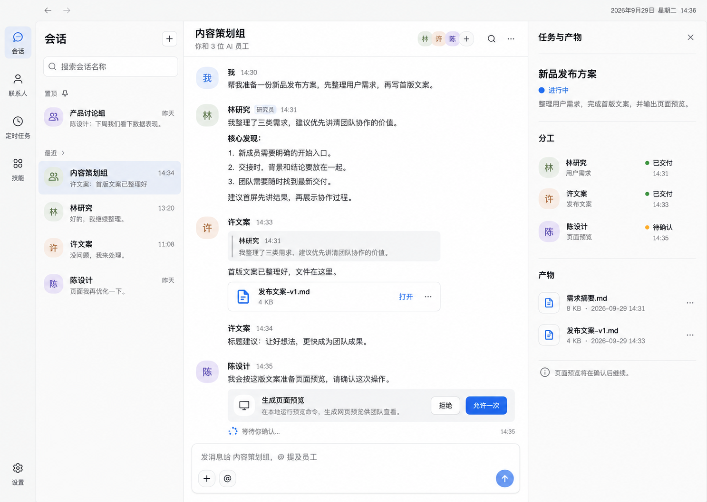

<!--
[INPUT]: 用户对第二版群聊界面的明确选择、原始生成图与当前 BoAI 会话边界。
[OUTPUT]: 会话恢复文字 label 分组并移除来源下拉；composer 实际行内标签/Soft 按钮皮肤/光标与直接删除、工具条 Card 边缘/移除 @、时间显隐与表情稳定提交/圆角/对齐；全局主题/字号与姓名提及/头像资料的最新修订；群聊第二版原图、用户反馈后的消息镜像/卡片/表情/Prompt Bar 与渐隐/输入/引用修订，以及分轮验证记录入口。
[POS]: ai-docs/spec/3.前端重构与功能/16-群聊界面设计/README.md。
[PROTOCOL]: 一旦本文件变化，必须同步更新 Header，并上浮检查所属目录 .folder.md。
-->
# 群聊界面设计：协作侧栏

状态：**会话列表已移除来源筛选，恢复置顶/会话文字分组；消息与工具条已回归全局 Soft 皮肤，正文使用全局字号；姓名点击提及，头像点击查看资料；composer 提及标签已改为系统 Soft 按钮皮肤的实际行内节点，光标在标签前后可见并支持一次删除；时间悬停显示，表情浮层/回应已继续微调。** [最新微调记录](./06-主题与成员交互微调.md)；本轮按用户要求不跑 E2E，此前验证和未通过记录保留。

2026-09-29，用户从本次对话展示的三张群聊效果图中选择了第二张，并要求保存目录、文档和设计图，后续按此实施。随后用户授权按文档和图稿修改产品并执行 E2E。现已接入真实群聊数据，执行语义保持原有边界；设计原图与实际截图分别保存。

## 选定设计图

[打开原始 PNG](./group-chat-v2.png)。文件实际尺寸 **1487×1058**；生成时的目标视口为 **1440×1024**。原图未裁切、未缩放、未重新生成。

原始生成文件名：`exec-4b75dfd8-ae56-45d5-b702-dc045fc5bb96.png`。这是三张生成结果中**第二张实际展示的图**，不是第三张带独立讨论回复框的方案。仓库内的 PNG 是后续实施使用的正式副本，不依赖个人 Codex 缓存路径。

## 已确认的方向

- 产品呈现为 AI 团队通信工作台，群聊使用员工靠左、用户整组镜像靠右的消息流。
- 人和员工通过头像、姓名区分；职责在头像资料浮层内，消息使用全局主题卡片，引用、@、正文和表情回应同卡。
- 四个区域分别承担主导航、会话选择、沟通、任务与产物查看。
- 右侧为按需打开的上下文详情；设计图展示的是用户已打开“任务与产物”的状态，不代表每次进入群聊强制打开。
- 以浅色、中性背景和清晰消息层级为基准。按后续反馈，输入框恢复全局 Soft 圆角、阴影与按钮，标题恢复原有悬浮渐隐衔接，按 Prompt Bar 方式增强 @ 与 / 输入菜单，保留真实模型/发送配置。
- 保留既有工作身份、真实交付证据、审批与详情标签作用域，视觉重排不改变执行语义。

## 阅读顺序

1. 本文与原图：确定整体层级和已选方向。
2. [视觉与交互规格](./01-视觉与交互规格.md)：布局、组件、状态、窄窗和无障碍细节。
3. [实施映射与验收](./02-实施映射与验收.md)：从已有组件落地，约束真实数据和必要回归。
4. [首次实现与验收记录](./03-实现与验收记录.md)：保留首轮截图、测试和未通过项。
5. [渐隐、输入与引用修正](./04-渐隐输入与引用修正.md)：此前实际问候复现和修正验证。
6. [消息交互与输入增强](./05-消息交互与输入增强.md)：镜像卡片、工具条/表情/引用与 Beautiful UI Prompt Bar 的 @ / 接入和此前验证。
7. [主题与成员交互微调](./06-主题与成员交互微调.md)：最新主题/字号、姓名提及与头像资料、composer 实际行内标签/Soft 按钮皮肤/光标与直接删除、时间显隐与表情焦点/圆角/对齐；本轮不跑 E2E。

后续实现先读仓库 [AGENTS.md](../../../../AGENTS.md)，再读本目录；本设计沿用仓库业务约束。生成图中的省略和示意性细节以正文列出的处理为准，不能据图删除已有业务能力。

## 范围与完成定义

本轮设计覆盖群聊主界面，以及其中的消息、审批、输入区和“任务与产物”详情。会话列表、导航和详情标签复用现有 Shell；单聊、设置、自动化与技能页不在本次重设计范围内，共享样式修改须验证不回归。

未选择的方向不进入本轮：第三版的独立讨论串、讨论专用输入框；此外，不新增聊天搜索服务、未读系统、附件上传、在线状态、完整文件编辑器或新的协作调度。

设计稿包含的姓名、内容、文件大小和时间均为示例，不是产品真实数据。后续实现完成须同时满足：视觉层级接近选定图、所有可见操作可用、状态来自权威数据、原有业务边界保持、相应测试通过。实际验收范围以 [最新微调记录](./06-主题与成员交互微调.md) 及其引用的历史记录为准，不把原始设计图当作测试证据。

## 生成与保存记录

- 方式：内置 Image Gen；参考仓库历史浅色截图 `ai-docs/images/soft-ui/chat-light.png` 与已有颜色/字体体系。
- 提示摘要：中文桌面 AI 群聊；四栏结构；三位员工的需求整理、文案交付与预览审批；左对齐消息；右侧真实任务分工和已发布产物；白色/浅灰表面、弱阴影、紧凑控件。
- 本目录只保留用户选定版本。今后修订图新增带版本号的文件，并更新本入口的选定记录，不覆盖本次原图。
