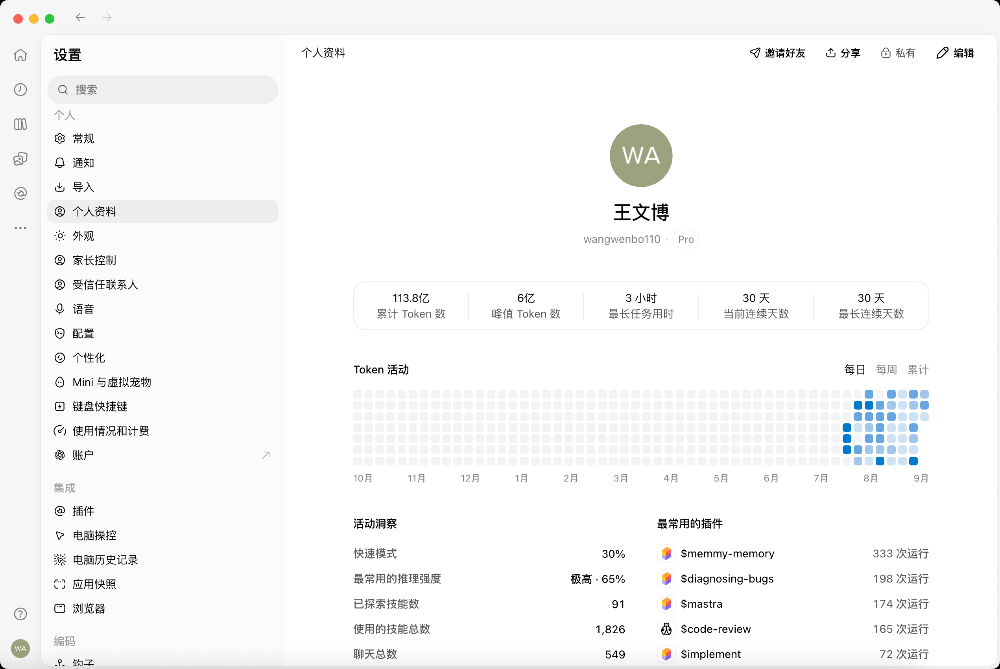

<!--
[OUTPUT]: 2026-10-26个人默认/恢复默认/无效头像回退统一改为小牛，复用fox对应ox.webp；已保存头像及员工默认分配保持。
[OUTPUT]: 2026-10-26活动洞察推理样本说明迁入共享图标Tooltip；数据行等高并随字体/窄窗内容统一增长，类型/lint通过，未跑E2E。
[OUTPUT]: 2026-10-25源码链接随Workspace迁移更新，历史验证结论保持。
[INPUT]: 用户于 2026-09-29 提供的桌面个人资料截图及沿用项目统一组件/主题的补充要求，以及设置、会话、头像、SQLite/IPC 和 Mastra 用量采集现状。
[OUTPUT]: 头像菜单身份首项/分享/设置/帮助、姓名按钮悬停背景与无图标编辑入口、紧凑表单和上传说明 tooltip；统计上三下二的容器响应式布局；资料编辑复用兼容接口横向表单且卡片不覆盖颜色；默认小牛 WebP 与旧文字头像兼容；用户八项前端调整、头像菜单/全屏分享与精简排版； 沿用项目设计系统的个人资料/会话头像规格，Mastra 逐步用量到本地统计的链路与缺口、实施映射及实际验收；保留实施前基线并链接交付证据。
[POS]: ai-docs/spec/3.前端重构与功能/17-个人资料/README.md；前端第 17 项规格与实施验收。
[PROTOCOL]: 一旦本文件变化，必须同步更新 Header，并上浮检查所属目录 .folder.md。
-->
# 个人资料与会话头像

2026-10-26默认头像调整：共享个人默认值由小老虎改为小牛，恢复默认及旧文字/无效/损坏图片回退沿同一常量；已有预设、上传头像及员工默认分配保持。核对fox实际映射ox.webp，全项目TypeScript、6个Renderer文件ESLint及2项既有资料定向回归通过（同文件其余10项未选择）；共享合同文件不在ESLint匹配范围，由类型检查覆盖。本轮未跑E2E、未重启应用、未改写本人已保存资料。

2026-10-26增量：活动洞察中“基于N次已记录实际强度的调用”不再单独占一行，改为“最常用的推理强度”旁的SettingsHelp图标Tooltip。Card内仅保留数据行，使用统一最小高度和等高网格；字号增大或窄窗换行时所有行按最大内容高度一致扩展。统计数据/口径与加载占位保持。全项目TypeScript、相关ESLint和差异检查通过，未运行E2E或实际窗口视觉验收。

规格日期：2026-09-29；实现日期：2026-09-30。状态：**P1/P2 已实施，个人资料专项已通过；全量回归仍有失败，不宣称全量验收通过**。

实现、数据边界、实际桌面截图与检查结果见 [个人资料实现与验收](../../2.已实现功能与代码现状/24-个人资料实现与验收.md)。第 2 节和第 6.1 节保留 2026-09-29 的实施前观察，带有「待实现」「当前」的描述按该日期理解；实际状态以上述实现记录为准。

## 2026-09-30 前端调整

最新菜单与编辑细节覆盖下方前期方案：左下角只保留本人头像；菜单首项显示头像、名称及已有用户名，点击进入个人资料，下面依次为分享、设置、帮助。分享直接打开全屏活动弹窗，按需读取活动、失败可重试，关闭丢弃迟到结果并恢复头像按钮焦点；不要求先导航到资料页。姓名悬停显示全局按钮背景，不显示编辑图标；点击打开同一个资料编辑框并聚焦名称，关闭回到该触发入口。

资料表单输入使用主题 `text-sm` 与 `--control-height`（当前 13px / 32px），行内上下留白收为 10px，卡片仍无额外配色。行间复用模型连接同一个 `soft-divide-y`，卡片页脚复用全局 `Separator`，两者均从 `--shadow-divider` 取值。个人头像选择器的图片格式/大小/裁剪说明只在标题旁图标 tooltip 显示。按用户要求不运行 E2E。

用户最新要求覆盖下文早期视觉方案：底部头像接管设置下拉菜单；顶栏为「分享 / 编辑」；头像悬停显示编辑角标并直接打开原预设/上传选择器；编辑弹窗宽 520px，不显示副标题。统计数值/标签缩小，来源和缺口说明进入 tooltip；移除常驻日期/时区、图例和日期文本表。活动洞察与技能排行上下排列，内容使用共享 Card。

分享参考 [用户截图](./share-reference.png)：全屏弹窗、活动卡片和底部操作。当前提供复制 PNG / 保存 PNG，预览与导出共用同一画布，不上传公开资料或代发社交平台。按用户要求，本轮不运行 E2E，之前的截图和通过数只代表调整前版本。

后续默认头像调整：使用现有离线小猫 SVG，不再以「我」字作为默认头像。新资料、恢复默认、旧文字头像以及无效/损坏图片均使用相同预设；导航、资料、编辑器、聊天和分享保持一致，已有有效预设或上传头像保留。

资料编辑表单参考「连接 OpenAI 兼容接口」：头像居于卡片上方；字段复用左标签/右输入框、图标和 tooltip 提示、共享行间分隔线，取消/保存位于卡片内底栏。卡片沿用全局默认颜色，不设置 `bg-muted` 或额外背景色；保存、校验和草稿守卫保持原逻辑。本次仍只做类型/UI 静态检查，不运行 E2E。

统计卡片按后续截图调整：资料内容区宽度不超过 600px 时，第一行累计 Token / 峰值 Token / 最长任务三等分，第二行最长连续 / 当前连续两等分；行间横线左右内缩、列间竖线上下内缩，复用全局分隔线 token。宽度充足时五项同排，极窄（不超过 280px）时保留单列兜底，依据容器宽度而非窗口宽度切换；本次不运行 E2E。

## 1. 目标、范围与依据

用户明确要求：在「设置」增加「个人资料」，参考其当前 ChatGPT desktop app 的个人资料页面；允许通过 CDP 查看样式；会话中也显示个人资料头像；先在 `ai-docs/spec` 落文档。

**2026-09-29 补充确认：截图用于参考内容组织与布局；组件、主题和视觉细节统一使用当前项目配置，不逐像素照搬参考应用。** 本条覆盖前版可能让人理解为复制字号、留白或控件皮肤的表述。

成功标准：使用现有设置导航与共享组件组织居中身份区、五项统计、Token 活动和下方洞察；视觉与项目其他页面一致。用户能编辑本地资料，保存后单聊、群聊中的本人头像同步变化，重启仍保留；统计有真实、可核对的数据来源。



### 证据与可信范围

- **截图事实**：原图为 2542 × 1702；可见设置分类、个人资料标题、邀请好友/分享/私有/编辑、圆形头像、姓名、用户名、Pro 标记、五项摘要、年度热力图、每日/每周/累计切换、活动洞察、最常用插件和导航栏底部头像。
- **现场查看未完成**：现有 CDP 工具返回浏览器配置占用冲突；桌面读取工具将目标识别为受限的 `com.openai.codex`，拒绝访问。没有绕过限制，没有重启参考应用，也没有取得 DOM、computed style 或编辑弹窗。页面尺寸与控件外观以项目现有配置为准，不依赖取得参考应用 CSS。
- **截图边界**：下方内容在「聊天总数」附近被裁切；隐藏区域、按钮行为、统计算法和编辑字段均未核实。截图里的姓名、用户名、会员状态和数字仅作视觉参考，不作为 BoAI 的默认值或真实数据。
- **本地事实**：第 2 节来自当前工作区源码，其中群聊界面已有进行中的修改。实施时应在当时最新版本上接入，保留这些修改。
- **历史记忆**：本轮按 `memmy-memory` 技能尝试检索，服务返回 `fetch failed`；本文不依赖未取得的历史结论。

### 范围决策

本文将完整资料页和会话头像作为目标，分阶段实施不代表只交付一个头像表单。以下属于**建议实施基线**，未冒充用户逐项确认：

| 项目 | 建议处理 |
| --- | --- |
| 头像、显示名称、用户名 | 本机资料，可编辑；不引入登录前置步骤 |
| 五项摘要、热力图、活动洞察 | 保留参考图层级，使用 BoAI 可验证的统计；未知有独立状态 |
| 最常用的插件 | 对应当前产品的「最常用的技能」，不把已安装或绑定当成使用 |
| 私有 | 本机资料范围在统计说明 tooltip 中展示；分享仅生成本地图片 |
| 分享 | 全屏活动卡片预览，支持复制和保存 PNG；邀请好友仍不展示 |
| Pro 标记 | 当前没有对应权益来源，首轮隐藏，不显示虚构会员身份 |
| 快速模式 | 当前缺少对应产品开关及可信记录，显示「暂不支持」；不把低思考强度等同于快速模式 |

## 2. 实施前基线与接入点（2026-09-29）

以下链接相对于本文，描述的是本轮读取到的代码事实。

| 位置 | 当前事实 | 后续接入 |
| --- | --- | --- |
| [设置入口](../../../../apps/electron/src/renderer/pages/settings/index.tsx) | 「个人」仅外观；另有模型连接和数据与备份，支持搜索、分栏和离开守卫 | 在外观上方加「个人资料」，扩展分类和直达入口 |
| [桌面 Shell](../../../../apps/electron/src/renderer/components/app-shell/index.tsx) | 持有快照、事件订阅、导航、各页独立详情标签与会话状态 | 分发唯一资料快照，增加底部头像入口；遵守主页面作用域 |
| [聊天界面](../../../../apps/electron/src/renderer/pages/conversations/-components/chat-view.tsx) | 用户头像为「我」或按 `origin` 显示「定」；员工走共享 Avatar | 以真实发送者身份显示个人头像，覆盖单聊、群聊与外部任务单聊 |
| [会话样式](../../../../apps/electron/src/renderer/styles/legacy.css)、[群聊样式](../../../../apps/electron/src/renderer/styles/group-chat.css) | 单聊 `.message-row.user .message-avatar` 被隐藏，群聊重新显示且为 32px 圆形；群聊连续消息省略重复头像 | 单聊也显示用户头像；保留已有消息方向、分组与滚动 |
| [共享 Avatar](../../../../apps/electron/src/renderer/components/common/index.tsx)、[头像合同](../../../../packages/shared/src/domain/avatars.ts) | 员工支持 12 个离线预设或 PNG data URL，损坏时回退预设 | 复用图片呈现和约束；个人的文字默认头像需显式区分，不能改变员工默认头像 |
| [头像选择器](../../../../apps/electron/src/renderer/components/employee/avatar-picker.tsx) | PNG/JPG/WebP，最大 5 MiB，居中裁成 256 × 256 PNG；表单确认前不持久化 | 复用处理逻辑及弹层原语，提供个人文案和恢复默认头像操作 |
| [产品合同](../../../../packages/shared/src/domain/index.ts)、[IPC](../../../../packages/shared/src/ipc/index.ts) | `Snapshot` 无个人资料；`Message` 有发送者身份；`AgentRun.usage` 的 Token 字段可缺失 | 新增资料及统计 DTO；展示身份与消息持久身份分开 |
| [服务](../../../../packages/runtime/src/service.ts) | 本人发送和表情回应使用 `senderId='user'`；自动触发使用 `automation:<id>`；人工补充仍可能带 `origin` | 保留稳定身份，不用是否带 `origin` 判断本人 |
| [ProductStore](../../../../packages/runtime/src/adapters/storage/product-store.ts) | SQLite 记录、事务和统一备份 | 存单例个人资料，事务校验版本后保存 |
| [工作用量合同](../../../../packages/shared/src/domain/work.ts)、[预算记账](../../../../packages/runtime/src/modules/collaboration/work-budget.ts) | 有自动化逐请求 `budgetModelCalls` 与幂等结算；普通运行也可能有累计 usage | 可复用可信证据，但不是已经完成的全局个人统计服务 |
| [原生技能执行入口](../../../../packages/runtime/src/adapters/mastra/task-runtime.ts) | 通过绑定资源提供 Mastra 原生技能工具 | 后续需记录真实技能激活证据，不能从资源清单推断调用次数 |

设置已有全局样式和 Base UI 原语，不另建设置外壳。个人资料属于本机用户，不是数字员工配置，不写入员工的 `AGENTS.md`、SOUL 或记忆。

## 3. 页面与视觉规格

### 3.1 结构

```text
窄导航 │ 设置分类              │ 个人资料                         分享  编辑
       │ 搜索                  │
       │ 个人                  │                 圆形头像
       │   个人资料（选中）    │                 显示名称
       │   外观                │                   用户名
       │ 工作空间              │
       │   模型连接            │ 累计 Token │ 峰值 Token │ 最长任务 │ 当前连续 │ 最长连续
       │   数据与备份          │
       │                       │ Token 活动                  每日 / 每周 / 累计
       │                       │ 年度活动图与月份、用量图例
       │                       │
本人头像                       │ 活动洞察（Card）
       │                       │ 最常用的技能（Card）
```

- 分类搜索匹配「个人资料」，选中态、行高、图标、字体复用设置导航；从其他设置切换过来要经过现有草稿守卫。
- 内容采用轻量顶栏和居中纵向文档，不放入右侧员工详情 Tabs。切换 sidebar 主页面保持设置自身状态；不得显示其他页详情标签。
- 顶栏左侧「个人资料」，右侧「分享」和铅笔「编辑」。身份区头像、名称、用户名纵向居中，留白使用当前设置页面的间距体系。
- 五项统计置于**同一个圆角容器**，宽屏等宽排列，内部细竖分隔；数值在上、灰色说明在下，不拆成五个厚重卡片。
- 「Token 活动」标题与粒度切换同一行，图下显示月份。下方洞察和技能排行上下排列，各自内容使用共享 Card。
- 页面主体独立纵向滚动，设置分类独立滚动；顶栏可粘附。进入统计区域不改变全局导航和分栏行为。

### 3.2 统一组件与主题（用户已确认）

页面直接组合现有 Button、Dialog、Input/Field、Card、Popover/Tooltip、Avatar 和设置布局；同职责控件必须使用同一实现。切换控件、校验反馈、焦点、禁用/加载态和图标均沿用项目配置，不根据参考图再写一套控件皮肤。

| 元素 | 项目内复用约束 |
| --- | --- |
| 设置分类栏 | 复用 Shell 现有可拖拽宽度；不硬编码截图中的窗口比例 |
| 内容正文 | 复用 `settings-document` 的居中宽度和响应式留白；有实际图表需要时仅增加局部布局规则 |
| 顶栏 | 复用设置页标题排版和共享 Button，图标沿用全局规格；截图中的小标题不覆盖项目标准 |
| 身份区 | 保留头像/名称/用户名层级；字号、字重、次级文字和间距取项目现有排版规范；头像增加所需的大尺寸变体 |
| 统计容器 | 复用 Card/Soft 表面、圆角和共享分隔线；只定义五列及窄窗换行的布局 |
| 活动与洞察 | 复用章节标题、列表行及图表主题；热力格尺寸按可用宽度设置，不复制参考图色值 |
| 会话个人头像 | 复用共享头像和现有消息布局；固定占位，尺寸与相邻员工头像协调 |
| 导航底部头像 | 沿用 rail 按钮触达面积与交互态，内部使用同一头像组件 |

颜色从 [global.css](../../../../apps/electron/src/renderer/styles/global.css)、[colors.css](../../../../apps/electron/src/renderer/styles/colors.css) 及现有主题语义变量取值。背景、次级文字、分隔线和控件沿用现有 Soft UI；热力图用项目现有蓝色/图表 token，缺少色阶时补入统一主题来源，不在页面散落颜色函数。个人默认头像使用稳定的柔和底色，图片保持原色。

浅色、深色、跟随系统及用户所选主题都由现有外观系统驱动，不维护个人资料专用主题。图标沿用本地 Solar/Carbon 封装。头像图片不能拉伸，使用正方形裁剪后圆形遮罩。

### 3.3 窄窗、缩放和可访问性

- 按内容区域实际可用宽度适配；不强制改写用户手动设置的侧栏宽度，也不让新页面挤出全局水平滚动。
- 五项统计由五列切为上三下二（600px 以内），极窄时单列（280px 以内），分隔线随行变化并保留内缩；洞察保持单列。身份和编辑入口始终可见。
- 年度热力图格子不压到无法点击；允许图区域内部横向滚动，默认露出最近日期，提供日期范围文字。
- 支持 760px 窗口、125%/200% 缩放和键盘操作。图格 tooltip 可聚焦查看，日期/用量通过图格可访问名称与 tooltip 展示，不再显示独立文本表，颜色不作为唯一信息。
- 编辑弹窗有可访问名称，打开聚焦首个字段，关闭返回「编辑」按钮；错误关联字段。焦点表现复用当前 UI 规范。

## 4. 编辑与保存

编辑弹窗未取得参考应用实测；以下为 BoAI 的建议方案：居中 Dialog，标题「编辑个人资料」，内容为头像、显示名称、用户名，底部「取消」「保存」。弹窗宽度 520px、无 description；资料页头像悬停展示编辑角标，点击直接使用共享 AvatarPicker。选中头像立即通过同一 revision 事务保存，失败保留已提交头像；弹窗内的选图仍随表单保存。

| 字段 | 校验与默认 |
| --- | --- |
| 显示名称 | 必填，去除首尾空白，1–40 个 Unicode 字符；初始为「我」；不自动读取系统用户名或外部账户 |
| 用户名 | 可选，3–32 位英文字母、数字、下划线或连字符；为空时整行隐藏；仅本地标识，不承诺全球唯一，不关联登录 |
| 头像 | 默认小猫 SVG、其他离线预设或本地图片；支持「恢复默认头像」；不接收远程图片 URL |

默认头像固定使用预设 `fox`（小牛 WebP，沿用素材历史 ID），与显示名称无关。旧 `kind: text` 记录按默认小牛展示，不修改原记录或版本；恢复默认显式保存该预设。已经保存的预设或上传头像保持原选择，不把显式保存的小老虎批量替换。超长名称换行/截断要有全文可访问名称。

图片处理复用已有约束：支持 PNG/JPG/WebP、源文件最多 5 MiB、居中裁成 256 × 256 PNG，编码后不超过 `AVATAR_IMAGE_MAX_LENGTH`。选择前说明自动居中裁剪；本轮不新增自由裁剪器。宿主独立校验 PNG 内容、大小和尺寸，不能只信任扩展名或前端校验。

保存行为：

1. 打开时复制已提交资料为草稿。选图/改名只改变弹窗预览；取消选择、解码失败、取消编辑都保留旧资料。
2. 上传处理中或保存中锁定重复提交；最新一次选择才可更新预览。失败保留草稿并就地提示，不能显示保存成功。
3. 「保存」将字段与头像作为一个版本化事务提交，成功后一次性更新全局快照。头像与名称不允许一半成功。
4. Escape、关闭、切换分类/主页面及退出应用均接入已有未保存守卫；保存成功清除本表单的脏状态，不清除其他页草稿。
5. 保存与较新版本冲突时保留本地草稿，提示重新载入已保存资料后再编辑，不静默覆盖。晚到的旧请求不能覆盖新快照。
6. 不修改员工配置版本，不取消运行，不发出一条聊天消息，也不改变会话排序。

## 5. 会话头像与身份联动

**本人身份判断固定为 `senderType === 'user' && senderId === 'user'`，不以 `origin` 是否存在作为判断。** 用户在自动化聊天中明确补充内容时仍是本人；自动触发的消息发送者为 `automation:<id>`，必须保留来源标识。

| 场景 | 显示规则 |
| --- | --- |
| 普通单聊 / 外部任务单聊 | 本人消息靠右，头像位于右侧，32px 圆形；解除旧样式的隐藏规则，不改变正文/引用/操作按钮 |
| 群聊 | 本人仍靠右、员工靠左；用个人头像替换「我」字占位，保留既有连续消息合并，首条有头像、续条保留占位 |
| 自动化原始触发 | 保留「定时任务」名称与独立来源头像，不显示成本人主动发送 |
| 自动化中的人工补充 | 即使带 occurrence 来源，也用本人的资料头像 |
| 系统消息 / 员工消息 | 保留其现有身份和头像，不受个人资料修改影响 |
| 旧本人消息 | 通过稳定的 `user` 身份展示当前资料头像；无需改写整段消息历史 |
| 头像丢失或损坏 | 回退默认小猫 SVG，不出现破图、不发起远程请求、不抖动消息高度 |

消息头可继续用「你」表示本人；引用预览、可访问文案、表情回应名单中的本人统一解析为「你」，个人资料页显示所保存的名称。保存资料之后的新消息可将显示名称写入 `senderName` 快照；旧消息的 `senderName` 保留原值，审计/导出保留发送时信息，不回写旧消息、模型上下文或记忆。

导航底部增加同一来源的个人头像，替换旧设置图标，点击打开包含身份首项、分享、设置和帮助的菜单；身份首项进入资料，各项页面导航仍经过草稿守卫。会话列表中的员工/群组头像继续表示聊天对象，不替换为本人头像。编辑成功后，所有已打开会话和导航头像随同一已提交快照更新，不重挂载会话、不丢输入草稿、滚动位置或精确消息定位。

## 6. 统计口径与缺失数据

### 6.1 Mastra 用量链路的实施前基线（2026-09-29）

本轮核对项目安装的 `@mastra/core@1.71.0`、`@mastra/observability@1.18.1` 及其实际接入代码。Token 的原始来源是模型供应商返回的 usage，Mastra 将它放进流事件和模型观测数据；活动热力图是这些数据按日期聚合后的产品展示。

```text
模型供应商返回 usage
  → Mastra agent.stream().fullStream 的 step-finish
  → engine.ts 读取 chunk.payload.output.usage
  → UsageRecorder 校验 inputTokens / outputTokens / totalTokens
      ├─ onUsage：按 run 累计 → SQLite 的 runs 记录
      └─ onModelCallUsage：当前仅自动化 → budgetModelCalls 明细与预算事务

个人资料活动图（待实现）
  ← 按日期/时区聚合的只读数据
  ← 去重并保留未知状态的可信调用明细
```

现有链路的准确范围：

1. **逐步采集**：[engine.ts](../../../../packages/runtime/src/adapters/mastra/engine.ts) 在 `step-finish` 读取供应商用量，工具后的后续模型步骤也会采集。`UsageRecorder` 仅接收有效非负数；只有合成的 `totalTokens: 0` 而无输入/输出时保留未知。各字段只合计已知值，因此普通 run 的汇总本身不能证明所有步骤都已记录。
2. **运行汇总**：[service.ts](../../../../packages/runtime/src/service.ts) 的 `onUsage` 保存 `AgentRun.usage` 到 SQLite `runs`，覆盖已接入的判断、回复/执行、记忆与重新汇报。普通任务还将用量更新到工作预算；这些是同一批用量的不同投影，不能相加。当前回调会跳过已取消/终止/关闭后的更新，不能承诺所有中断调用都有完整最终回执。
3. **自动化明细**：宿主预留唯一 `callId`，逐步用量经 `onModelCallUsage` 进入 [work-budget.ts](../../../../packages/runtime/src/modules/collaboration/work-budget.ts)。`budgetModelCalls` 保留运行/轮次/会话/阶段、预留与结算时间、usage 及完整性；重复回执只更新差额，缺失回执不按零处理。
4. **Trace**：[trace.ts](../../../../packages/runtime/src/adapters/mastra/trace.ts) 将 Mastra 原生 Span 的 attributes、input/output 等交给本地 exporter，再存入 `traceSpans`。这是执行诊断链路；当前没有配置 Mastra 的 `MastraStorageExporter` 作为个人统计后端，也没有年度活动查询接口。

Mastra 也提供结果用量读取接口，见 [MastraModelOutput](https://mastra.ai/reference/streaming/agents/MastraModelOutput)。官方 [Automatic metrics](https://mastra.ai/reference/observability/metrics/automatic-metrics) 说明：Token 指标来自带 usage 的 `MODEL_GENERATION` Span，依赖供应商返回数据；内置指标落库还需要对应 exporter 和支持指标的存储。框架具备这些能力，不代表当前项目已经启用该存储链路。本文以项目已安装版本与实际接入为实施依据。

**活动图需要补的工作**：沿用现有采集点，为普通聊天/普通任务补齐稳定调用身份、开始/完成时间和完整性记录，再统一按日期聚合；自动化复用已有调用身份与回执，不建立另一份可重复累加的账本。只增加用量观测，不为普通聊天创建 Work，不改预算及执行控制。跨日调用建议归入实际调用开始日；缺少可信时间的旧汇总不硬摊到每日热力图。

连接测试当前未接入这些持久用量回调，ACP 也不能假定能取得外部程序用量；首版活动图应明确排除未记录来源并提示统计不完整。已有历史记录无法可靠补全时保留未知，不用聊天字数估算。

### 6.2 数据范围与一致性

建议首版范围为**当前本地数据目录中仍保留的活动记录**，不是 ChatGPT 账号或所有设备的终身统计。页面在「统计说明」tooltip 内提供「基于本机保留记录」与「部分用量未记录」提示，不把每个数字都塞进技术说明。清空/删除会话后，关联统计应随清理更新；资料自身保留。不同数据目录互不合并。

计数由 Runtime 的确定性代码完成；Renderer 只展示聚合 DTO，不为资料页载入所有聊天正文，也不调用模型推断统计。每个查询带数据版本、统计范围、生成时间、显示时区及完整性说明，同次响应中的摘要、图表和排行使用同一快照。

所有指标区分：可信的 `0`、无可用值 `null`、部分已知和不支持。存在未知回执时可显示「已知 12.3 万」并说明不完整，不能以 0 填补未知。历史数据不足时显示「暂无记录」，保留页面结构但不绘制虚构活跃色块。

### 6.3 五项摘要

| 指标 | 建议定义 | 边界 |
| --- | --- | --- |
| 累计 Token 数 | 保留记录中，按唯一模型调用去重后的已知 `totalTokens` 总和；仅在输入/输出两项均已知时允许相加得到总量 | 覆盖真实判断、执行、修复、记忆等调用；不把工作预算额度算作用量 |
| 峰值 Token 数 | 在当前显示时区内，单个自然日的最高已知用量 | tooltip 明确「单日峰值」及日期；同值取最近日；不是单请求上限 |
| 最长任务用时 | 有明确任务身份和起止区间的已结束根工作，其执行区间合并后的最长时长 | 不含排队、审批/用户等待；并行子工作区间取并集；无可靠区间不展示；不能用 `updatedAt-createdAt` 冒充 |
| 当前连续天数 | 连续存在本人主动发消息的自然日；今天未活跃但昨天活跃时沿用至昨天，否则为 0 | 自动触发、后台记忆不延长连续使用；人工补充算活跃；未知旧日期不能算无活动 |
| 最长连续天数 | 保留的可判断日期中，最长连续本人活跃天数 | 按自然日计算，不用固定 24 小时相减；随时区和清理重算 |

Token 数据先使用可靠的逐请求账本；同一来源有 `budgetModelCalls` 时，不能再把相同运行的 `AgentRun.usage`、`WorkExecution.usage`、预算总量或 Trace usage 加一遍。对于没有逐调用记录的历史运行，仅在能证明累计值完整且与其他来源无重叠时作为旧汇总纳入，并标明旧数据口径；无法证明则显示缺失。后续若补齐普通聊天逐调用观测，应复用现有 call ID/回执机制，**不得为了统计给普通聊天创建 Work**。

失败/取消前已经发生的可信调用仍计用量；缺失回执保留未知。重启、刷新、重复回调、预算追加、共享依赖被多个工作引用都不能重复计数。统计写入失败不能重试业务工具，也不能改变预算权威账本或工作交付状态。

### 6.4 Token 活动

默认展示最近 12 个日历月，截至今天；按当前设备的 IANA 时区划分自然日，响应中回传时区。切换时区后基于 UTC 时间戳重新分桶，不能混用旧缓存。未来日期不记为 0，范围外格子不参与统计。

- **每日**：参考图的七行年度热力图，列为周、周一开始，月份标签置下方。悬停/键盘聚焦显示日期、已知 Token 和缺失状态。
- **每周**：建议切换为按周聚合的紧凑柱图，tooltip 展示周起止日期；不把一周的值复制到七个日格。
- **累计**：建议显示所选 12 个月内从起始日至当日的累计曲线，标签明确「区间累计」；与顶部全部保留记录的总量区分。

每周/累计的具体图形属于 BoAI 的建议交互方案，使用项目已有图表与主题配置。三种模式共用同一份日聚合数据，切换只改变呈现，不触发模型调用。

每日热力图使用空值状态及四档正用量色阶；正值按当前范围的分位阈值确定重复阈值合并；不显示常驻图例，具体值在图格 tooltip 中展示。0 与未知采用不同的可访问文案/视觉标记，正值不能进入零档；有部分已知用量的日期需标识不完整。

### 6.5 活动洞察与技能排行

| 项目 | 定义 / 当前差距 |
| --- | --- |
| 快速模式 | 保留参考布局位置，当前显示「暂不支持」；未来必须按实际请求参数统计 |
| 最常用的推理强度 | 已记录实际生效强度的请求中频次最多的一档及占比；说明有效样本范围，不从员工当前配置反推历史；无证据显示暂无记录 |
| 已探索技能数 | 出现可信激活记录的不同技能身份数量；安装、收藏、绑定、查看详情不计使用 |
| 使用的技能总数 | 有证据的技能激活次数；同一工具调用的流式重复通知只计一次，多次真实激活分别计数 |
| 聊天总数 | 保留会话中至少有一条本人发送消息的不同会话数；单聊和群聊均计；纯自动触发且无人参与的聊天不计 |
| 最常用的技能 | 同一范围按激活次数降序前五，平局按稳定技能 ID 排序；名称、离线图标和「N 次使用」；点击可用技能进入现有技能详情 |

技能统计需要 `toolCallId`、运行/会话归属和可解析技能身份；同名不同来源不合并。技能已移除时保留记录名但不提供失效导航。ACP 自有工具没有可信明细时标为未记录，不能用进程启动次数充当技能次数；没有事件时展示简洁空态。截图以外的更多洞察条目不自行添加。

## 7. 数据与实现边界

以下为建议合同，不代表已有接口。优先沿用项目的唯一 IPC、Runtime 用例、ProductStore 和全局快照，不添加网络服务或第二份 localStorage 权威状态。

| 合同 / 所有者 | 约定 |
| --- | --- |
| `LocalUserProfile` / shared | `schemaVersion`、稳定 `id: 'user'`、`revision`、`displayName`、可空 `username`、头像值、`updatedAt`；个人默认固定为小猫，员工仍按原规则选择预设 |
| 资料保存 / Runtime | 建议单例 `userProfiles/user`；`updateUserProfile({expectedRevision, ...draft})` 通过 `ProductStore.transaction` 比较版本、校验并提交；客户端不能指定其他身份 |
| 快照 / Shell | `Snapshot` 增加已提交的资料投影，通过现有 `changed` 刷新唯一快照；统计不塞入每次全局快照 |
| 统计读取 / Runtime | 建议 `getProfileActivity({from, to, timezone})` 返回摘要、日桶、洞察、排行及完整性元数据；限制日期范围、聚合后跨 IPC 返回 |
| 图片 / 宿主与 Renderer | 延用有界 PNG data URL，存入资料记录，不引入可任意访问的本地文件路径；解码校验职责留宿主，复用现有能力 |
| 展示 / Renderer | 资料页、编辑表单和头像在适当模块内复用；如将头像处理从 employee 提取到 common，保持员工预设/回退与已有调用兼容 |
| 更新与可见性 | 活跃资料页在相关已提交事件后合并刷新；隐藏页暂停统计读取/轮询。资料保存回执与已受理的运行不因切页中断 |

兼容、备份和清理：

- 旧数据库没有资料时生成默认投影，首次保存才写入；稳定本人 ID 不迁移、不重编号。较新未知 schema 不静默覆盖。
- 头像随资料记录进入现有 SQLite 备份，恢复不依赖原始图片路径；旧备份无资料时回到默认，不能混入目标目录旧资料。
- 统计来自恢复后的保留记录；缓存必须失效重建，不能把恢复前后数据相加。重建只读现有证据，不调用模型、不重放工具。
- 清空/删除会话按既有边界清理关联统计事件与缓存，不保留可重建已删会话内容的旁路；个人头像和资料不随聊天清空。
- 资料不关联 Codex OAuth、API Key、外部 ACP 登录或员工记忆；头像数据不自动附加到模型请求。姓名只是显示文本，不拼接为指令。

## 8. 实施阶段与验收

| 阶段 | 产出 | 完成门槛 |
| --- | --- | --- |
| P0 · 规格基线 | 规格、原始参考图、索引 | 明确证据限制、统计差距和建议；不声称功能交付 |
| P1 · 资料闭环 | 个人资料导航、身份区、编辑、持久化、导航头像、单聊/群聊头像 | 保存/取消/失败/重启/旧数据/备份恢复可核对；统计区诚实显示尚无记录或不可用 |
| P2 · 活动数据 | 五项摘要、三种图表粒度、洞察与技能排行，补足必要观测 | 所有可用数字可回查证据；不重复、不把未知当零；缺能力项明确展示限制 |
| P3 · 视觉与完整回归 | 浅深色、窄窗、缩放、大历史、键盘及运行中编辑 | 对照参考图核对信息分区，对照项目现有页面核对组件/主题一致性；记录实际截图和未完成项 |

### 模块与持久化验收（Vitest）

- [x] 资料保存按预期版本比较；并发过期保存不能覆盖；重启能读取已提交值，失败保留旧值。
- [x] 头像格式、超限、损坏和空值回退；个人默认头像的引入不改变员工预设行为。
- [x] 本人、自动化触发、带 origin 的人工补充正确区分；修改资料不改变工作归属和消息 ID。
- [x] 同一模型调用重复回执只计一次；逐调用与 run/预算/Trace 汇总不重叠；未知、部分已知、0 各自正确。
- [x] UTC 跨日、时区切换、月/年边界、夏令时及今天未活跃时的连续天数；图表区间累计与全量总计明确区分。
- [x] 任务等待不计执行时长，并行区间不相加；缺少可信区间返回未知，运行结束不冒充业务交付。
- [x] 技能激活去重、同名不同身份分开、删除后的引用回退；清空会话/恢复备份后正确重建。

### 桌面流程验收（playwright-bdd）

- [x] 从设置搜索和导航底部头像进入个人资料；切换主页面不混入其他页面详情标签。
- [ ] 编辑名称、用户名和头像，保存后打开既有单聊与群聊，头像立即一致；取消无变化，失败可重试。
- [x] 单聊自己的头像实际可见且靠右；群聊仍保留首条头像/连续消息规则、引用、表情回应和操作栏。
- [x] 自动化原始触发保持独立头像；人工补充显示个人头像；外部任务聊天也正确显示。
- [ ] 运行中编辑资料不取消运行、不重置输入/滚动/焦点消息；切页、关闭弹窗和退出应用的脏状态保护完整。
- [ ] 新安装、旧数据、损坏头像、断网、重启及备份恢复；无统计时是诚实空态，不出现示例数字。
- [x] 浅色/深色、760/1124/1440px 宽度、125%/200% 缩放；热力图横向滚动仅发生在图区域。
- [x] 信息分区覆盖顶栏、头像/名称、五项摘要、热力图和洞察；按钮/表单/卡片/弹窗/图标使用共享组件，排版和主题与当前项目其他页面一致，无参考应用专用皮肤。

桌面流程只增加到 `tests/e2e/features/`、`steps/` 与 `support/`，不新建平行 `.spec.ts` 入口。完成后运行相关 Vitest、项目规定的静态检查及 `pnpm test:electron`；场景使用隔离数据，保留现有业务断言，不操作真实用户历史做破坏性验证。

2026-09-30 已同步实现文件 Header、目录地图和实现记录。未勾选的桌面组合项中，持久化失败/备份恢复已通过 Vitest，保存/取消/损坏头像/重启/运行中编辑/原生关闭已通过 Electron；尚未把所有组合分别展开为桌面场景（例如桌面文件系统保存失败重试、恢复备份后的 UI、操作系统断网、滚动与精确消息定位）。这些证据不冒充全部通过。全量回归的失败范围另见实现记录。
