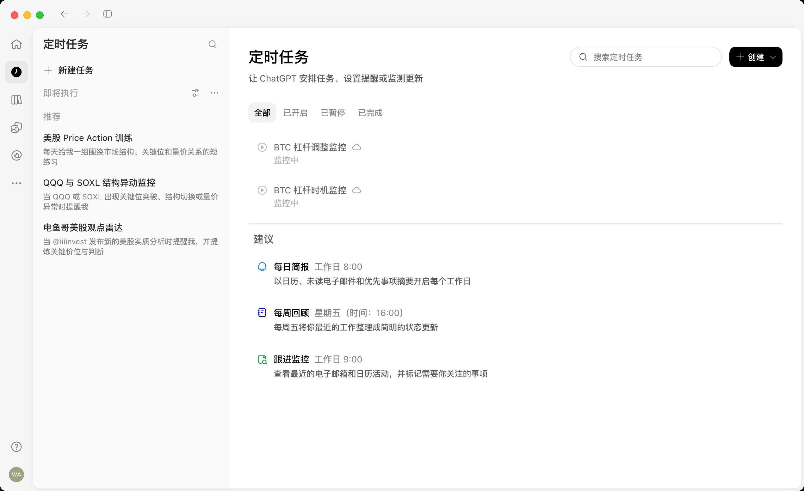
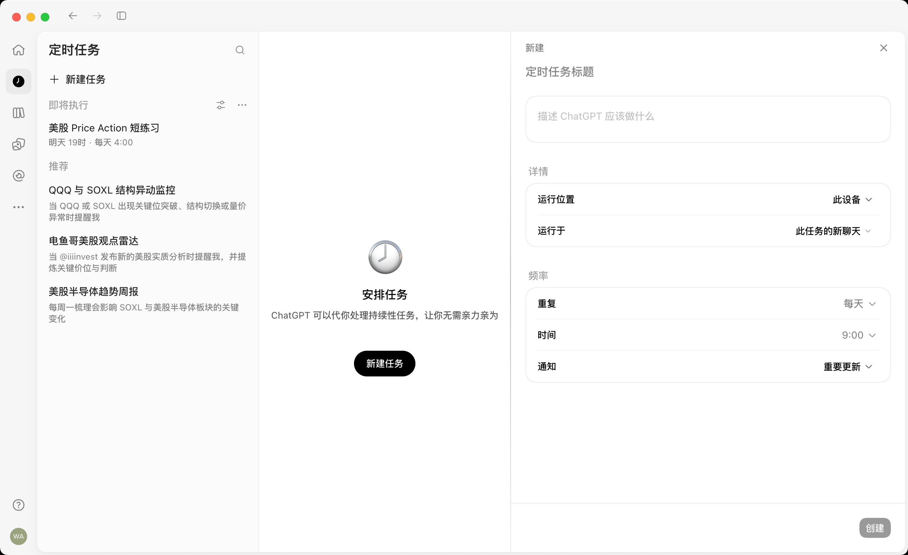

<!--
[OUTPUT]: 2026-10-14员工/群自动化与员工浏览器为独立待实施闭环；群内真实采集→依赖汇总，浏览器优先直接迁用固定GitHub源码；仅文档复核。
[INPUT]: 用户于 2026-09-29 提供的定时任务总览/新建截图、简化配置与 Agent 辅助创建意图、通讯录分类样式，以及当前 schedules/contacts/Shell/自动化合同与运行实现。
[OUTPUT]: 定时任务总览、通讯录式即将执行/执行记录分类、七项精简表单、Agent 辅助草稿、旧监控兼容、实施映射与已验证验收清单。
[POS]: 前端第 18 项已实施规格；覆盖旧自动化设计中的页面组织与创建表单要求，运行时约束继续沿用原专题。
[PROTOCOL]: 一旦本文件变化，必须同步更新 Header，并上浮检查所属目录 .folder.md。
-->

2026-10-14后续交互目标转至[第5组11员工与群聊自动化](../../5.Mastra能力扩展/11-员工与群聊自动化设计与实施计划.md)：在员工/群对话中管理，右侧配置/执行详情，全局页作为同数据总览；群内支持真实分工依赖。本目录保留原七项表单与独立API草稿助手的实现历史，不作为新设计仍需额外选择草稿模型的要求。仅文档，未修改运行实现/原验收。

# 定时任务体验简化

规格日期：2026-09-29；实施日期：2026-09-30。状态：**S1 / S2 / S3 已实施并完成本地专项验收**。实现、证据和验证限制见 [定时任务体验简化实施](../../2.已实现功能与代码现状/25-定时任务体验简化实施.md)。所有测试使用隔离数据和本地模型协议端点，没有创建用户真实任务。

## 1. 本次要改成什么

**查看任务先进入总览；新建时右侧只保留截图中的七项；左侧用通讯录的分组样式区分「即将执行」和「执行记录」；另提供「让 Agent 帮我创建」入口。**

### 用户明确要求

1. 当前定时任务配置过于复杂，新建配置以图二右侧这几项为上限。
2. 可以通过点击创建，由 Agent 帮助完成创建。
3. 查看定时任务参考图一的任务总览。
4. 左侧 list 参考项目「通讯录」的 label 分类样式，包含「即将执行」「执行记录」。
5. 先形成文档，后续按文档统一修改。

### 本文采用的实施基线

以下是对需求的具体落地建议，不冒充用户逐项确认：

- 手动填写和 Agent 辅助共用一份草稿及右侧编辑器；默认点击「创建」打开精简表单，下拉菜单提供「让 Agent 帮我创建」。
- 七项是：**标题、任务描述、运行位置、运行于、重复、时间、通知**。星期选择、执行员工和时区收进相应选项的展开内容，不再增加常驻顶层配置行。
- 运行位置首期只有「此设备」；新计划默认每次新建任务聊天，执行员工由用户在「运行于」中明确选择。
- 组件、字号、颜色、边框、圆角使用项目现有设计系统；原图指导信息组织，不要求复制第三方控件皮肤。
- 首轮保留现有每天、工作日、每周选日能力；一次性任务、月度规则、云端执行不作为这次页面改版的前置功能。

### 依据与覆盖范围

- 两张用户截图已原样归档：它们只说明可见布局和文案，不证明下拉菜单、云端能力或推荐机制如何实现。图中的投资任务仅为示例，不是要求创建这些任务。
- 需求阶段事实来自当时工作树；实施阶段已启动真实 Electron 做专项验收，截图见 evidence/。没有验证参考应用的隐藏交互。
- 按 `memmy-memory` 技能尝试历史检索，服务返回 `fetch failed`。本文以用户本次要求和本地源码为依据。
- **本次 UI 改版以本文为准**；[自动化产品与运行时设计](../../5.Mastra能力扩展/07-自动化产品与运行时设计.md) 中的原生时钟、事务、权限、预算、通知、恢复规则继续有效。旧的多字段表单和结果阅读优先首页不再作为新版页面目标。
- [既有自动化实施记录](../../2.已实现功能与代码现状/22-自动化增量实施.md) 保存旧运行边界的历史交付事实；本文新体验的交付另见第 25 项实施记录。

## 2. 参考图

图一用于任务总览：标题、简短说明、搜索、创建、状态筛选和轻量任务列表。



图二用于创建：标题、任务描述、「详情」两行与「频率」三行，底部固定创建按钮。



图中「推荐」「建议」并非本次必做需求。首轮不引入推荐算法或额外模板专区；先让真实任务和执行记录清楚可用。

## 3. 改版前的实现与问题（需求基线）

| 当前事实 | 对用户的影响 | 改版处理 |
| --- | --- | --- |
| 创建包含名称、任务类型、描述、聊天策略、员工/目标会话、频率、星期、时间、时区、通知、启用开关；另有预算和五次时间预览 | 创建前需要理解过多内部概念 | 收敛成七项，条件选择只在对应控件内部展开 |
| 监控类型会进一步展开文件、JSON 字段、阈值、有效期与冷却 | 普通任务也先面对复杂能力分支 | 通用创建默认执行任务；结构化监控保留专用入口 |
| 没有选中计划时，中心主要是插画和新建按钮 | 已有任务仍缺少一眼可扫的总览 | 初次进入就显示任务总览 |
| 左侧是单个任务列表，筛选/排序藏在菜单，历史和待处理在底部 | 「将来执行什么」和「已经发生什么」层级不清晰 | 固定为两个可折叠分类，待处理作为状态筛选 |
| 单个计划阅读页优先显示结果、运行、用量及操作 | 适合诊断，日常查看显得繁重 | 首层显示任务和结果摘要，技术明细按需展开 |
| 已有独立编辑 Tabs、未保存守卫、完整历史分页及通知精确定位 | 有可复用基础 | 保留这些机制，不另建抽屉或第二套状态源 |
| 已有保存/预览 IPC，当前任务工具未接入创建自动化的专用草稿能力 | 「让 Agent 创建」尚不能仅通过新增按钮完成 | 作为明确的新增能力接入结构化草稿和真实保存回执 |

## 4. 页面结构与导航

```text
应用导航 │ 定时任务列表            │ 主内容区                         │ 右侧详情（按需打开）
         │ 定时任务                │ 定时任务          搜索  创建 ▾   │ 新建 / 编辑定时任务
         │ ＋ 新建任务             │ 全部  已开启  已暂停  需处理     │ 标题
         │                         │                                 │ 任务描述
         │ 即将执行             ▾  │ 行业简报     工作日 09:00        │ 详情
         │   行业简报              │ 下次：明天 09:00 · 已开启        │   运行位置  此设备
         │   明天 09:00 · 工作日   │                                 │   运行于    新任务聊天 · 员工
         │   查看全部任务          │ 周报整理     周五 17:00          │ 频率
         │                         │ 下次：周五 17:00 · 已开启        │   重复      工作日
         │ 执行记录             ▾  │                                 │   时间      09:00
         │   行业简报              │                                 │   通知      重要更新
         │   今天 09:00 · 已交付   │                                 │
         │   查看全部记录          │                                 │            取消  创建
```

主内容区有四种明确状态：`总览 / 单个任务 / 全部执行记录 / 单次执行结果`。右侧创建/编辑独立于这四种阅读状态，不再由「有没有选中计划」猜测当前页面。

| 用户操作 | 结果 |
| --- | --- |
| 首次进入定时任务 | 打开总览，右侧默认关闭 |
| 点击「查看全部任务」或详情中的「返回全部任务」 | 回总览并保留原搜索、筛选和滚动 |
| 点击任务行 | 主内容区显示该任务详情，不自动打开编辑器 |
| 点击执行记录行 | 主内容区显示那一次的结果，以记录 ID 定位 |
| 点击「查看全部记录」 | 进入跨计划的完整执行历史 |
| 点击「新建任务」或「创建」主按钮 | 打开本页现有右侧新建标签；有未保存草稿时回到原草稿 |
| 点击「编辑」 | 按计划 ID 打开/激活原有编辑标签 |
| 保存成功 | 更新总览、左侧和选中任务；新建标签沿用当前完成后关闭行为 |
| 切换到通讯录等主页面再回来 | 恢复定时任务自己的阅读位置、分类折叠和右侧草稿；其他页面不显示这些标签 |

### 4.1 左侧两类列表

**分类样式直接复用通讯录**：无底色分组标题、相同文字层级与留白、相同折叠箭头和悬停反馈。分类名称是稳定的系统分组，不增加自定义标签、分类管理和拖拽排序。

| 分类 | 内容与排序 | 行内显示 | 完整入口 |
| --- | --- | --- | --- |
| 即将执行 | 已开启且日程同步成功、具有真实下次执行时间的计划；按下次时间升序，同刻按稳定 ID 排序 | 标题 + 下次执行时间/重复规则，最多两行 | 查看全部任务，包含暂停和异常计划 |
| 执行记录 | 最近的单次执行，包含运行中、等待、结束、失败、跳过、中断；按 `startedAt + id` 倒序 | 任务标题 + 本次时间/结果或当前状态，最多两行 | 查看全部记录，支持完整分页 |

- 分组标题点击只负责折叠；「查看全部」是独立入口，避免同一点击同时导航和折叠。
- 暂停、同步失败和等待同步的计划仍在总览中显示，不伪造下次时间塞进「即将执行」。运行中属于本次执行状态，同一周期计划仍可同时有下一次计划。
- 左侧执行记录先取最近一页（建议 10 条），它是快捷入口；完整历史不能受这页数量限制。没有全量计数接口时，不把「已加载 10 条」显示成总记录数。
- 「即将执行」为空显示「暂无即将执行的任务」；历史为空显示「暂无执行记录」。已暂停任务仍可由「查看全部任务」找到。
- 两组默认展开；折叠、选中和列表滚动在本次应用会话内跨主页面切换保留。无需为此新增业务数据库表。
- 总览顶栏负责任务搜索，历史页负责记录搜索/筛选；首轮左侧不再增加第三份搜索状态。

### 4.2 任务总览

- 顶部为「定时任务」、一行短说明「安排重复任务，查看执行结果」、搜索框和「创建 ▾」。
- 首轮筛选为「全部 / 已开启 / 已暂停 / 需处理」，默认全部。搜索按任务名称和描述匹配，与筛选取交集。
- 采用轻量纵向列表；每行突出名称，辅以时间规则、真实下次时间和一个必要状态。操作菜单在悬停、键盘聚焦时可用。
- 默认按下次执行时间排序，无下次时间的计划排在后面；同时间稳定排序。不要把最新结果正文、预算和文件证据塞进总览行。
- 开启状态与同步状态分开：`enabled=true` 但同步中/失败时显示「等待同步 / 同步失败」，不能表现成已经可执行。暂停仍明确显示为暂停。
- 「需处理」沿用宿主的待处理投影，并包含计划同步失败；不能只检查最新一条记录，不能以看过记录为解决条件。
- 没有任何任务时保留标题与创建入口，使用现有任务空态插画；筛选无结果显示「没有符合条件的任务」，不误导用户重新创建。

**关于图一的「已完成」：** 当前只有周期计划，没有计划级完成字段或一次性结束语义。因此首轮把已完成用于执行记录筛选；不能因为某次执行完成，就把每天运行的计划归为「已完成」。以后若接入一次性任务/真实结束条件，再增加计划级「已完成」Tab。本条是适配现有模型的取舍，不是对参考图隐藏行为的推断。

### 4.3 任务详情与执行记录

任务详情首屏依次为：标题与「编辑 / 更多」、描述和时间摘要、下次执行、最新结果摘要、必要的待处理入口。下方为该任务的完整历史。

- 暂停/恢复、立即运行一次、删除放入操作菜单；运行中的记录提供「停止本次」。暂停未来计划和停止当前执行必须保持不同含义。
- 最新结果优先显示实际正文/产物入口，不以模型请求数或 token 数作为标题。等待补充、失败、中断及部分交付清楚显示原因和可用操作。
- 单次结果页保留结果正文、证据/文件和「打开结果聊天」，使用具体消息 ID 定位；旧计划删除后，仍能通过执行记录 ID 打开留存历史。
- 「运行明细」按需展开模型用量、预算、通知回执、来源与比较证据。额度不足时，追加入口出现在需要处理的位置，继续使用已有明确确认和原工作接续。
- 全部历史提供「全部 / 进行中 / 已完成 / 需处理」筛选。已完成指 `status=completed` 的运行结束，行内仍区分已交付、无变化、部分结果、未交付/未知；不同筛选可重叠，不能把完成运行直接渲染成业务成功。
- 「进行中」覆盖已受理、运行、等待审批/用户/依赖及停止中；停止中要等执行器真正退出后结束。跳过、失败、中断、取消均保留在「全部」，需要处理的项沿用权威谓词。
- 完整历史的搜索和新增筛选在服务端查询后分页；不能只筛当前已加载一页。建议搜索单次记录保存的任务标题，首轮不承诺结果正文全文检索。

## 5. 精简创建：只留七项

表单放在已有右侧详情标签内，上方「新建」、关闭入口；中间自然滚动；底部固定「取消 / 创建」。除标题和描述外，两张设置卡分别组织「详情」与「频率」，每行左侧名称、右侧当前值。

| 常驻项 | 初始值 | 用户如何修改 |
| --- | --- | --- |
| 标题 | 空，提示「定时任务标题」 | 直接输入；可以由 Agent 建议，仍可改 |
| 任务描述 | 空，提示「描述 Agent 应该做什么」 | 多行文本；只写希望完成的任务与结果 |
| 运行位置 | 此设备 | 当前只读，不展示没有实现的云端/其他设备选项 |
| 运行于 | 新任务聊天；尚未选择员工 | 同一个选择面板中选择新任务聊天及员工，或指定已有聊天 |
| 重复 | 每天 | 每天 / 工作日 / 每周选日；星期多选在本项内展开 |
| 时间 | 09:00 | 时间选择器；同一浮层提供时区修改 |
| 通知 | 重要更新 | 重要更新 / 每次结果 / 静音 |

标题、描述、可用执行对象和有效时间必填。标题/描述长度沿用当前校验，不在改版中悄悄放宽。表单不能出现无原因的禁用提交；未选择员工等原因显示在对应项附近。

### 5.1 「运行于」承接执行身份

选择面板内部提供两条路径：

1. **新任务聊天（默认）**：显示可用员工列表，用户选一个。选定后这一行显示「新任务聊天 · 小博」；每次触发使用独立聊天和工作区。
2. **指定聊天**：在面板内搜索、选择已有单聊/群聊；使用该聊天现有成员与资料。选定后显示具体聊天名，不再额外展示「目标会话」表单行。

执行员工是现有授权边界，不能为了少一个字段而静默使用第一个员工。即使只有一个候选，也需要用户明确选择，或从用户明确指定的 Agent 创建上下文中带入，并在提交摘要中可见。页面偶然选中的旧聊天不构成授权上下文。

沿用当前资格校验：员工已启用、模型连接与模型可用、符合自动化执行边界；本地 ACP 员工及允许宿主命令的配置不自动参与。无可用对象时在选择面板提示去配置员工/连接，保留创建草稿。

这里隐藏的是重复表单行，真实保存仍包含确定的聊天策略与员工/聊天 ID；权限范围不扩大。

### 5.2 时间与重复

- 时区默认取创建时设备时区并保存为明确值；已有计划保持原时区。设备时区改变，不静默迁移所有计划。
- 平时显示「09:00」，下方只读摘要显示「下次：明天 09:00 · Asia/Singapore」；点时间项可在同一浮层改时区。
- 只读的单行「下次执行」不算新增配置项；未来五次预览移入时间浮层的「查看后续时间」，不常驻大列表。
- 日期计算与校验继续走现有纯预览能力；输入无效时显示具体原因，不能先格式化非法时区。
- 「工作日」明确是周一至周五，不承诺自动识别节假日；周几多选仍属于「重复」这一项。
- 首轮不提供未实现的一次性、每月、自定义 cron。Agent 遇到这些要求时说明暂不支持，不擅自改成每天执行。

### 5.3 通知与默认启用

| 文案 | 保存策略 | 说明 |
| --- | --- | --- |
| 重要更新 | `important_only` | 沿用当前交付/待处理和结构化监控的重要性规则；普通报告交付也可能每次提醒，不是自动进行语义去重 |
| 每次结果 | `all_results` | 沿用当前通知资格规则，不新增心跳或进度通知；并非承诺每个未受理时间点都会通知 |
| 静音 | `muted` | 不提交系统提醒，仍保留结果和应用内待处理状态 |

新建不再展示「启用计划」开关，点击「创建」表示保存并开启；保存成功而日程同步尚未成功时，显示「已创建，等待同步」或明确失败原因，不能报成已经按时可执行。编辑已有暂停计划时保存仍保持暂停，只有用户点击恢复才启用。

底部可保留一行短说明：「在此设备运行；应用退出或设备休眠时不会执行。」详细执行边界由帮助入口承接，不扩展成一整套前置配置。

### 5.4 从当前表单移走的内容

| 当前内容 | 新位置 / 处理 |
| --- | --- |
| 任务类型 | 普通新建固定为执行任务；结构化监控走专用入口 |
| 执行员工、目标会话独立行 | 合并到「运行于」选择面板内部 |
| 单独时区输入 | 移入「时间」选择浮层 |
| 五次完整执行预览 | 浮层内按需展开；主表单仅一行下一次时间 |
| 执行范围与预算明细 | 任务详情/运行明细；不要求新建时理解或调整 |
| 启用计划开关 | 新建默认开启；后续暂停/恢复在任务操作菜单 |
| JSON 字段、阈值、有效期、冷却 | 专用监控规则编辑，不放进通用创建表单 |

**不增加「高级设置」大折叠区把原表单整体搬进去。** 每项信息只在用户正在处理它的具体位置出现，系统原有约束继续生效。

## 6. 让 Agent 帮我创建

这是同一个创建流程的另一种输入方式，已通过专用草稿 IPC 与无工具的模型提取接入；实际保存仍由用户提交至同一 `saveAutomation` 入口。

### 6.1 用户流程

1. 「创建 ▾ → 让 Agent 帮我创建」进入定时任务页内的辅助输入状态，提示「告诉我什么时候、让谁做什么」。不跳到不相关的普通聊天，也不覆盖正在编辑的草稿。
2. 用户输入，例如：「让小博在每个工作日早上九点整理项目进展，有结果提醒我。」
3. Agent 提取标题、任务描述、员工、频率、时间与通知意图，填入同一个精简草稿。系统校验 ID、支持的日历规则、权限与下次执行时间。
4. 只有缺少会影响执行的信息才追问：例如没有指定员工，或「晚上」无法确定具体时间。默认的新任务聊天、此设备和设备时区直接体现在摘要，不逐项问一遍。
5. 右侧显示可修改的七项，底部显示普通「创建」。用户这一次提交就是对具体计划的确认，不再额外叠加确认弹窗。
6. 只有保存返回真实计划身份后，界面/Agent 才显示已创建；显示名称、下次执行和查看任务入口。关闭辅助输入、取消草稿或模型失败都不创建计划。

### 6.2 必须明确的边界

- 采用「生成结构化草稿 → 确定性校验/预览 → 用户提交 → 同一保存入口」链路。Agent 不维护另一套定时器，不写 cron 文件，不通过命令脚本建任务。
- 不让 Agent 猜员工 ID、资源授权或已有聊天身份。候选来自用户允许的当前上下文；没有明确执行员工时保持未选，不能默认授权助手自己执行。
- 草稿辅助使用用户明确选用的可用模型连接/助手身份；不为此新增一个必填配置行。没有可用连接时提示并保留手动创建入口，不静默创建新员工或借用未知身份。
- 标明自然语言提取的模型调用使用现有用量记录；它不是未来某次自动化 occurrence，不提前伪造 Work、触发记录或 occurrence 预算。
- Agent 仅返回可校验的草稿候选，宿主决定能否保存。声明“已创建”的自然语言不能代替持久回执。
- 用户编辑草稿后，迟到的生成结果不能覆盖新内容；用草稿身份和版本关联请求。关闭草稿或改写要求后丢弃过期响应。
- 一次提交绑定稳定请求身份；连点、回执丢失或重新打开草稿不得重复建计划。实现时先核对现有保存是否支持创建幂等，缺失则补充宿主事务去重/回执查询，不能只禁用按钮。
- 第一版不提供无预览直接启用的聊天指令模式。后续若增加，需要明确用户已授权的具体字段与同样的保存回执机制。

## 7. 既有监控与历史数据兼容

现有 `report / monitor` 两类能力都保留。不能为了精简 UI 把原来确定性比较的监控悄悄转成每次调用模型的普通报告。

| 场景 | 处理 |
| --- | --- |
| 旧普通计划进入编辑 | 映射为七项；原员工/会话、时区、通知和暂停状态保留 |
| 旧结构化监控进入编辑 | 使用同一编辑标签展示基本信息；已有规则以只读摘要和「编辑监控规则」上下文入口承接，不显示通用类型切换 |
| 编辑监控规则 | 保留专用 `MonitorEditor` 的规则能力，在专用视图中编辑；不能误称“只填一句话即可完成监控授权” |
| 新建结构化监控 | 「创建」菜单二级入口保留「监控已发布数据」；进入专用模式并明确数据来源。它不是普通新建的默认流程 |
| Agent 被要求监控 | 能明确映射现有已授权 JSON 来源与规则时才提供监控草稿；否则解释缺少来源或规则并引导选择，不能许诺互联网持续监控 |
| 旧通知布尔值 | 使用现有兼容映射，不将旧“每次结果”静默改为“重要更新” |
| 历史计划已删除或员工失效 | 记录保留可读身份和原因；不重绑其他员工，不创建替代计划 |

默认值只作用于新建；编辑和保存不得用默认值覆盖旧记录未展示的字段。切换普通模式与监控模式前保存/放弃草稿使用现有守卫；首次改版不做批量计划迁移或自动重新启用。

UI 简化后仍须保持：Mastra 原生 schedules 是唯一周期时钟；受理、预算、结果和通知事务边界不变；同一触发去重；权限变化可见；暂停不停止当前执行；停止等待真实退出；恢复/重启不自动重放工具；预算追加需用户明确确认；通知提交不等于送达；监控数据缺失不等于没有变化。

## 8. 组件、状态与实施映射

复用 Base UI/shadcn 的 `Button`、`Input`、`Textarea`、`SelectField`、`DropdownMenu`、`Collapsible` 与项目已有浮层原语；使用共享图标和全局语义 token。不新建平行颜色体系或复制通讯录的业务分类数据模型。

| 位置 | 原有职责 | 本轮实现映射 |
| --- | --- | --- |
| [schedules/index.tsx](../../../../src/renderer/pages/schedules/index.tsx) | 计划列表、欢迎态与阅读区 | 总览、两类侧栏、明确阅读状态与稳定导航；职责增多时按实际独立视图拆组件 |
| [automation-editor.tsx](../../../../src/renderer/pages/schedules/automation-editor.tsx) | 新建/编辑、权限选择、预览和保存 | 七项精简编辑器、嵌入式执行对象/时间选择、默认值仅用于新建；接收 Agent 草稿 |
| [automation-history.tsx](../../../../src/renderer/pages/schedules/automation-history.tsx) | 完整历史、结果、待处理和预算追加 | 轻量记录摘要、单次结果阅读、按需展开技术细节；保持既有操作和精确定位 |
| [monitor-editor.tsx](../../../../src/renderer/pages/schedules/monitor-editor.tsx) | 结构化监控规则 | 专用创建/编辑上下文复用，不删除已有能力 |
| [contacts/contact-list.tsx](../../../../src/renderer/pages/contacts/contact-list.tsx) | 通讯录分组标题和折叠 | 作为样式/交互依据；不修改通讯录数据或排序规则 |
| [app-shell/index.tsx](../../../../src/renderer/components/app-shell/index.tsx)、[tabs-state.ts](../../../../src/renderer/components/detail-panel/tabs-state.ts) | 主导航、选中项、页内标签身份 | 保存本页阅读状态、草稿/编辑标签复用与通知定向路由；各页隔离 |
| [tab-session.tsx](../../../../src/renderer/components/detail-panel/tab-session.tsx) | 常驻内容与未保存守卫 | 继续承接关闭、切换和异步更新，不重复实现确认层 |
| [automations.ts](../../../../src/shared/domain/automations.ts)、[IPC](../../../../src/shared/ipc/index.ts) | 自动化输入、历史查询和事件 | 按需增加草稿与创建回执合同、历史查询的搜索/状态过滤；不把页面分组变成业务计划状态 |
| [service.ts](../../../../src/runtime/service.ts)、[automation-service.ts](../../../../src/runtime/modules/automations/automation-service.ts)、[automation-repository.ts](../../../../src/runtime/modules/automations/automation-repository.ts) | 应用接入、调度与事务账本 | 草稿校验/受控保存、必要的创建幂等回执、完整历史过滤分页；复用原执行链 |
| [schedule-policy.ts](../../../../src/runtime/modules/automations/schedule-policy.ts) | 日历规范化与纯预览 | 保持日期权威计算，不为 UI 新写第二套时间算法 |
| [automation-draft.ts](../../../../src/runtime/modules/automations/automation-draft.ts)、[engine.ts](../../../../src/runtime/adapters/mastra/engine.ts) | 候选校验与模型适配 | 独立无工具草稿提取；明确连接、姓名/授权校验、原始用量回执，不创建 Work 或 occurrence |
| [global.css](../../../../src/renderer/styles/global.css)、[pages.css](../../../../src/renderer/styles/pages.css) | 全局样式入口与页面布局 | 复用通讯录分组与现有设置行视觉，局部调整布局和留白 |

本轮实现遵守的最小合同：

1. 阅读状态能分别携带计划 ID 或执行记录 ID；不能继续用 `selected=null` 同时表示总览、历史与空态。
2. 新建草稿有稳定身份与版本；手填、Agent 回填和提交共用它。编辑保持原 `expectedRevision` 冲突保护。
3. 历史新增过滤条件在数据库分页前生效；改变条件后重置游标，迟到响应不串入新查询。左侧预览与完整历史按 occurrence ID 去重。
4. 初次创建的重试有稳定请求身份和持久回执；明确区分保存失败、已保存但同步失败、响应未知，只有新的用户创建意图才能产生新计划。
5. 活跃页面刷新数据；隐藏后暂停非必要列表读取。已受理任务、后台保存结果和通知回执照常处理，重新进入时读取最新投影。

窄窗口遵从现有 Shell 的可调分栏与详情规则；不为定时任务另建一套弹层导航。内容滚动和固定页脚分开，缩窄或放大后所有七项与创建按钮仍可到达。图标按钮有可访问名称，折叠和弹层支持键盘，焦点返回触发点。

## 9. 实施顺序与验收

S1、S2、S3 已完成；下列项目由模块测试、真实 Electron 场景与实现截图联合验证。复用既有场景时保留原业务断言，证据对应关系与全仓检查限制记录在第 25 项实施文档。

| 阶段 | 交付范围 | 完成条件 |
| --- | --- | --- |
| S1 页面与手动创建 | 总览、两类列表、精简表单、任务/结果阅读、旧监控入口 | 手动新建到查看结果闭环可用，旧数据不变义 |
| S2 Agent 辅助创建 | 结构化草稿、必要追问、候选校验、稳定提交身份与回执 | 文字需求能生成可审阅计划，真实保存后才报成功，重复提交不重复建计划 |
| S3 联合验收 | 页面状态、旧数据、完整历史、通知定位、主题/窗口适配与文档 | 下列验收通过；失败和不支持范围有真实记录 |

### 可执行的验收清单

- [x] A01：已有任务时首次进入直接看到总览、搜索、状态筛选和创建；无须先点左侧某个任务。
- [x] A02：左侧「即将执行」「执行记录」与通讯录分组样式一致，可折叠；计划按下次时间、记录按实际时间稳定排序。
- [x] A03：暂停/同步失败计划不冒充即将执行；仍可通过总览找到；无任务和筛选无结果有不同空态。
- [x] A04：普通创建始终只有七个常驻项；没有独立员工、目标会话、任务类型、时区、启用开关或大段预算配置。
- [x] A05：在「运行于」选择员工后才可创建新任务聊天计划；每次触发独立聊天，普通单聊复用仍排除自动化聊天。
- [x] A06：指定已有单聊/群聊可用；无资格员工和失效聊天给出原因，不自动替换对象。
- [x] A07：每天、工作日、星期多选和时区预览正确；默认时区只用于新计划，编辑旧暂停计划仍暂停。
- [x] A08：创建成功、同步中、同步失败与提交结果未知能区分；连点/重试不重复建计划，取消不留下计划。
- [x] A09：点击任务打开阅读区，编辑才打开右侧；反复新建/编辑复用原标签；切换主页面恢复草稿与滚动，不串页。
- [x] A10：普通计划某次完成后仍保持周期计划，不进入虚构的计划「已完成」；运行结束与业务交付分开展示。
- [x] A11：左侧最近一页之外的记录可在完整历史查到；搜索和筛选覆盖全量，分页无重复/遗漏，较早待处理记录不会被最新成功掩盖。
- [x] A12：通知和历史记录打开精确 occurrence/消息；删除计划后留存记录仍可定位；静音不删除结果或待处理。
- [x] A13：暂停未来计划不取消本次；停止中等待真实退出；预算追加、用户补充和重启无重放行为保持原合同。
- [x] A14：旧普通/监控计划及通知偏好读取、编辑后不被默认值覆盖；监控比较仍由代码执行，缺失/过期数据不显示无变化。
- [x] A15：Agent 输入完整时直接生成可修改的七项；缺少员工/明确时间时只补关键问题；不支持的周期/能力明确反馈。
- [x] A16：Agent 迟到响应不覆盖手动修改；生成失败仍可手动填写；无持久回执不显示已创建，同一次提交只保存一份计划。
- [x] A17：浅色/深色、常用宽度和窄窗口、系统缩放下，内容可读、页脚可达；键盘可完成创建与查看；无假按钮或隐藏的必填字段。

### 验证方式与文档回环

- 纯合同、默认值兼容、权限/幂等、历史查询边界等使用 Vitest 验证业务意图；避免给简单视觉排列写镜像测试。
- 实际桌面流程使用 `tests/e2e/features/`、`steps/` 和 `support/` 的 `playwright-bdd`，复用既有自动化场景并保留原业务断言；不新增平行 `.spec.ts` 入口。
- 视觉验收保存真实实现截图；本目录两张参考图不能算验收证据。不借验收执行用户的真实计划或使用真实业务数据。
- 每阶段更新涉及源码 Header、目录 `.folder.md` 和本文验收状态；实际交付另写入第 2 组实施记录。本轮已修改源码并重新运行专项模块和 Electron 流程；不以历史测试成绩代替本轮验证。
