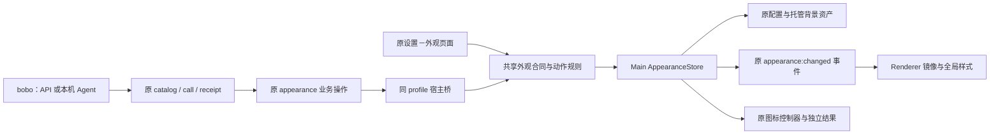

<!--
[OUTPUT]: 2026-11-07关联第30组执行总计划；本篇继续拥有外观A阶段合同和实际进度。
[INPUT]: 2026-11-07用户设计请求与首版仅支持bobo的确认；2efea140源码中的外观、宿主桥与应用工具。
[OUTPUT]: 保留手动设置的统一配置合同、增量任务、验收标准与后续Agent执行入口；本轮仅设计。
[POS]: 第3组外观自动配置设计，承接14/19/20/21的已有实现。
[PROTOCOL]: 一旦本文件变化，必须同步更新 Header，并上浮检查所属目录 .folder.md。
-->
# 外观统一配置与 bobo 操作计划

后续整体顺序见[第30组执行总计划](../30.配置开放与插件及上下文交接/README.md)；本篇仍是外观A阶段的唯一合同，第11节保留实际进度。

日期：2026-11-07。状态：**设计完成，尚未实施**。源码核对基线：`2efea140`。后续执行前重新核对当前分支，本文路径按当前 Workspace 结构书写。

## 1. 目标与范围

让用户可以直接对 bobo 说“切成深色，字体大一点”“恢复默认外观”，由 bobo 读取当前配置、选择实际可用值并修改；用户仍能在原“设置 → 外观”页面随时手动调整，双方看到和修改同一份配置。

用户已确认：**首版只支持 bobo，沿用现有权限**。本轮仅设计并留下执行计划，不改变当前外观、个人数据或运行实例。普通员工授权另期，不因开放外观而开放全局应用管理。

产品边界：

- 保留现有页面布局、控件、自动保存和即时预览；可以调整内部接线以统一语义。
- 配置归当前 BOAI 桌面 profile，不归 bobo 的人格、记忆或员工配置；bobo 是操作者。
- API bobo 与本机 Agent bobo 共用原工具入口，保留各自执行循环。
- 第一交付覆盖当前可配置的模式、主题、颜色、字体字号、缩放、应用图标、已有背景效果、移除背景及恢复默认。
- “将用户指定图片设为背景”属于后续独立阶段 A5；第一交付明确不能由员工导入新图，手动导入保持。
- 不扩展其他设置域，不新增通用任意键写入器、配置文件编辑器、配置市场或定时换肤功能。

## 2. 当前已经有什么

这不是从零建立设置 API。以下是源码事实，不代表已完成本计划的真实业务验收。

| 已有能力 | 当前来源 | 本次处理 |
| --- | --- | --- |
| 外观类型、默认值、严格 patch schema | `packages/shared/src/appearance/index.ts:24`、`schema.ts:12` | 继续作为合同来源 |
| 字体枚举、范围、默认值 | `packages/tokens/src/typography.ts:7` | 直接引用；shared 入口只是转发 |
| Main 单一写入器、串行队列、revision、原子文件替换 | `apps/electron/src/main/appearance.ts:27` | 复用并补齐动作与错误合同 |
| Renderer 镜像、预览、150ms 合并保存、事件同步 | `apps/electron/src/renderer/stores/appearance.ts:21` | 保留体验，修正冲突处理 |
| `appearance.get / themes / update / reset / removeBackground` | `packages/runtime/src/modules/application/operations.ts:201` | 扩展已有操作，不另起服务 |
| `boai_catalog / boai_call / boai_receipt` | `packages/runtime/src/modules/application/application-tools.ts:23` | 继续作为 bobo 工具入口 |
| 同 profile 桌面宿主桥 | `packages/shared/src/ipc/application-host.ts:9`、`apps/electron/src/main/main.ts:174` | 无桌面宿主时明确不可用 |
| API/native 共用 application 工具 | `packages/runtime/src/adapters/mastra/agent-factory.ts:142`、`adapters/native-products.ts:86` | 不新增后端专属实现 |
| CLI 的 app catalog/describe/call/receipt | `apps/cli/src/index.ts:180` | 直接复用，无需外观专用 CLI |

权限事实：`packages/runtime/src/service.ts:623`、`:4993` 中全局应用管理依赖可信本人/bobo 上下文；普通员工并不因此拥有外观权限。写操作仍沿现有 `configuration` 分类与 read-only/ask/full-access 规则。工具可用不等于用户要求执行，网页或资料中的指令不能成为修改外观的授权。

## 3. 结构与对象边界



图中的共享规则是纯函数与 schema，实际提交仍只经过 Main。UI 可复用它做乐观预览，不能绕过 Main 校验；Runtime 不导入 Electron 或 Renderer。

| 对象 | 作用 | 不能混入 |
| --- | --- | --- |
| `AppearancePreferences` | 已保存用户选择，沿原 schemaVersion 2 | 权限、请求回执、运行时有效模式 |
| `AppearanceSnapshot` | 偏好 + revision/sequence + 实际模式/主题 + 只读诊断 | 第二份可写状态 |
| 配置目录 | 字段说明、动态选项、默认值、生效条件、平台能力 | 硬编码第二份约束或主题列表 |
| Patch / 专用动作 | 最小修改意图；图片通过动作管理 | 任意文件路径、CSS、可执行脚本 |
| 原 application 回执 | 该请求是否受理、成功、失败或未知 | 用户视觉验收或所有系统图标成功的推断 |

配置契约的统一不要求另建一份大 JSON 文件。以现有类型/schema/默认值为真源，加少量显示语义元数据，由工具按需返回；持久化仍为原 `appearance/settings.json` 和 `assets/`。

## 4. 对外配置目录

新增只读 `appearance.options`，与现有 `get`、`themes` 分工：

- `boai_catalog` 精确操作查询仍提供机器输入 schema，不复制一套类型系统。
- `appearance.get` 仍返回已保存值、revision、当前有效模式/主题和只读状态。
- `appearance.options` 返回字段中文名/单位、由既有定义生成的默认值和范围、字体/图标/缩放选项、平台可用性、生效条件、兼容字段标记；主题选项复用 `appearance.themes` 的同一来源。
- 选项必须体现当前启用的插件和平台；调用时再次验证，不能只相信读取目录时的状态。
- 大色板、CSS、图片字节不进入普通配置目录，避免每轮注入完整外观数据。

| 用户概念 | 现有字段 | 首版规则 |
| --- | --- | --- |
| 明暗模式 | `mode` | `system / light / dark`；跟随系统不覆盖偏好 |
| 浅色/深色主题 | `themeIds.light / dark` | 动态查询 ID 和对应模式，不凭名称编造 |
| 每模式自定义色 | `customColors.light/dark` 的 accent/background/foreground | 六位十六进制或 null；null 表示恢复主题值 |
| 界面字号 | `typography.ui.sizePx` | 10–22 整数；普通操作同步内容字号 |
| 代码字号 | `typography.code.sizePx` | 10–24 整数 |
| 三类字体 | `typography.ui/content/code.family` | 分别使用既有字体枚举，不接受任意 CSS 字体串 |
| 整体缩放 | `zoomFactor` | 常规操作使用页面现有 75/80/90/100/110/125/150%；底层 0.75–1.5 合法旧值兼容 |
| 应用图标 | `appIconId` | 从当前 manifest 查询；按平台报告支持情况 |
| 背景效果 | `background.glassOpacity / overlayOpacity / blurRadius` | 玻璃/遮罩 0–1，玻璃 null 跟随明暗默认；模糊 0–32 整数；无图时说明暂不生效 |
| 背景图片 | `background.assetId` | 只读引用，通过导入/移除动作修改 |

当前默认值继续来自 `appearanceDefaults` 和 `typographyControls`，不因本次接入重置用户配置。当前界面/代码字号默认 13，缩放默认 1，模式默认 system。

兼容项不作为新增产品设置宣传：`fontFamily` 是旧别名；`typography.content.sizePx` 存在但当前无独立界面控件；`background.imageOpacity` 仍在 schema 中但当前 Renderer 未消费。目录应标为兼容/高级或不生效，bobo 不主动用它们实现普通需求，更不能声称 imageOpacity 已改变视觉。

## 5. 修改规则必须统一

继续使用 `appearance.update({ patch, expectedRevision })`。最小 patch 表示修改哪些字段，省略字段保持；null 只在原 schema 允许的位置有重置意义。

新联动改变了旧 patch 的行为，必须显式升级操作契约，不能静默改写旧调用。复用现有 `ApplicationOperation.contractVersion/legacy` 机制（参见 `packages/runtime/src/modules/application/schedule-operations.ts`）：新 update/reset/remove 使用 v2，员工目录与工具只暴露当前合同；显式 v1 的旧 update 保留原低层合并含义。A0 核对旧调用者并登记兼容范围，旧无版本 reset/remove 只可保留在确需兼容的本人入口，不能供员工绕过 CAS。持久偏好的 schemaVersion 仍是 2，与操作契约版本是不同概念。

新增共享规范化逻辑，由 UI 预览和 Main 提交共同使用：

该逻辑只处理“用户发起的写命令”，不要把主题清色、字号联动塞进通用 `applyAppearancePatch`。当前 Main 初始化也用该函数加载完整偏好；加载/迁移/普通快照合并必须保持无动作副作用，否则重启可能清除自定义色或改写历史独立内容字号。共享命令规范化应可重复执行而不重复扩展意图。

1. **选择主题**：清除该模式原来的三项自定义色；若同一 patch 明确带新覆盖色，先选择主题再应用指定颜色。另一模式不变。
2. **修改界面字号**：未显式提供内容字号时，同步 `content.sizePx`，与当前手动操作一致。已有客户端显式设置内容字号保持兼容，目录注明高级能力；UI 不新增内容字号控件。
3. **切换模式**：只改变 mode，不把 system 写成某个当前有效模式，不清另一模式主题。
4. **已有背景**：保留纯色覆盖；背景图存在时前景/背景色暂不生效，强调色仍有效。移除背景恢复原纯色配置。
5. **主题可用性**：未知 ID、模式不匹配、已停用插件主题都明确拒绝整次 patch，不静默替换成默认主题。插件后来停用引起的运行时回退继续保留原选择，与主动设置非法主题区分。
6. **原子配置**：一个 patch 内任意字段非法则全部不提交；多个字段一次保存并回传实际快照。

移除背景、恢复默认同样纳入版本校验；同步更新现有 UI 调用者，若保留旧 IPC 兼容入口，它不能成为员工绕过版本检查的路径。恢复默认需要清楚的用户意图；“换个主题”不能推导成全量恢复。普通可 patch 字段可以按已知旧值再次设置，并在最新 revision 上确认没有同字段新修改；首版不承诺跨 reset/remove 的完整撤销，不新增资产历史或通用 undo 系统。

## 6. 并发、失败与生效证据

### 6.1 手动与 bobo 同时修改

所有写操作，包括 reset/removeBackground，都携带 `expectedRevision`，并在原 Main 串行队列内检查。revision 冲突明确未提交，bobo 重新读取后重新判断，不能机械换版本覆盖人的新值。

现有手动图片导入也在 A2 补齐：打开选择流程时捕获版本，在解码/托管完成后的引用提交前检查；期间发生 reset/移除/其他写入时明确冲突，保留已提交配置并清理本次未引用的新资产。A5 延后的只是 bobo 素材入口，不是手动导入的并发保护。

UI 当前冲突会重读后自动重发一次。需要保存编辑基准，比较本次 patch 及其联动字段：

- 对方只改了互不相交字段，可合并后用新 revision 重试一次。
- 对方修改了同字段，或主题/颜色、字号/内容字号等联动字段，不自动覆盖。刷新已提交快照、只清理对应 inFlight 冲突意图的保存状态，保留用户后来新增的 pending 修改，沿 Sonner 告知用户重新调整；不得重放旧 patch。
- 全量 reset 与任何偏好修改冲突；移除背景与导入/背景引用修改冲突。
- 未提交预览与已提交偏好分开，较旧事件不能覆盖新快照；sequence 变化但 revision 不变的系统模式事件仍需接受。

不引入跨进程编辑锁、轮询同步或新的全局状态库。

### 6.2 确定失败与结果未知

当前 Main 普通 Error 经桥接后可能被 application 层归为 `OUTCOME_UNKNOWN`。实施时定义结构化外观错误并跨宿主桥保留错误码：版本冲突、非法主题、只读配置、非法参数、宿主不可用等已知拒绝不得误报成未知。

错误码映射复用已有应用错误约定。只有能证明未写入时才返回确定失败；宿主落盘后、runtime 回执完成前断连属于真实未知窗口，不能把所有 I/O 异常归为“安全重试”。

写入继续使用原稳定 requestId；中断后查原 `boai_receipt`，不能生成新 ID 重放。当前值恰好相同不证明原请求成功。普通 read/get 不创建请求回执。

### 6.3 保存与显示分开

普通操作的成功回执证明配置持久化并返回快照，Renderer 沿原事件应用。首次验收再检查实际显示和重启保持，不新增每次写入都等待全窗口 ACK 的系统。

应用图标有独立异步结果。补只读 `appearance.iconStatus`，复用既有图标状态 IPC，通过宿主白名单接出；返回所选图标与各目标结果。bobo 可据实说“图标选择已保存，Dock 已更新，安装图标未成功”，不能仅凭配置回执说全部完成。首版不新增自动重试策略，现有手动重试保留。

查询结果的 `requestedId` 必须对应本次图标目标，相应目标的 `appliedId` 匹配且 pending 已结束，才可报告该目标成功。旧状态或并发新选择覆盖时只报告实际当前状态，不把其他请求的成功归到本请求。

## 7. bobo 的操作流程

补充 `application.guide(topic: 'appearance')`，并在原 self-management 技能里加导航。技能只说明如何使用目录和回执，不硬编码全部字段/主题值，不新增专属外观工具组。

1. 读当前可用的 appearance 操作；首次或选项有关时读取 options/themes。
2. 读当前值和 revision，结合用户明确要求生成最小 patch。
3. 对“字体大一点”这类可作合理判断的请求，使用目录步长小幅调整并说明实际改动；遇到多个同名主题等确实无法决定的情况再询问。
4. 用原 boai_call 提交，沿已有权限模式处理。用户指令明确且权限允许时不新增专用确认弹窗。
5. 根据回执报告改了什么；图标另查结果。失败/未知时说明实际状态并沿原回执恢复。

例：用户说“改深色，界面字号 15，代码字号 14”，bobo 读取 revision 为 12 后提交以下 operation input；requestId 沿原工具外层协议传递：

```json
{
  "patch": {
    "mode": "dark",
    "typography": {
      "ui": { "sizePx": 15 },
      "code": { "sizePx": 14 }
    }
  },
  "expectedRevision": 12
}
```

共享规则补齐内容字号 15，其余配置保持。成功后可简短回复“已切为深色，界面字号 15、代码字号 14。”只有结果支持时才能这样回复。

## 8. 后续 Agent 执行计划

以下为待执行任务，不是本轮完成记录。A0 → A1 → A2 → A3 → A4 为首版；A5 单独交付。

| 阶段 | 工作 | 主要归属 | 完成条件 |
| --- | --- | --- | --- |
| A0 核对基线 | 重新读取本文/AGENTS/开发技能，核对当前接口、所有调用者和已有用例，确定变化清单 | 本文与现有源码 | 不把已有五项操作重写成另一套服务 |
| A1 统一配置目录 | options、字段语义元数据、动态枚举/默认/可用性；补 appearance guide 的 schema | shared appearance、tokens 引用、application operations | UI 当前可配项全部有机器可读说明，兼容字段清楚标记 |
| A2 统一修改规则 | v2合同及旧update适配；共用主题/字号命令规范化；严格主题验证；reset/remove/手动import CAS；错误穿透；UI 冲突处理 | shared、Main store/host、Renderer store/页面内部接线 | 同一意图两入口结果一致；旧合同明确；无意覆盖和已知失败误报未知被定向验证 |
| A3 bobo 接入收口 | guide、原技能导航、图标状态查询；检查 API/native 的同一目录和权限 | application-tools、operations、host、原技能 | bobo 可发现并使用；普通员工权限保持；无桌面宿主明确不可用 |
| A4 验收与文档 | 按下节验收，记录实际结果/原失败/未验项，更新目录索引 | 现有测试与本文第11节 | 工程结果、真实员工执行、实际显示分开报告 |
| A5 图片导入扩展 | 用户明确提供的会话附件/已授权素材引用，经宿主校验并托管；导入动作补 CAS/回执 | 既有素材授权服务、host、Main import | 授权素材换图、失败保旧图、并发与资源清理全部有证据 |

建议编辑责任：shared 合同由一人负责冻结；Main/host 与 Renderer 可以在合同冻结后并行；application/技能由另一人接入。共享 `ipc`、`main.ts`、operation 注册指定单一编辑者，其他 Agent 提交需求，避免互相覆盖。

A5 输入优先使用当前已有的可信附件/资产引用；不得让模型直接传 assetId 写配置、任意路径读取或未经授权下载 URL。复用当前 PNG/JPEG/WebP、10 MiB、8192 边长、3200 万像素等校验，执行前重新核对实际常量。新图验证/托管成功后再提交引用，引用失败不删除旧图。A5 未完成时，不得宣称“外观页所有操作已可由员工完成”。

## 9. 验收标准

先做与改动对应的后台/模块测试和类型检查。真实模型、桌面交互、安装版另记证据；本设计阶段不执行这些测试。后续遵守当次用户测试范围，不自动跑全量 E2E 或抢占个人屏幕。

| 场景 | 需要证明 |
| --- | --- |
| 读取目录 | 所有当前页面可配项有来源；动态主题、字体、图标准确；无虚构选项 |
| 最小修改 | 一次改模式和字号，其他偏好不变；输入越界整次拒绝 |
| 两入口一致 | 手动和工具选择同一主题/字号，最终偏好及联动字段一致 |
| 版本兼容 | v2联动、显式v1原低层update、旧回执读取分别成立；员工不能借旧reset/remove绕过CAS |
| 非法主题 | 未知、错模式、已停用主题明确拒绝；已有插件停用仍只回退有效值 |
| 双向同步 | bobo 写后原控件更新，手动写后 get 返回新值；保留草稿/聊天执行 |
| 并发 | 同字段冲突不覆盖；不同字段可合并；reset/remove/手动import 不绕过 revision；旧inFlight冲突不清除后来的pending |
| 请求恢复 | 同 requestId 不重复写；已知拒绝可区分；真实未知不伪造成功 |
| 背景 | 无图效果暂不生效；有图时保留纯色；移除恢复；首版不谎称支持导入 |
| 图标 | 保存与各系统目标结果分开，不能把平台不支持称成功 |
| 权限 | 本人/bobo 沿原授权；普通员工/后台无本人意图/只读模式不越权 |
| 宿主与重启 | 无宿主明确不可用；相同 profile 重启保留自定义色和历史独立内容字号，加载不触发写命令联动 |
| 两类 bobo | API 与至少一个当前支持的本机后端分别完成真实请求；不能用注册测试替代真实执行 |

优先扩展已有 `tests/application-protocol.test.ts`、`tests/application-plugins.test.ts` 和现有 appearance/store 用例；只补能证明业务不变量的场景，不为字段映射复制一套镜像测试。若真实员工/视觉验收未执行，报告“工程检查通过，真实业务/显示未验”，不得写完整交付。

## 10. 可交给后续 Agent 的任务文本

> 按 `ai-docs/spec/3.前端重构与功能/28-外观统一配置与bobo操作计划.md` 执行 A0–A4。只让 bobo 沿现有权限配置外观，保留当前设置页面和手动操作。复用现有 appearance 操作、boai_catalog/call/receipt、Main AppearanceStore 和 shared schema。补配置目录、共享主题/字号规则、版本冲突及结构化错误、图标结果查询和按需指南，不另建设置服务，不开放普通员工管理权限，不改个人数据。A5 图片导入另期。先核对当前调用者，再在独立 worktree 实施；测试以本次明确范围为准，未运行真实模型或桌面验收就如实记录。提交、合并和运行版本切换按当次授权处理。将实际进度唯一记在第11节。

## 11. 唯一实际进度

- 2026-11-07：完成源码只读盘点、权限边界确认和本计划；用户选择首版仅支持 bobo。
- A0–A5 均未开始实施；未修改产品代码、当前外观或个人数据，未调用外观写工具。
- 本轮只检查文档差异及相对链接；未运行测试、真实模型、桌面自动化、构建、安装或发布。
- 本文是待用户后续使用的设计草案；不将早期外观/图标功能的已有成绩视为本计划已验收。
