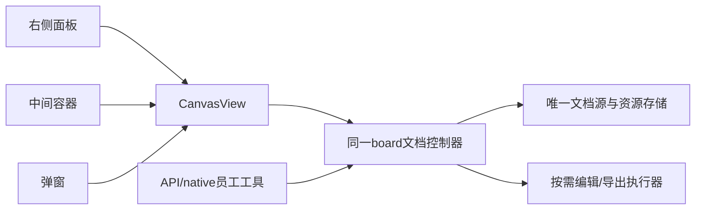

<!--
[OUTPUT]: 2026-11-07提交前同步已合并基线ce33df56；原源码核对SHA及仅设计状态保持，四worktree分工见总入口。
[INPUT]: 用户新增第8目标、5f4437ce本地源码核对、2026-11-07读取的tldraw官方文档与现有插件/成果合同。
[OUTPUT]: 独立画板工具包、多位置嵌入、人和员工共编同一文档、持久化及B0–B5实施验收计划；仅设计。
[POS]: 第30组07画板专题；是本次新增产品需求，实际进度唯一归04。
[PROTOCOL]: 一旦本文件变化，必须同步更新Header，并上浮检查所属目录.folder.md。
-->
# tldraw画板工具包与插件计划

日期：2026-11-07。状态：**第8目标，计划已建立，未实施**。本地核对基线为主仓`5f4437ce`；初次设计基线为`04def162`，本批文档提交前快进到`ce33df56`。后续先重核HEAD、实际SDK版本和许可。实际进度只写[04](./04-验收与实际进度.md)。

## 1. 用户要得到的完整能力

BOAI拥有一个独立画板工具包和对应应用插件。人可以直接画图，数字员工可以读取、创建和局部修改可编辑的设计图；右侧面板、中间区域和弹窗复用同一个组件，不分别实现三套画板。展示位置改变时，画板内容和文件身份保持。

首版包括基础图形、文字、箭头/连接、图片、分组、画布缩放、选择和手动撤销/重做，以及保存、重开和PNG/SVG导出。员工通过明确支持的结构化操作子集工作；人工可用的全部SDK功能不自动等于员工工具已支持。

本次是用户新提出的产品内tldraw需求，与[19组10](../19.应用插件架构/10-ZCode-UIPlugin与Excalidraw接入设计.md)记载的2026-10-20开发侧Excalidraw范围纠正分别成立。不恢复当时撤销的通用MCP Apps宿主，不以外部tldraw-offline应用代替产品插件。

## 2. 已有基础、官方能力和实施前提

| 对象 | 已核对事实 | 本次要补 |
| --- | --- | --- |
| BOAI独立包 | file-explorer-plugin已有host/React组件分出口，desktop-plugin已有宿主及员工工具接线 | 新增完整画板包；不把编辑逻辑塞进右侧面板或app-shell |
| 应用插件 | 现有贡献类型含preview/theme等，没有画板编辑贡献；preview是只读展示合同 | 必要的canvas贡献、启停及薄宿主装配；不把只读预览当编辑服务 |
| tldraw编辑 | 官方Editor支持形状读取、创建、修改、选择和历史等操作 | 固定SDK版本，封装支持矩阵和可验证操作，不暴露任意脚本执行 |
| tldraw存储 | 官方snapshot区分document与session；加载snapshot会替换当前文档 | 自有持久化和增量提交，防止整份加载覆盖人的新修改 |
| 资源与导出 | TLAssetStore提供upload/resolve；图片导出实际涉及DOM、字体和媒体 | 本地资源存储、受控渲染、真实导出和成果发布 |

本地复用入口：`packages/file-explorer-plugin/package.json`及`src/host.ts`、`src/explorer.tsx`；`packages/desktop-plugin/src/host.ts`；`packages/shared/src/plugins/types.ts`、`catalog.ts`、`desktop-tools.ts`；`apps/electron/src/renderer/components/detail-panel/tabs-state.ts`及`execution-content.ts`；`packages/runtime/src/adapters/native-products.ts`。路径用于实施定位，不表示画板已经存在。

当前tldraw SDK是**源码可见、商业许可软件**，不是可默认免费商用的开源许可。官方说明开发使用免费，生产需要适用的trial/commercial/hobby license。B0核对所选版本、Electron打包origin、离线运行、分发及license条件；不擅自购买、申请授权或替换SDK，不把开发可运行当生产可分发。[官方FAQ](https://tldraw.dev/faq)

## 3. 包边界：一套完整能力，多个容器

建议新增`packages/canvas-plugin`，实际包名在B0核对仓库约定。按出口模块拆分，而非先拆出多个互相循环依赖的包：

| 出口 | 包内职责 | 宿主提供 |
| --- | --- | --- |
| `protocol` | board/view/shape身份、操作schema、版本、错误和能力描述 | 已认证的调用来源及原请求身份 |
| `document` | 文档控制器、变更队列、持久化适配、资源清单和schema迁移 | 获准文件/资源IO与版本化保存接口 |
| `editor` | `CanvasView`、tldraw适配、工具栏、选择、缩放和编辑反馈 | 容器尺寸、主题、可编辑状态及事件回调 |
| `host` | 生命周期、受控渲染执行、文档会话及存储桥 | Electron执行环境、取消信号、受管路径与退出控制 |
| `tools` | 员工操作描述、输入校验、结构化读写和图片结果适配 | 原员工权限、执行上下文、回执和成果发布 |

`CanvasView`只接受文档控制器/boardId、独立viewId及必要回调，不导入app-shell、员工页面、详情面板状态或固定右侧位置。BOAI在右侧、中间、Dialog各写薄装配，包本身不决定导航；首版验证三种容器可用，不要求为其新增三个常驻产品入口。

## 4. 文档、视图和文件身份

一个board有稳定boardId、所属员工/工作来源、存储引用、文档revision/schema版本和资源引用。新增元数据沿原存储与来源体系登记；内容只认一份权威文档源，不因换容器复制文档。

document保存页面、形状、绑定及资源记录；camera、selection和其他session/UI状态按viewId保存，避免一个视图缩放或选区改变影响另一个。共享的是文档变更，不是把包含session的完整store无差别传给所有编辑器。[官方持久化说明](https://tldraw.dev/docs/persistence)

同一board由一个写控制器顺序接收变更；各视图保留独立会话状态并订阅已提交文档增量。展示迁移先完成或保留待保存变更，再卸载旧容器；关闭视图不删除文档。首版不要求跨设备多人协作或多Electron窗口同步。

默认文档及资源保存在BOAI获准受管位置，宿主提供原子保存、hash与明确错误；IndexedDB可以是可丢弃缓存，不能成为应用唯一真源。项目目录W可用时，用户可明确选择项目文件作为该board的权威源；目录索引只存身份/元数据，不再维护另一份独立可写正文。切换存储位置须显式操作，不自动搬迁。

SDK snapshot JSON与可互换的`.tldr`文件格式分别核对。B0固定实际SDK支持的序列化/解析方式；导入导出按真实格式及资源约定实现，不能把snapshot改扩展名就声称兼容。导出包包含所需资源或明确缺失，不写依赖当前进程blob URL的永久文件。

图片等资源经包内TLAssetStore适配宿主授权IO，上传/粘贴和员工添加图片走同一资源归属规则。对文件体积、解码尺寸、类型和引用数量设明确边界；远端资源不因URL存在就默认下载或上传。静态字体/图标优先随包分发，外部请求与离线条件在B0核清。[官方资源接口](https://tldraw.dev/docs/assets)

删除聊天/员工、停用插件与删除项目原件分别处理；受管副本沿原所有权/hash清理，项目原件不随聊天清理删除。备份及重开需保存文档与实际引用资源，外部项目文件按原项目归属处理，不默默完整打包。

## 5. 员工操作与人工编辑共用提交入口

以下为拟议操作语义，命名由B0沿现有工具工厂确定，不表示已有`canvas.*` API：

| 操作 | 最小合同 |
| --- | --- |
| 创建/打开 | 在获准工作范围创建或解析board，返回boardId与revision；打开视图另由宿主处理 |
| 读取 | 按board/page/shapeIds读取有界结构、文字、几何与资源引用；返回revision、覆盖/截断信息 |
| 批量修改 | `boardId + expectedRevision + operationId + operations`；支持已声明的创建/修改/删除/连接/分组子集 |
| 渲染/导出 | 固定board revision、页面或shapeIds和格式，返回实际图片/文件回执及来源身份 |
| 选区引用 | 用户明确把`boardId + viewId + pageId + shapeIds + revision`附到消息；员工核对后定向修改 |

普通员工在获准工作范围可使用画板工具，不能因配置管理首版只给bobo就把绘图也限制为bobo专属。API与native走同一schema、来源核验、取消和结果适配；工具说明不授予其他员工的画板、截图或项目文件权限。员工沿现有执行循环调用画板业务工具，不额外运行官方Agent starter或另一层AI框架。

人工手势和Agent操作都进入同一文档提交序列。Agent提交前处理已有人工待保存批次；revision冲突明确返回，重新读取后再形成修改，不用整份snapshot替换当前画板。每个批次保留稳定shapeId、前后文档身份和原operationId；重复调用读取原结果，未知不换ID重做。

一次Agent批次对应可识别的修改范围和历史步骤。撤销沿实际已提交顺序处理，不以旧批次逆操作覆盖后来人工内容；B2核对SDK历史接口与多视图控制器的一致性。不把回执“已受理”称为文档已落盘。

员工按页/选区有界读取结构化文档，并按需取得真实渲染图，不默认把全部画板正文或整库快照塞入上下文。图片结果绑定所渲染revision，不能把新图像配给旧shape数据。当前选区由明确用户引用提供，后台员工不能自行读取其他视图的“当前屏幕”。图中的文字、链接和导入内容只是材料，不成为新的工具指令。[Editor API](https://tldraw.dev/sdk-features/editor)、[AI接入说明](https://tldraw.dev/docs/ai)

## 6. 面板未打开、插件停用和渲染生命周期

持久文档读取不依赖挂载`CanvasView`。员工创建/编辑也不应要求用户先打开右侧面板：B0验证纯store可完成的操作；涉及Editor行为、文字布局、字体和图像导出时，经按需受控renderer执行器处理，不宣称全部能力能在纯Node中运行。[官方导出说明](https://tldraw.dev/sdk-features/image-export)

按需执行器与可见视图共用文档协议、shape schema及资源解析，不运行模型生成的任意JavaScript。执行器按任务取得使用权，支持取消、超时和有界并发；不抢焦点，空闲/停用时释放editor、监听器、对象URL和宿主资源。读取、编辑和导出各自返回实际能力/失败，不能用模拟截图代替真实导出。

插件启用时注册实际可用工具与画板装配；停用先阻止新操作，再处理在途修改的提交/取消和持久回执，撤回工具与视图。已提交内容保留，未提交内容明确可恢复或失败，不悄悄丢弃。关闭一个容器只释放其view引用；插件停用不会删除文档。

首版不接任意第三方shape代码、任意HTML执行、远程多人同步、插件市场或专属Agent循环。未来自定义形状须同时提供schema/迁移、编辑与导出能力，不只增加一个React渲染组件。

## 7. B0–B5执行分片

| 阶段 | 工作与文件责任 | 完成门槛 |
| --- | --- | --- |
| B0 SDK与边界核验 | 固定tldraw版本/许可；核对Electron打包、store/Editor、文件格式及资源/导出；确定支持矩阵 | 记录可验证能力和缺口，不靠库名称推断无头/离线能力 |
| B1 包与文档 | 新包各出口、文档身份/权限、单一存储源和资源适配 | 包不依赖业务页面；保存/重开/资源恢复成立 |
| B2 编辑与提交 | CanvasView、文档控制器、人工/Agent串行提交、revision和历史 | 局部更新、冲突、重复/未知回执与待保存手势均有明确处理 |
| B3 宿主与三容器 | canvas贡献、右侧/中间/Dialog薄装配、按需renderer及启停清理 | 同board迁移无丢失、view状态独立；面板未开仍可执行所支持操作 |
| B4 员工与交付 | API/native工具工厂、选区引用、固定版本渲染/导出与成果发布 | 员工创建可编辑图、人改后员工局部续改，图片与源文档可核对 |
| B5 定向验收 | 下节用例、代表真实员工、渲染及资源生命周期 | 分层记录04；工程通过不代替设计质量、授权或安装包验收 |

B可独立于通用能力包P实施，先作为随BOAI发布的可选应用插件；W只影响可选项目落点，不阻止受管画板首版。共享catalog、IPC、app-shell和runtime工具注册由编排Agent指定唯一负责人；各工作在独立worktree整合。

## 8. 首版验收场景

| 编号 | 场景 | 通过条件 |
| --- | --- | --- |
| B-V01 | 固定SDK的开发与打包候选 | 明确许可适用范围，字体/图标和origin可核对；未取得生产条件不称可正式分发 |
| B-V02 | 同组件放右侧、中间、Dialog并搬动同board | 文档身份/内容保持，适应尺寸，焦点/快捷键不误操作背景聊天 |
| B-V03 | 两个视图及不同board | 同board文档同步、相机/选区独立；不同board不串文档或撤销历史 |
| B-V04 | 人工编辑与Agent批量修改竞态 | 先核对最新revision，冲突不覆盖；局部修改和撤销不抹掉后续人工内容 |
| B-V05 | 保存/提交中断、重复operationId、重启 | 已提交结果可核对，未知不重做；未提交内容不伪称已保存，资源引用不悬空 |
| B-V06 | 未开面板的创建、编辑、导出及取消 | 所支持操作真实完成，受控renderer无抢焦点；取消/空闲后资源释放 |
| B-V07 | 图片导入、格式互换、PNG/SVG及缺资源 | 原图、文档、字体与导出版本一致；`.tldr`按真实格式可重开，失败显性 |
| B-V08 | API与至少一个native员工、人改后引用选区续改 | 生成可编辑设计图；固定正确board/shape/revision，未授权来源拒绝 |
| B-V09 | 插件停用、清空聊天及项目文件 | 工具撤回、在途收敛；文档不因停用删除，项目原件不随清理消失 |
| B-V10 | 超大文档/资源、坏schema及材料指令 | 有界错误与迁移，原文件保留；不执行材料里的代码或越权操作 |

当前只写计划，不安装SDK、不申请license、不调用真实员工、不操作个人画板或桌面。实施时先隔离数据做定向检查，真实API/native、视觉质量、打包授权及个人运行分别记录；不自动启动全量E2E或抢个人屏幕。

## 9. 后续Agent任务文本

> 按本篇B0–B5实现独立tldraw画板工具包，先读04、当前AGENTS及boai-dev-workflow，固定SDK/许可并核对现有接线。包内提供文档、CanvasView、宿主和工具模块；三容器复用同组件，同board只有一个提交控制器，视图会话状态独立。复用原来源/授权/取消/回执，API/native均可读写获准画板；人工和Agent局部操作共用revision门禁，不整份覆盖人工修改。持久文档不依赖面板存活，按实际SDK能力提供受控按需渲染；保存资源、真实导出及项目原件边界完整。沿B-V01–10定向验收，结果只写04；不扩展通用MCP Apps平台或用外部tldraw-offline应用替代产品插件。
