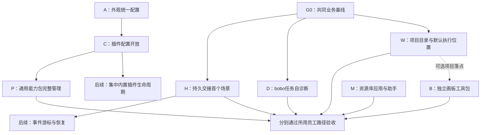

<!--
[OUTPUT]: 2026-11-09项目目录收敛现行规则归06顶部，源码/定向后台结果归04第18节；无E2E。
[INPUT]: 2026-11-07用户确认建立计划；外观方案、当前插件与会话源码、第29组核心合同、T3与Openbot固定版本研究。
[OUTPUT]: 九目标总计划：八项产品增量与一项普通Skill工作，按四个worktree分工及共享文件唯一负责人实施；实际进度归04，四组实现与各自验收回执已汇入，WT2原生限定支持见04第16节，组合及真实模型业务另验。
[POS]: 第30组唯一计划入口；业务模型遵守第29组，实际进度唯一归04。
[PROTOCOL]: 一旦本文件变化，必须同步更新Header，并上浮检查所属目录.folder.md。
-->
# 配置开放、插件与上下文交接执行计划

日期：2026-11-07。状态：**四个worktree已分别实施；固定版本、工程通过及未验范围见04，尚未组合合并**。

最初授权为建立计划；2026-11-07用户已分别明确启动WT1–WT4实施，按各自目标范围执行。真实模型、个人数据、提交/合并及运行版本切换仍按当次授权，不将工程通过当真实业务通过。实际阶段与固定版本见04。

## 1. 目标与阅读入口

让用户既可以通过原设置界面配置 BOAI，也可以委托 bobo 配置；让外部技能与 MCP 能力能按包管理；让员工在执行能力变化或工作交接时保留可追溯、可核对的上下文，解释任务卡点，并在用户明确选择的项目目录执行工作；画板支持员工协作，资源库提供服务连接器与预制员工入口。

当前共 **9 个目标：8 项产品开发 + 1 项普通Skill编写**。按用户确认顺序为：①外观配置开放，②插件配置开放，③通用能力包接入，④上下文交接与恢复，⑤bobo自诊断，⑥工作方法提炼Skill，⑦项目目录选择与默认执行位置补齐，⑧tldraw独立画板工具包与插件，⑨资源库应用与助手目录。共同基线G0和验收不另计目标，R后续切片及A5不计入首批。

首版设置管理只给 bobo，沿现有本人消息来源与权限策略；普通员工只按明确绑定使用能力，不因此取得全局管理权限。员工、workspace、长期 memory、任务和群组归属继续遵守[第29组核心设计](../29.员工核心模型与完整验收/01-核心设计.md)。

| 文档 | 本轮用途 | 实施状态 |
| --- | --- | --- |
| [已有外观计划](../3.前端重构与功能/28-外观统一配置与bobo操作计划.md) | 第一份统一配置样板，A0–A4首版，A5背景图片导入另期 | WT1源码/定向检查已接，真实待验 |
| [01 插件配置开放](./01-插件配置开放计划.md) | bobo发现插件配置，沿原服务读写，手动设置保持 | WT1源码/定向检查已接，真实待验 |
| [02 通用能力包接入](./02-通用能力包接入计划.md) | 标准Skills/MCP包导入、绑定、启停、更新和卸载 | WT2 API工程及限定版本CLI通过；Claude混合包/Codex纯Skill，限制见04§16 |
| [03 T3上下文交接与恢复](./03-T3上下文交接与恢复计划.md) | 持久handoff、运行时能力/切换、协议回放，列后续恢复切片 | WT3工程回执见04；真实交接未验 |
| [04 验收与实际进度](./04-验收与实际进度.md) | 共同业务基线、阶段门槛与唯一实际记录 | 四WT实施与各层证据 |
| [05 bobo任务自诊断](./05-bobo任务自诊断计划.md) | 依据现有任务和运行证据解释卡点，提供只读诊断与宿主降级 | WT1源码/后台通过；真实解释未验 |
| [06 项目目录与默认执行位置](./06-项目目录与默认执行位置计划.md) | 第7目标：员工默认目录、聊天/任务目录持续使用、执行与交付一致性 | WT3工程回执见04；真实/GUI未验 |
| [07 tldraw画板工具包与插件](./07-tldraw画板工具包与插件计划.md) | 第8目标：独立可嵌入画板、员工读写、同文档多容器及保存导出 | WT4工程及隔离渲染通过；许可/真实员工另验 |
| [08 资源库应用与助手目录](./08-资源库应用与助手目录计划.md) | 第9目标：提示词后新增服务连接器与预制员工入口，参考Openbot | WT2受控工程通过；真实账号/GUI未验，M3/M5未完 |

用户后续明确：**成果修订核对暂不做；工作方法沉淀只是普通Skill工作，不列为产品功能开发。** 方法、工作结果、纠正记录或录屏均可作为用户提供的材料，不与桌面活动功能绑定，不新建候选管理、采纳状态机或页面。具体范围见第9节。

## 2. 已有能力与真实增量

本轮核对的主仓基线为 `04def162180a8ae517a7fa2722d3b40c3ad2233b`。此前审计基线 `e9ef6fae` 到此提交的增量属于会话文件布局；本计划的插件/交接结论仍沿已核对源码。执行前需重新核对届时 HEAD。

后续专题分别注明自己的核对基线：05自诊断为`16d9760c`，06项目目录、07画板及08资源目录的BOAI源码为`5f4437ce`，07另核对2026-11-07官方tldraw文档与许可；08另固定Openbot源码`3a40cf5d242370008b6815dad651567e68f075ff`；设计worktree在本批文档提交前已快进到已合并的`ce33df56`；上述源码核对仍分别对应各篇记录的SHA，不将快进当作重新验证。

| 方面 | 已有基础 | 本计划要补 |
| --- | --- | --- |
| 应用业务操作 | catalog/call/receipt、外观操作、内置插件查询/启停、运行时插件部分管理 | 可发现配置合同、明确副作用/可用性与薄适配 |
| Agent运行时插件 | SDK、RuntimeProvider、独立包安装/更新、hash/CAS/lease、隔离进程桥 | 按实际缺口细化能力、切换策略和协议证据 |
| 内置应用插件 | 静态贡献目录，浏览器/桌面/语音等模块及各自清理路径 | 在新增能力时集中必要接线，控制替换成本 |
| 外部能力包 | Skills管理、MCP数据源，以及部分Codex启用插件的skills发现 | 完整包身份、支持矩阵、安装与绑定关系、生命周期 |
| 上下文 | 原生initial/incremental输入、session核验、API checkpoint、任务结果来源校验 | 持久交接对象、覆盖/遗漏、预算与投递证据 |
| 恢复 | 持久消息、分页、执行窗口增量、回执与中断记录 | 后续统一事件游标、补快照、有界缓存及特定副作用恢复 |
| 项目目录 | 消息`workingDirectory`、CLI `--cwd`、API/native执行目录及原授权 | 桌面选择入口、员工默认值、聊天/任务固定目录及项目文件发布一致性 |
| 画板插件 | 独立应用插件包、静态贡献目录、API/native插件工具桥与原成果发布 | tldraw组件/文档资产控制器、员工业务工具、可复用容器与许可核对；当前没有编辑画板贡献 |
| 资源目录 | 资源库skills/sources/prompts、Source服务、员工预设和员工创建 | 提示词后的应用/助手入口、连接预设与配置、必要认证、模板映射和来源记录；不复制数据源/员工实例 |

应用目录与助手目录是资源库的两个入口，合计一个目标。应用卡片描述可连接的服务；连接实例仍属原数据源。助手卡片是模板，使用后生成普通员工，不引入第二套员工运行或记忆。

三种插件保持不同职责：运行时插件负责接入完整Agent；内置应用插件负责应用模块；通用能力包为员工增加技能和工具。包格式不能替代 RuntimeProvider，技能文字不能替代工具实现或授予权限。

源码入口：`packages/runtime/src/modules/application/operations.ts`、`modules/backends/runtime-plugins.ts`、`modules/resources/local-skill-catalog.ts`、`packages/shared/src/plugins/catalog.ts`、`packages/runtime-plugin-sdk/src/runtime-api.ts`、`packages/runtime/src/adapters/native-sessions.ts`、`modules/contexts/context-repository.ts`。

## 3. 执行顺序与依赖

建议按可独立验收的批次推进，各条主线分别交付，不预设工期。

| 批次 | 执行范围 | 前置与产物 |
| --- | --- | --- |
| G0 共同基线 | 核对当前源码与第29组SINGLE-01；准备隔离数据、代表员工和原失败清单 | 建立真实业务基线；本轮不运行。后台合同工作可先行，不能用它冒充真实通过 |
| A 外观样板 | 原外观计划A0–A4 | 配置目录、双入口一致规则、版本冲突与回执；作为C的参照 |
| C 插件配置 | 01的C阶段 | 先做浏览器显示偏好等实际已支持设置，验证通用描述和原服务适配 |
| P 通用能力包 | 02的P阶段 | 标准包解析、来源/版本、技能/MCP绑定、停用和升级；不依赖重做运行时插件 |
| H 上下文交接 | 03的H0–H4 | 先完成G0相关基线和能力策略核对；H2同员工切换为工程里程碑，H3按第29组前置完成员工A→B交接 |
| D bobo自诊断 | 05的D0–D4 | 沿真实任务身份聚合只读证据，区分等待/失败/未知；可与配置主线独立推进 |
| W 项目目录 | 06的W0–W4 | 复用现有`workingDirectory`，补默认值/持久选择与文件交付；已开始任务不随员工默认目录变化 |
| B 画板工具包 | 07的B0–B5 | 先固定SDK/许可和编辑执行方式；独立包、宿主适配、员工工具及三种容器，项目落点可沿W接入 |
| M 资源库应用与助手 | 08的M0–M5 | 先固定Openbot来源/许可和实际连接方式；新增两入口、连接配置及模板创建，复用Source与员工服务 |
| R 后续切片 | 03登记的恢复/生命周期及可选协议升级 | 根据真实故障、容量或使用需求选择，不随首版自动全部启动 |

A与G0可并行准备。C只借鉴A的配置发现/回执模式，不依赖外观专属字段。P的标准格式和导入设计可与C并行，最终管理入口沿C形成的约定。H的来源/预算纯逻辑和协议回放可并行准备，真实切换实施与验收前需有可解释的原业务基线。

H3还依赖第29组群组闭环的相应前置；若前置未完成，记录工程里程碑和阻塞项，不能用H2通过代替员工协作交付。此依赖不要求本组顺带完成所有群memory或长期自用目标。

W可独立于插件与交接实施；其真实验收复用G0相关员工路径。W与H共用原生session指纹及运行配置，先统一目录切换语义再整合；不要求为目录选择先恢复完整文件浏览器。

B可先用现有受管文档位置独立实施，不依赖通用能力包或新的运行时插件平台。W提供后续显式项目落点。画板包由同一CanvasView供右侧、中间和弹窗使用，普通员工按原工作来源使用画板工具；配置管理仅bobo的规则不限制获准画图员工。B0先核对生产许可与Electron加载条件；当前SDK源码可见不等于免费商用。

M可独立于P/B推进；它提供连接器发现与员工模板入口，P负责可安装能力包，B负责可嵌入画板。M创建普通Source与员工，不要求先完成插件市场；模板引用能力包时遵守P的实际可用性。M0需核清Openbot非商业许可和GitHub/Vercel等代表服务的认证方式，不能把模型登录当作服务连接授权。

## 4. 必须保持的边界

1. **原设置仍可手动操作。** 不新建另一份配置，不让模型直接改私有JSON/数据库/CSS；配置写入接原领域服务。
2. **真实来源决定权限。** bobo管理沿原本人消息与configuration策略；后台主动行为、检索内容和插件技能不自动获得新的管理意图。
3. **一个能力只有明确的加载归属。** BOAI与原生Agent不能同时注入同包并重复执行；当前Codex有不同启动分支，不能假定所有原生插件一律禁用。
4. **员工连续性与运行时内部状态分开。** 持久交接补产品来源链，不能宣称复制了厂商私有session或已经完成长期memory跨引擎适配。
5. **不确定副作用不重放。** 同一写意图沿原requestId/回执；取消请求、落盘、外部应用、任务验收分别记录。
6. **现有功能按证据保留。** 不把已有插件、上下文和恢复能力重新列为从零开发，不把已合并修复称为真实业务全部验收。
7. **项目目录与权限分开。** 目录规定默认执行/文件位置，员工workspace保持原归属；不自动授予访问权、不迁移旧文件，原生Agent保留自身权限与会话规则。
8. **画板独立于显示位置。** 人与员工操作同一文档，容器切换不复制文档；编辑与发布副本分开，旧开发侧Excalidraw历史不替代本次产品目标。

9. **目录、实例和权限分开。** 应用预设不保存凭据，连接不自动扩大员工权限；助手模板不含现成账号和私有身份，创建后沿普通员工生命周期。

## 5. 首版不包含

- 第三方代码发布/安装交易市场、任意第三方UI执行、全部hooks或平台私有connector兼容。资源库应用与助手目录按08明确纳入首版，不另建顶层市场。
- 替换Mastra、改写所有原生Agent循环、统一成一个万能执行器。
- 整包移植T3 Orchestrator/ProjectionStore/server，或先做全库event sourcing迁移。
- 自动把个人Codex/Claude插件和凭据导入BOAI，或修改其全局配置。
- 普通员工全局设置管理权限；外观新图导入按原A5另期。
- OpenCode专属HTTP/SSE协议自动列为首版必做；现有ACP路径保持，使用需求明确后单独安排。
- 成果修订核对按用户选择暂不做；方法沉淀不建设新的产品模块、桌面记录接线或自动学习系统。

后续R切片不因写在路线图中而自动进入首轮实施范围。

## 6. 四个worktree并行实施

用户原计划开启四个worktree，现已分别实施。本节按代码归属组织九个目标，不新增目标。四组现已按用户明确指令从同一main基线创建独立分支；下列分工继续有效，实际记录见04。

### 6.1 四组范围与内部顺序

| worktree / 建议分支 | 负责目标 | 实施顺序及主要责任 |
| --- | --- | --- |
| WT1 配置与诊断 / `feat/config-diagnosis` | ①外观配置开放A、②插件配置开放C、⑤bobo自诊断D | 先做A配置样板，再推广到C；D的只读证据合同可独立推进。负责配置描述/原服务适配、本人管理入口与只读诊断投影 |
| WT2 能力与资源库 / `feat/capability-library` | ③通用能力包P、⑨应用与助手目录M、⑥工作方法提炼Skill | 先定Source/包来源/绑定/模板稳定ID；P解析与M目录可并行，配置调用接已冻结合同。普通Skill独立编写，不开发方法沉淀产品模块 |
| WT3 执行上下文 / `feat/context-project` | ⑦项目目录W、④上下文交接与恢复H | 先定W0目录优先级、持久字段和native session切换语义；H的预算/来源逻辑可并行，真实切换沿统一合同整合。负责目录、交接和运行时连续性 |
| WT4 独立画板 / `feat/canvas` | ⑧tldraw画板B | B0核对SDK/许可和编辑执行方式，再独立包、宿主、员工工具及多容器；先使用现有受管文档落点，W完成后接项目位置 |

这样分组是为减少相互修改同一条调用链。WT4虽只有一个目标，仍包含文档与资产持久化、编辑器、人/员工共编、导出及宿主生命周期，不应按目标数量判断工作量。

### 6.2 共享文件与唯一负责人

| 共享区域 | 默认负责人 | 其他组如何配合 |
| --- | --- | --- |
| `modules/application/operations.ts`及ApplicationHost管理/诊断白名单 | WT1 | 各组在自己的模块提供业务入口、schema及错误合同，由WT1加入聚合注册；不同时重写该文件 |
| `packages/runtime/src/service.ts`、运行配置/共享员工实体、ProductStore迁移及native session接缝 | WT3 | 先冻结项目目录、交接身份与版本字段，其他组提交最小接线需求；迁移编号和公共分发串行整合 |
| Source schema/SourceService、能力包来源与绑定、共享员工预设和创建界面 | WT2 | WT3提供员工项目默认字段与语义，WT2将其接入创建表单；不再新增一套模板或连接状态 |
| 画板包、`shared/plugins/types.ts`/`catalog.ts`新增画板贡献、画板工具桥与宿主挂载 | WT4 | 与WT1配置贡献、WT3 native适配接缝先对齐；同一公共文件该批次仅由指定编辑者落改动，其他组不自行复制整段注册 |
| shared IPC总入口、根包清单和`pnpm-lock.yaml` | 整合批次开始前明确指定一人，默认由WT3协调 | 各组可维护自己包的依赖清单；汇总后统一生成锁文件，不选一方覆盖其他新增依赖，不为并行另建IPC体系 |
| 本组04唯一进度、README与根索引 | 协调者，默认WT1汇总 | 各组提供阶段/固定SHA/证据/失败和未验范围；协调者串行追加，不让四组同时覆盖进度表 |

“唯一负责人”指该批次真正修改公共文件的人。需要移交时先说明文件、已合并提交和接下来唯一编辑者；独立worktree不能消除Git合并时的语义冲突。功能逻辑尽量留在各自领域模块，共用入口只做必要接线，不借此启动全库重构。各Agent不是独自在代码库工作，不能回退他人改动。

### 6.3 启动与整合顺序

1. 四组都从本计划合并后的同一main提交创建各自分支，分别核对最新规范、当前能力和原失败。各自使用独立node_modules/profile，复用pnpm store；该步骤已按后续明确授权执行，固定身份见04。
2. 先进行一次短的公共合同对齐：WT1配置/回执，WT2 Source/包绑定/模板来源，WT3 cwd/session/交接身份，WT4 board/工具贡献。WT3协调G0相关业务基线，其他组沿同一用例定义在各自隔离数据上验证；不能只做字段定义就宣布G0通过。
3. 各组同时推进自己的模块。P3等依赖点等配置合同和对应G0结果，不等待WT1所有A/C/D全部完成；H不要求等待全部W完成，B也不要求等待P/M/W全部完成。
4. 公共合同与必要接线先以小批次整合；后续按可独立验收的切片合并。每组开始依赖实现前同步已实际合入main的相应提交，不直接依赖别人worktree的文件。未来产品提交/合并按届时授权；本次`git cpf`只覆盖当前计划文档。
5. WT3冻结的目录/session语义优先供H/W共用；WT2普通应用Source保持bobo现有全启用源策略，包贡献则包含bobo在内受包绑定门禁。WT1诊断始终只读，不通过WT3的恢复接口暗中重跑任务。
6. 各组分别交付定向检查，协调者核对组合后的最小跨组场景。API/native、真实服务、真实员工、显示、合并和个人运行分别留证。H3仍遵守第29组群闭环前置，H2通过不能代替完整员工交接。

给各Agent的开工范围可直接写为“执行总计划第6节WT1/WT2/WT3/WT4，按该行目标和对应专题实施”。四组都要读取第4节共同边界、04验收和第7节总任务文本，不能只按目标名称自行扩大范围。

## 7. 交给后续Agent的总任务文本

> 先读 `ai-docs/spec/30.配置开放与插件及上下文交接/README.md`、04验收进度、当前AGENTS和boai-dev-workflow，再核对当前HEAD。按用户本次指定的A/C/P/H/D/W/B/M阶段执行；若明确要求实施本总计划，产品首版范围为G0及A/C/P/H/D/W/B/M，另按第9节编写普通Skill，R和A5另期。保留现有手动设置，首版仅bobo管理配置；复用已有业务工具、领域服务、RuntimeProvider、技能/MCP与回执。自诊断只读现有事实，不隐式恢复、重试或改任务状态。项目目录沿已有workingDirectory补入口、默认与持久规则，员工workspace和授权保持，补API/native项目文件交付接缝。画板按独立包实现，同一文档可嵌右侧/中间/弹窗，现有员工沿共用工具编辑；保持许可和来源边界，不恢复旧MCP Apps整套宿主。资源库在提示词后加应用和助手；应用复用Source连接与原权限，助手复用员工预设/创建，按08核对Openbot许可与必要认证缺口，保留现有技能与数据源管理。工作方法沉淀是普通Skill工作，不为此开发产品模块；成果修订核对暂不做。遵守第29组员工模型和真实单员工闭环，不借此替换Mastra或整搬T3。先读取阶段已有能力和验收条件，再分配唯一文件责任并在独立worktree实施。后台检查、真实员工、显示效果、合并和个人运行分别留证；本次未授权的外部调用或桌面操作留为待验，不启动全量E2E或抢占个人屏幕。每完成一个切片更新04，明确失败、未验和下一步。提交、合并、发布及运行版本切换按当次授权处理。

## 8. 文档归属和证据

- 员工产品语义及SINGLE-01：[第29组](../29.员工核心模型与完整验收/README.md)。本计划为其增量实施切片，不覆盖长期memory与群组目标。
- 现有插件：[第19组](../19.应用插件架构/README.md)；开发包边界：[第26组外部插件接入](../26.Workspace工程结构重构/04-外部插件开发与接入.md)。
- 标准能力包格式：02引用2026-11-07核对的[官方说明](https://developers.openai.com/plugins/build/plugins)；实施时固定实际schema版本和样本。
- T3：03自带必要固定源码链接和迁入边界，不依赖另一个研究worktree长期存在。
- Openbot：08保留固定SHA的市场页面、连接器与模板源码链接，以及LICENSE/NOTICE复用边界；截图仅作布局参考，未运行上游应用。
- 本组新工作的实际进度只写[04](./04-验收与实际进度.md)；外观A阶段细节归原28第11节，G0原业务成绩归第29组03，通过链接汇总，不复制成另一份相互冲突的完成记录。

## 9. 工作方法沉淀：普通Skill工作

用户认可这一用途，明确要求保持简单：给Agent一段认可的工作过程、结果、纠正记录或可选录屏材料，由一个Skill指导其提炼适用场景、所需输入、操作步骤、注意事项和输出标准，生成或更新可复用的 `SKILL.md`。一次任务的具体答案不直接变成长期规则。

这属于技能内容编写，后续可复用或精简已有 `boai-alchemy` 的相关指引；不以它为前提，也不新增应用API、数据模型、页面、候选库、专用审批流程或每日扫描任务。录屏是可选输入，不要求改造BOAI桌面活动或把该功能作为依赖。用户检查内容、保存及绑定沿普通Skills用法处理；WT2已编写普通Skill并完成结构与新输入推演，未自动绑定，实际记录见04第15节。
