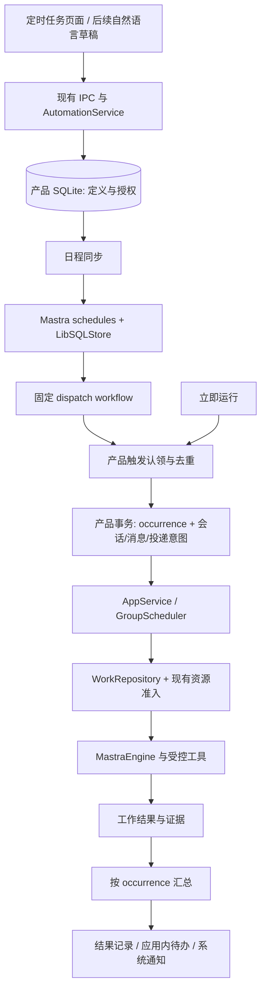

<!--
[OUTPUT]: 2026-10-14员工/群自动化与员工浏览器为独立待实施闭环；群内真实采集→依赖汇总，浏览器优先直接迁用固定GitHub源码；仅文档复核。
[INPUT]: 用户提供的定时任务界面及复用现有右侧面板的要求、自动化/会话/WorkRepository 与详情标签实现、安装版 Mastra 1.71.0 和 Craft 代码。
[OUTPUT]: 2026-09-29 定时任务体验简化规格的 UI 覆盖入口；A+0/A+1/A+2 交付与矩阵证据入口、时钟跳变及原生中断恢复边界； A+2 已发布 JSON 来源、确定性比较与检查点的接入合同；完整历史待处理筛选与最新结果优先阅读；明确追加额度和原工作接续的已实现边界；自动化通知策略/持久提交回执与精确导航；自动化产品目标、持久与执行合同、现有详情面板承接的新建/编辑交互、分阶段实施和验收方案及统一预算/编辑与任务聊天/完整历史的实施状态。
[POS]: Mastra 能力扩展组的自动化演进主设计；补充并修订 06 的历史规划，A+0/A+1/A+2 的实现证据另见实施记录，A+3 保持按需扩展。
[PROTOCOL]: 一旦本文件变化，必须同步更新 Header，并上浮检查所属目录 .folder.md。
-->

**2026-10-14后续目标：** [11员工与群聊自动化](./11-员工与群聊自动化设计与实施计划.md)承接本组现有时钟/事务/Work，明确员工/BOAI群归属、群内多员工采集→依赖汇总、对话创建、右侧详情和全局总览；覆盖下方旧独立API草稿/会话代替归属的未来设计。API与本机均在目标内，本机自主执行规则按第13组最新合同，不沿用较早暂停/预算限制。本次仅文档，运行代码与历史成绩保持；本增量唯一进度归11 §10。

# 自动化产品与运行时设计

日期：2026-09-28；实施状态更新：2026-09-29。**A+0/A+1/A+2 本地交付已完成；A+0 事务/版本/投递、跨工作来源/证据、取消退出、明确补充、逐调用统一预算/等待容量再准入与无重放核对已接入，A+1 独立编辑标签/任务聊天、日历预览和完整历史/结果定位已接入，三档通知/持久回执和明确预算追加已接入，完整历史待处理筛选/最新结果优先阅读已接入，A+2 首个 JSON 产物监控已接入，14 项验收与 6 类恢复断点已核对**，实际范围见 [自动化增量实施](../2.已实现功能与代码现状/22-自动化增量实施.md)。

本文基于当前工作区源码，包括已有未提交修改；不能仅用 Git HEAD 复现所有观察。已有实现和核验依据见 [08-Craft与Mastra自动化调研](./08-Craft与Mastra自动化调研.md)，旧方案见 [06-自动化与定时执行](./06-自动化与定时执行.md)。运行时设计冲突时以本文为准；现行行为仍以代码为准。本文没有启动真实用户计划、调用付费模型或改变应用数据。

**2026-09-29 用户体验修订（待实施）：** 创建表单、总览与左侧分类改以 [18 定时任务体验简化](../3.前端重构与功能/18-定时任务体验简化/README.md) 为准：七项配置、通讯录式「即将执行 / 执行记录」、独立总览与 Agent 辅助草稿。本文旧 UI 描述保留为历史设计，不能据此重新增加常驻配置；原生时钟、事务、权限、预算、通知和恢复边界继续适用。

## 1. 结论与设计假设

**保留 Mastra 原生 schedules 作为周期时钟；由 BoAI 管理自动化定义、每次触发、授权、工作归属和交付；实际执行继续经过现有员工运行链路。** 当前项目已沿此链路完成 A+0/A+1/A+2，本地验证与运行限制见实施记录。

最值得先做的体验是：选择员工、写清任务、选择频率，每次在一个可追溯的任务聊天里执行，回到应用就能看到结果或需要处理的问题。暂不把可视化工作流编辑器、任意脚本或云端执行列为前置条件。

设计假设：

- 当前交付载体仍是本地 Electron，运行位置首期只有“此设备”。
- 截图用于定义交互目标，不据此推断别的产品在云端、通知、监控方面的实现或承诺。
- 优先支持已配置的 Mastra 模型员工；沿用当前单聊和群聊能力，不撤回已经存在的群聊自动化。
- 下文默认值是设计建议，不是已经生效的产品配置；开发时可据业务需求调整。
- 最初范围为调研与规格，后续已获准实现；参考仓库的说明仍不构成执行用户真实计划、发布或迁移数据的请求。

### 成功标准

1. 用户能看懂谁执行、何时执行、在哪里执行、结果放哪里，以及错过时间后会怎样。
2. 同一逻辑触发只建立一个执行入口；并发、编辑、重启不会造成无依据的重复执行。
3. “有回复”“运行结束”“任务已交付”“通知已提交”各有明确含义。
4. 自动化和人工任务共享现有权限、工作认领、预算、取消与结果发布机制。
5. 每个未执行、失败、等待或中断都有可查看原因；系统不把未知状态写成成功。

## 2. 制定方案时的基础与缺口（2026-09-28）

现有链路：`NativeSchedules → AutomationService.admit → AppService.sendMessage → GroupScheduler → MastraEngine`。定义和 occurrence 在 `boai.sqlite`；Mastra 调度状态在 `automation-mastra.sqlite`。

| 方面 | 当前已经具备 | 下一步缺口 |
| --- | --- | --- |
| 配置 | 每天/每周、时间、IANA 时区、既有目标会话、版本检查 | 员工选择与会话策略分开；工作日；可理解的授权摘要 |
| 原生触发 | 固定 evented workflow、schedules CRUD、显式 worker 启停 | 同步失败重试、运行健康可见、触发对账完整性 |
| 去重 | occurrence hash、手动 requestId、进程内串行；消息请求也去重 | SQLite 事务内认领与消息投递；配置版本和触发身份分离 |
| 执行 | 单聊/群聊走既有员工入口；来源标注；配置变化拒绝旧授权 | 按 occurrence 关联所有 Work、子工作和接续 turn |
| 交付 | 保存 runIds、resultMessageIds、单轮状态 | 不再把 turn completed 直接当作业务完成 |
| 恢复 | 活跃记录重启后中断；不重放工具；备份恢复暂停 | 识别各提交断点，核对已有结果；等待用户的后续输入有明确归属 |
| 通知 | notify 布尔值与 Electron 系统通知 | 重要更新规则、应用内结果收件箱、通知发送状态 |
| 会话 | 绑定已有会话；普通单聊按员工复用 | 截图的“此任务的新聊天”尚无独立语义 |

已经通过的自动化测试证明了现有基础链路，**不证明故障注入、真实休眠恢复、业务交付聚合或新聊天能力已完成**。细节见调研文档。

## 3. 产品模型：计划、触发、工作、聊天分开

### 3.1 四个核心对象

| 对象 | 回答的问题 | 生命周期 |
| --- | --- | --- |
| `AutomationDefinition` | 长期要做什么、何时做、授权给谁 | 创建、启用、暂停、完成、归档 |
| `AutomationOccurrence` | 这一次为什么触发、发生了什么 | 每个日历时刻或手动请求一条 |
| `WorkItem / WorkExecution` | 谁负责交付、谁正持有执行权 | 沿用当前持久工作模型，可包含子工作和结果依赖 |
| `Conversation / Message` | 人在哪里查看、讨论和补充 | 由会话策略选择；不充当调度器或执行锁 |

一次 occurrence 可以涉及多个 Work、多个 turn 和多个 run；一个 run 不等于一个 occurrence。父子归属和结果依赖继续分开：引用了另一项独立工作的结果，不代表拥有那项工作的停止权。

### 3.2 首期提供两种运行方式

**每次新建任务聊天，作为新建计划的推荐默认值。** 适合每日简报、定期整理、报告生成。每次有独立上下文和工作区，不把昨日长对话无限带入。需要跨周期状态时，明确保存自动化检查点或引用上一份已交付结果。

**在指定聊天中运行。** 适合已有项目讨论和群组，沿用现有授权消息窗口。会话忙碌时先保持现行“跳过并记录原因”，避免静默插入或中断人工对话。

旧计划继续绑定原会话，不自动改为新聊天。日后确有“每天在同一自动化专属聊天延续”的需求，再增加第三种方式，不在首期制造三个难以区分的选项。

### 3.3 必须先解决普通单聊的复用规则

当前 `AppService.saveConversation()` 对同一员工返回既有单聊。反复调用它不会得到“每次新聊天”。建议为会话增加用途元数据，例如 `purpose: personal | automation`，自动化会话另带 `automationId` 和 `occurrenceId`。

- 保留普通联系人单聊的复用行为；自动化专用创建用例显式建立独立会话。
- 创建动作复用同一套成员校验、工作区初始化、历史和清理逻辑；不要从 renderer 直接写记录。
- occurrence 与会话绑定在产品事务中提交。目录准备失败时记录初始化失败；空目录可清理，不得启动执行后再补关系。
- 上下文策略明确为当前任务聊天、指定资料和获准员工配置；不因选了同一员工而把其其他私聊、群聊历史自动复制过来。
- 自动化聊天从计划详情进入，也可在聊天列表按来源筛选；不为每次执行创建一个新员工。

## 4. 模块边界与执行链路

| 归属 | 负责 | 不应负责 |
| --- | --- | --- |
| Mastra schedules | cron 计算、到期扫描、框架调度记录和 workflow 触发 | BoAI 的员工授权、公开消息、业务完成判断 |
| NativeSchedules 适配器 | SDK 生命周期、日程同步、原生触发身份解析 | 直接运行员工、另起周期时钟 |
| AutomationService / Repository | 定义、版本、触发账本、策略与结果归属 | 复制一个 Agent 执行循环或 Work 状态机 |
| AppService / GroupScheduler | 当前上下文、成员判断、投递、执行与公开提交 | cron 表达式与通知策略 |
| WorkRepository | 原子认领、持有者校验、共享预算、父子工作/依赖和证据 | 计划启停和系统通知 |
| Electron main | 当前设备生命周期、系统通知、打开对应结果 | 判断任务完成、保存第二份自动化配置 |

薄 workflow 只完成“产品已受理或明确跳过”。它的 `success` 不能显示为“自动化任务完成”。**不把完整 Agent 执行放入可重试的 dispatch step**，避免工作流重试重复外部副作用。

框架确实还提供 agent schedules，可以直接 `generate` 或发送 signal；但当前产品员工是动态装配，消息、权限和工作权威均在 BoAI。直接绑定 `agentId` 会绕开这些入口，因此此处继续选择 workflow 包装。官方能力和本地版本证据见 [调研 §3](./08-Craft与Mastra自动化调研.md#3-mastra-核验结果)。

## 5. 持久化合同

以下是拟新增/调整的**产品合同草案**，不是可以直接粘贴调用的 Mastra API。

### 5.1 Definition

| 字段组 | 建议内容 |
| --- | --- |
| 身份与版本 | `id`、`schemaVersion`、`revision`（编辑并发）、`executionRevision`（执行配置快照）、`scheduleGeneration`（日程规则代际） |
| 内容 | `name`、`prompt`、`taskKind: report | monitor`、可检查的交付描述 |
| 执行目标 | `employeeIds` 或现有会话成员；`conversationPolicy`；`executionHostId` 首期为当前安装实例 |
| 日程 | `kind: recurring`、`daysOfWeek`、`localTime`、`timezone`、派生的 `cron` |
| 生命周期 | `state: active | paused | completed | archived`、暂停原因、创建/修改时间 |
| 授权 | `authorizationRevision`、获准员工/资料/工具范围、必要配置指纹 |
| 策略 | `overlapPolicy`、`misfirePolicy`、运行预算引用、通知策略 |
| 同步 | `scheduleId`、期望与已应用版本、`syncStatus`、错误和最近成功同步时间 |

名称、排序或通知修改无需作废工具授权，也不应改变同一时刻的触发身份。修改 prompt、员工、资料、执行后端等执行语义时递增相应版本；改变日程才递增 scheduleGeneration。三种版本职责不同，不必为每一个显示字段建独立版本号。

首期 UI 不暴露原始 cron。每天、每周选日和工作日编译为同一种周期表示。普通工作日不等于交易日；截图中的行情监控需要独立交易日历和数据源能力，不能仅凭周一至周五 cron 宣称已实现。

`completed` 为有限次计划预留；无限重复计划某次成功后仍为 `active`。在单次/有限次计划真正支持前，UI 不展示空的“已完成计划”筛选。

### 5.2 Occurrence

| 字段组 | 建议内容 |
| --- | --- |
| 来源身份 | `id`、`automationId`、`source`、逻辑时刻键、`nativeTriggerId/nativeRunId` 或 `manualRequestId` |
| 快照 | 触发时的执行版本、日程代际、prompt、员工和授权版本；密钥只保存引用 |
| 时间 | `scheduledFor`、`admittedAt`、实际 `startedAt`、`finishedAt`；都保存 UTC |
| 关联 | `conversationId`、根触发消息、所有 `turnIds`、直接拥有的 `workIds/rootWorkIds`、`runIds` |
| 运行 | admission 状态、execution 状态、原因码、实际使用的宿主 |
| 业务结果 | `deliveryStatus`、结果/产物证据、是否有重要变化、数据完整性 |
| 用量 | 已知 usage、`usageIncomplete`、模型调用数、预算归属 |
| 可观测性 | 调度延迟、排队时间、trace/run 引用、用户可读错误 |

初期继续使用 `ProductStore.records`，以 collection + 稳定 id 作为唯一键，使用已有 `transaction()` 完成读、比较和写。不需要先迁移为另一套 ORM 或专用数据库。历史规模增长后再增加分页/查询索引；内存全量 map 和“只返回最近 300 条”不等于数据保留策略。

通知使用小型 `automationDeliveries` collection；只保存已提交结果的投递意图与状态。监控检查点等到监控阶段再增加，避免为未来功能提前建空模块。

## 6. 触发、事务与幂等

### 6.1 分别定义三种身份

- 周期触发：`automationId + scheduleGeneration + timezone + logicalCalendarSlot`。日历时间回拨产生的两个物理时刻映射到同一个本地分钟键，因此按建议只执行一次。
- 手动触发：`automationId + manualRequestId`，不因配置修订改变重试请求的身份。相同 id 对应不同请求参数须拒绝，而不是静默运行另一份任务。
- 后续事件触发：`automationId + subscriptionRevision + sourceEventId`；不按自然语言相似度合并。

触发记录单独保存实际 UTC 时间和框架 trigger id，不能只用 `Date.now()` 替代计划时刻。改名不会生成第二次执行。改日程后只面向新规则的下一个有效时刻，不回填“刚才那一刻”。

### 6.2 单次受理流程

1. 将 Mastra 触发或手动请求转为统一 trigger envelope，验证时间和来源。
2. 在宿主临界区检查计划状态、执行版本、授权、目标可用性、预算和资源策略。
3. 在一个产品 SQLite 事务中读取并比较版本；若已存在 occurrence，返回已有结果；否则创建受理/跳过记录。
4. 同事务准备会话关联、稳定消息 requestId、消息/turn 记录和可辨识的投递状态。无法在此阶段准备的内容，保存明确的待投递意图。
5. 事务提交后刷新内存投影并交给现有 scheduler；执行前再次检查最新许可。
6. task 的创建、认领、预算预留与工作状态变更仍经过 WorkRepository 事务；普通 chat 不创建工作。

不能在 `ProductStore.transaction()` 回调内再调用同一个 store 的外层排队方法。若需要把工作记录与 occurrence 关联一起提交，应给 WorkRepository 增加受控的事务内辅助操作，而不是让 AutomationService 绕过它写工作集合。

产品消息投递和 Work 的实际认领可以是两个事务，但必须共享稳定来源标识；没有完成认领就不能调用执行工具。已提交 occurrence、还没启动模型的情况必须可辨认。

### 6.3 两个数据库之间不承诺原子提交

产品定义是权威；Mastra schedule 是其调度投影。先提交产品定义与 `pending` 同步状态，再同步框架，再确认已应用版本。中途失败留可重试状态；重试的只是配置同步，不是员工工作。

恢复时按稳定 id 对账。没有产品定义的框架日程暂停；已删除的产品定义保留 tombstone，防止迟到触发复活。先暂停所有权不明的计划，完成产品初始化与对账后再启动 worker。运行时发现同步错误也应有有界重试，不要求用户重启应用。

**无法仅凭 Mastra 的认领机制承诺外部副作用 exactly-once。** 模型、文件、HTTP、应用数据库不存在一个共同事务。可承诺的是产品受理去重、已知结果复用、执行权校验，以及对无法确定是否发生的副作用停止自动重放。

## 7. 运行状态与交付判定

不要把所有含义继续挤进一个 `status`。

| 维度 | 建议状态/结果 | 说明 |
| --- | --- | --- |
| 准入 | accepted / skipped / rejected | 是否获准进入本次运行 |
| 执行 | queued / running / waiting_approval / waiting_user / cancelling / finished / failed / interrupted / cancelled / needs_review | 执行过程；`finished` 仅说明已结束 |
| 交付 | pending / delivered / no_change / partial / blocked / unknown | 用户任务是否得到可检查结果 |
| 通知 | pending / submitted / failed / unknown / suppressed | 通知提交不等于用户已读 |

### 7.1 结果汇总规则

- report 任务：明确要求的工作均有 `delivered` 及有效证据，才显示“已交付”。必要工作失败或等待不能被另一位员工的一条回复遮盖。
- 没有任何工作、成员全部 pass：记录“未形成交付”，不能因 turn 自然结束就成功。
- 普通问候或确认属于聊天，不创建 Work，也不满足报告型任务的交付条件。
- monitor 任务：检查确实完成，数据完整且符合冻结的比较规则，才允许 `no_change`。数据源失败、数据过期或证据不足不是“无变化”。
- Work 还在等待依赖或用户：occurrence 仍未交付。运行槽可释放，结果归属仍保留。
- `partial` 保留已有成果和未完成部分，UI 引导查看，不自动重新执行成功部分。

群组的“要求哪些工作”必须来自明确的任务交付合同或负责人声明，并通过宿主验证。并非所有群成员都必须发言，也不能等所有独立根任务；只等待本 occurrence 拥有的必要工作。日后若有汇总负责人，也应在定义中明确，不额外引入匿名总控 Agent。

### 7.2 穿过子工作与接续轮次

现有 `inspectAutomation()` 按初始 turnId 找 run/message；子工作和定向接续可能产生新 turn。建议把 `automationId/occurrenceId` 作为来源传播至工作、执行和唤醒记录，汇总以工作归属为准。

用户在“等待补充”记录上点击回复时携带 occurrenceId，继续同一份工作和预算；普通聊天新消息不能模糊地被当成回答了所有等待任务。新周期仍有独立 occurrence，是否允许启动由计划的等待策略决定。

建议首期：同一计划已有等待用户/审批的 occurrence 时，后续周期记为“等待上次处理，已跳过”；其他计划仍可使用释放的执行槽。等待有明确过期状态，不无限占用模型或进程资源。

### 7.3 取消的范围

暂停计划仅阻止未来自动触发；“停止本次”进入 cancelling，取消本次拥有的 work/run，适配器退出后再释放资源并终结状态。已有工作中的独立共享依赖不随之停止。

不要仅按 conversationId 取消所有工作：同一聊天之后可能已有用户的新任务。取消与结果发布共用宿主临界区，迟到结果不能改变已停止 occurrence。计划归档保留历史，不隐式删除结果文件。

## 8. 时间、漏跑、重启与运行位置

### 8.1 首期建议策略

| 场景 | 建议行为 |
| --- | --- |
| 正常到期 | Mastra 到期后触发；不承诺秒级准点 |
| 同计划上一轮仍在运行 | skip；不并发执行同一计划 |
| 指定聊天忙碌 / 全局自动化容量满 | 保持 skip 并记录原因；后续可增加有期限的排队选项 |
| 进程短暂离线，待触发时刻落后不超过 10 分钟 | 允许处理这条原生待触发记录 |
| 原生待触发时刻落后超过 10 分钟 | 记为过期跳过，等待下一个正常周期 |
| 手动运行暂停的计划 | 允许，仍校验当前授权；不启用计划、不改变 cron |
| 暂停后恢复 | 从现在计算下一次，不补暂停期间的任务 |
| 已开始运行后应用重启 | 标记中断/待核对；G4 约束解除前不自动恢复工具 |
| 从备份恢复 | 所有计划暂停，检查当前设备、员工、密钥和路径后启用 |

这沿用现有“只处理原生保留的一个到期点”的保守策略。它**不等价于“停机数天后总会补最近一次”**：安装版 scheduler 可能读到数天前的 nextFireAt，处理它之后直接推进到当前时间之后。若以后需要 latest-only，应在启动/唤醒时做一次有界日历核对，共用相同逻辑时刻键，并与原生触发去重；不能悄悄增加第二个持续 cron loop。

### 8.2 时区与夏令时

- 保存显式 IANA 时区。电脑旅行后仍按计划时区执行；UI 同时显示计划时区和下一次时间。
- 设定不存在的本地时刻时跳过；重复时刻默认只执行一次。
- 日历键去重、实际触发过滤、未来时间预览必须共用同一纯函数语义；不能预览五次却只允许其中三次执行。
- 验收已补春季缺失/秋季重复时刻与预览、准入一致性；固定时钟测试不代表真实 OS 睡眠/唤醒验证。
- 测试系统时钟回拨/前跳；执行时长使用稳定的时限逻辑，不能无限延长授权。

### 8.3 崩溃断点矩阵

| 断点 | 恢复应做什么 | 不应做什么 |
| --- | --- | --- |
| 产品定义已保存，原生日程未同步 | 幂等同步到当前期望版本 | 再创建一个不同 id 的计划 |
| Mastra 已推进日程，产品无受理记录 | 用 trigger/lastRun 等证据登记漏投或待核对 | 把框架成功直接视为产品已执行 |
| 产品事务已提交，执行尚未开始 | 核对消息、投递和执行记录，标记需显式继续 | 重启即自动重新发送 prompt |
| 工具已执行，结果尚未提交 | 保存中断及可能副作用，要求核对 | 自动重试整轮 Agent |
| 结果已提交，汇总未更新 | 根据既有工作证据重建投影 | 再次调用模型重做任务 |
| 系统通知已提交，但回执未保存 | 记录不确定；应用内结果保持可见 | 断言用户已收到或盲目重复外发 |

Mastra trigger 查询需要分页/游标或明确的对账水位，不能永远只扫描最近 100/1000 条而宣称完整。旧触发的版本无法还原时只保存其已知原生身份，不能用最新定义版本伪造历史。

### 8.4 本地与未来远程执行

当前 main 有单实例锁；macOS 关闭最后窗口仍保留进程，Windows/Linux 关闭最后窗口退出。系统睡眠与真正退出期间本地任务不执行。显示“此设备 · 应用运行时执行”，可单独指示 runtime 故障。后台进程存在不等于操作系统唤醒能力。

“云端/另一台设备”暂不显示成可选项。未来需要常驻服务、宿主身份、凭据/资源可达性、远程日志与授权模型，以及任务迁移后的旧宿主 fencing。只同步一份 SQLite/JSON 或在两个设备各建同名计划会产生两个调度权威，不能作为远程方案。

## 9. 授权、预算和并发

### 授权

保存并启用计划时，展示会反复执行的任务内容、员工、工具和资料范围。首期保留“模型员工、受控资料/文件、禁用自动化命令和外部 ACP”能力边界。已有 `allowCommands` 员工目前被整项拒绝；以后可增加自动化专用的更窄执行 profile，让同一员工人工任务保有较宽权限。

每次触发和敏感操作前检查当前授权，执行权限取“计划授权范围”与“当前员工/会话许可”的交集。撤权立即生效；新增工具或资料不自动扩大旧计划许可。密钥值不进入指纹或导出，连接地址、身份和权限变化需重新核验。更换同一身份的密钥不必等同于扩大权限，但连接失败必须可见。

命令、发送外部消息、外部写入等能力以后按具体任务授权增加，不借用 Craft 的权限模式名称直接放开。来自网页、文件、Webhook 的文本是待处理数据，不能改变自动化定义、预算或授权。

### 预算

制定方案时自动化 10 分钟与 WorkRepository 默认 5 分钟限制并存。2026-09-29 已接入每次触发从受理起 5 分钟的统一逐请求预算，界面显示实际期限；以下是预算合同；已接入明确追加额度、累计用量和确认回执，故障矩阵与最终证据见实施记录：

1. 每次 occurrence 一个预算来源；不同日期不共享一份永久耗尽的 WorkBudget。
2. 同次的判断、执行、报告修复、记忆维护、子工作和重试都记入该来源，执行前预留；不能等汇总时才发现超限。
3. 尚未产生 Work 的初始判断也有预算。可扩展 WorkRepository 的预算预留入口，不为此创建假的普通聊天 Work。
4. 用唯一调用/执行标识结算，避免把 turn 聚合和 Work 聚合再相加而重复计费。
5. 一部分模型返回 usage、一部分未知时，展示“已知用量 + 不完整标记”，不把部分合计显示成精确总数。
6. 自动化系列可后续增加每日调用上限和连续失败暂停；首期先保证每次运行有可靠上限，避免堆叠两套预算执行器。

等待用户不自动重置现有 WorkBudget 的绝对 deadline。若补充信息时原预算已经过期，应明确显示预算到期；继续需要用户授权新的预算额度并保留前后关联，不能用“恢复”暗中清零调用/费用或重新执行已有副作用。是否把人工等待从执行时长中扣除属于后续预算模型变更，首期沿用并如实展示现有规则。

当前固定追加方案：24 次模型请求、8 次工作执行、16,000 输出 tokens，同时增加 8 项工作、3 次重试、4 次汇报修订、3 次无进展接续；有效期为确认后 5 分钟。各累计上限增加相应额度，已消耗计数和未知用量不重置，未用额度保留。保存前后上限、原期限、确认消息及上一笔追加关联。权限/容量/记录版本/实际退出任一检查失败，消息、额度、工作接续全部回滚。预算到期停止与人工停止分别处理；重启中断、待核对工具操作和旧无可信账本记录不走此续行入口。

### 并发

初期保持全局最多两个活跃自动化作为产品配额；实际任务继续进入现有 TaskAdmission 和 ModelCapacity。既有同连接六项、独立工作区任务六项、相同员工会话互斥和宿主命令互斥仍有效。

等待释放计算槽，不等于执行适配器还没退出就释放资源锁。后续需要改善忙时体验时，先做容量有限、过期可解释的 FIFO 队列；手动请求与自动触发采用同一准入规则，不绕过容量。

## 10. “重要更新”与持续监控

截图里的“重要更新”不能只替换 notify 开关的标签。

建议通知策略：`all_results`（每次结果）、`important_only`（默认：交付、重要变化、失败、待处理）、`muted`（只留应用内记录）。正常 skip 可合并展示；连续失效、授权变更或需要操作的故障进入待处理列表。通知与 prompt 分开配置，避免用户修改通知偏好改变任务含义。

对报告任务，每次完成报告就是有价值结果。对监控任务，采用以下流程：

1. 读取明确的数据源、检查数据时间和完整性。
2. 按固定规则提取可比较状态，并与上次成功检查点比较。
3. 只有需要语义判断时才调用模型解释变化；稳定阈值、去重和冷却用代码。
4. 保存证据、观察时间、比较器版本及变化原因，然后决定是否通知。
5. 检查点更新与产品结果提交在同一事务完成；失败不推进成功检查点。若比较规则或数据来源改变，重新建立基线，不比较不可比数据。

“无变化”也留下可追溯运行记录，但不需要每次向聊天写长篇结论。行情模板必须有获准数据源、数据新鲜度和规则，首期不能靠模型猜测实时行情。这里是监控产品示例，不涉及执行交易。

应用内结果是交付权威；系统通知只是提醒。结果事务可写通知 outbox，主进程消费并报告提交/失败。没有操作系统可确认的送达/已读证据时只记录 `submitted`。优先保证应用内不漏结果，不承诺 OS 通知 exactly-once。

### 10.1 已接入的首个来源与比较合同（2026-09-29）

首批 `taskKind: monitor` 固定使用指定聊天的同名最新 JSON 产物；用户保存聊天 ID、文件名、字段 JSON Pointer、changed 或 numeric_delta 规则，以及数据有效期和冷却秒数。该入口不新建聊天、不调用模型；报告任务保持既有执行方式。UI 提供对应配置与独立的监控结果阅读，数据格式与使用示例见 [实施记录](../2.已实现功能与代码现状/22-自动化增量实施.md)。

来源必须声明真实观测时间与 complete: true。基线、无变化、变化未达阈值、重要变化和数据失败分别保存；未知/过期数据不推进成功检查点。数值阈值从基线或上次释放的重要结果累计，冷却期间不提前移动该参考值；冷却结束后的下一次有效检查仍有重要变化才提醒。all_results 按用户明确偏好提醒每次结果，important_only 遵守重要性/冷却，muted 仅保留结果。

规则快照、比较前后值、时间、数据/文件 hash 与产物身份构成应用内证据。来源/规则/执行授权变化重建基线；恢复备份同样清除基线并保持计划暂停；清空源聊天删除监控私有值与检查点，保留触发身份以防重放。此首批来源不表示已经接入 HTTP、行情 API 或交易日历。

## 11. 界面与 IPC

### 11.1 已确认的页面方向

用户补充要求：自动化前端参考所附图片，右侧已有类似能力，应复用现有实现。具体采用“左侧任务列表 + 中间内容区 + 按需打开的现有右侧详情面板”。截图提供布局、信息密度和留白参考；顶部桌面工具栏、导航、详情标签与主题继续遵循 BoAI 当前界面。

| 区域 | 内容 | 与现有实现的关系 |
| --- | --- | --- |
| 全局导航与顶栏 | 现有定时任务入口、列表/详情开关、详情窗口标签 | 沿用 AppShell / DesktopToolbar，不在自动化页面再造导航和标签栏 |
| 左侧 | 标题与搜索、新建任务、排序/筛选、任务列表、执行记录入口 | 扩展现有 SchedulePage 列表；宽度与开合沿用 Shell |
| 中间未选中 | 居中的时钟、简短说明和“新建任务”按钮 | 复用现有 schedule-clock 资源与空状态布局 |
| 中间选中任务 | 最新结果、需处理事项、计划摘要、最近执行 | 作为阅读区，编辑操作转到右侧；不把整张配置表单铺在中间 |
| 右侧 | 新建或编辑自动化的表单内容 | 承接到现有 DetailPanel / DetailTabSession 中；外框、拖拽线、标签、关闭和编辑保护均复用 |

列表以轻量文本行呈现：任务名称、至多两行任务摘要、下一次执行时间；最近失败或待补充时显示短状态。当前状态与结果可以通过筛选和选中后的详情查看，不在每行堆叠多枚徽章。推荐模板如需要呈现，应明确标为模板，点击只建立草稿，不能混成已经启用的任务。

“即将执行”是排序方式，“活跃/已暂停/需处理”是状态筛选，二者分开。只有有限次计划支持完成生命周期后，才增加“已完成计划”；某次运行结束不把无限重复计划移出活跃列表。搜索无结果、没有计划和没有选中项使用各自的空状态文案。

中间详情先展示最新结果和待处理动作，再展示配置摘要与执行历史。将“编辑计划”“暂停未来执行”“立即运行一次”“停止本次”分开，避免一键暂停被误认为中止了已经进行的任务。

### 11.2 复用现有右侧面板的具体边界

当前已核对的可复用能力：

- [AppShell](../../../src/renderer/components/app-shell/index.tsx) 管理右侧宽度、显示/收起与详情目标。
- [DetailPanel](../../../src/renderer/components/detail-panel/index.tsx) 与窗口标签管理显示、选择、排序和关闭。
- [tabs-state](../../../src/renderer/components/detail-panel/tabs-state.ts) 按稳定目标身份去重，关闭当前标签后选择相邻标签。
- [DetailTabSession](../../../src/renderer/components/detail-panel/tab-session.tsx) 保留隐藏内容、独立编辑草稿、未保存标记与关闭保护，并提供固定页脚的布局宿主。

制定方案时 `schedule` 详情目标仅展示说明，编辑器在中间页面。2026-09-29 已将编辑器接入上述标签会话：说明标签继续保留，新建草稿有固定 key，编辑按计划 ID 分开；没有创建另一套右侧 drawer。

建议新建标签使用稳定的新建草稿身份，同一入口再次点击时激活已有草稿；编辑标签按 automationId 去重。每个标签固定绑定自己的任务和版本，不随着左侧选中项变化而偷偷换成另一个任务。不同任务的草稿可以在现有多标签中并存。

| 用户操作 | 中间区 | 现有右侧面板 |
| --- | --- | --- |
| 打开定时任务页面 | 空状态或当前选择的任务 | 保留 Shell 当前面板状态，不强制新开编辑器 |
| 点击任一“新建任务” | 保留当前阅读内容 | 打开/激活同一新建草稿标签，焦点进入标题 |
| 点击左侧任务 | 更新该任务结果和历史 | 不覆盖其他详情或尚未保存的自动化草稿 |
| 点击“编辑计划” | 保留该任务阅读视图 | 打开/激活此任务的编辑标签，读取明确版本 |
| 创建成功 | 刷新列表并选中新任务 | 清除 dirty，关闭本次创建标签；其他标签保留 |
| 编辑保存成功 | 刷新对应任务摘要和记录 | 更新已保存版本并清除 dirty，留在当前编辑标签 |
| 收起右侧或切换标签 | 阅读区随既有布局变化 | 保留各自草稿与滚动位置 |
| 关闭未保存标签或离开需销毁编辑会话的范围 | 不先丢弃状态 | 走现有继续编辑/放弃/保存保护；不增加另一套确认框 |
| 后台发现版本冲突 | 保留现有已提交结果 | 展示冲突并保留用户草稿，不静默覆盖 |

宽度、手动拖拽、窄窗适配按当前 Shell 对该页面的规则处理，不照搬图片中的像素比例，也不为自动化建立独立的响应式面板状态。内容区独立滚动、操作区固定在底部；收窄时标签和值可换行，保存操作保持可达。

### 创建表单

表单采用图中从上到下的分组：标题、任务内容、“详情”、“频率”，底部为主要操作。详情组增加 BoAI 必需的“执行员工”，频率组显示重复、时间、时区与通知。使用现有行式控件、分组表面和分隔线；颜色、字体、圆角、间距、图标与深浅色模式复用全局 token 和共享 UI，不单独复制截图的白色皮肤。

| 字段 | 推荐呈现 |
| --- | --- |
| 标题、任务内容 | 明确预期结果；模板只填草稿，不自动启用 |
| 执行员工 | 默认单员工；已有群组可选择群聊及当前成员 |
| 运行位置 | 此设备，并说明应用退出/睡眠限制 |
| 运行于 | 每次新建任务聊天 / 指定聊天 |
| 频率 | 每天、每周选日、工作日；时间、时区；下次三至五次预览 |
| 通知 | 重要更新 / 每次结果 / 静音 |
| 执行范围 | 已授权资料与能力摘要、实际预算；复杂项折叠 |
| 提交 | “创建并启用”；同步失败显示“已保存，尚未启用”并提供重试 |

字段只展示当前真正可用的能力。“运行位置”只有此设备时使用明确的固定值；每次新聊天和重要更新策略要与对应后台阶段一起交付，不能先放出看似可选但仍执行旧行为的选项。创建按钮以必要字段有效为启用条件，校验错误靠近对应字段；执行范围和预算等次要说明按需展开。

后台必须返回有效状态；UI 不能仅凭 `enabled=true` 显示“正在计时”。至少区分用户意图、日程同步和运行时健康。

### IPC 演进

保留已有 list/save/pause/delete/run/stop，扩展版本化 DTO；新增 preview 和 occurrence 详情读取。历史支持分页，结果打开定位到 occurrence/message，而不是只进入聊天底部。

“立即运行”确实会消耗资源并产生允许的副作用；不要同时把它命名为“测试配置”。配置检查/时间预览是纯校验，检查模型连接也不应发送实际业务任务。自然语言创建后续可复用同一 DTO 和保存用例：模型只产草稿，代码校验并展示可审阅摘要；没有新的用户启用意图不启动计划。

## 12. 未来扩展的进入条件

| 能力 | 何时值得做 | 接入方式 |
| --- | --- | --- |
| 一次性任务 | 有明确“明天下午做一次”需求 | 单独定义 at-time 语义并验证持久适配；不假定 Mastra cron API 自带一次性 flag |
| 事件触发 | 有稳定来源事件，如指定工作交付、资料导入 | 产品事件 id、事务投递、来源链和去重；不能只监听 renderer 瞬时事件 |
| Webhook 入站 | 有外部系统主动推送的需求 | 专门鉴权入口、签名/重放校验、大小限制、速率/预算；外部数据不授予权限 |
| Webhook 出站 | 结果需交给外部系统 | 独立 delivery、目标授权和 idempotency key；外发超时不重跑 Agent |
| 固定业务 workflow | 同一任务有稳定多步骤、审批或局部恢复收益 | 版本化代码模板，经产品授权执行；框架快照只负责步骤状态 |
| 动态工作流 | 固定模板已不够且有真实需求 | 白名单组件与图验证；不是当前自动化的前置条件 |
| 远程执行 | 退出应用后仍需可靠服务 | 常驻宿主和资源/凭据/调度所有权协议，单独交付 |

事件自动化默认忽略自身产生的同类事件；携带 correlation/causation、深度和触发次数上限，避免 A→B→A 循环。模型 task 的结果依赖继续走现有 WorkWait/WorkWake，不为每个依赖再新建一条 cron 自动化。

## 13. 实施顺序与代码落点

这些阶段是本次增量 A+，不改写旧文档 A1/A2 的历史验收口径。

| 阶段 | 交付 | 主要落点 | 退出条件 |
| --- | --- | --- | --- |
| A+0：可信执行记录 | 事务受理、来源贯穿工作/接续、交付与执行分离、用量完整性、取消归属 | automations、AppService、WorkRepository、shared 合同 | 无重复受理；跨 turn 不漏结果；无证据不得完成；故障矩阵通过 |
| A+1：截图对应体验 | 现有详情面板承接新建/编辑、新任务聊天、员工/会话分离、预览、工作日、通知策略、结果详情 | conversations、schedules 页面、现有详情标签与 Shell、IPC、main | 草稿与标签行为一致；每次新聊天真实隔离；原有单聊/群聊无回归；用户能找到具体结果 |
| A+2：可解释监控 | 持久检查点、无变化、重要性、数据失败、冷却去重 | automation 结果模块和已有数据工具 | 数据缺失不伪报正常；无变化不打扰；有变化有证据 |
| A+3：按需求扩展 | 单次任务、事件、固定 workflow、远程宿主中实际需要的部分 | 分别设计的适配器 | 各自权限/恢复/预算合同通过，不捆绑上线 |

建议只按职责增加少量文件：事务变更稳定后抽 `automation-repository.ts`，时间纯逻辑抽 `schedule-policy.ts`，结果汇总变复杂后抽 `automation-results.ts`。保留 AutomationService 作为用例入口；NativeSchedules 当前位置可保留，后续专门做结构重构时再移动，避免本功能顺便改目录。

自动化触及源文件时，应先补齐当前缺失的 Header（例如 `native-schedules.ts`、自动化领域类型），并同步对应 `.folder.md`。原始调研不修改源码；后续实现继续遵循该同步协议。

### 数据迁移

- 增加 schemaVersion；迁移前保留可恢复快照，迁移幂等，未知高版本拒绝加载。
- 旧 `conversationId` 映射为 existing-conversation；旧 notify=true 映射 all_results，false 映射 muted，保留用户通知意图。
- 不重算旧 occurrence 主键和 nativeRunId。新幂等索引/alias 需覆盖历史触发，防止升级后同一时刻再执行。
- 旧 completed 保留“历史运行完成”，没有证据不能升级为 delivered；旧 usage 没有完整性证据时不补零。
- 旧计划首次引入更强授权快照时需要核对范围；不要静默增加能力。
- 普通原地升级保留可验证的启停状态；从备份/另一安装实例恢复全部暂停。
- 保持现有历史清理协议：删除结果正文和会话资源后保留最小去重 tombstone；不能因清空聊天重放旧触发。清理待办、检查点与来源引用也需定义，删除数据不应由通知投影复活。

## 14. 验收矩阵

按仓库规则：纯逻辑、持久化、协议使用 Vitest；Electron 用户流程使用 `tests/e2e/features`、`steps`、`support` 的 playwright-bdd，不增加平行桌面 spec。

| 业务不变量 | 应有验证 |
| --- | --- |
| 同一次触发只有一个产品入口 | 两个 Repository 实例并发认领、手动请求重发、同槽原生重复事件；SQLite 事务验证 |
| 配置修改不导致旧任务重放 | 改名、通知变化、prompt 版本变化、暂停与触发竞争、归档迟到事件 |
| 执行完成不冒充交付 | 全员 pass、只聊天、待用户、部分成功、证据无效、真正 delivered |
| 接续不漏归属 | 父子工作、多 turn、依赖失败、独立根工作不干扰、预算仍归原 occurrence |
| 停止只停止自己的工作 | 同聊天新增人工任务、共享独立依赖、取消未退出、迟到结果 |
| 用量未知保持未知 | 全未知、部分已知、累计重复回调、跨 turn/子工作调用去重 |
| 漏跑行为与说明一致 | 9 分钟/11 分钟延迟、停机数天、暂停恢复、时钟跳变 |
| 夏令时可解释 | 春季缺失时刻、秋季重复时刻；预览和准入一致；使用固定时钟 |
| 重启不重放工具 | 对 §8.3 各断点注入崩溃；沿用同场景目录重启 |
| 配置与授权没有静默失效 | 原生同步失败、连接变化、撤权、缺失目标、运行时退出 |
| 新任务聊天确实独立 | 连续两次同员工任务生成两个独立会话；普通联系人单聊仍复用 |
| 自动化编辑复用现有详情行为 | 两处新建入口激活同一草稿；同任务编辑去重；切换列表不改绑；收起保留草稿；关闭保护；创建关闭不清掉其他标签；窄窗保存可达 |
| 通知可解释 | 静音、有变化、无变化、数据失败、OS 不支持、提交后崩溃 |
| 清理与迁移不会复活执行 | 历史删除、旧数据升级、跨路径恢复、tombstone 去重 |

制定方案时仅执行了当时现有自动化相关 5 项测试，全部通过。2026-09-29 已逐项建立上述 14 项及 §8.3 六类断点的测试映射，见实施记录“最终验收核对”。新增原生进程退出场景验证实际 write_file 后不重放；仍无真实睡眠/唤醒、远程副作用或 OS 送达证明。

**建议先完成 A+0，再交付 A+1。** 这样新增界面显示的“完成”“新聊天”“重要更新”都有相应运行语义支撑，而不是先扩大表单、随后补可靠性。
