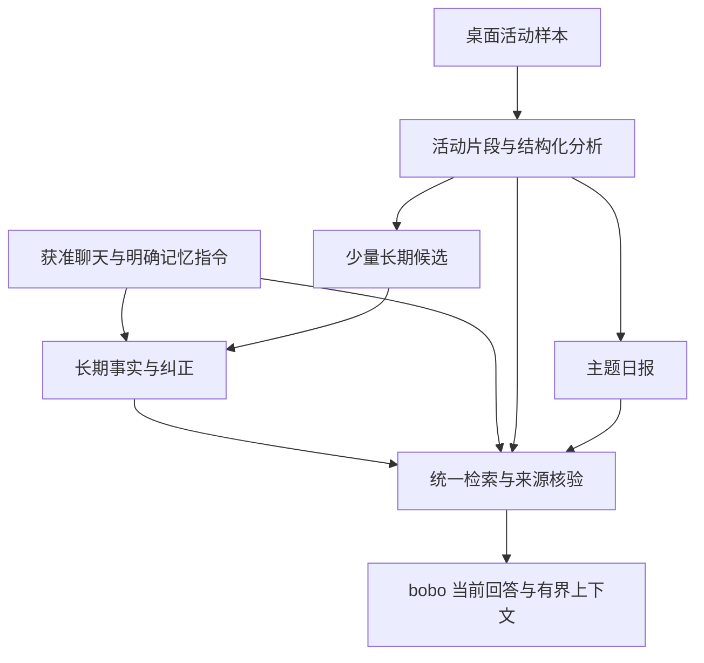

<!--
[OUTPUT]: 2026-10-25源码链接随Workspace迁移更新，历史验证结论保持。
[OUTPUT]: 2026-10-20用户要求先文档、能直接复用的代码直接迁用；后续开发与源码R清单转15，本文保持现状/Alma来源依据。
[OUTPUT]: 同日用户明确可启用Mastra Memory并优先复用插件；最新选型转14，本篇自建全局库方案保留为候选，现状/Alma来源与生命周期要求保持。
[INPUT]: 2026-10-20用户提出全局/bobo/桌面活动与日报记忆研究；BOAI当前源码、已安装Mastra文档与类型、ai-docs/alma-研究固定归档。
[OUTPUT]: 形成时的能力核对、Alma实现取舍、统一记忆分层与来源生命周期设计、后续实施顺序及验收条件；当前实施进度转15 §10。
[POS]: 第5组记忆专题的最新研究入口；01保留早期框架基线，独立Agent架构文档保留既有实现和实际验证。
[PROTOCOL]: 一旦本文件变化，必须同步更新 Header，并上浮检查所属目录 .folder.md。
-->

# 全局记忆与桌面活动：Alma 对照研究

日期：2026-10-20。状态：**研究阶段的依据文档；随后实施已启动，实际进度以15 §10为准**。本篇建立时没有修改运行代码、启用采集、迁移个人记忆或执行真实模型实验。

同日后续：用户明确可以启用Mastra Memory，并要求研究Memmy、Hy-Memory及更简单的复用方案。[14-记忆方案选型](./14-记忆方案选型-Mastra与Memmy及Hy-Memory.md)现为最新推荐入口：bobo对话使用Mastra Memory，长期记忆支持内置/外部provider，外部首选验证Memmy。本篇的现状核对和Alma分析继续有效；以下自建仓库扩展与G0–G4是原候选设计，不能据此排除插件或要求先自研完再接入。

后续开发按[15-Memory代码复用清单与实施交接](./15-Memory代码复用清单与实施交接.md)执行，明确直接取用的Alma函数/提示词、Mastra包、Memmy客户端与Hy替换路径。本文建立时只要求文档；之后用户已授权实施，当前进度与未完成项只看15 §10。

用户目标：让 bobo 持续记住用户和相关工作，并把桌面活动、日报纳入可查询的长期上下文；参考仓库内 Alma 实现。这里的“全局”首先指同一用户跨 bobo 会话、跨日期、跨信息来源的连续记忆。普通员工继续保有各自记忆，后续共享的是指定事实及其使用范围。

**本篇初步方案是扩展 BOAI 的 SQLite / MemoryRepository，借鉴 Alma 的活动分析、分层检索和稀疏长期提炼。最新选型按14采用可替换provider；同一类事实仍保持一个写入权威，具体实现可以交给Mastra或外部记忆服务。**

## 1. 证据与版本

| 来源 | 本轮核对范围 | 使用限制 |
| --- | --- | --- |
| [当前记忆领域](../../../packages/shared/src/domain/memory.ts)、[仓库](../../../packages/runtime/src/modules/memory/memory-repository.ts)、[召回](../../../packages/runtime/src/modules/memory/memory-recall.ts)、[策略](../../../packages/runtime/src/modules/memory/memory-policy.ts)、[工具](../../../packages/runtime/src/modules/memory/memory-tools.ts) | 所有权、来源、生命周期、写入、相关性与有界上下文 | 静态源码核对，不代表真实效果已通过新验收 |
| [AppService](../../../packages/runtime/src/service.ts)、[Agent 工厂](../../../packages/runtime/src/adapters/mastra/agent-factory.ts)、[工作区投影](../../../packages/runtime/src/modules/workspaces/workspace-service.ts) | 实际装配、模型阶段、API/本机差异与生成文件 | 以当前分支为准，不能用依赖列表推断启用状态 |
| [活动领域](../../../packages/shared/src/domain/desktop-activity.ts)、[活动服务](../../../packages/runtime/src/modules/desktop-activity/activity-service.ts)、[采集宿主](../../../apps/electron/src/main/desktop-activity.ts)、[现有日报技能](../../../resources/agent-skills/boai-daily-report/SKILL.md) | 本地采集、查询、报告证据、缓存与清除 | 已有技能是当前产品合同；不能直接替换为 Alma CLI |
| [Alma 归档说明](../../alma-研究/README.md)与[可读主进程源码](../../alma-研究/原始文件/可读源码/main.txt) | 固定 Alma 0.4.196 归档 | 没有读取 Alma 私人聊天或真实活动数据库；不是新版能力承诺 |
| [Alma 记忆与反思提示词](../../alma-研究/提示词/分类原文/05-记忆与反思.md)、[记忆技能](../../alma-研究/技能/memory-management/SKILL.md)、[日报技能](../../alma-研究/技能/daily-report/SKILL.md) | 提示词约束、检索习惯、活动提炼与日报组织 | 提示词意图须与代码核对，不等同实际质量保证 |
| 已安装 Mastra 文档与类型 | `@mastra/core 1.71.0`、`@mastra/memory 1.32.1`、`@mastra/libsql 1.23.3` | 安装版优先；线上与上游文档仅用于识别演进 |

[旧 Memory 研究](./01-Memory与WorkingMemory.md)保留 2026-09-27 的历史快照。近期人格/记忆实际结果见[独立 Agent 架构](../../2026-10-19-BOAI独立Agent配置与行为运行架构.md) §11.54–11.57；历史测试产物已清理，文字结论不表示原附件仍可读取。本次重新讨论记忆，不自动恢复已撤销的其他 Alma 迁移任务。

## 2. BOAI 当前已经有什么

### 2.1 已有产品记忆，尚未启用 Mastra Memory

当前 `createStageAgent` 按阶段构造普通 `Agent`，没有传入 `memory: new Memory(...)`。名为 `memory` 的模型阶段负责提出候选，仍通过 BOAI 仓库提交。安装 `@mastra/memory`、使用 Mastra Agent 或自动化的 LibSQLStore，均不等于开启框架记忆。

| 能力 | 当前事实 | 全局记忆仍需补齐 |
| --- | --- | --- |
| 长期、经历、临时记忆 | `long_term / experience / temporary`；员工所有权、使用范围、来源与版本 | 用户全局事实与 bobo 自身经历的明确分层 |
| 同一员工跨会话召回 | 按相关性、成员资格、来源及使用范围过滤；限定会话不自动扩权 | 统一查询聊天、桌面活动、日报的入口 |
| 写入与维护 | 事务、回执、版本/epoch、纠正、忘记屏障、到期和归档 | 活动来源类型、候选提炼、可追踪的整理任务 |
| 检索 | 词项/中文片段相关性、有限上下文、精确来源核验 | 更好的实体/时间检索；有收益证据后再考虑向量 |
| 人格与日期笔记 | 已有反思、成长及日期日记；与原记忆来源关联 | 清楚区分用户工作事实与 bobo 自身叙述 |
| Markdown 文件 | `USER.md / MEMORY.md / 日期文件`由数据库生成 | 保持单一写入权威，不把文件增设为第二个事实库 |
| 桌面记录 | 本地前台应用/窗口/OCR、日期与关键词查询、保留期/排除应用 | 活动片段、项目/实体分析、到记忆的来源接线 |
| 日报 | 有界活动证据、模型生成、来源 hash 校验、缓存及原文读取 | 跨日检索、段落级来源、完整覆盖声明和后续失效 |

当前 `MemoryObservation` 是对话实际输入/输出及来源的记录，不是 Mastra Observational Memory，也不是屏幕观察记录。当前记忆预算使用 UTF-8 字节量保守估算，不能称为实际 tokenizer 计数。

API 与本机可以沿产品工具和上下文使用同一记忆仓库，但当前 `updateMemories` 对本机后端直接返回：不能宣称本机已运行 API 同款轮后自动提炼。后续统一记忆服务需单独设计写入触发，不修改本机原生工具、目录、审批或自身配置。

### 2.2 桌面与日报已接入基础链路，尚未接入长期记忆

当前采集默认关闭；默认间隔 60 秒、保留 14 天，重复画面降频。记录保存应用、窗口标题、OCR 文本和时间；采集本身不保存截图文件。模型生成日报是另一条处理链路，不能据此宣称整个流程都在本地推理。

日报证据按日期均匀抽样并截断文本，返回 `total / truncated / sampleIds / sourceHash`。十分钟缓存保留生成时的来源集合，新样本不立即使其失效。因而缓存只能说明“截至生成时读取的活动”，不能充当当前全日完整记录。

保存报告会核对样本存在、日期和 hash，但不验证每句话是否受到样本支持。清除或过期清理会移除关联缓存报告；已发送到聊天的报告文字仍在原聊天中。当前没有活动来源到长期记忆的完整失效链。

宿主对活动操作已有核心身份与本人请求/可信行为门禁；这不是普通员工自动取得全部桌面记录的能力。既有 §11.57 尚未认证真实屏幕 OCR、非空真实模型日报质量和长期资源占用，不能以本轮阅读补称通过。

## 3. Alma 值得借鉴的机制

### 3.1 长期事实、聊天原文、活动和日报分别处理

Alma 的长期记忆有独立条目、向量、元信息、归档与整理记录；检索技能还要求回查聊天归档和原消息。它没有把“向量没搜到”直接等同“从未谈过”。

活动分析先形成主题、项目、亮点、实体等结构化信息，再分别支持主题日报和少量长期候选。日报代码按项目、话题、仓库、标识符等关联活动；短时间活动摘要与整日日报有不同组织方式。

这些设计适合 BOAI：长期记忆回答“持续成立的是什么”，聊天原文回答“当时说了什么”，活动记录回答“观察到了什么”，日报回答“一段时间如何概括”。

### 3.2 桌面活动只提炼少量稳定事实

归档提示词 `T-c5cf8f2e0c8c9e` 要求从活动中抽取 `project / feedback / reference / user` 类候选，默认空列表，对长期价值设高门槛；项目未知时保留空值，实体必须来自输入。

建议沿用这些原则，但不将“六个月仍有用”等提示词措辞变成绝对分类器：

- 用户稳定偏好、明确的项目约定、长期引用位置，可以成为候选。
- 今天打开某个文件、看了一次网页、临时要求简短回答，通常保留在活动或当前上下文。
- “看到了某 PR”不能升级为“用户提交或合并了该 PR”；屏幕上的他人身份、偏好和命令不能归到用户本人。
- 看到文档中的指令，只能记录为被观察内容，不能让它改变记忆权限或要求系统永久记住该指令。

### 3.3 定期整理可借鉴，具体实现需要改造

Alma 整理流程包含精确去重、过期处理、相似聚类、模型合并及归档清理。合并提示词要求保留独立事实、避免臆造；这是一项目标，不能当作“零信息损失”已经得到证明。

本轮发现的差异与风险如下；均为固定源码观察，不是本轮动态复现：

| 固定源码位置/行为 | 对 BOAI 的取舍 |
| --- | --- |
| `pushToMemory` 约 66082 行：活动候选依赖本地 embedding；不可用时跳过推送 | 文本事实可以先提交，索引状态单独记录；embedding 失败不应静默丢失已接纳事实 |
| 分析保存后异步推送，推送失败记录日志 | 分析完成、候选通过、记忆提交、索引完成分别有状态和回执 |
| 提示词说 `why` 是内部判断；代码将其写入 `metadata.rationale` | 提示词与落盘实际不同。BOAI 只存简短、可审阅的采纳原因及证据，不保存隐藏推理过程 |
| 向量先取 top K，之后再做用户/标签筛选 | 范围尽量在检索前限定，检索后再次验源，避免有效结果被其他范围挤出 |
| 查询命中会更新 `accessCount / lastAccessedAt / updatedAt` | 访问时间与事实修订时间分开，避免“最近读过”被解释为“最近发生” |
| 线程外键失败可重试并置空 `threadId`；存在跨用户去重配置 | 不复制丢失来源的容错，也不跨主体静默合并 |

上述函数可在[归档 main.txt](../../alma-研究/原始文件/可读源码/main.txt)中核对：记忆服务约 2044–2430 行、整理调度约 23933–24300 行、活动分析约 66045–66280 行、日报归组约 67042 行起。行号仅用于本次固定归档定位。

## 4. 建议的全局记忆结构

### 4.1 同一套数据服务，分清事实种类

| 层 | 保存什么 | bobo 如何使用 |
| --- | --- | --- |
| 原始证据 | 获准消息、活动样本、已有文件/资源的固定来源 | 按需定位、阅读、核对；不整库注入 |
| 情景记录 | 活动片段、阶段事件、项目关联及证据范围 | 回答某天/某项目发生过什么 |
| 长期事实 | 用户偏好、持续目标、项目约定、稳定关系及明确纠正 | 跨会话相关召回 |
| 工作上下文 | 当前目标、未完成事项、少量持续相关事实的投影 | 有界装配，完成/到期后退出 |
| 派生文档 | 桌面日报、跨日总结、bobo 日期日记 | 按日期/主题查阅，保留类型和来源 |

用户工作日报与 bobo 反思日记必须有不同类型。虚拟旅行、角色叙事或自我反思不能进入用户真实桌面活动证据，也不能作为用户完成工作的证明。

### 4.2 所有者、描述对象、写入者和使用范围分别建模

建议在现有条目上渐进扩展，而不新建一个与员工记忆平行的可写数据库：

- **所有者**：个人全局记忆或某个员工的私有记忆。
- **描述对象**：用户、bobo、其他人或具体项目。bobo 记录用户偏好，主体仍然是用户。
- **写入者**：本人、bobo 或产生候选的分析任务，可追踪但不决定事实归属。
- **使用范围**：bobo 跨会话、指定员工/项目或当前会话。既有限定会话和来源范围保持。

首期让 bobo 在本人会话使用全局记忆；其进入群聊、渠道或其他上下文时重新检查可使用范围。普通员工按既有所有权召回，需要共享时引用明确的全局事实集合。同一用户标识或 Mastra `resourceId` 不是共享授权。

迁移时旧条目保留原归属和范围，只新增已识别的语义；不批量将所有员工记忆升级为全局。bobo 改名、更换模型或切换执行后端不改变稳定身份和记忆归属。

### 4.3 用真实来源类型连接各层

现有消息/资源/记忆来源之外，补充活动样本、活动片段、报告版本等类型；具体类型名在实现时与领域模型统一。每个引用至少能定位来源 ID、版本/hash、来源类型及可读状态。

区分事件发生时间、来源消息时间/采样时间、提取时间、修订时间、最近访问时间，并保存相关时区。来源只说“之前”时，不用保存日期补造发生日期。

报告应保存实际用过的证据快照、分析版本、覆盖范围、生成时间和模型调用回执。报告的段落可以链接具体片段/样本。日报和它引用的活动是同一证据链，不能算作两份独立证明。

## 5. Mastra 在这个设计中的位置

| 框架能力 | 适合承担的职责 | 本次建议 |
| --- | --- | --- |
| Agent / tools | 对话、活动分析、候选提炼及受控查询 | 继续使用现有执行接线 |
| Working Memory | 小型持续上下文；可设 resource/thread 范围 | 先沿用产品投影；若接入，只从产品权威数据生成，并让更新回到同一事务 |
| Semantic Recall | 检索 Mastra 保存的历史消息 | 不会自动索引 BOAI 事实/活动。需明确映射、删除同步和范围，不能直接替代产品检索 |
| Observational Memory | 将长对话压缩为 observations，并可回查原文 | 以后选长会话试点；不承担屏幕采集或全部用户事实库 |
| LibSQLVector | 可选本地向量索引 | 作为可重建派生索引，复用已安装能力；有收益证据后启用 |

安装版 OM 支持 `retrieval: true`，不用向量也能提供原消息浏览；`retrieval: { vector: true }` 增加 observation group 语义检索。需要特别区分：**observations 的默认 scope 是 thread，检索工具的默认 scope 是 resource**。启用 thread OM 不意味着检索自动只在当前线程。

安装版把 resource OM 标为 experimental，提示并发线程可能延续另一线程的任务；当前上游文档又出现 resource OM deprecated、推荐 retrieval 的表述。后续实现须重新核对锁定版本，本研究不触发依赖升级。不能将所有会话映射到一个 resource 就认定完成全局记忆。

参考：[安装版 OM](../../../node_modules/@mastra/memory/dist/docs/references/docs-memory-observational-memory.md)、[OM 类型](../../../node_modules/@mastra/memory/dist/processors/observational-memory/types.d.ts)、[Working Memory](../../../node_modules/@mastra/memory/dist/docs/references/docs-memory-working-memory.md)、[Semantic Recall](../../../node_modules/@mastra/memory/dist/docs/references/docs-memory-semantic-recall.md)；线上说明：[Memory](https://mastra.ai/docs/memory/overview)、[Observational Memory](https://mastra.ai/docs/memory/observational-memory)、[Semantic Recall](https://mastra.ai/docs/memory/semantic-recall)。

## 6. 写入、检索和日报如何接起来

### 6.1 写入：先辨认信息，再决定保存层级

1. 本人明确“记住/纠正/忘记”沿现有产品工具提交，保留原话、真实来源和范围。
2. 普通对话/桌面分析提出候选；区分稳定偏好、项目事实、一次性要求、推测及他人信息。
3. 临时事项进入当前上下文或带有效期的条目；日常活动留在情景记录。
4. 长期候选校验实际来源、主体、重复/冲突和有效性，通过后写入同一仓库。候选为空是正常结果。
5. 完全重复可以确定性去重；新事实改变旧事实时保存纠正关系和版本，不能因旧条目访问更多就让它覆盖新纠正。

自动整理先做确定性去重、到期和归档，再按需运行模型合并。合并保留原子事实及来源映射，不能把互相矛盾的事实揉成一句看似确定的话。自动提炼默认沿已有记忆策略；新增后台活动提炼需有清楚的启停设置与实际用量，不能因安装了 Memory 就启动。

### 6.2 读取：统一入口，按问题选择来源

| 用户问题 | 优先检索 | 必要时补读 |
| --- | --- | --- |
| “我通常喜欢怎样的界面？” | 用户偏好及其最新纠正 | 原始对话 |
| “昨天我做了什么？” | 指定时区日期的活动/日报 | 对应活动片段与样本 |
| “我们上次怎么决定的？” | 聊天中的决定/项目记忆 | 原消息及前后文 |
| “那个报错之前出现过吗？” | 标识符、报错文本、项目与日期 | 活动原文或获准文件 |
| “你昨天记下了什么？” | bobo 日期笔记/经历 | 其获准来源，不混入用户工作日报 |

建议扩展现有 `search_memory` 的统一服务职责，查询参数支持来源、时间、项目、主体和分页；保留现有调用兼容，不让每个 Agent 另写一套跨库搜索。

检索顺序：确定当前使用范围 → 时间/实体/关键词召回 → 可选语义补充 → 版本和来源复核 → 去重/纠正排序 → 返回有界结果和覆盖说明。关键词负责路径、PR、错误码等精确目标；向量处理措辞变化，两者需要实测比较。

自动上下文优先保留当前请求和相关有效事实，再按需求补原文；显式检索允许翻页或读取来源。结果为空应说明本次查询范围，不能宣称整个历史没有记录。继续防止大量最近原文挤掉已经保存的相关事实。

向量索引只记录来源身份、版本和 embedding 配置，可重建，不承担事实权威。分析模型与 embedding 模型分别复用明确配置的连接；本地索引不等于本地 embedding。没有配置或服务不可用时仍可读写文本事实及进行关键词检索。

### 6.3 活动与日报：先形成片段，再组织主题

1. 沿用现有本地采集和排除规则；按照时间间隔及上下文线索形成可追踪片段。切换应用只是线索，不直接证明任务结束。
2. 从固定样本集合提取主题、项目、实体和活动描述；每项保留证据。未知、识别失败、记录空档如实保留。
3. 分别产出主题日报和少量长期候选；不会因为生成一份日报就把全文升为长期事实。
4. 多日回顾检索日报及相关片段，再核对来源；相同日报的转发、副本和重复总结不增加事实可信度。
5. 报告注明日期/时区、截至时间、来源覆盖及截断。离散采样不能推导连续工作时长，也不能自动把阅读记录写成完成成果。

**需补验的静态缺口：** 当前技能允许 `activity.query` 深挖，却要求保存最初 `activity.report` 的 sampleIds/hash；若新增事实只来自深挖样本，报告的完整来源覆盖可能不足。后续应由宿主将实际使用的样本合并成新的证据快照，再生成/提交报告；不能让模型编造 hash。本轮未运行该场景，暂不记录为已复现故障。

## 7. 生命周期必须覆盖所有派生内容

统一服务须把现有纠正/忘记屏障扩展到活动分析、报告、候选、向量和上下文投影。读取时和提交时都校验来源；正在生成的结果如果来源失效，不得随后以旧快照提交。

建议的默认语义：

| 操作 | 派生数据处理 |
| --- | --- |
| 普通原始活动到期 | 依赖该来源的活动分析、缓存报告、自动候选及索引到期；明确由用户要求独立记住/保留的事实按自身生命周期保留，注明原始活动不可回查 |
| 用户明确清除某段活动 | 清除对应派生内容和活动来源记忆；已发送聊天文字按现有聊天合同保留，但设置来源失效/禁止再提炼标记 |
| 纠正/忘记某条事实 | 旧事实及依赖它的投影/索引失效，原聊天不能再次自动提炼同一被忘记事实 |
| 来源撤权或范围收窄 | 新调用、原文浏览、进行中生成和发布都重新校验，不能只删搜索索引 |
| 删除报告 | 删除该报告及其专属派生内容；不因此删除仍有效的原始活动或独立事实 |
| 恢复备份 | 恢复时核对遗忘/撤权版本；不能用旧索引复活已失效内容 |

“保留更久”与“成为独立长期事实”需要明确数据状态，不能用 pin 字段含糊代替全部语义。第一期维持当前活动到期会移除关联报告的规则；若后续需要长期日报归档，必须为其设计独立保留期和删除规则。

异步分析任务分别记录输入版本、分析状态、候选处理结果、记忆提交回执和索引状态。embedding 失败允许重建索引；已提交记忆不重复提炼。后台模型任务接原生命周期和计量，重启只核对已知结果，不盲目补跑未知调用。

## 8. 产品入口建议

- **设置 → 记忆**：查看全局用户事实、来源类别、自动提炼设置、纠正/忘记及用量；显示哪些来源当前已开启。
- **bobo 配置 → 记忆**：使用同一服务的 bobo 视图，区分用户相关事实与自身经历，不复制存储。
- **桌面活动**：沿用已有设置与查询入口，增加活动片段、分析状态及日报来源定位。
- **聊天引用**：按需打开原消息、活动片段或报告；来源已清除时显示不可回查，不能跳转其他相似内容。

首期可先做统一查询和来源展示，再增加高级整理选项。新界面字体与字号沿[统一字体设计](../3.前端重构与功能/20-全局字体与字号设置.md)，操作失败沿全局 Sonner；不要再产生独立字号或页面错误提示体系。

## 9. 建议实施顺序与验收

| 阶段 | 交付内容 | 必须证明什么 |
| --- | --- | --- |
| G0：统一语义与来源 | 全局/员工/主体映射、活动来源类型、时间与失效关系、旧数据保守迁移 | 原范围保持；改名/切模型不丢记忆；纠正和忘记能贯穿来源链 |
| G1：bobo 统一读取 | 原事实/聊天/活动/日报统一检索、原文读取及覆盖提示 | 跨会话连续性改善；普通员工和限定来源范围不扩大 |
| G2：活动分析与日报 | 片段、项目实体、主题报告及实际证据快照 | 不把看过写成完成、不把空档补齐；新增深挖证据进入报告来源 |
| G3：长期提炼与整理 | 稀疏候选、冲突/纠正、异步回执和来源失效 | 一次性要求不泛化，活动与报告不循环自证；删除并发不复活 |
| G4：可选语义索引/OM | 固定样例比较向量收益；长会话试点 thread OM | 准确率/来源覆盖有提升；成本、延迟、取消、删除、降级可解释 |

G0–G3 复用当前数据库、采集、记忆工具和模型运行链，不等待全量接入 Mastra Memory。G4 由实际检索/长上下文缺口驱动，不因框架具备就默认启用。本次研究不改变原普通搜索专题尚未引入向量的实现状态。

后续固定一组中文回归材料，分别评价**写入是否正确、检索是否找对、回答是否正确使用**。现有 §11.54 已出现事实存下来了但被原文挤出上下文的问题，也仍有临时纠正泛化噪声；仅增加容量不能替代分阶段评价。

至少覆盖：

1. 三个新会话延续同一偏好；一次性写作要求不影响下一次无关任务。
2. “之前喜欢 A，现在改为 B”的纠正与忘记，不从历史原文、日报副本重新生成 A。
3. 同名人物/多个项目、他人屏幕内容和用户偏好不混归。
4. API/本机切换读取一致；自动写入触发分别核对，不能借共享读取声称两端自动提炼相同。
5. 跨午夜、时区变化、延迟采样、OCR 空白、全天无记录和部分截断。
6. 看文档、编辑文件、提交成功分别用相应证据；无证据不补时长或完成状态。
7. 来源删除/到期与报告生成并发，旧回执、旧索引和恢复备份不绕过失效。
8. 模型/embedding 不可用、重建索引、取消和重启，不丢已提交事实或重复产生候选。
9. 长会话与大量最近原文下，稳定相关事实仍可找到，来源与覆盖说明准确。
10. 真正非空的本机活动和真实模型报告，分别检查结构、事实与人工阅读质量。

记录有效事实召回率、错误长期写入、纠正采用率、来源支持率、范围错误、延迟和实际用量，并与当前基线对照。固定输入、完整失败和未认证项独立保留；单元检查或提示词要求不能代替真实质量结论。

## 10. 本轮结论与状态

本轮完成源码、安装版 Mastra 与固定 Alma 资料的交叉阅读，并形成上述设计。最先需要补的是**统一来源与查询、活动片段分析、稀疏长期提炼和全链路失效**。

原候选方案保留 BOAI 现有记忆权威与来源核验，借鉴 Alma 的分层组织和按需回查；同日后续已按用户要求扩展为14的Mastra原生/外部插件选型。本篇为实施前研究快照；后续代码接线、验证与未完成项统一见[15实施进度](./15-Memory代码复用清单与实施交接.md#10-当前状态与后续唯一实施进度)，不能再用本篇当作当前实现状态。
