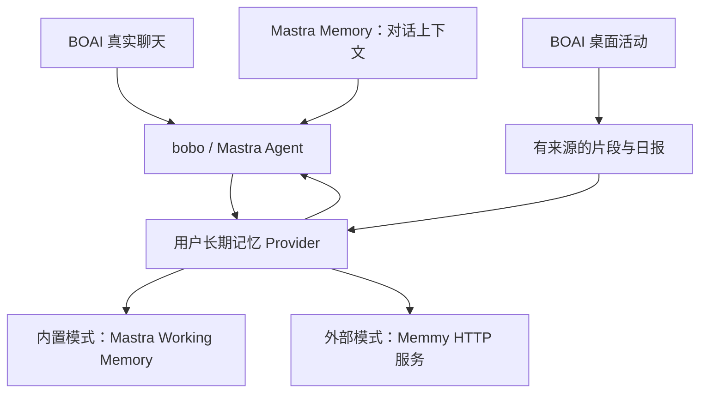

<!--
[OUTPUT]: 2026-10-20用户要求能抄直接抄、以后实现；具体源码清单/接入文件/开发阶段转15，本文维持选型依据，复用客户端与独立片段获明确方向。
[INPUT]: 2026-10-20用户明确可启用Mastra Memory、优先复用成熟组件/插件，指定Hy-Memory与memmy-agent，并要求比较更简单的用户长期记忆方案。
[OUTPUT]: 固定源码与官方资料对比、Mastra原生/外部Memmy两条方案、插件适配职责、活动证据接入与验证顺序；替代13中默认必须自建全局记忆的选型倾向。
[POS]: 第5组最新记忆选型入口；13维护BOAI/Alma现状和分层研究，本文维护组件选择与复用路线。
[PROTOCOL]: 一旦本文件变化，必须同步更新 Header，并上浮检查所属目录 .folder.md。
-->

# 记忆方案选型：Mastra、Memmy 与 Hy-Memory

日期：2026-10-20。状态：**本篇保留选型依据；实施已启动，实际进度与外部模式启用门槛以15 §10为准；个人记忆未迁移**。固定Memmy 2.1.6缺按来源轮次级联撤销接口，不能在当前忘记合同下直接开放为生产provider。

当前实现以[15-Memory代码复用清单与实施交接](./15-Memory代码复用清单与实施交接.md)为主入口。用户已明确原包/服务可直接用、独立源码能迁用就迁用；R编号原件、接入位置、开发阶段和唯一后续进度统一归15。

用户补充明确了选型原则：Mastra Memory 可以启用；用户长期记忆可以交给外部插件；已有组件能解决的问题直接复用，避免维护完整记忆引擎。本文据此调整[13 的初步方案](./13-全局记忆与桌面活动-Alma对照研究.md)：保留其来源与分层要求，但不再把自建 `MemoryRepository` 作为未来所有记忆的强制存储实现。

## 1. 推荐结论

**建议 bobo 的对话上下文采用 Mastra Memory；用户长期记忆支持可替换 provider，外部服务首选验证 Memmy。只在 BOAI 内使用时，Mastra 自身也是最简内置方案。桌面采集与日报继续沿现有产品链路，借鉴 Alma 的组织方式，并通过真实活动证据接入所选 provider。**

2026-10-20实施决策：本期采用**内置路径**。Mastra保存可重建的bobo公开会话投影与Working Memory输入，原有来源/纠正/忘记事务库继续作用户长期事实权威；桌面活动使用Alma组织规则和独立有期限的来源检索。Memmy固定版缺可信来源轮次级联遗忘，本期不开放外部切换；这属于可选后续扩展，不阻断内置方案交付。内置事实权威保留原库是为了不丢现有来源失效合同，不表示继续开发一套新提炼算法。实际代码与验证见15 §10。

| 使用目标 | 推荐选择 | 理由 |
| --- | --- | --- |
| 让 bobo 连续对话、跨会话记住少量偏好，尽量减少运行组件 | **Mastra Memory 内置模式** | 已安装 TypeScript 依赖及 LibSQL；框架支持历史、Working Memory 和长对话压缩 |
| 希望 BOAI、Codex、Claude 等共用用户记忆，减少算法/索引/整理维护 | **Memmy 外部 provider 插件** | 独立本地服务、现成宿主集成、管理页、用户记忆及外部活动证据接口 |
| 专门研究复杂用户画像、冲突演化、工作/代码经验 | **Hy-Memory `pro` 对照候选** | 画像与分层事实能力更明确；Python 与存储依赖增加桌面分发成本 |
| 希望直接嵌入一个通用事实提取库，自己提供 UI 和生命周期 | **Mem0 TypeScript OSS 备选** | 可以作为库接入；完整产品管理与外部来源链仍需宿主负责 |
| 希望桌面日报与人格记忆更自然 | **Alma 作为产品/提示词参考** | 固定归档提供了活动分段、主题报告、稀疏提炼的可读实现 |

这是一项基于接口、现有技术栈和维护范围的工程推荐。没有在同一中文资料集上实测这些方案，不能据此宣称 Memmy 的记忆准确率高于 Hy-Memory 或 Alma。

“插件化”可以减少记忆算法维护，但仍要维护 BOAI 的身份映射、事件接入、来源删除、错误处理和版本兼容。选择一个 provider 后，它承担该类长期事实的写入权威；不让两个引擎同时修改同一用户画像。

## 2. 核对基线

| 项目 | 本轮固定依据 | 已确认范围 |
| --- | --- | --- |
| Mastra | 本项目 `core 1.71.0 / memory 1.32.1 / libsql 1.23.3` 的安装文档及类型 | 已安装，当前 Agent 未启用；可以接入，存在产品历史/内部阶段适配工作 |
| Memmy | [`8cd095c7f67300b6582a912bdd7fd33163d5e5b4`](https://github.com/MemTensor/memmy-agent/tree/8cd095c7f67300b6582a912bdd7fd33163d5e5b4)，提交时间 2026-10-19 UTC；Memory 工作区版本 `2.1.6` | TypeScript 本地服务、客户端、接口、用户记忆、活动证据与检索实现 |
| Hy-Memory | [`8f1c4045e913566a6f40eb4451d68218b2307773`](https://github.com/Tencent-Hunyuan/Hy-Memory/tree/8f1c4045e913566a6f40eb4451d68218b2307773)，提交时间 2026-10-20 UTC；SDK 源码版本 `2.0.4` | Python SDK、HTTP 服务、插件目录、MemHub 架构和数据处理说明 |
| Mem0 | [`0724291bd864cf807e88ee8981c8226644e8fb42`](https://github.com/mem0ai/mem0/tree/0724291bd864cf807e88ee8981c8226644e8fb42)，提交时间 2026-10-14 UTC；TS 包源码版本 `3.3.1` | 官方 Node 用法、配置默认值和本地向量存储实现 |
| Alma | [本仓库固定 0.4.196 资料](../../alma-研究/README.md) | 延续13的静态分析，本轮不重新读取个人数据 |

源码分支、工作区版本和已发布安装包是不同对象。特别是 Hy 根 README、使用指南、MemHub README 中存在不同版本号，后续必须按实际采用的发布版本核对；本文不提供可直接执行的安装命令，不把 main 分支接口视为所有旧安装包都具备。

GitHub 最新发布元信息也已核对：[Memmy v1.2.3](https://github.com/MemTensor/memmy-agent/releases/tag/v1.2.3)于2026-10-19发布，`target_commitish`与本轮固定提交相同，列有macOS arm64/x64安装包；这是App版本，与Memory工作区的2.1.6分别记录。[MemHub v1.0.4](https://github.com/Tencent-Hunyuan/Hy-Memory/releases/tag/v1.0.4)于2026-10-18发布，当前资产列有macOS arm64及Linux arm64/x64 runtime；不根据README中的目标平台承诺未列出的制品。本轮未下载或启动这些安装包。

仓库许可证核对：Memmy 根目录为 [MIT](https://github.com/MemTensor/memmy-agent/blob/8cd095c7f67300b6582a912bdd7fd33163d5e5b4/LICENSE)，Hy 根目录声明 [Apache-2.0](https://github.com/Tencent-Hunyuan/Hy-Memory/blob/8f1c4045e913566a6f40eb4451d68218b2307773/LICENSE)，Mem0 为 [Apache-2.0](https://github.com/mem0ai/mem0/blob/0724291bd864cf807e88ee8981c8226644e8fb42/LICENSE)，本项目 Mastra 安装包也声明 Apache-2.0。Alma 的本地研究归档不等同于获准再分发的 SDK。

## 3. 各方案真正提供什么

### 3.1 Mastra：最贴合 bobo 的内置对话记忆

Mastra 的持久历史、resource 范围 Working Memory、Semantic Recall、Observational Memory 都是可用组件。用户全局偏好规模较小时，可以直接使用结构化 Working Memory；不必先建设独立向量检索服务。长对话可以使用 thread 范围 OM，并按需回查其他获准线程。[官方概览](https://mastra.ai/docs/memory/overview)、[Working Memory](https://mastra.ai/docs/memory/working-memory)。

实际接入需完成：

- 为 bobo 的公开对话稳定映射 `thread` 与 `resource`，生命周期不随每次阶段 Agent 重建而重置。
- 明确一次历史装配和一次提交；不能同时传完整产品历史、加载框架同一份历史、再重复保存。
- 私有判断、记忆提炼、报告候选、被取消/未发布回复不作为用户公开历史自动沉淀。
- 模型调用、取消、退出、删除与后台压缩沿宿主生命周期；存储投影可重建。

建议在“内置模式”由 Mastra Working Memory 管理小型用户画像、OM 管理长对话上下文，逐步退役被替代的自建自动提炼路径。在“外部 Memmy 模式”里，用户事实由 Memmy 管理，Mastra 仅保存对话上下文/任务状态；若使用 Working Memory，则只读映射相关事实或限定为其他职责，避免并行修改画像。

安装版 OM 的观察 scope 默认 thread，而 retrieval 默认可跨同一 resource；两者必须分别设置。上游最新文档已将 resource OM 标为 deprecated，建议 thread OM 配合 retrieval/Working Memory；本项目安装文档仍写 experimental。按锁定版本实现，不照搬不同版本的示例。[安装版 OM](../../../node_modules/@mastra/memory/dist/docs/references/docs-memory-observational-memory.md)、[上游说明](https://mastra.ai/docs/memory/observational-memory)。

Mastra 不是现成的跨应用记忆桌面软件。对于 BOAI 之外的宿主、桌面活动证据、统一管理与删除传播，仍需产品接线。

### 3.2 Memmy：外部插件首选

Memmy 同时提供 Agent 产品和可独立运行的 Memory Service。BOAI 可以只连接 Memory Service，保留自己的 Agent、会话、工具和 UI，不必迁入 Memmy Agent Runtime。

已核对服务默认 localhost HTTP、SQLite 持久存储、CLI 和管理页。Memory 工作区是 `private: true`，并非可假定直接 `npm install @memmy/memory` 的稳定公共 SDK；适合以受支持安装包/独立服务及 HTTP 合同对接。现有服务包含 native SQLite、sqlite-vec、可选本地 embedding 等依赖，独立进程能减少与 Electron ABI 的耦合。[Memory 说明](https://github.com/MemTensor/memmy-agent/blob/8cd095c7f67300b6582a912bdd7fd33163d5e5b4/Memory/readme.md)、[包配置](https://github.com/MemTensor/memmy-agent/blob/8cd095c7f67300b6582a912bdd7fd33163d5e5b4/Memory/package.json)。

可复用接口：

| 接口/机制 | BOAI 对接用途 |
| --- | --- |
| session open/close、turn start/complete | 在真实对话前召回、完成后记录；映射稳定会话/轮次 |
| memory search/add/get/delete | 查询、明确保存、来源详情与删除 |
| 用户事实/偏好记录与纠正字段 | 用户长期记忆，独立于 Agent 任务轨迹 |
| evidence sync/status | 接收 BOAI 的被动活动证据，查询异步处理状态 |
| panel 与变更/回执数据 | 复用管理能力，或在 BOAI 展示受支持的必要内容 |

[简版 API 文档](https://github.com/MemTensor/memmy-agent/blob/8cd095c7f67300b6582a912bdd7fd33163d5e5b4/docs/en/reference/memory-api.mdx)没有完整列出新能力；实际还需核对 [HTTP 路由](https://github.com/MemTensor/memmy-agent/blob/8cd095c7f67300b6582a912bdd7fd33163d5e5b4/Memory/src/server/http.ts)和[请求类型](https://github.com/MemTensor/memmy-agent/blob/8cd095c7f67300b6582a912bdd7fd33163d5e5b4/Memory/src/types.ts)。

**对桌面活动最有价值的发现：** `syncExternalEvidence` 已接收 `sourceRecordId / revision / startedAt / endedAt / provenance / parentSourceRecordIds`，以 `observed_activity` 保存，支持版本去重、删除墓碑和派生活动撤回。无需把屏幕文本伪装为用户消息。[服务实现](https://github.com/MemTensor/memmy-agent/blob/8cd095c7f67300b6582a912bdd7fd33163d5e5b4/Memory/src/service/memory-service.ts#L1991)。

活动处理已有“有用的工作上下文/决定/约束/待办/阻碍/进展”提炼，并核对短引文与来源；提示词明确不从屏幕推断稳定偏好或把尝试当完成。处理完成和原始证据入库分别有状态。这比只复用一个向量搜索接口更接近 BOAI 的实际需要，但仍须验证上游生成质量。[活动分析管线](https://github.com/MemTensor/memmy-agent/blob/8cd095c7f67300b6582a912bdd7fd33163d5e5b4/Memory/src/service/evidence/observation-memory-pipeline.ts)。

用户记忆也不是只有宣传文字：存在独立 `UserMemoryRecord`、原始轮次引用、替代关系及用户级召回。但检测规则中包含中英文模式匹配，不能据此承诺复杂隐含偏好、一次性例外或跨句纠正一定正确。[用户记忆规则](https://github.com/MemTensor/memmy-agent/blob/8cd095c7f67300b6582a912bdd7fd33163d5e5b4/Memory/src/service/user-memory/user-memory.ts)、[检索实现](https://github.com/MemTensor/memmy-agent/blob/8cd095c7f67300b6582a912bdd7fd33163d5e5b4/Memory/src/service/retrieval/retrieval-service.ts)。

Memmy 的上层整理还包含任务轨迹、经验策略、环境知识和技能演化；这比简单用户偏好库复杂。BOAI 第一阶段只接必要能力，不把自动技能演化接进员工技能管理，也不同时安装另一套桌面采集。模型总结/演化与 embedding 分别配置，不能将“本地数据库”称为“所有处理都离线”。[记忆流程说明](https://github.com/MemTensor/memmy-agent/blob/8cd095c7f67300b6582a912bdd7fd33163d5e5b4/docs/en/memory/overview.mdx)。

当前 Codex 开发环境存在 `memmy-memory` 技能，说明开发工具有集成说明；它不证明 BOAI 已连接 Memmy，也不证明当前运行服务与本轮源码版本相同。本轮没有读取或改动用户的 Memmy 私人记忆。

### 3.3 Hy-Memory：用户画像研究有价值，运行组件更多

Hy-Memory 的 chat 路径提供原始对话、事实、摘要、基础画像和更高层结构；working/coding 路径处理工具执行轨迹与可复用经验。不是所有命名层级都已实现：README 中 L4/L5 标为 reserved。

建议比较时使用 `pro`：具备模型提取与冲突协调，图存储可关闭。`lite` 主要是原文向量检索，不等于完整长期事实提炼；`ultra` 需要图能力并增加显式演化，当前需求不必从它开始。它支持兼容模型端点，**不要求先部署 Hy 的 30B 模型**。[项目说明](https://github.com/Tencent-Hunyuan/Hy-Memory/blob/8f1c4045e913566a6f40eb4451d68218b2307773/README.md)。

值得关注的接口细节：

- 原记忆按 user/agent/session 区分，用户画像单独按 user 聚合，符合“用户长期记忆不属于某一次聊天”的需求。
- 需要随结果读回的业务来源放在 `meta`；`metadata` 是处理选项，不能混用。
- 支持 source 过滤和明确 CRUD；混合来源结果有特殊规则，BOAI 需映射具体来源可用性。
- working/coding 输入需要真实工具轨迹，不能为 OCR 活动编造 tool call 来满足分类。

[使用指南](https://github.com/Tencent-Hunyuan/Hy-Memory/blob/8f1c4045e913566a6f40eb4451d68218b2307773/docs/usage.md)。

纯 SDK 是 Python，核心依赖包含 ChromaDB、Kuzu、numpy 等；即使 `pro` 不启用图，安装依赖和打包成本仍需计算。已有 [HTTP 服务](https://github.com/Tencent-Hunyuan/Hy-Memory/blob/8f1c4045e913566a6f40eb4451d68218b2307773/hy_memory/server.py)，可以作为独立进程接入，不必另写 Python RPC。[依赖清单](https://github.com/Tencent-Hunyuan/Hy-Memory/blob/8f1c4045e913566a6f40eb4451d68218b2307773/pyproject.toml)。

同仓库 **MemHub** 是 Hy 引擎之上的共享记忆产品，提供来源、治理、宿主桥及桌面/CLI，README 明确仍处 preview。根 `plugins/` 当前主要提供 OpenClaw 插件，hook/MCP 目录标为预留；不能把 MemHub 的宿主桥能力冒认为纯 SDK 已有通用 Mastra 插件。[插件清单](https://github.com/Tencent-Hunyuan/Hy-Memory/blob/8f1c4045e913566a6f40eb4451d68218b2307773/plugins/README.md)、[MemHub](https://github.com/Tencent-Hunyuan/Hy-Memory/blob/8f1c4045e913566a6f40eb4451d68218b2307773/memhub/README.md)。

MemHub 明确不采集屏幕/OCR等活动。BOAI 采用它仍需自己的活动证据接入，因此本轮没有发现它比 Memmy 更直接的桌面记忆接法。[MemHub 数据说明](https://github.com/Tencent-Hunyuan/Hy-Memory/blob/8f1c4045e913566a6f40eb4451d68218b2307773/memhub/PRIVACY.md)。

### 3.4 Mem0：值得保留的轻量库备选

补充比较了 Mem0 官方 TypeScript OSS，入口为 `mem0ai/oss`，提供提取、搜索及 CRUD；它适合想直接嵌入事实引擎、自己负责产品 UI 的场景。[官方 Node 指南](https://docs.mem0.ai/open-source/node-quickstart)。

这里也有文档与源码差异：部分说明称 Node 默认是 in-memory vector store，但本轮固定源码中名为 `MemoryVectorStore` 的实现实际使用 `better-sqlite3` 落盘。因此不能仅凭类名认定重启丢失，也不能把 Python 默认 Qdrant 配置套到 TS。[默认配置](https://github.com/mem0ai/mem0/blob/0724291bd864cf807e88ee8981c8226644e8fb42/mem0-ts/src/oss/src/config/defaults.ts)、[向量存储源码](https://github.com/mem0ai/mem0/blob/0724291bd864cf807e88ee8981c8226644e8fb42/mem0-ts/src/oss/src/vector_stores/memory.ts)。

对本项目而言，它减少的是提取/更新/检索算法工作；跨应用宿主集成、桌面活动来源链、异步作业和管理体验仍要补。已有 Mastra 加上可独立连接的 Memmy，暂时没有足够收益同时引入第三套引擎。

## 4. 推荐的接入结构

图中的内置/外部长期 provider **择一生效**。外部模式下，Mastra 对话记忆仍可保留当前交流上下文，但不能把已经忘记或撤回的 provider 事实继续藏在旧 Working Memory/OM 中。对涉及遗忘的对话投影需失效、重建或阻断，具体行为必须验收。

### 4.1 直接复用原服务与必要客户端代码

首个外部插件连接用户已有的 Memmy 本地服务，使用公开 HTTP；按15直接迁用所需客户端/类型和必要依赖，提炼/存储/检索由原服务运行。Alma可独立的片段直接迁入对应模块。若以后选择内置引擎，再按完整依赖成组迁入，避免同时维护原服务与同算法副本；当前不默认启动Memmy全套Agent或扫描其他软件历史。受管runtime分发另按实际需要接入。

BOAI 当前[插件贡献类型](../../../src/shared/plugins/types.ts)只有预览、主题、运行时及网页搜索，**尚无 memory provider 扩展点**。需要新增小型能力合同；现有 OpenClaw/Codex 插件不能直接作为 BOAI 插件加载。单纯装一个 Skill 或 MCP 搜索工具也不会自动完成每轮写入、纠正与删除。

建议第一版合同只覆盖：

| 能力 | 内容 |
| --- | --- |
| 状态与能力 | 服务版本、读写/活动证据/删除能力、当前可用状态 |
| 对话接入 | 已提交的用户/助手轮次，稳定 ID；需要自动 recall 时复用原轮次生命周期 |
| 查询/读取 | 范围、相关结果、真实来源与覆盖，按需读取详情 |
| 明确保存/纠正/忘记 | 实际回执和 provider 的原生语义；不支持的操作如实暴露 |
| 活动证据 | 按记录 ID/version 同步及删除，独立于聊天 |
| 退出/解绑 | 停止新任务；保留已存数据，删除是另一个明确操作 |

内部名字只是待实施合同，不是已经存在的 SDK API。避免设计一整套通用插件市场后再接入一个服务。

### 4.2 明确谁保存什么

| 数据 | 权威归属 |
| --- | --- |
| 公开聊天、活动原始记录、用户设置、日报原件 | BOAI 原产品存储 |
| 当前对话上下文/长会话压缩 | Mastra Memory；由公开来源生成，不替代产品会话 |
| 用户长期事实 | 当前选择的 provider |
| provider ID 映射、待同步事件、来源状态/删除屏障 | BOAI 的适配层记录 |
| provider 内部向量、提炼、去重和整理状态 | 由 provider 自己管理 |

每次选择 provider 都需明确已有记忆的去向。先保留旧库作为可查的迁移来源，分批导入有来源的有效条目，验证后停止被替代的旧写入链；不同时自动维护两份独立事实。切换服务不静默上传整库。

“少维护”的主要收益来自不用自己实现向量融合、候选提炼和后台整理；跨数据库提交仍不是原子事务。适配层需要少量持久待同步事件和回执，超时先核对，避免盲目重复提交。

### 4.3 用户与员工范围

所有用户全局记忆使用稳定的产品用户 ID，不使用 bobo 显示名。员工、项目、会话分别映射；同一 provider 的 namespace 字段不自动等同 BOAI 当前成员资格。

特别是 Memmy 用户记忆按 user 召回、Hy 用户画像也按 user 聚合。第一版将全局用户画像接给 bobo 本人会话，普通员工仍沿已有范围；之后才做明确共享。不能因为底层跨应用共享，就默认把私密画像注入所有群聊。

本机 Agent 保留原生配置。BOAI 只对自己的记忆接入事件去重，避免原生 Memmy Hook 与 BOAI 再次写入同一轮次；不通过改变用户的本机工具权限来完成集成。

## 5. 桌面活动和日报怎样少写代码

优先继续使用现有 BOAI 采集、排除应用、保留期和日报入口。Alma 的主题归组与事实区分已经可作为参考；Memmy 的 external evidence 可承担进一步提炼和可检索的活动记忆。

建议数据流：

1. BOAI 为已采集样本/片段生成稳定来源 ID，保留观察时间与真实 OCR。
2. 向 Memmy `evidence/sync` 提交被动证据；源更新时间映射为其 ISO `revision`，不把内容 hash 填入时间字段。
3. 通过 `evidence/status` 区分已接收、处理中、跳过、成功或失败；接收成功不宣称内容已可召回。
4. 日报仍基于真实活动证据按项目/主题生成；需要引用记忆提炼时保留原来源。若将报告作为聚合证据同步，用父来源关系连接。
5. BOAI 清除或到期时同步删除；插件不可用期间记录待处理状态，读取先应用本地失效屏障。

现有 Memmy 请求对内容和父来源数量有上限，不能一次提交无限长日报或所有样本 ID；适配器按片段组织，并实际验证聚合关系。上游支持派生删除不等于已经证明 BOAI 的聊天副本、Mastra OM 和在途模型都不会复活旧事实；这部分是联合验收。

桌面观察的工作事实与用户稳定偏好分开保存。Memmy 的活动管线本就不应从旁观屏幕推断长期偏好；用户明确表达的偏好通过真实对话记忆路径接入。

## 6. 后续开发顺序

**第一步：bobo 启用 Mastra Memory。** 先迁通公开历史、thread/resource 和小型 Working Memory，区分当前请求、私有阶段及发布结果；再按长对话需求接入 OM。完成重启、取消、删除和跨会话连续性验证。

**第二步：增加 Memmy provider 插件。** 使用已有服务连接，接查询/真实轮次/明确记忆管理与故障降级；提供内置/外部选择，外部模式关闭重复的用户画像写入。此时只导入小型合成资料，不搬个人全量历史。

**第三步：接桌面证据与日报来源。** 复用 Memmy external evidence 和现有 BOAI 采集/报告，验证真实处理状态、时间范围、删除传播及跨日回顾。

**条件备选：** 如果 Memmy 对中文偏好/纠正的结果不足，保留同一 provider 合同，比较 Hy-Memory `pro` 的画像与协调路径；如果独立进程成本不可接受，优先回到内置 Mastra，必要时再评估 Mem0 TS。不要同时维护四个生产适配器。

## 7. 选型验证与本轮状态

后续对比至少使用同一组数据和相同/可比较的提取模型条件，分别记录：

- **长期偏好**：跨新会话召回；一次性要求不固化；新纠正替代旧偏好。
- **真实主体**：用户、bobo、他人引用及屏幕内容不混归。
- **来源与遗忘**：报告和历史副本不能重建被忘记事实；删除期间在途处理不重新提交。
- **运行可靠性**：provider 停止、超时、重启、重复事件、异步处理失败和模型缺配置。
- **可用性**：本地安装/连接难度、是否额外下载模型、实际延迟/内存/磁盘及模型调用量。
- **桌面回顾**：采样空档、跨日/时区、浏览与完成的区别、真实非空日报质量。

先比较现有 BOAI、Mastra 内置模式与 Memmy。只有这两条新增路线无法满足需求，才追加 Hy/Mem0 的真实实验，控制调研和维护范围。

本轮完成固定源码、官方文档、当前 BOAI 插件/Agent 接线的核对及本文；没有安装服务、变更本机 Hook、读取私人记忆、提交真实用户数据或运行模型效果测试。推荐优先级已明确，实际质量仍待上述验证，不以文档或上游宣传代替结果。
