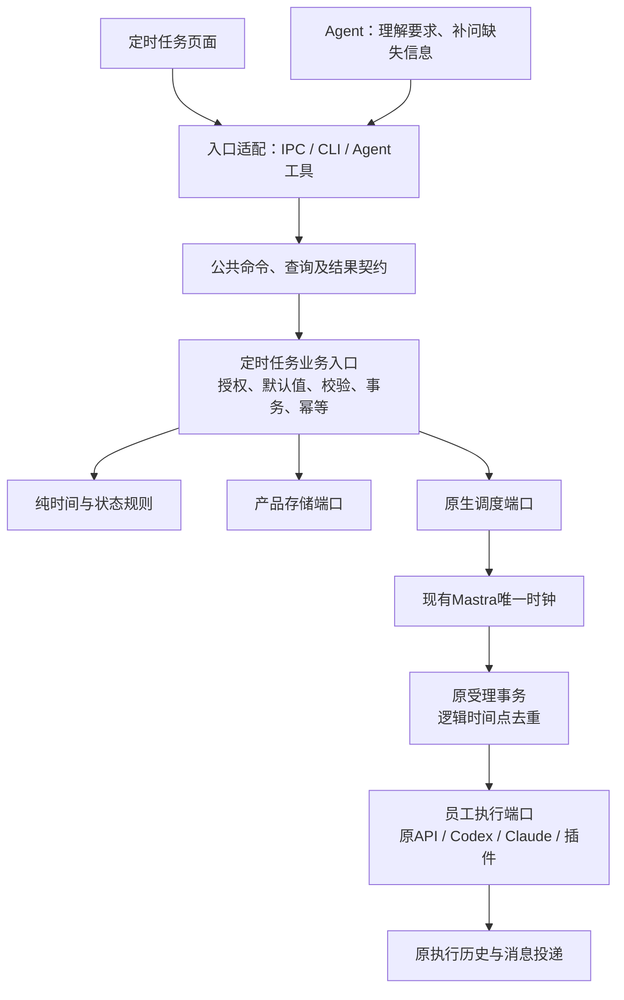

<!--
[OUTPUT]: 2026-11-03补充后续用户确认：定时计划每次派生新员工Task并进入面板；本轮实现归16§33，时钟/计数缺陷边界独立。
[INPUT]: 2026-11-03定时提醒创建失败的只读分析、现有AutomationService/应用协议/原生调度代码，以及用户对简单可调用API的要求。
[OUTPUT]: 高内聚低耦合的定时任务公共契约、统一业务入口、薄适配层、单次提醒、错误/幂等/恢复规则及实施验收清单；附本轮代码落点、静态检查与未验范围；不代表个人应用已加载。
[POS]: 第5组定时任务API与工具边界及实施进度；12维护现行页面，16员工任务篇维护Kanban与持续任务会话。
[PROTOCOL]: 一旦本文件变化，必须同步更新Header，并上浮检查所属目录.folder.md及README索引。
-->

# 定时任务领域 API 与工具适配层设计

日期：2026-11-03。状态：**用户已授权实施，代码已接线；实际验证边界见§16。** 下文定义目标契约，§16逐项区分源码实现、静态检查、未运行的测试和个人版本加载，不能把方案条目直接视为产品验收通过。

## 1. 目标与范围

让 Agent 调用定时任务像调用一个完整业务能力：知道给谁、什么时候、做什么，就能保存一个可核对的计划；缺什么就明确补什么，失败则知道下一步怎么处理。Agent 不需要了解 cron、内部员工任务定义、执行会话或框架调度记录。

采用**模块化单体中的端口与适配器模式**：以一个定时任务业务入口收拢规则，页面、IPC/CLI、Agent 工具只是入口适配器；数据库、原生调度和员工执行是出口适配器。对外使用独立的业务命令与结果，内部存储或框架升级不改变调用者的业务表达。

本设计覆盖创建、修改、查询、暂停/恢复、删除未来计划、明确立即运行和核对回执，补齐单次定时。保留原生调度、执行队列、员工权限、运行证据及历史清理能力。页面布局、Kanban 交互、记忆系统、原生 Agent 循环和整体框架替换均不在本次范围内。

不新增微服务、第二个定时循环、通用工作流引擎或另一套任务数据库。下文的服务/端口名称表达职责，实施时优先收敛已有模块，不要求每个概念都新建一层 class。

## 2. 已观察的问题与证据边界

基于源码快照 `15a4e150` 及本轮此前的只读运行核对，已确认一次提醒创建持续约7分8秒，出现77次工具调用，其中7次创建调用使用6个不同请求ID，均返回unknown；没有保存出目标提醒。此处只保留脱敏计数和协议问题，不复制个人消息、数据库或完整模型上下文。

| 当前事实 | 对外边界的问题 | 目标处理 |
| --- | --- | --- |
| `automations.create`从内部`automationInputSchema`裁剪少数字段 | `purpose: employee-task`仍进入公开工具schema，模型带着它提交周期计划 | 公共命令独立定义，不从内部DTO做黑名单式omit |
| `AutomationService.save`要求该purpose只能搭配manual和单员工 | 公开schema能通过，业务层又拒绝 | 完整字段及跨字段校验由同一业务用例负责，写入前得到明确结果 |
| 普通Error/Zod异常在应用写接口中落为unknown | 确定的输入拒绝丢失原因，调用者无法修正 | 区分可安全公开的业务错误、系统失败和真正提交未知 |
| Agent查询回执后仍多次更换请求ID创建 | 幂等仅保护同一ID，不能约束同一意图的无效绕行 | 未决写入保留原身份核对；连续无进展必须停止并报告 |
| 现有频率没有单次定时，manual没有时钟触发 | 一次提醒被拼成每日/每周，再要求Agent自行删除 | 一次时间点成为业务契约，由宿主原子消费，不靠模型删计划 |

现状入口：[应用操作注册](../../../packages/runtime/src/modules/application/operations.ts)、[应用回执及异常处理](../../../packages/runtime/src/modules/application/application-service.ts)、[保存与业务校验](../../../packages/runtime/src/modules/automations/automation-service.ts)、[时间策略](../../../packages/runtime/src/modules/automations/schedule-policy.ts)。上表不能推导出原生时钟或所有执行链路都已失效；本次失败发生在创建阶段。

## 3. 对象先分清

| 对象 | 回答的问题 | 权威归属 |
| --- | --- | --- |
| 定时计划 Schedule | 谁在什么时间执行什么要求，未来是否继续触发 | 定时任务模块，沿现有`AutomationDefinition`持久化 |
| 一次触发 Occurrence | 哪个逻辑时间点已被受理、排队、执行或错过 | 原`AutomationOccurrence`及原受理事务 |
| 员工执行 Work/Run | 员工这次具体做了什么、等待什么、产出什么 | 原员工执行内核和执行记录 |
| 人工委派任务 Assignment | 用户的目标、验收标准及持续任务会话 | 原员工任务模块和Kanban |
| 操作回执 Receipt | 某次创建/修改请求到底有没有提交 | 原业务写入回执及其协议投影 |

创建一个计划不等于创建一张Kanban卡，也不等于执行一次任务。内部可以复用受理、队列或记录代码，但公共契约不出现`purpose: employee-task`。bobo与普通员工都可以是计划的执行员工，核心身份不要求另一套计划模型。

## 4. 模块职责与依赖方向



| 边界 | 应负责 | 不应负责 |
| --- | --- | --- |
| 公共契约 | 业务输入、结果、可修正错误、版本 | DB字段、cron、框架runId、内部会话策略 |
| 业务入口 | 一致授权、默认值、完整校验、版本检查、受理/幂等、同步意图 | 理解自然语言、模型重试、渲染页面 |
| 时间策略 | 日期/时区、下一次时间、唯一逻辑触发点、单次消费规则 | 读UI状态或调用模型 |
| Repository | 同一产品库内的条件写入、稳定回执、触发去重 | 判断用户意图或向Agent构造话术 |
| 原生调度适配器 | 注册/更新/移除/对账，转换框架格式，回传真实触发身份 | 新建业务目标、运行员工工具、决定验收 |
| 员工执行适配器 | 将已受理Occurrence交给原执行内核 | 改写日程、自动再建计划或扩大员工权限 |
| 工具/IPC/CLI适配器 | 信封、来源身份、协议转换与统一错误映射 | 复制校验、推测owner、补假字段、实现补偿业务 |

依赖规则：契约和纯规则不依赖Electron、Mastra或应用工具注册器；业务入口依赖出口能力，不反向调用`boai_call`、页面或顶层`AppService.handle`。装配根把现有实现注入端口，避免适配器和业务服务互相回调、嵌套取得同一串行锁。

## 5. 公共 API：业务字段直接表达

工具继续沿用`boai_catalog`、`boai_call`、`boai_receipt`和`automations.*`操作名，不再新增一套面向模型的同义命名。

### 5.1 创建命令

以下类型是拟议公共契约示意，`requestId`沿原调用信封，不重复放入业务input：

```ts
type CreateSchedule = {
  employeeId?: string
  name?: string
  instruction: string
  trigger: ScheduleTrigger
  enabled?: boolean
  notification?: 'all_results' | 'important_only' | 'muted'
}

type ScheduleTrigger =
  | { kind: 'once'; date: string; time: string; timezone?: string }
  | { kind: 'hourly'; minute: number; timezone?: string; startsOn?: string }
  | { kind: 'daily'; time: string; timezone?: string; startsOn?: string }
  | { kind: 'weekly'; daysOfWeek: number[]; time: string; timezone?: string; startsOn?: string }
  | { kind: 'monthly'; dayOfMonth: number; time: string; timezone?: string; startsOn?: string }
  | { kind: 'manual' }
```

日期为`YYYY-MM-DD`，时间为`HH:mm`，时区为IANA标识；这些格式和范围进入实际schema，不仅写在描述里。星期明确采用0=周日、1=周一至6=周六。每个分支strict，只接收该频率有意义的字段：单次不需要weekday，按小时不需要假造一个小时值。

`manual`只保留现有“无日程、明确立即运行”的能力，不表示“未来只执行一次”。已有历史计划和手动入口不因此迁入Kanban。定时提醒必须用`once`，禁止用manual保存后假称已预约。

公共输入不包含`purpose`、`employeeTask`、`conversationPolicy`、`conversationId`、`employeeIds`、`cron`、`scheduleGeneration`、授权指纹、框架scheduleId。它们由内部归属/执行上下文映射处理。旧指定聊天和群计划沿兼容入口保留；新建单员工计划不要求调用者理解这些旧格式。

### 5.2 有来源的默认值

| 参数 | 规则 |
| --- | --- |
| employeeId | 本人直接员工会话可默认当前员工，包括bobo；全局页面需实际选择，缺少可信员工上下文的CLI/API必须明确传入 |
| timezone | 可省略，但只能从可信请求上下文的用户时区补齐；无法取得则返回缺失字段，不静默使用UTC |
| name | 可省略，由instruction做确定性的短标题展示；不为起标题另发模型请求 |
| enabled | 默认true，回执明确其激活是否完成；保存本身不立即执行员工 |
| notification | 默认all_results；显式muted保留，提醒场景不可静默改成important_only |
| date/time | 使用用户明确值或可核对的已有约定；“明天”按当前用户时区计算，未指定几点且无约定时先询问 |

宿主为Agent提供当前本地日期、时间、IANA时区及当前员工ID的可信上下文。模型不必运行`date`、读系统文件或先列全部员工，才知道“明天”和“当前bobo”是什么。跨员工指派仍要解析真实对象并核验权限，不能因创建失败擅自换执行员工。

自然语言理解留给Agent；业务服务只接收明确的结构化值，不隐藏第二个“解析提醒”的模型调用。相同来源、相同输入和相同参考时刻，所有入口应得到相同规范化结果。

### 5.3 其余操作

| 操作 | 关键输入 | 明确语义 |
| --- | --- | --- |
| `automations.preview` | 同一trigger结构 | 只读计算，不保存、不执行；不是创建必经的第二套校验 |
| `automations.get` / `list` | id或员工/计划筛选与游标 | 返回公开计划摘要、版本、激活状态和下一次时间 |
| `automations.update` | id、expectedRevision、实际变更字段 | 在原计划上修改，不重新创建；修改trigger须得到完整有效的新trigger |
| `automations.pause` / `resume` | id、expectedRevision | 控制未来触发，恢复不补跑暂停期间的历史；过期单次不能假称重新预约 |
| `automations.delete` | id、expectedRevision | 取消未来触发并保留原历史/去重墓碑，不连带停止正在执行的Run |
| `automations.run` | id、requestId | 用户明确要求时立即运行；与保存分开，不消费未来单次日程 |
| `automations.history` / `occurrence` | 计划或精确Occurrence身份 | 读取真实执行，不根据“计划已保存”推导运行完成 |
| `automations.stop` | 精确Occurrence ID | 停止这次执行并等待原退出围栏，不按计划ID或员工ID扩大取消范围 |

旧“取消提醒”自然语言可映射删除未来计划，但“停止正在执行”必须使用精确执行身份。明确要求停止未来及当前时，分别调用对应业务操作，并分别报告结果。

## 6. 一条请求的完整用例

用户说“明天提醒我提交材料”，没有指定几点且无明确默认时间：Agent只问“明天几点提醒你？”，不先创建一个时间随意的计划。假设用户补充“上午9点”，可信上下文日期为2026-11-03、时区为Asia/Shanghai、当前员工为bobo：

```json
{
  "operation": "automations.create",
  "requestId": "submit-materials-20261104-0900",
  "input": {
    "name": "提交材料提醒",
    "instruction": "提醒我今天提交材料。",
    "trigger": {
      "kind": "once",
      "date": "2026-11-04",
      "time": "09:00"
    }
  }
}
```

业务层补齐可信employeeId/timezone，核验完整命令并提交；示意回执如下：

```json
{
  "protocolVersion": "boai.application.v1",
  "operation": "automations.create",
  "requestId": "submit-materials-20261104-0900",
  "receiptId": "example-receipt-id",
  "status": "succeeded",
  "data": {
    "id": "example-schedule-id",
    "revision": 1,
    "name": "提交材料提醒",
    "employeeId": "bobo",
    "trigger": {
      "kind": "once",
      "date": "2026-11-04",
      "time": "09:00",
      "timezone": "Asia/Shanghai"
    },
    "activation": "ready",
    "nextTriggerAt": "2026-11-04T01:00:00.000Z"
  }
}
```

此时Agent可以回复“已安排明天上午9点提醒你，只提醒一次”。只有activation=ready才可称已安排生效；pending应说明“已保存，等待调度激活”，failed应说明“已保存，但尚未生效”并附可操作原因。计划ID、版本和回执供后续查询使用，不要求在普通回复里堆出内部字段。

正常已知契约的创建只需一次业务写调用。工具schema首次发现可以缓存到当前契约版本，preview按需要调用；成功回执已包含可核对的规范化时间，不强制再次list/get确认。写入中断才查原回执，时间含糊才补问，不把每次提醒变成固定多步研究流程。

## 7. 统一校验与可修正错误

验证分为公开schema的类型/分支检查、业务规则检查、事务内当前权限/版本复核。实现可以分阶段执行，但规则只有一份，公开目录和业务入口不能各自维护相互矛盾的“有效参数”。preview与create共用时间策略；真实写入仍重新核验当时的日期、授权和版本。

| 错误码（拟议） | 调用者应知道什么 | 允许的下一步 |
| --- | --- | --- |
| `MISSING_FIELD` | 缺哪个业务字段，例如trigger.time | 补问缺失信息，未开始业务写入 |
| `INVALID_INPUT` / `UNSUPPORTED_SCHEDULE` | 哪个字段/组合不合法或能力未支持 | 按结构化字段提示修正，不猜另一个owner/频率 |
| `PAST_TRIGGER_TIME` / `AMBIGUOUS_LOCAL_TIME` | 时间已过或处于重复本地时刻，不能唯一确定 | 用户明确新的时间或选择实际偏移 |
| `NOT_FOUND` / `FORBIDDEN` | 目标不存在或当前来源不能操作 | 明确报告，不创建替代员工绕过 |
| `REVISION_CONFLICT` | 当前版本已变化 | 重读原对象，在用户意图仍有效时重新提交变更 |
| `REQUEST_CONFLICT` | 同一requestId被用于不同命令 | 核对原回执，不覆盖旧意图 |
| `UNRESOLVED_WRITE` | 当前来源还有未决创建，附原receiptId | 先核对原提交，不换参数或请求ID继续创建 |
| `OUTCOME_UNKNOWN` | 提交结果确实无法确定 | 仅读取原回执与可证明的业务结果，不另起创建 |

错误包含安全的`fields`、`message`及下一步，例如`trigger.time`缺失；不回传原始异常堆栈、凭据或完整业务输入。领域错误以稳定的业务类型/错误码表达，由协议适配器映射，领域层不依赖`ApplicationValidationError`这个协议实现类。

确定的校验拒绝应为rejected，业务对象未改变；调度注册失败且计划已经保存，应返回真实保存结果与activation=failed，而非笼统称创建未知。只有无法证明提交与否的情况才是unknown；不能把所有Error改成rejected，也不能继续把所有普通Error改成unknown。

## 8. 幂等、事务与回执权威

一次写意图使用一个稳定requestId，指纹绑定规范化业务命令及可信来源。沿用现有“来源身份+requestId”的去重范围；不同来源不会互相读取私有回执。receiptId支持在原获准会话后续轮次核对，源清理仍沿原失效规则。

首次受理时冻结默认员工、时区和参考时刻，回执保留规范化结果。重试优先核对原请求及冻结值，不因用户后来更换时区、当前日期变化或配置更新，把同一个省略参数的输入解释成新意图；当前权限仍须重新核验。

| 结果/重试 | 行为 |
| --- | --- |
| 同来源、同requestId、同指纹 | 返回原对象/原结果，不重复保存或执行 |
| 同requestId、不同指纹 | REQUEST_CONFLICT，不把它当成修改计划 |
| 明确rejected，用户意图仍有效 | 修正输入后可以新建请求身份；原拒绝记录不被篡改 |
| running / unknown | 保留原身份，只核对；相同调用不得自动重放业务写入 |
| succeeded | 停止创建，不为“再确认一次”换ID重新保存 |
| cleared | 告知原来源/结果已清理，不通过新ID复活旧意图 |

计划、创建去重记录和待同步意图在同一个产品SQLite事务中提交。优先复用`AutomationRepository`与`automationCreations`，不要再新增第三套“提醒请求账本”。应用协议回执是业务结果的索引/投影，不是另一份独立成功权威。

产品库与Mastra调度库不承诺跨库原子事务。产品提交后，由已有同步/对账路径幂等应用到唯一原生时钟；恢复可根据原业务回执补齐协议结果或激活状态，不能重建第二个计划。

unknown核对不得只因“暂时没查到计划”就宣告未提交：还需确认原写入不在途、提交回执及事务边界确实可判定。只有获得明确未应用的证据，才能转为可修正拒绝或允许继续。查询回执不会再次调用创建服务。

## 9. 单次定时由宿主保证

`once`的公共含义是“在这个确定时间点受理一次员工执行”。时间点由本地日期、时间和时区规范化，计划保存后回显对应UTC时刻。修改时重新校验并增加原日程版本，旧版本的迟到回调失效。

到期后，现有受理事务用“计划ID+日程代次+单次逻辑时间点”去重，并原子记录消费状态与Occurrence/持久投递意图。排队和等待批准仍属于同一次触发，不能因尚未交付再建一次。业务执行失败也不自动把单次日程恢复成未消费；明确再次执行使用原手动运行入口。

消费后移除未来原生注册，但保留计划、执行会话和历史；无需Agent调用delete。原生注册清理若失败，后续回调也会被产品侧已消费身份拦住。这里保证的是一次业务受理意图，不对模型外部副作用或操作系统通知承诺端到端exactly-once。

现有`NativeSchedules`是唯一时钟。适配器应先核对已安装版本的实际能力，再选择原生单次注册或受产品单次消费约束的兼容注册；本文不假定框架已提供某个one-shot API。即使底层需要cron表达式兼容，也只在该适配器内生成，并校验目标日期及消费状态，不能让Agent选择每日/每周再自行清理，更不能引入第二个常驻轮询器。

暂停、删除、变更代次、重启和备份恢复都必须保留原去重/墓碑边界。立即运行一次不消费未来的日历触发，防止“先试运行”悄悄取消明天的提醒。

## 10. 时间、离线与通知边界

- 单次时间必须在未来；时区显式保存，不因电脑后来换时区改动已有计划。夏令时不存在的本地时刻明确拒绝，重复本地时刻要求消除歧义，不静默选择另一个时刻。
- 周期规则保持原语义：按小时选分钟、每周选星期、每月选日期；不存在的月日按现有跳过策略，startsOn仅表示开始边界，不等于只触发一次。
- 应用退出或休眠期间，当前本地宿主不能承诺准时执行。单次补偿拟沿用现有10分钟容差：启动/唤醒时在同一受理路径做有界核对，容差内可受理一次，超出则记录missed并停止未来触发；需要更晚补提醒由用户明确另定，不在恢复后突发执行。本轮已将单次补偿接到原启动/观察受理路径，未新增周期时钟；实际休眠/唤醒效果尚未验证。
- 时钟对账、原生回调和唤醒核对共用同一逻辑时间点与事务，不各起一次执行。重启可以恢复日程注册和未消费投递意图，不能自动重放结果未知的员工工具。
- 默认沿现有员工执行及消息/通知投递路径；本设计不额外引入无需员工执行的提醒通道。应用内消息是否登记、系统通知是否提交、用户是否已读分别记录，不把计划保存或OS通知提交称为已提醒到本人。

## 11. 工具适配层保持薄且完整

公共schema以CreateSchedule等业务命令为源，直接生成工具目录和入口验证；禁止从持续扩张的内部DTO上逐个排除字段。UI/CLI使用同一类型和校验入口，运行内核及存储映射留在模块内。

工具适配器只做四件事：解析既有调用信封；注入不可伪造的当前员工/本人消息/时区上下文；调用业务入口；把公开结果和错误映射到现有协议。来源身份、版本与幂等键不可由模型自行伪造或通过表单可编辑字段升级权限。

旧`manage_automation`若继续存在，只作为同一命令入口的兼容适配，不再维护第二份默认值/保存逻辑。管理能力是否向普通bobo会话、员工会话或特定后台来源开放，由能力策略统一核验；工具目录必须与实际可用权限一致，不能“目录available，运行才发现根本没接入”。

Agent技能文档只说明业务用法、缺失信息与回执处理，不承担参数补丁和隐藏业务校验。创建成功后不调用run；用户只要求提醒，也不额外创建Kanban任务、员工、群或工作区。

## 12. 连续失败必须收敛

一次unknown不是鼓励Agent试另一个参数组合。首期使用可确定的范围：同一可信调用者、同一原用户消息、同一`automations.create`操作族，最多存在一项未决创建。业务入口在接纳新requestId前，通过请求状态端口核对该范围的原回执；存在running/unknown时返回UNRESOLVED_WRITE及原receiptId，不再次写计划。范围核对与新请求认领必须同产品库事务/条件提交，避免两个并行创建同时通过。只读查询继续可用，同ID核对也不被阻断。

请求状态端口由宿主装配，映射现有应用回执与业务创建回执；业务模块不import应用协议实现类，不另存一份互相矛盾的成功状态。保护判定不把当前新请求自己当作已有未决请求，已提交业务结果优先经只读核对补齐协议投影。这不新增模型需要维护的intentKey或另一套语义相似度去重。

用户同一句话明确要求多个计划时按顺序创建：前项succeeded后才提交下一项，某项unknown则先核对，尚未提交的项明确保留为待处理，不假称已创建。保护范围不是整个会话或整个员工，不影响其他明确来源的独立工作。新轮次继续原未决意图必须关联旧receiptId并先核对，不能靠Agent伪造新消息来源绕开；用户明确提出的另一项新计划沿真实新来源单独处理。全局表单/CLI则由可信提交上下文提供对应范围，适配器不得替换未知提交身份。

对同一意图的重复只读结果、同类参数拒绝和没有新增信息的目录读取做有界无进展检测。建议首批验收阈值为：相同原因连续3轮且没有新信息时，停止本轮自动尝试并说明阻塞原因；阈值必须由宿主确定性执行，不能只写在提示词中。真正的外部等待或有进展长任务继续沿现有运行机制，不新增统一墙钟截断。

unknown只走原回执核对；rejected才按明确字段纠正；缺时间才询问时间。拒绝/未知的业务结果必须进入执行观测，不能因为工具函数正常返回，就被无进展判断当成业务成功。

界面的“工具步骤完成”与“计划创建成功”分开。前者只代表调用返回，后者必须引用succeeded的业务回执与真实计划ID。不得把77次返回的工具调用呈现或解释为完成了77项用户目标。

## 13. 最小代码落点与兼容方式

| 现有位置 | 目标职责与必要变化 |
| --- | --- |
| `packages/shared/src/domain/automations.ts`及相邻契约 | 明确公共命令、结果与时间分支；内部DTO分开，禁止公共类型透传内部purpose |
| `modules/automations/automation-service.ts` | 收敛为唯一计划业务入口，调用完整校验/授权和Repository；不接收工具特有信封 |
| `modules/automations/schedule-policy.ts` | 规范化时间、preview、单次/周期匹配与稳定时间点规则；无模型依赖 |
| `modules/automations/automation-repository.ts` | 原计划/回执条件写、单次消费与Occurrence同事务，保持旧历史去重 |
| `modules/automations/native-schedules.ts` | 实现调度出口转换及对账，不新增另一套时钟 |
| `modules/application/operations.ts` / `application-service.ts` | 公开新契约，映射结构化业务错误和原回执；不直接暴露内部AutomationInput |
| `service.ts`及现有员工执行桥 | 只装配上下文、能力策略和出口适配；不继续堆放计划业务校验 |
| 原定时页面、IPC/CLI、`automation-commands.ts`和scheduler技能 | 同一业务入口的调用者/兼容映射，删除重复规则与模型绕行说明 |

兼容原则：保留操作的业务名字，工具目录明确报告输入契约版本及schema指纹；公共v2命令从新入口进入，已发布旧IPC/CLI输入通过显式Legacy映射调用同一业务入口。外部固定契约的调用者继续使用其声明版本，旧新字段混用或未知版本明确拒绝，不能同一入口静默猜测格式。协议版本与输入契约版本分开，沿现有application.v1信封不代表旧业务字段永远透传。

新版Agent只看到一套当前schema，不同时加载两套互相冲突的参数。契约版本/指纹由宿主适配器携带或协商，不要求模型每次手填版本号。旧版本的保留和退出需要实际调用清单，不能仅因为新工具能调用就直接删除兼容入口。

旧持久定义、旧群分工、监控、指定会话和历史继续只读/编辑原语义；新建单员工提醒不暴露这些旧字段。内部员工任务执行仍走原EmployeeTaskService，暂时共享的底层受理代码只通过内部适配接入，不能借本设计再改Kanban状态或普通任务会话。

## 14. 实施顺序

| 阶段 | 要交付什么 | 退出条件 |
| --- | --- | --- |
| S0 公开边界修正 | 隐藏内部字段；补完整跨字段校验与安全业务错误；纠正unknown误报 | 当前周期创建不再陷入相同失败，确定拒绝可说明字段；不宣称已支持单次 |
| S1 统一业务入口 | 公共命令、上下文默认值、查询/写入/版本/回执规则；各入口共用 | 相同命令各入口结果一致，没有独立的模型专属保存逻辑 |
| S2 单次调度闭环 | once时间表达、原子消费、唯一原生时钟映射、离线/重启对账 | 重复回调和恢复不多执行，原计划/历史保留，能核对真实下一次时间 |
| S3 Agent调用收敛 | 更新工具目录/技能、未决写意图核对和无进展退出 | 明确请求正常一次写入；失败有原因且不会换ID反复创建 |
| S4 兼容与产品验收 | 旧定义/旧入口映射、实际触发/取消/通知、当前应用加载核对 | 下节场景有同版本证据，源码、运行实例和真实用户效果分别报告 |

不以“新建Facade类”“把schema挪文件”作为阶段完成；要验证规则只有一个权威、调用确实更简单、结果确实可解释。S0–S4是交付和验收阶段；本轮源码落实见§16，不能仅凭接线宣布各阶段退出条件已通过。

## 15. 验收清单（尚未执行）

| 场景 | 必须成立 |
| --- | --- |
| 明天提醒但无具体时间/约定 | 只补问时间，零业务写入，不猜8点/7点 |
| 明确单次提醒，当前bobo或普通员工 | 归属正确，正常只需一次创建写调用，返回规范化日期/时区/下一次时间 |
| 一次/每天/每周/每月/每小时/manual | 各自只需有效字段；manual无未来触发；单次不要求weekday |
| 非法内部purpose、混用字段、缺目标 | 副作用前明确rejected及安全字段，不生成错误计划或unknown |
| 公共schema允许的合法命令 | 不能再因隐藏的相反字段约束被业务层拒绝 |
| 同ID同输入、同ID不同输入 | 前者同一计划，后者REQUEST_CONFLICT，均不产生第二计划 |
| 提交成功但协议响应丢失 | 原回执能核对出原计划；不再创建、运行或重复发消息 |
| unknown且原写仍在途 | 不以查询暂缺结果断言未写；不允许替换ID绕过 |
| 明确拒绝后更正、当前版本冲突 | 有可解释的新提交/重读路径，不篡改旧回执或并发用户改动 |
| 计划已保存但调度未激活/激活失败 | 保存与激活分别可见，Agent不会假称已经生效 |
| 单次重复回调、清理注册失败、重启 | 只受理一个逻辑时间点，使用同一Occurrence/投递身份，历史仍可查 |
| 单次已受理但排队/等待批准/失败 | 不恢复为可重复触发；再次工作需明确原手动运行意图 |
| 先立即运行一次、随后到预约时间 | 手动执行和日历触发身份分开，手动不消费未来预约 |
| 暂停/恢复、删除、改时间及迟到旧回调 | 控制未来且校验代次；不误停止其他Run，不复活旧计划 |
| 本地时区变更、DST、过去时间 | 显式时区稳定，歧义可纠正，preview和实际受理语义一致 |
| 退出/休眠跨过预约时刻 | 容差内最多受理一次；超时missed，不悄悄晚跑或按周期继续 |
| 连续相同unknown/同类拒绝、目录空转 | 核对原身份；无进展阈值退出并报告，工具返回不冒充业务成功 |
| 用户一句话明确多个独立计划 | 按序提交且分别有回执；某项未知先核对，其余明确待处理，独立新来源不被整会话锁住 |
| 旧单员工/群/监控/指定聊天计划 | ID、版本、权限、历史及原执行语义保留，不批量迁移成单次或Kanban卡 |
| API及本机员工 | 沿原配置和原生循环执行，计划不新增本机用量/时长限制 |
| 原消息和系统通知 | 应用内消息不重复；OS提交/未知/已读不混为一谈 |

后续验证应分为纯契约/时间规则、事务与故障注入、适配器一致性、真实模型调用、实际Electron自然触发和个人版本加载。受控测试通过不能替代真实Agent是否选对工具、实际时刻是否触发或本人是否收到提醒。

## 16. 本轮交付状态与阅读入口

用户随后授权“修改一下代码”，本轮在独立分支 `feat/schedule-api-20261103` 实现以下候选，未操作个人应用数据或重启个人实例。

| 阶段 | 已落到源码的内容 | 验证边界 |
| --- | --- | --- |
| S0 | 独立`schedules.ts`业务schema，禁用内部purpose/employeeTask/onceAt透传；业务校验返回明确拒绝及字段，未知仅保留未确认副作用 | 已补契约/适配回归源码，未运行本地测试 |
| S1 | `ScheduleApi`统一公开命令、员工/时区默认值、业务视图；`schedule-operations.ts`薄适配；页面/旧IPC/save管理工具复用原AutomationService | 公共v2与显式v1共存，CLI增加`--contract-version`；旧群/监控/原聊天保持原语义 |
| S2 | once解析为确定UTC时间点，七段cron含年份映射到原Mastra时钟；消费元数据与Occurrence/投递意图同事务提交，原生暂停失败仍受产品去重约束；启动/观察复用原受理路径 | 排队/失败/错过均不重新消费，手动试跑不消费预约；实际自然触发、休眠/重启和通知未验 |
| S3 | 新工具目录仅暴露业务字段和实际上下文；同消息未决创建阻止换ID；创建/修改/启停/删除从原领域回执只读恢复；相同定时观察连续重复3次通知宿主退出当前来源运行 | 稳定回执不重放，迟到原调用不降级已核对成功结果；源技能已更新，个人已安装副本未批量改写 |
| S4 | 页面可选单次日期/时间及bobo，保留已保存时区；原有测试夹具调整并新增明确旧版本回归源码 | 本地测试按用户要求未运行；真实模型选工具、Electron触发、个人应用加载和完整清单未验 |

单次`state: finished`表示预约时间点已消费（含错过/受理/排队），不表示员工执行成功或用户已收到通知；实际结果继续读取原Occurrence/历史。保存成功与`activation`分别回显，激活失败不得报告提醒已生效。

整合 `origin/main` 的 `423c173f` 后，最终检查如下：

- `pnpm typecheck` 通过，含workspace依赖/公开入口检查（14个包、1043个源码文件）、共享设计包构建及TypeScript。
- 本轮两个修改的定时页面文件ESLint通过，`git diff --check`通过。
- `pnpm build`完整构建通过。
- 按用户要求未运行本地Vitest、Electron测试或真实模型任务；新增/调整回归源码不等于已验证通过。GitHub检查、合并及个人运行实例加载独立报告，不由本地构建结果推定。

- 现行页面与历史验证：[12-定时任务统一页面与bobo创建](./12-定时任务统一页面与bobo创建.md)。其中直接共用内部AutomationInput为原实现记录；新Agent公共契约已切到本文v2，旧IPC通过兼容入口继续沿原存储/执行服务。
- 已有调度、受理与运行恢复：[07-自动化产品与运行时设计](./07-自动化产品与运行时设计.md)与[11-员工与群聊自动化](./11-员工与群聊自动化设计与实施计划.md)。旧日期的预算/权限说明按后续已确认规则阅读，不因本文恢复旧限制。
- 人工委派与持续会话：[16-员工任务队列与聊天分离](./16-员工任务队列与聊天分离.md)。本设计不把定时触发、员工内部步骤和人工验收混成一条状态流水线。

### 2026-11-03 PR #99 后续核对

原head `5a9703b5` 的GitHub Test为5055通过、1失败、136跳过；唯一失败是空星期校验的具体提示被通用文案覆盖，原拒绝规则未放开。本批保留schema自有的约束/跨字段提示，恢复可操作错误，不删除或放宽原测试；同时整合main的Bobo历史配置改动。用户明确要求git cpf，本轮不重跑测试、不等待CI，合并结果不表述为全量检查通过。

本次仍是定时API边界改造：计划保存执行要求和trigger，人工任务保存目标/状态/独立会话，二者复用执行能力，但尚未统一为同一个taskId。产品概念应当是同一种人-Agent约定的任务；定时计划仅引用任务并提供触发规则，每次Run独立记录，预约消费不能替代人工验收。该对象统一是后续范围，本PR没有借此改动Kanban或重建员工任务。

### 后续用户确认：计划派生新员工任务

用户明确接受一个定时计划每次生成新的taskId，并要求任务进入数字员工面板。计划模板与实际员工任务仍分层；复用的是员工任务的独立会话、执行、状态和验收能力，不要求一个计划固定复用同一个Task。最新实现/验证归[16§33](./16-员工任务队列与聊天分离.md#33-定时派生任务进入员工面板2026-11-03)。

PR #99合入main后的隔离E2E还发现单次cron缺少后继时刻而未派发、内部目录/回执重复计入无进展，以及生成Task未进入面板三处问题。本轮只接通第三项及必要的任务会话/权限/历史语义；前两项仍待修复，不能用周期时钟的面板E2E代替单次时钟验收。
