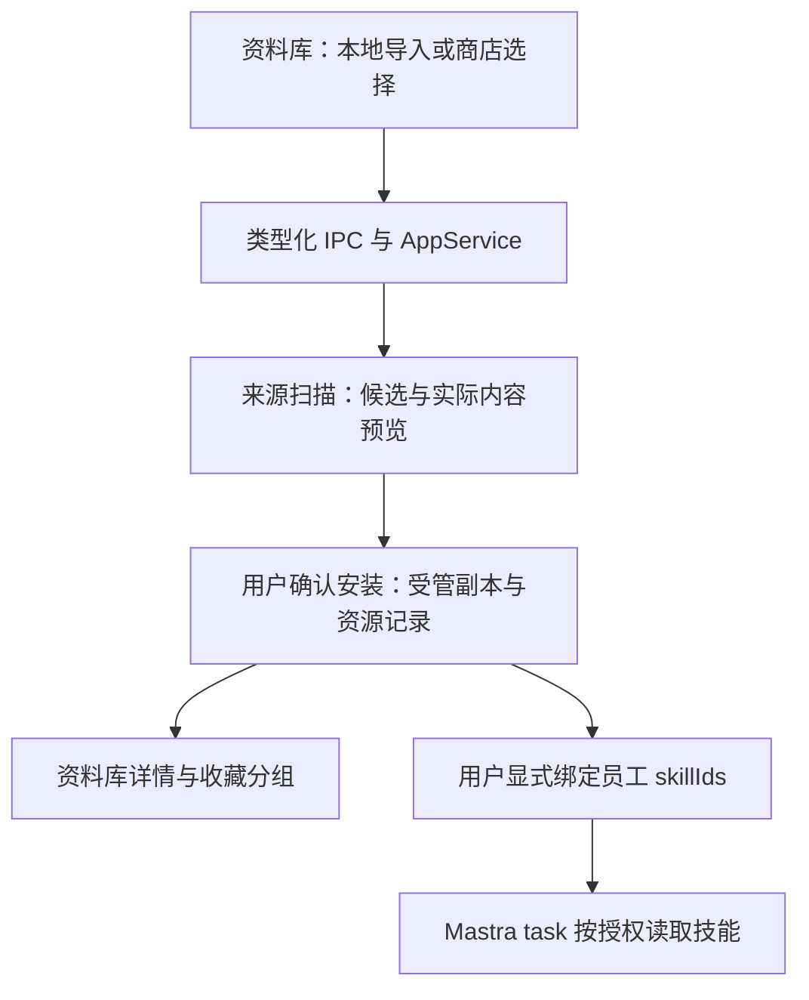

<!--
[OUTPUT]: 2026-10-25源码链接随Workspace迁移更新，历史验证结论保持。
[INPUT]: boai-app Skills 管理/商店源码、boai-agent 当前工作区及本组迁移规格与实施记录。
[OUTPUT]: 本机 local 身份与受管 Resource 的并列目录映射； 最新图标浮层/本机发现合同优先；旧能力接入位置、RPC 到现有 IPC 的替换表、纵向接入链路、复用边界、K1–K4 验收状态与后续维护入口；商店到实际任务及备份升级的验收导航。
[POS]: Skills 管理与商店迁移的简明接入指南；先于详细规格阅读。
[PROTOCOL]: 一旦本文件变化，必须同步更新 Header，并上浮检查所属目录 .folder.md。
-->
# 迁移接入指南

更新：2026-09-29。本指南最初用于迁移规划，现已按授权完成 K1–K4 实现与主闭环验收；下文保留源码迁移方法，当前证据统一见实施记录；后续用户反馈发现导航与本机发现缺口，现按 [05](./05-本机发现与图标导航修正.md) 修正。

## 1. 如何添加到当前项目

将旧项目的 Skills 管理和商店接到当前图标侧栏的 popover：本地管理提供已安装、我的收藏、分组和详情；技能商店提供 skills.sh、ClawHub、SkillHub 的浏览、搜索、详情及安装入口。

用户主流程保持为：**浏览或导入 → 预览实际技能内容 → 安装到本应用 → 显式绑定员工 → 员工在 task 中读取**。检查更新、更新和移除都围绕同一个资源进行。

复用旧项目的功能和交互，接入当前项目的资源、IPC、存储及 UI 组件。旧项目不成为新应用的运行时依赖；不需要复制整个 monorepo 或另一套 Agent 引擎。

三项边界必须保持：

- 安装、收藏和员工绑定是独立操作；公共安装不自动授权所有员工。
- 员工仍通过 `skillIds` 引用现有 `Resource.id`，更新不改变资源身份。
- 技能说明可读取不等于脚本执行环境已就绪；执行能力继续按第 5 组 Sandbox/Skills 规格推进。

## 2. 旧代码到当前代码的接入表

旧仓库根：`/Users/wangwenbo/Desktop/demo/boai/boai-app`。当前仓库根：`/Users/wangwenbo/Desktop/demo/boai/boai-agent`。下表旧源码路径相对旧仓库，当前落点均为本次已核对存在的文件。

| 能力 | 旧源码入口 | 当前接入位置与处理方式 |
| --- | --- | --- |
| 列表、搜索、收藏和分组 | `apps/electron/src/renderer/components/app-shell/SkillsListPanel.tsx`、`apps/electron/src/renderer/hooks/useSkillCollections.ts` | [资料库](../../../src/renderer/pages/library/index.tsx)、[集合用例](../../../packages/runtime/src/modules/resources/skill-collections.ts)：保留操作语义，以 resourceId 标识技能；收藏关系进入 SQLite |
| 正文、文件与安装预览 | `apps/electron/src/renderer/pages/SkillInfoPage.tsx`、`apps/electron/src/renderer/components/app-shell/InstallSkillDialog.tsx` | [内容详情](../../../apps/electron/src/renderer/pages/library/skill-content.tsx)、[导入弹窗](../../../apps/electron/src/renderer/pages/library/skill-import-dialog.tsx)、[包预览](../../../apps/electron/src/renderer/pages/library/skill-preview.tsx)：接现有详情标签和组件 |
| 商店列表、搜索与详情 | `packages/server-core/src/services/skill-marketplace.ts`、`apps/electron/src/renderer/components/skill-marketplace/SkillMarketplaceListPanel.tsx` | [provider 映射](../../../packages/runtime/src/modules/resources/marketplace-providers.ts)、[商店用例](../../../packages/runtime/src/modules/resources/skill-marketplace.ts)、[商店页面](../../../apps/electron/src/renderer/pages/library/skill-marketplace.tsx)：复用映射与交互，保留每家分页和排序差异 |
| API 与事件 | `packages/server-core/src/handlers/rpc/skills.ts` | [IPC 合同](../../../packages/shared/src/ipc/index.ts)、[AppService](../../../packages/runtime/src/service.ts)：使用现有 window.boai.request/subscribe 与 changed 事件 |
| 来源扫描、安装与更新 | `packages/shared/src/skills/management.ts` | [技能管理](../../../packages/runtime/src/modules/resources/skill-management.ts)、[来源适配](../../../packages/runtime/src/adapters/skills/source.ts)、[更新用例](../../../packages/runtime/src/modules/resources/skill-updates.ts)：保留候选预览和逐项结果，改用应用内受管副本 |
| 旧库导入与导出 | `packages/shared/src/personal-repository/export.ts`、`packages/shared/src/personal-repository/types.ts` | [旧格式解析](../../../packages/runtime/src/adapters/skills/library-format.ts)、[库导出](../../../packages/runtime/src/modules/resources/skill-library-export.ts)：离线读取 boai.json、lock 与 skills/；集合信息按本组附录合同处理 |

逐项可点击的旧源码链接见 [01 源码映射](./01-现有实现与迁移映射.md)。表中路径均写全，复制组件前同时检查其导入，替换旧 RPC、路由与组件依赖。

### 需要适配的旧机制

旧 `SkillsCliService` 通过 `npx skills` 写入 global/project 目录；当前应安装到 BoAI 自身的数据目录。可复用来源识别和候选处理的思路，不能直接把旧 CLI 接到新的安装按钮上。

旧收藏依赖 `source:slug` 和 renderer localStorage；当前需要稳定的资源 ID、事务版本检查和可备份的集合记录。旧页面依赖 Craft 组件、路由、Jotai 等，迁入时用当前组件和状态接口替换，不整体引入依赖树。

### 复制旧交互时如何替换调用

以下名称来自两边当前源码，不是需要另外实现的新 API。输入和返回类型以 [现有 IPC 合同](../../../packages/shared/src/ipc/index.ts) 为准；表中列出对应关系，不意味着旧参数可原样传入。

| 旧入口或行为 | 当前调用 | 接入时注意 |
| --- | --- | --- |
| `skills.GET` | `listLocalSkills` 与 `snapshot` 中 `resources` 的 `kind === 'skill'` 项 | 本机只读条目使用 `local:` 身份；受管副本使用 Resource ID，安装来源另读 `listSkillInstallations` |
| `skills.GET_FILES` 与详情读取 | `getSkillDetail`、`readSkillFile` | 传 resourceId 和相对文件路径，不沿用 workspaceId + slug 拼接绝对路径 |
| `skills.MARKETPLACE_LIST` / `MARKETPLACE_DETAIL` | `listSkillMarketplace`、`getSkillMarketplaceDetail` | 保留 provider + id；页面读取结果中的 value、fetchedAt 和 stale |
| `skills.SCAN_SOURCE` / `INSTALL` | `chooseSkillSource` → `scanSkillSource` → `getSkillPreview` → `installSkills` | 远程来源无需选择本地路径；扫描计划和候选 ID 由运行服务产生，安装后查询 `getSkillOperation` 的逐项结果 |
| `skills.CHECK_UPDATES` / `UPDATE` | `checkSkillUpdate` → `updateSkill` | 检查不修改文件；用户审阅差异后确认更新，保存当前资源身份 |
| `skills.UPDATE_ALL_GLOBAL` | 无同义入口；可用 `checkAllSkillUpdates` 批量检查 | 当前流程逐项确认更新，不能把“批量检查”接成自动覆盖 |
| `skills.UNINSTALL` / `DELETE` | `removeResource` | 统一执行员工撤权和受管副本清理，不只移除列表项 |
| `skills.EXPORT_LIBRARY` | `planSkillLibraryExport` → `exportSkillLibrary` | 先检查导出内容和冲突，再由桌面宿主选择保存位置 |
| 收藏、分组和拖动后的保存 | `getSkillCollections`、`updateSkillCollections` | 提交 expectedRevision；旧版本冲突后刷新，不覆盖另一窗口的新结果 |
| `skills.CHANGED` | `api.subscribe` 接收 `changed` 后刷新 | 不复制旧 RPC 的工作区广播系统 |

页面继续组合 [当前 UI 组件](../../../apps/electron/src/renderer/components/ui/.folder.md)、[本地图标](../../../apps/electron/src/renderer/components/icons/.folder.md) 和 [详情面板](../../../apps/electron/src/renderer/components/detail-panel/.folder.md)。旧的 `EntityPanel`、`AppShellContext`、`window.electronAPI` 等依赖，按职责替换为当前页面 props、`DesktopApi` 和详情打开回调。可直接参考旧组件的搜索、分组、预览和错误反馈，不要求重建旧 AppShell 才能复用这些交互。

### 最小纵向接入链路

后续开发以一项技能从预览到实际使用为首个可检查切片。若使用当前工作区，先核对以下已有链路与测试，再修补缺口；只有从迁移前版本开始时才按顺序新增这些能力。

1. **合同与宿主入口**：先读 [Skills 类型](../../../packages/shared/src/domain/skills.ts) 和 [IPC](../../../packages/shared/src/ipc/index.ts)。列表展示本机目录与受管资源；本机 `local:` 身份仅供阅读与收藏，执行仍用 Resource ID。安装管理保存来源，收藏关系单独持久化。
2. **扫描与预览**：由 `scanSkillSource` 产生候选，通过 `getSkillPreview` 查看实际包。此时不能新增资源或员工绑定；用户取消后可直接退出。
3. **确认与安装**：`installSkills` 使用扫描计划、所选候选和请求身份提交，展示逐项结果。受管文件和资源记录成功提交后，资料库才显示“已安装”；失败不算安装成功。
4. **显式授权与使用**：在现有员工配置里选择该资源，再发起 task。验收同时覆盖已绑定员工可读、未绑定员工不可读、普通 chat 不自动加载；收藏不影响这些权限。
5. **维护与迁移**：在同一资源身份上补齐更新、卸载、便携库和完整备份恢复。按 [04 验收矩阵](./04-实施阶段与验收.md) 逐项关联证据，不能以文件复制完成代替功能验收。

商店主要提供发现与来源信息；本地、商店和远程地址的安装都进入同一套扫描、预览和提交用例。UI 不直接下载、写入技能目录或执行旧 `npx skills` 安装命令。

## 3. 当前工作区已有内容

核对基线：旧仓库 HEAD `5c023b984fd05aaad71cbc97a0a7de8b3fc4d00b`，工作区干净；当前仓库 HEAD `5798775d7bfecf533faff2e8827b52f310bf2c5e`，存在大量未提交实现，以下依据实际工作区，不只依据 HEAD。

当前已有本地管理、收藏分组、三家商店、安装/更新、旧库导入导出的模块和页面。已有 IPC 包括 `getSkillDetail`、`scanSkillSource`、`installSkills`、`listSkillMarketplace`、`checkSkillUpdate`、`updateSkill`、`planSkillLibraryExport` 等。继续实现前先查实际导出，不按早期草案再建一套同义接口。

状态以 [21-Skills 管理与商店实施](../2.已实现功能与代码现状/21-Skills管理与商店实施.md) 为准：K1–K4 主链路和 K-01 至 K-22 验收已完成；商店到真实 task 读取/发布、完整应用备份/升级、原生下载断流及真实更新断点恢复分别有证据。本指南最初只做文档核对；后续测试结果和边界统一以实施记录为准，未重新探测在线商店。

[01](./01-现有实现与迁移映射.md) 保留最初的迁移前盘点；[03](./03-架构合同与数据迁移.md) 保留设计合同，其中部分拟定文件/方法名与最终落点不同。需要了解当前代码时，先看本节、实施记录和实际类型导出。

## 4. 从迁移前版本实施与后续维护

若从迁移前版本开始，按 [04](./04-实施阶段与验收.md) 的 K1 本地管理 → K2 商店浏览 → K3 安装更新 → K4 便携库顺序推进。当前工作区已完成这些阶段；下表保留后续修改时应维持的核对顺序，不表示仍有未交付任务。

| 优先顺序 | 工作内容 | 完成证据 |
| --- | --- | --- |
| 1 | 对照当前代码和已有测试逐项核对 K-01 至 K-22，区分已验证、部分验证、未验证 | 每项关联真实测试与限制；不能用页面出现替代验收 |
| 2 | 复核已有商店到实际 Mastra task 的补验，核对原生远程入口剩余边界 | 隔离数据下的生产 IPC/引擎链路；未绑定员工、普通 chat 和不支持 Skills 的后端不能越权 |
| 3 | 补齐取消、更新/卸载恢复、活跃执行器与备份竞争的缺口 | 故障后保留一致内容和授权；原始技能目录未被修改；未知结果如实显示 |
| 4 | 复核已补验的旧资源升级、新旧完整备份实际任务与剩余便携库格式边界 | Resource ID、员工绑定、内容与来源可核对；便携 ZIP 往返不能代替完整应用备份测试 |
| 5 | 同步实施记录和本组验收状态 | 只将有证据的项目标为完成，更新受影响 Header 与目录地图 |

测试沿用 Vitest 和 Electron playwright-bdd，使用隔离目录和受控商店/模型响应。真实接口探测单独记录日期与结果；用户真实技能数据迁移是独立操作，不随开发测试自动执行。

K5 的使用统计、私有来源、外部 Agent 全局目录管理保持可选后续，不属于本次 K1–K4 交付。

## 5. 功能迁移与用户数据迁移

复制旧源码用于接入功能，不会自动带来旧应用中安装的技能。用户数据迁移应在功能验收后显式进行：从旧应用导出“我的”技能库 ZIP，或选择旧技能目录，在当前应用预览后导入，最后重新选择员工绑定。

旧导出未携带收藏分组时，只能恢复实际技能内容和可识别来源；不能推断不存在的集合数据。详细冲突、来源和导出格式见 [02 产品流程](./02-产品流程与范围.md) 与 [03 数据迁移](./03-架构合同与数据迁移.md)。
