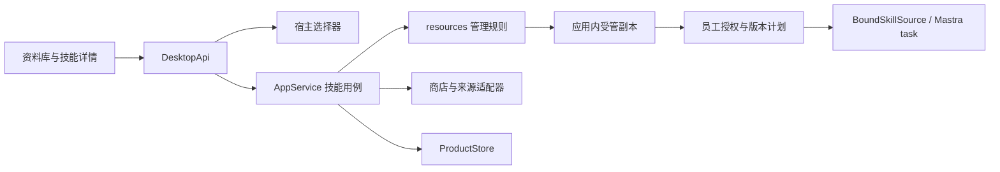

<!--
[INPUT]: 当前 DesktopApi、AppService、ProductStore、Resource、员工权限和旧 Skills 来源/商店合同。
[OUTPUT]: 模块职责、拟定数据/IPC、安装更新一致性与兼容迁移设计。
[POS]: Skills 迁移的待实施技术规格；字段和方法名是建议合同，不代表已导出 API。
[PROTOCOL]: 一旦本文件变化，必须同步更新 Header，并上浮检查所属目录 .folder.md。
-->
# 架构合同与数据迁移

更新：2026-09-28。以下均为实施设计，不新增第二套 Agent 或工作项系统。

## 1. 分层与文件落点



按实际阶段创建文件，以下路径不是要求立即预建空模块。

| 建议位置 | 职责 | 复用/限制 |
| --- | --- | --- |
| `src/shared/domain/skills.ts` | 技能来源、管理状态、收藏分组、扫描计划、商店请求/结果的纯类型 | 通过 domain 现有入口导出；不依赖 Node、React 或 Mastra |
| `src/shared/ipc/index.ts` | 对应 Methods 输入/输出 | 保持唯一桌面合同；不照搬 `window.electronAPI` 或旧 RPC channel |
| `src/runtime/modules/resources/skill-management.ts` | 扫描预览、身份/冲突规则、安装/更新计划、收藏分组用例 | 小范围拆出职责，沿用 `local-resources.ts` 和员工配置验证 |
| `src/runtime/modules/resources/local-resources.ts` | 同一份 frontmatter 解析、目录校验和受管复制 | 已有工具先扩展，避免预览通过而安装使用另一套校验 |
| `src/runtime/adapters/skills/marketplace.ts` | 三家商店的请求/响应映射和能力定义 | 迁入旧服务纯逻辑，接可注入的宿主 HTTP 请求；规模增长后再拆 provider 文件 |
| `src/runtime/adapters/skills/source.ts` | 有界下载、公开仓库/ref 解析、ZIP 解包到 staging | 只取得文件，不运行技能、不安装依赖；采用固定版本库，不动态执行 `npx` |
| `src/runtime/adapters/storage/product-store.ts` | 现有 SQLite records/事务 | 新增 collection 使用现有存储；不为收藏建独立数据库 |
| `src/runtime/service.ts` | 受理请求、短提交临界区、撤权、备份与变化事件 | 不把每个 provider 和所有文件操作堆进 service；网络下载不占用全局串行临界区 |
| `src/main/main.ts` / `preload.ts` | 原生选择器、打开路径、IPC 桥接 | renderer 不取得任意文件写权限；现有资源选择器兼容保留，ZIP 选择新增明确合同 |
| `src/renderer/pages/library/` | 本地技能、收藏分组、商店、详情及安装预览组件 | 分拆现有 index 的局部职责；复用 app-shell/详情面板、UI、全局样式与本地图标 |
| `src/renderer/hooks/` / 必要的 `stores/` | 可取消查询、商店缓存与页面临时状态 | 沿用当前 React/Zustand 模式；收藏权威在宿主，不引入 Jotai/localStorage 业务真源 |

现有网络适配先参考 `src/runtime/adapters/mastra/model-catalog.ts` 的请求、超时和错误处理模式。只有多个新增请求确有共享需求时才提取薄 HTTP 帮助层；renderer 不裸写网络请求，也不为迁移引入整套 `@craft-agent/*`、Bun 或旧 server-core。

## 2. 身份、作用域和状态

### 2.1 继续使用 Resource

`Resource.kind === 'skill'` 仍是唯一可绑定的技能资源。保留现有路径：

```text
<dataPath>/skills/<resourceId>/<name>/                       公共 Skill
<dataPath>/agents/<agentId>/workspace/skills/<name>/         员工专属 Skill
```

不为收藏复制一份技能，不把 `source:slug` 当新的主键，不让 renderer 持有的路径决定文件写入位置。相同 name 的公共资源可拥有不同 ID/来源；同一员工的有效绑定 name 必须唯一。员工专属目录按 name 唯一，安装到已有目录时必须走冲突/更新检查。

### 2.2 新增管理元数据（建议）

在 ProductStore 的 `skillInstallations` collection 中以 **resourceId** 保存管理元数据，Resource 继续保存资源基础字段。该记录不再重复保存 name/path/owner，避免两个事实来源。

| 字段组 | 内容和规则 |
| --- | --- |
| 身份 | `resourceId`、`revision`（本地管理记录递增版本）；更新保持 resourceId |
| 来源 | kind 为 local / git / url / marketplace / snapshot；可选 provider、providerItemId、规范化仓库 URL、ref、skill 相对路径、可更新下载信息 |
| 安装依据 | resolved commit/provider version（能取得时）、实际安装内容 hash、安装/更新时间；显示版本不能代替内容校验 |
| 兼容信息 | 无法映射的声明、检查结果；声明权限不自动生效 |
| 更新检查 | checkedAt、current / available / unsupported / failed、候选版本及错误摘要；不能只存布尔值 |

远程身份：`provider + providerItemId`；仓库来源身份：规范化仓库 + skill 相对路径 + ref 策略。内容身份：受管树 hash。不可凭相同 name、描述或 URL 展示文本推定是同一个技能；无法确定来源时保留 snapshot。

元数据中的 URL 不保存嵌入式凭据或临时签名；若缺少可重新获取的来源，保存为不可自动更新。现有导入资源缺少管理记录时按本地副本呈现，不伪造来源或远程版本。

### 2.3 收藏集合

建议 `skillCollections` 保存一个应用级版本化集合：`revision`、`favoriteResourceIds`、有序 `groups[{id,name}]`、`groupByResourceId`。按现有 ProductStore 事务校验 expectedRevision、资源存在与类型，避免多窗口丢失修改。分组名规范化、重复名规则复用旧纯函数；删除组只移除分配关系。

折叠、搜索和当前 tab 是 UI 偏好，可沿用现有 UI 状态方式。收藏/分组是需要备份的业务记录，不能只存在 renderer localStorage。

### 2.4 不合并这些状态

| 状态维度 | 权威依据 |
| --- | --- |
| 已安装 | 受管资源记录和经过校验的文件 |
| 已收藏 | 收藏集合 |
| 员工可使用 | 员工绑定、资源所有者、执行后端和当次授权 |
| 说明可用 | 当前环境计划对 SKILL.md / 文件的校验 |
| 脚本能否执行 | 当前命令授权及 S2 的实际依赖/执行环境验证 |

普通 chat、参与判断和 memory 阶段不因安装技能获得文件/技能/命令工具。外部 Agent 自带 Skills 与 BoAI 受管 Skills 分开，不能因扫描到同一目录宣称 ACP 已适配。

## 3. IPC 合同草案

新增方法先放 shared 类型，再实现服务与 UI。以下名称为拟定；输入均严格校验，列表/文本有大小上限，返回可区分的业务结果而非原始 CLI stdout。

| 方法 | 输入要点 | 输出/副作用 |
| --- | --- | --- |
| `getSkillDetail` | resourceId | 基础资源、来源、正文概要、绑定和管理能力；只读 |
| `listSkillFiles` / `readSkillFile` | resourceId、受限相对路径 | 文件列表或有界文本；只读，不接受任意绝对路径 |
| `getSkillCollections` / `updateSkillCollections` | 修改操作、expectedRevision | 集合快照；只改收藏/分组 |
| `chooseSkillSource` | folder / zip | 原生选择结果或取消；宿主处理，与旧 choosePath 分工明确 |
| `scanSkillSource` | source kind、用户选择的源、目标作用域 | scanId、候选 ID、内容 hash、兼容/冲突、有效期；只准备临时内容，不安装 |
| `installSkills` | requestId、scanId、候选 ID、目标、明确冲突选择 | operationId；最终逐项 resourceId/skip/error；不自动绑定 |
| `getSkillOperation` / `cancelSkillOperation` | operationId | 查询/请求取消；取消到执行器退出才算结束 |
| `listSkillMarketplace` / `getSkillMarketplaceDetail` | provider、query/sort/page/cursor 或 providerItemId | 统一商店模型和真实可用能力，缺失信息保持未知 |
| `checkSkillUpdates` | 所选 resourceIds | 逐项检查结果及 updatePlanId；不修改资源文件 |
| `updateSkill` | requestId、updatePlanId、expectedRevision/hash | 更新单个资源；保留 ID 和绑定，执行前检查计划与使用状态 |
| `planSkillLibraryTransfer` / `applySkillLibraryTransfer` | import/export、选择项或宿主源引用、planId、冲突选择 | K4 预览与提交；逐项结果、来源与集合恢复摘要 |

员工绑定继续走现有 `saveAgent`，卸载继续走 `removeResource` 并扩展管理记录/收藏清理，不再新增功能重复的卸载 API。原有 `importResource` 保持兼容，内部复用同一校验/导入能力。

长操作由宿主维护 operationId 与进度，支持页面切换后查询，不增加定时后台服务。刷新实际数据沿用 `changed` 事件；必要时仅增加类型化的技能管理进度事件。`requestId` 在一次安装操作内幂等，重复提交同一参数返回原操作；同 ID 不同参数拒绝。

扫描结果在宿主保留精确文件/hash、来源、候选和目标，renderer 只回传 ID；不能用一个前端传回的临时绝对路径替换已预览包。扫描和检查允许写临时缓存/结果记录，“只读”指不改变已安装内容、绑定和集合。计划在文件、目标、版本或有效期变化后失效，提示重新预览。

## 4. 安装与更新的一致性

### 4.1 共用管道

1. **取得**：本地源只读；远程源下载到应用 staging，保留确定版本与实际 hash。缺少可靠远程版本时仍可安装快照，但不声称可自动更新。
2. **扫描**：解析完整 YAML，校验当前 name 规则、SKILL.md、相对路径和文件边界；仅输出候选，不执行文件。
3. **计划**：固定候选内容、来源、目标和预期记录版本，识别重复、冲突和不兼容。
4. **提交**：进入短临界区重新检查，落盘、保存 Resource/来源/操作结果，再发 changed。多项安装按项提交，已成功项不因另一项失败而被删除。
5. **绑定**：独立的用户操作；沿用现有员工配置并发版本和权限校验。

K1 先统一当前单项目录复制，K3 再增加更新和恢复协议。远程等待、解包和大文件 hash 在临界区外执行，不能阻塞停止任务、发送消息或其他本地操作。

### 4.2 文件系统和数据库不能假装是一个事务

沿用稳定路径，不为首期设计永久多版本仓库。每项提交使用同盘 staging/旧版本备份和一个最小持久操作记录，记录 resourceId、旧/新 hash、已验证的受管相对路径和 prepared/files-swapped/committed 阶段。

- 更新先完整准备新内容，再在确认无使用者后将旧目录移到受管备份位置、新目录移入；DB 事务写 Resource/来源新版本和操作提交标记。
- 文件交换失败保持或恢复旧内容；DB 提交失败利用旧目录回滚；提交后再清理旧目录。不要先删旧资源再尝试下载新资源。
- 启动时在资源装配前对照日志、文件 hash 和 DB 决定完成清理或回滚。无法判定的资源标为需要修复并禁止绑定/执行，保留证据，不盲删目录。
- 恢复只处理本地文件/记录一致性，不自动重试网络安装，也不重放员工工具。未提交安装可以清理其受管 staging，原始来源不受影响。
- 成功仅在文件、DB 和结果一致后返回；清理未完成单独记录。该日志是管理操作的一致性记录，不是 WorkRepository 中的员工业务工作。

更新提交前再次检查相关活跃/等待工作、执行器退出状态和 expected hash/revision；同资源管理互斥与授权/发布共用宿主临界区。更新成功时推进相关员工配置版本、失效资源缓存及来源记忆，重新生成后续运行的环境计划。不能让旧计划继续读取新文件并冒充旧版本。

移除沿用当前撤权和取消逻辑，并在同次 DB 变更中删除 `skillInstallations`、收藏/分组引用。文件清理失败有可重试清理记录；运行读权限已撤销后也不能把残留文件当作仍安装成功的条目。

## 5. 来源与文件边界

沿用现有资源校验并补足下载/解包边界；这些检查编码在可测试代码中，不依赖模型判断。

- 保持现有最多 2000 个文件/目录、100 MB 的资源上限；环境计划已有深度上限，扫描也需统一。超限报告具体原因，不静默截断成“完整安装”。
- ZIP 在写出每个 entry 前检查绝对路径、`..`、Windows 盘符/UNC、符号链接/硬链接、重复路径和大小写冲突；限制实际解压总量、单文件和压缩输入大小。仅检查下载 Content-Length 或解压结束后才检查不足以保护目标目录。
- HTTP 请求从宿主统一发起，限制实际读取字节、重定向和超时；公开商店只访问经校验的 HTTPS 目标，拒绝 loopback/私网跳转。用户本地文件导入走独立入口，不把文件路径当 URL 下载。
- 下载包/本地目录中的 package scripts、Git hooks、meta.ts、技能脚本均不在安装时执行。GitHub 来源优先取得固定 ref 的文件归档，不触发任意仓库命令。
- frontmatter 的 alwaysAllow、requiredSources、OpenClaw 专有字段作为兼容提示保留，不能改变命令授权或读取范围。描述/文件中的绝对路径不能提升权限。
- 保留现有普通文件、realpath、资源 hash 和读取时校验；导入后原件变化不改变本应用副本；应用内文件被外部编辑后旧 hash 失效。

首期无需在普通本地导入界面显示实现细节；只给出用户可理解的错误及下一步。测试中必须覆盖这些边界，不能用“商店官方”替代校验。

## 6. 商店适配与缓存

迁移旧 `SkillMarketplaceItem` 的 provider、id、slug、来源、正文、统计、安装目标等概念，但下载权限和受管身份由宿主解析。适配器声明各自支持的 sort、分页方式、搜索限制、正文和更新能力；不为统一 UI 假造 API 能力。

响应需运行时校验，不直接把未知 JSON 强转为类型。坏记录可逐项跳过并记诊断；整批 schema 不匹配应报错，不能显示成合法空列表。下载/详情失败不影响已安装本地资源。

可沿用旧缓存参数作为初值：5 分钟 TTL、列表和详情各最多 100 项，key 包含 provider/query/sort/page/cursor/limit；同请求合并，失效代次阻止迟到响应写回。缓存只存展示数据；安装前重新验证选中来源和实际内容。首次仅进程内缓存，跨重启离线商店不是首期承诺。

K2 用冻结响应离线测试并补一次真实接口探测。若某 provider 的接口已变化，仅降级该 provider 并展示原因，不阻塞本地管理，也不宣称三家商店已全部交付。

## 7. 数据升级、旧库导入与备份

### 7.1 当前数据无损升级

- 旧 Resource 和员工 `skillIds` 不重新生成，现有路径不移动。
- 缺少集合视为无收藏、无自定义组；缺少来源记录按本地副本显示。已安装≠原创，不把旧公共资源自动归为“我创建的”。
- 安装内容 hash 可在首次详情/检查或有界迁移中生成；初始来源未知仍然未知，不能拿当前文件反推安装时的原始内容。
- 升级和恢复复用现有数据版本入口；新增 collection 的默认值、幂等迁移与旧备份缺字段都要测试。若需要调整数据版本，才同步根文档和迁移说明。

### 7.2 旧应用库兼容

接受旧 `kind: boai-skill-library`、`schemaVersion: 1` 和 `skillsPath: skills`，验证 `boai.lock.json` schema、相对路径与包内文件。来源映射只读解析，不加载/执行 TypeScript。完整包内容优先，不能因 lock 中有仓库来源就用最新版替换备份中的实际版本。

旧 local/vendor/source/snapshot 仅作为来源分类，不直接映射当前员工权限。缺少或不能验证的来源按 snapshot，保留提示。相同来源+hash+目标作用域可复用，冲突默认跳过；资源名相同但来源不同不自动覆盖。收藏导入可幂等合并，重新导入不会重复创建分组或资源。

当前项目导出在兼容旧库基本格式之外，可增加独立、带 schemaVersion 的 `boai-agent.collections.json`：以包内稳定 entryKey 关联收藏与分组，不写本机 resourceId/agentId/绝对路径。旧库没有该文件时不恢复不存在的分组信息；旧应用忽略它时不宣称完整往返兼容。

同名多来源技能无法无损平铺到旧 `skills/<slug>` 格式。K4 首期导出预览要求用户选择一个来源，或分别导出多个包；不静默覆盖或改名破坏 SKILL.md。若后续需要单包保留多变体，应升级独立格式并提供兼容读取，不偷偷扩展旧语义。

复制技能内容时保留 references/scripts/assets 和许可文件；排除应用凭据/会话/机器元数据。来源 URL、机器路径和可能含本地配置的文件在导出预览中给出排除或阻断结果，不声称能识别任意文本中的所有秘密。输出先写临时 ZIP，成功后提交到用户选择位置，目标同名文件不得无提示覆盖。

### 7.3 备份与恢复

完整应用备份继续由现有 exportBackup 负责；新 collection 包含在 boai.sqlite，受管技能仍在原目录。备份还需拒绝正在提交的技能管理操作，避免 DB 和文件快照错位；下载缓存、staging 和可重建商店缓存不进入正常备份。

恢复先检查数据/操作状态并重定位受管路径，再允许资源读取。来源标识、hash 和收藏保留；临时绝对路径和执行准备状态不照搬。恢复技能文件不自动授予新员工权限，也不恢复命令执行许可或未完成工具操作。
