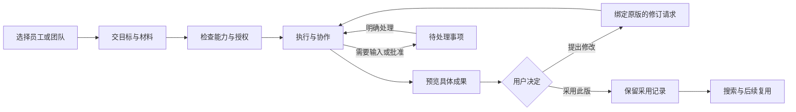

<!--
[INPUT]: Agent IM 功能调研、当前产品合同、用户要求的详细规格目录及相关专题。
[OUTPUT]: 2026-10-02 独立待处理页退役，原问题消息卡片通过同一输入框明确回复；原业务记录与未知回执核对保留，旧设计及首版证据按历史保留；本组知识工作场景、既有能力与范围；第 9 组团队创建及角色互动扩展的优先级说明，建议与事实分开标记。
[POS]: ai-docs/spec/8.Agent-IM产品完善/00-产品定位与用户旅程.md。
[PROTOCOL]: 一旦本文件变化，必须同步更新 Header，并上浮检查所属目录 .folder.md；实际交付后更新实施记录。
-->

# 产品定位与用户旅程

状态：待实施产品目标。更新：2026-09-30。

范围更新：用户已确定先实现 [团队创建助手](../9.团队创建助手/README.md)，产品同时容纳工作团队与角色互动。本文的知识工作者定位和材料报告旅程保留为第 8 组基础完善场景，不再作为全产品唯一场景或当前首个开发门槛。团队创建先交付，连续记忆和正式游戏分期推进。

## 1. 产品目标

BoAI 是以 IM 为交互入口的 Agent 工作台：用户与数字员工单聊或组群，员工按各自职责处理真实工作，用户能查看过程、控制权限、检查成果并继续提出修改。

当前实施假设是“一个人在本机指挥多个 Agent 完成日常知识工作”。这个假设用于排序，尚不等于经过用户研究确认的市场定位。后续若确定优先服务开发者或多人团队，应先调整场景与顺序，再扩展对应能力。

核心目标：

> 用户交付真实材料和目标后，能在可接受的时间与预算内获得可检查、可修改、可采用的成果；离开后回来，也能迅速找到成果和需要自己处理的事。

保留现有统一群聊消息流、右侧任务与产物、每页独立详情标签。普通交流不强制创建工作项；明确任务才进入已有工作执行体系。

## 2. 首个端到端验收场景

**基于用户提供的两份资料，完成一份有来源依据的研究报告。**

1. 用户上传两份文本型 PDF 或文本资料，说明目标与输出要求。
2. 研究员读取获准材料，提炼事实并保留来源；需要联网补充时使用已接通的只读能力。
3. 写手根据材料生成报告；审核员核对报告实际版本与来源。
4. 用户在应用内预览最终报告，能定位所引用的材料。
5. 用户针对该版本提出一处修改，员工生成关联的新版本，旧版仍可查看。
6. 用户确认采用最终版本；任务结果、产物版本和用户确认可以相互定位。
7. 用户切换聊天或重启应用后，仍能找到成果及未处理事项；中断的业务操作不自动重放。

这一场景用于首个完整交付，不把研究员、写手、审核员固化为所有任务的强制拓扑。简单任务仍可由一名员工完成。

## 3. 已有基础与本轮增量

| 领域 | 已有基础 | 需要补齐的增量 |
| --- | --- | --- |
| 聊天 | 单聊/群聊、提及、引用、表情、快捷命令、置顶与排序 | 附件、消息/产物搜索、持久未读定位 |
| 协作 | 稳定工作身份、负责人、父子委派、依赖、定向接续、预算与停止树 | 完整业务链质量验证、面向用户的验收与返工 |
| 成果 | 私有工作文件、显式发布、运行归属、真实交付证据与工作结果版本 | 应用内预览、产物修订关联、采用记录 |
| 能力 | 模型连接、Skills 管理/商店、授权知识、文件工具、审批命令、单聊 ACP | 真实能力检查、必要网页工具、易理解的授权与依赖状态 |
| 日常管理 | 聊天内审批、会话活动标记、自动化待处理筛选、通知与部分用量 | 原聊天问题卡片/同一输入框明确回复、任务/员工用量视图 |
| 入门 | 员工角色模板、可编辑配置 | 包含真实工具、材料、输出要求和能力检查的团队场景模板 |

本表基于 2026-09-29 调研时工作树，包含当时已有未提交改动。开发每个目标前重新核对，已交付部分只补差距，避免重复实现或依据历史规划回退现有能力。

## 4. 用户要完成的工作

| 时刻 | 用户的问题 | 产品应给出的答案 | 对应目标 |
| --- | --- | --- | --- |
| 开始前 | 该找谁做？需要准备什么？ | 可运行的团队场景、输入要求、能力缺口 | IM-04/07 |
| 交代时 | 这份材料到底给了谁？ | 消息附件、共享范围、解析结果 | IM-02 |
| 执行中 | 现在谁负责？为什么停住？ | 真实工作目标、负责人、依赖和可处理阻塞 | IM-01/05 |
| 收结果 | 这是成品还是草稿？来源可靠吗？ | 明确版本、预览、来源和审核记录 | IM-03 |
| 修改时 | 我改的是哪一版？ | 绑定版本的修订请求和新旧版本关系 | IM-03 |
| 回来时 | 哪些事等我？成果在哪？ | 待处理、搜索、阅读位置 | IM-05/06 |
| 复盘时 | 多个员工比一个值在哪里？ | 采用结果、介入次数、可信用量和耗时 | IM-08 |

典型用户首先是个人知识工作者。开发者场景可以沿用聊天和任务体系，但仓库差异、测试结果与隔离执行需要单独规格；多人团队也需要真实用户身份与协作权限，不能把现有单用户状态直接开放共享。

## 5. 三个代表场景

### 首批：材料研究报告

输入两份获准资料；输出一份带引用的报告；审核和采用绑定明确版本。首批用此场景贯穿开发，避免每个功能只有单独演示而无法串联。

### 后续：内容生产

用户提供品牌说明和目标受众，员工生成文案并核对事实；用户通过成果版本提出改写。实际发布到外部平台属于新的明确动作，不由“采用文案”自动触发。

### 后续：资料分析

用户提供表格，员工完成计算、解释和报告。只有表格解析与执行环境具备相应能力后才展示为可运行模板，不因模型会生成表格文字就承诺支持真实工作簿。

## 6. 体验与产品边界

- 对话是连续入口；用户不必先理解工作项、run、调用账本等实现概念。
- 需要用户决策时才突出可执行事项；普通成员交流留在聊天，不制造重复通知。
- 结果可以是可核对的回答或文件；只有用户明确请求文件时才以文件作为完成条件。
- 引用、审批、采用与停止均携带明确对象；“看过了”不等于授权或验收。
- 多员工是可选协作方式，员工数量不是产品成功指标；简单任务允许直接完成。

## 7. 用户旅程图

这张图描述用户操作，不授权系统自动重试、追加预算或重放工具。任何接续仍遵循已有工作控制。

## 8. 价值验证

首先记录用户从提交请求到得到可采用成果的过程：任务是否达到要求、需要几次补充/返工、已知和未知用量、耗时与中断原因。试运行帮助确定正式门槛；正式比较前锁定题目、版本和预算，保留失败及未完成样本。首批用户反馈与竞品功能都只能提供证据，不能替代实际采用结果。
