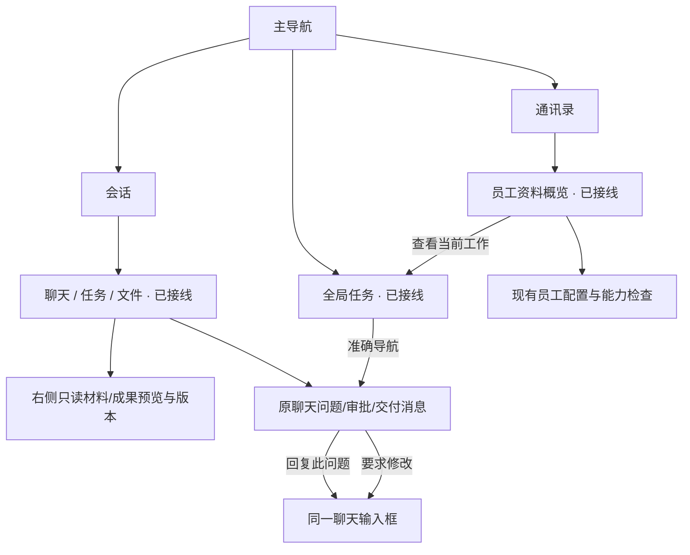

<!--
[OUTPUT]: 2026-10-05 定义完整会话三视图、全局任务与员工资料概览；Work只读详情在卡片展开、右侧保持固定结果/文件预览；当前完整源码统一通过、应用包独立通过，结果与缺口唯一归13，宽度/缩放不由旧界面成绩替代，旧图侧栏业务按钮退役。
[INPUT]: 八项 Agent IM 功能规格、现有 Shell/工作/存储边界和设计提案。
[OUTPUT]: 原未回答问题引用与卡片按钮都进入明确问题模式；其他消息仅普通引用；2026-10-02 独立待处理页退役，原问题消息卡片通过同一输入框明确回复；原业务记录与未知回执核对保留，旧设计及首版证据按历史保留；页面入口、详情作用域、两张图稿、组件行为与响应式合同，当前入口与历史建议明确区分。
[POS]: ai-docs/spec/8.Agent-IM产品完善/09-信息架构与交互设计.md。
[PROTOCOL]: 一旦本文件变化，必须同步更新 Header，并上浮检查所属目录 .folder.md。
-->

# 信息架构与交互设计

更新：2026-10-05。状态：原设计提案与当前入口合同并存，既有事实回链第10组，新工作视图代码回链[第2组29](../2.已实现功能与代码现状/29-员工协作工作视图实施.md)。会话“聊天/任务/文件”、全局任务和员工资料概览已进入生产界面，完整源码已统一通过、macOS应用包独立通过，实际报告与验证层缺口统一见[工作视图实施](./13-工作视图实施与自动验收.md)。图 B 的独立待处理页及图 A 的右侧业务按钮已退役；图稿仅保留历史，正文的聊天入口优先。

## 1. 与现有界面的关系

保留窄导航、会话列表、统一聊天流、可调右侧详情及现有 Soft 输入框。现有[群聊设计及连续修订](../3.前端重构与功能/16-群聊界面设计/README.md)负责当前样式基线；[员工协作工作视图](./12-员工协作工作视图.md)定义当前会话主视图、全局工作发现和员工资料入口，复用已有工作与交付合同。

Renderer 使用已有基础组件、图标与全局语义 token；不根据生成图逐像素硬编码一套新颜色或组件。任务状态继续在消息和详情中呈现，输入框上方不新增常驻运行状态条。

## 2. 信息架构

| 用户入口 | 新增内容 | 详情归属 | 主要动作 |
| --- | --- | --- | --- |
| 会话输入框 | 文件选择、拖入、粘贴图片和附件草稿 | 当前会话 | 移除/重试/发送 |
| 消息内附件 | 原件、解析状态和引用来源 | 会话页的材料详情 | 查看材料/定位来源 |
| 消息产物 / 会话文件视图 | 文件来源、固定版本与实际记录 | 会话页右侧只读成果详情 | 查看文件/版本、返回原交付消息；采用/稍后处理在原消息，修改进入同一 composer |
| 会话聊天/任务/文件（已接线） | 同一会话消息流、Work 与已发送材料/已发布成果 | 主内容区域按会话切换，内容详情沿原右侧预览 | 查看/筛选/定位原消息和工作 |
| 全局任务（已接线） | 当前可见获准范围内的 Work 状态总览 | 独立主页面，复用任务卡片内只读详情，固定文件结果沿本页右侧预览 | 筛选、展开真实子工作、回到原聊天或具体触发 |
| 原问题消息卡片 | 当前问题与明确版本/工作/occurrence | 原会话输入框和引用预览 | “回复此问题”后发送明确补充；普通引用不隐式关联 |
| 原审批消息卡片 | 当前有效动作、命令与范围 | 原会话 | 允许一次/拒绝 |
| 会话搜索 | 正文、文件、筛选和结果 | 当前搜索所在页面 | 定位结果/返回列表 |
| 通讯录员工资料概览（已接线） | 身份、职责、真实能力状态和当前工作 | 员工详情所在页面 | 发消息、查看工作、进入现有配置 |
| 员工配置 | 能力检查及显式绑定 | 现有配置详情 | 检查、补全、授权 |
| 通讯录团队创建入口 | 必填团队名称/需求 | 核心会话与后台原子创建记录 | 提交到核心助手，沿第9组当前合同创建 |
| 工作详情 | 用量、时间、完整性 | 当前工作详情 | 查看分解与证据 |

图中每个主页面分别保存自己的标签、选中项、草稿和滚动。跨页跳转只通过显式导航切换目标；不能复用另一页隐藏的标签状态造成误操作。

新增视图只组织已有对象，不创建第二套任务状态。会话“聊天/任务/文件”切换保留该会话 composer 草稿、明确引用目标与消息锚点；隐藏的聊天停止阅读观测，隐藏列表停止读取。打开任务或文件不自动把聊天标已读，也不采用成果或批准请求。全局任务区别于“定时任务”的计划管理：只聚合实际 Work，计划定义不充当工作卡片。员工资料先展示本人身份、职责、真实可用能力和当前工作，配置复用现有入口；内置浏览器继续作为应用功能。

全局任务和员工当前工作只读展示、筛选与导航，不提供独立问题回答、审批、采用或修订中心。原目标被清理、隐藏、撤权或文件失效时按原来源核对，不猜另一个会话、消息或新版。详细范围与数据合同见[工作视图规格](./12-员工协作工作视图.md)与[数据契约](./10-数据契约与迁移边界.md)。

## 3. 图 A：材料输入与产物验收

对应 [IM-02](./02-聊天附件与资料处理.md) 与 [IM-03](./03-产物预览版本与验收.md)。

本图是历史设计参考：右侧底部“要求修改/采用此版本”动作位置已退役。当前采用、稍后处理及未知回执核对均在原员工交付消息，修改进入同一 composer；右侧保持只读内容、版本与来源记录。

| 区域 | 设计意图 | 行为约束 |
| --- | --- | --- |
| 左侧会话 | 保留原有选择与搜索，不制造新工作区体系 | 切换不丢当前会话草稿和阅读位置 |
| 用户材料 | 两份 PDF 跟随原消息展示 | “已解析”只在真实成功后出现，不表示所有员工已读 |
| 成员回复 | 各自贡献留在同一消息流 | 保留提及、引用、表情和执行过程入口 |
| 产物文件行 | 版本与待确认状态可见 | 点击打开该版本，不重新发布文件 |
| 右侧预览 | 来源、正文与版本在一个上下文中 | 查看新版不覆盖用户对旧版的审阅 |
| 图中右侧底部动作（退役） | 历史的要求修改 / 采用此版本 | 不按图恢复；原消息动作与 composer 均绑定明确成果及版本 |

推荐在常用宽屏下让预览有足够阅读宽度，例如右侧约 420–560 CSS px；这是设计建议范围，最终复用现有手动分栏设置，不能切换聊天就强制重置用户宽度。

## 4. 图 B：旧统一待处理收件箱（退役设计）

历史图 B 的 PNG 未保存在当前 checkout，保留其[设计说明与缺失记录](./designs/README.md)，不使用失效图片链接冒充可见图稿。

对应 [IM-05 当前聊天内处理合同](./05-统一待处理收件箱.md)。本图的独立事项列表/详情与主导航入口已于 2026-10-02 按用户要求退役，不再作为实施目标。

当前问题卡片选择或引用原未回答问题后进入明确关联模式，复用同一 composer 和引用预览，携带 question/version/原消息及适用 workId/occurrence；引用其他消息只做普通引用。提交或回执未知保留原载荷/key，只读核对；普通消息引用不能解除等待。命令在原审批卡片批准/拒绝，成果从原文件卡打开固定版本预览。原失败与工作记录继续通过聊天和已有详情解释，不另建处理工作台。

## 5. 关键状态与反馈

| 场景 | 首选反馈 | 禁止出现的假象 |
| --- | --- | --- |
| 附件处理中 | 当前文件行显示阶段和取消入口 | 全屏阻断所有聊天 |
| 附件失败 | 就地原因、重试与移除 | 空内容被当作就绪 |
| 预览加载 | 当前详情正文骨架，保留标题来源 | 旧文件正文显示在新标题下 |
| 采用提交 | 当前按钮忙碌，成功后显示采用记录 | 提交前即显示已采用 |
| 事项已过期 | 禁用旧操作，说明来源已变化 | 继续按旧审批执行 |
| 读取失败 | 当前区域重试 | 使用“暂无事项”隐藏错误 |
| 搜索无结果 | 保留关键词与筛选并提示无匹配 | 清空用户输入 |
| 用量不完整 | 已知部分与缺失标记 | 总量/费用显示为零 |

所有异步视图按请求身份丢弃迟到结果；切页不取消已经被宿主受理的提交，也不能让旧回执覆盖新对象。

## 6. 窄窗、键盘与可访问性

沿用现有侧栏显隐和手动宽度，不在窄窗强制自动改变用户设置；在当前剩余空间内折行，提供清楚的收起入口。聊天输入、发送及原消息业务按钮始终可达，不在 composer 添加停止本轮或停止并发送按钮；需要停止时进入原工作或运行详情的明确操作。PDF、代码和长表格只在局部区域滚动。

验收至少覆盖常用宽屏、1124px、760px，以及125%/200%缩放；这些是检查尺寸，不是固定栅格断点。新增工作视图沿原生Electron窗口准备1340/1124/760×100%/125%/200%九组合，逐组合检查原聊天动作、会话任务/文件、全局看板/列表和员工概览，实际成绩归13。200%是直接原生压力检查，不改变产品外观配置的保存范围。键盘可完成选附件、切换版本、请求修改、处理事项与返回消息；状态有文本，不只靠颜色。确认表单保留焦点与草稿，失败后可修正。

## 7. 图文优先级与未覆盖部分

图稿中的日期、文件大小、内容、头像、计数和引用都是示例；窗口装饰沿用实际平台。图 B 中底部来源文字出现“产品讨论组”，与事项主标题的“资料研究小组”不同，属于生成图偏差：实际实现必须使用该事项真实会话身份，不能照抄这处不一致。

图稿没有覆盖附件失败、历史版本、撤权、深色和窄窗，这些必须按本文与功能文档实现/验证。设计图不代表已支持截图中示例文件大小，也不代表真实报告经过审核。

需要视觉细化时先修改本规格与对应图稿版本；不得仅凭图上出现了某个控件就扩大业务范围。完整来源与生成提示见 [设计说明](./designs/README.md)。
