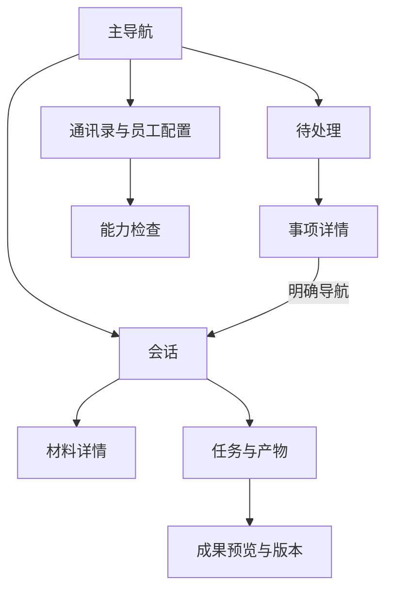

<!--
[INPUT]: 八项 Agent IM 功能规格、现有 Shell/工作/存储边界和设计提案。
[OUTPUT]: 页面入口、详情作用域、两张图稿、组件行为与响应式验收；本文件为待实施建议，实际合同需核对现有代码。
[POS]: ai-docs/spec/8.Agent-IM产品完善/09-信息架构与交互设计.md。
[PROTOCOL]: 一旦本文件变化，必须同步更新 Header，并上浮检查所属目录 .folder.md。
-->

# 信息架构与交互设计

状态：设计提案，尚未实施，也未由用户逐屏确认。图稿是视觉参考，正文定义操作语义。

## 1. 与现有界面的关系

保留窄导航、会话列表、统一聊天流、可调右侧详情及现有 Soft 输入框。现有[群聊设计及连续修订](../3.前端重构与功能/16-群聊界面设计/README.md)负责当前样式基线；本专题只增加必要的材料、成果和待处理交互。

Renderer 使用已有基础组件、图标与全局语义 token；不根据生成图逐像素硬编码一套新颜色或组件。任务状态继续在消息和详情中呈现，输入框上方不新增常驻运行状态条。

## 2. 信息架构

| 用户入口 | 新增内容 | 详情归属 | 主要动作 |
| --- | --- | --- | --- |
| 会话输入框 | 文件选择、拖入、粘贴图片和附件草稿 | 当前会话 | 移除/重试/发送 |
| 消息内附件 | 原件、解析状态和引用来源 | 会话页的材料详情 | 查看材料/定位来源 |
| 消息产物 / 任务与产物 | 预览、版本、审核与采用 | 会话页的成果详情 | 要求修改/采用此版 |
| 主导航“待处理” | 四类跨会话事项 | 待处理页自己的详情 | 提交补充/批准/验收/处理错误 |
| 会话搜索 | 正文、文件、筛选和结果 | 当前搜索所在页面 | 定位结果/返回列表 |
| 员工配置 | 能力检查及显式绑定 | 员工详情所在页面 | 检查、补全、授权 |
| 新建入口 | 从场景创建团队 | 新建向导 | 确认对象后创建 |
| 工作详情 | 用量、时间、完整性 | 当前工作详情 | 查看分解与证据 |

图中每个主页面分别保存自己的标签、选中项、草稿和滚动。跨页跳转只通过显式导航切换目标；不能复用另一页隐藏的标签状态造成误操作。

## 3. 图 A：材料输入与产物验收

对应 [IM-02](./02-聊天附件与资料处理.md) 与 [IM-03](./03-产物预览版本与验收.md)。

| 区域 | 设计意图 | 行为约束 |
| --- | --- | --- |
| 左侧会话 | 保留原有选择与搜索，不制造新工作区体系 | 切换不丢当前会话草稿和阅读位置 |
| 用户材料 | 两份 PDF 跟随原消息展示 | “已解析”只在真实成功后出现，不表示所有员工已读 |
| 成员回复 | 各自贡献留在同一消息流 | 保留提及、引用、表情和执行过程入口 |
| 产物文件行 | 版本与待确认状态可见 | 点击打开该版本，不重新发布文件 |
| 右侧预览 | 来源、正文与版本在一个上下文中 | 查看新版不覆盖用户对旧版的审阅 |
| 底部动作 | 要求修改 / 采用此版本 | 两个动作都绑定明确成果及版本 |

推荐在常用宽屏下让预览有足够阅读宽度，例如右侧约 420–560 CSS px；这是设计建议范围，最终复用现有手动分栏设置，不能切换聊天就强制重置用户宽度。

## 4. 图 B：统一待处理收件箱

对应 [IM-05](./05-统一待处理收件箱.md)。

列表优先显示用户要做什么，正文摘要只帮助判断上下文。四种筛选来自权威事项类型，不由模型即时猜测。当前选中项在右侧显示其真实来源和操作，不混入最近打开的另一份报告。

“回到原消息”切换到实际来源会话并携带稳定消息身份。若消息已清理但业务记录仍可显示，说明失效原因，不跳到其他群的相似内容。“打开或已读不会自动采用报告”的含义须在行为上保证，不依赖一段提示文案。

## 5. 关键状态与反馈

| 场景 | 首选反馈 | 禁止出现的假象 |
| --- | --- | --- |
| 附件处理中 | 当前文件行显示阶段和取消入口 | 全屏阻断所有聊天 |
| 附件失败 | 就地原因、重试与移除 | 空内容被当作就绪 |
| 预览加载 | 当前详情正文骨架，保留标题来源 | 旧文件正文显示在新标题下 |
| 采用提交 | 当前按钮忙碌，成功后显示采用记录 | 提交前即显示已采用 |
| 事项已过期 | 禁用旧操作，说明来源已变化 | 继续按旧审批执行 |
| 读取失败 | 当前区域重试 | 使用“暂无事项”隐藏错误 |
| 搜索无结果 | 保留关键词与筛选并提示无匹配 | 清空用户输入 |
| 用量不完整 | 已知部分与缺失标记 | 总量/费用显示为零 |

所有异步视图按请求身份丢弃迟到结果；切页不取消已经被宿主受理的提交，也不能让旧回执覆盖新对象。

## 6. 窄窗、键盘与可访问性

沿用现有侧栏显隐和手动宽度，不在窄窗强制自动改变用户设置；在当前剩余空间内折行，提供清楚的收起入口。聊天输入、发送、停止以及当前业务主要按钮始终可达。PDF、代码和长表格只在局部区域滚动。

验收至少覆盖常用宽屏、1124px、760px，以及 125%/200% 缩放；这些是检查尺寸，不是固定栅格断点。键盘可完成选附件、切换版本、请求修改、处理事项与返回消息；状态有文本，不只靠颜色。确认表单保留焦点与草稿，失败后可修正。

## 7. 图文优先级与未覆盖部分

图稿中的日期、文件大小、内容、头像、计数和引用都是示例；窗口装饰沿用实际平台。图 B 中底部来源文字出现“产品讨论组”，与事项主标题的“资料研究小组”不同，属于生成图偏差：实际实现必须使用该事项真实会话身份，不能照抄这处不一致。

图稿没有覆盖附件失败、历史版本、撤权、深色和窄窗，这些必须按本文与功能文档实现/验证。设计图不代表已支持截图中示例文件大小，也不代表真实报告经过审核。

需要视觉细化时先修改本规格与对应图稿版本；不得仅凭图上出现了某个控件就扩大业务范围。完整来源与生成提示见 [设计说明](./designs/README.md)。
