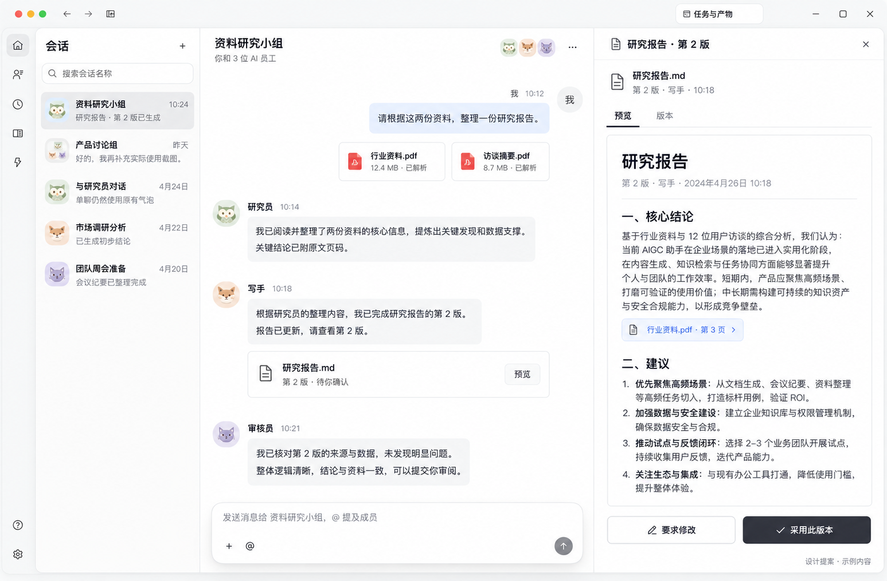

<!--
[INPUT]: 现有群聊实际截图、IM-02/03/05 规格与内置 imagegen 生成结果。
[OUTPUT]: 两张设计提案的用途、原始尺寸、生成提示及图文偏差记录；与实际运行证据分离。
[POS]: ai-docs/spec/8.Agent-IM产品完善/designs/README.md。
[PROTOCOL]: 一旦本文件变化，必须同步更新 Header，并上浮检查所属目录 .folder.md。
-->

# 设计提案与生成记录

生成日期：2026-09-29。两张原始 PNG 均为 **1547 × 1016 px**。方式：**内置 image_gen 工具，未使用 CLI/API 备用脚本。**

两张图均为待讨论/待实施设计，不是运行截图，也不表示用户已逐屏选定。参考图是[现有群聊浅色截图](../../3.前端重构与功能/16-群聊界面设计/evidence/corrected-light.png)，只用于风格与布局参考；没有修改或覆盖它。当前实际产品的后续视觉修订仍以原群聊文档为准。

## 图 A：附件与产物验收



适用：[IM-02 附件](../02-聊天附件与资料处理.md)、[IM-03 产物](../03-产物预览版本与验收.md)。展示已发送材料、员工回复、产物文件行，以及带版本/来源/修改/采用的预览详情。

原始生成文件：exec-6f92b6a5-2171-4bd2-9473-0b791b9e9fef.png。仓库文件为原样复制，无裁切或后期编辑。

## 图 B：统一待处理收件箱


适用：[IM-05 收件箱](../05-统一待处理收件箱.md)。展示四类待办筛选、来源列表、选中事项详情和明确操作，沿用窄导航与右侧详情。

原始生成文件：exec-66d96f58-9611-4f5c-a439-81ca4e89c6de.png。仓库文件为原样复制，无裁切或后期编辑。

## 已检查与偏差

- 两图已视觉检查：统一消息流/事项列表、右侧预览、主要操作与中文层级可读。
- 日期、文件大小、名字、时间、人数、报告正文和计数均为示意，不能作为能力上限、真实用户数据或测试成绩。
- 图 A 混合了窗口控制装饰；实际实现使用当前平台的原生 Electron 窗口规则。
- 图 B 底部来源链接示意出现“产品讨论组”，而选中事项来自“资料研究小组”。这是生成偏差，实际导航必须使用事项绑定的真实来源身份。
- 图稿未覆盖失败、撤权、深色、窄窗及全部版本状态；以[交互规格](../09-信息架构与交互设计.md)及对应功能文档补齐。
- 颜色、阴影、字体、图标与组件最终复用现有全局 token 和组件。图稿不能成为新建平行样式体系的依据。

## 完整生成提示

### 图 A

```text
Use case: ui-mockup. Create one high fidelity product design reference screen for the BoAI local desktop app, landscape about 1600x1050. Input image is a style and layout reference only, not an edit target. Preserve the restrained soft white/very light gray Chinese desktop IM style, slim navigation rail, conversation list, single shared chat stream, floating top bar, subtle rounded composer and animal agent avatars. This is a proposed UI, not a working product screenshot. Show the key new flow: user provided two PDF materials and agents delivered a report ready for human review. Layout: slim 52px rail, 240px conversation list, approximately 580px central conversation, a wide 500px report preview in the right detail pane. Top right detail tab named “研究报告 · 第 2 版”. Center title “资料研究小组”. Show user message aligned right “请根据这两份资料，整理一份研究报告。” and two compact attachment tiles “行业资料.pdf” and “访谈摘要.pdf”, labeled “已解析”. Then left-aligned agents 研究员, 写手, 审核员 with small pastel animal avatars, concise meaningful messages. Researcher “关键结论已附原文页码。” Writer “报告已更新，请查看第 2 版。” Reviewer “已核对第 2 版的来源与数据。” Final artifact tile “研究报告.md” with “第 2 版 · 待你确认” and “预览”. In the right panel show an actual document preview with title “研究报告”, metadata “第 2 版 · 写手”, tabs “预览” and “版本”, a source chip “行业资料.pdf · 第 3 页”, sections “核心结论” and “建议”, and realistic brief Chinese paragraphs. At bottom of right panel visible secondary action “要求修改” and primary dark neutral button “采用此版本”. Composer at bottom of chat remains just a rounded text area with small + and @ and send. No status banner above composer, no dashboard charts, no oversized colorful cards, no kanban. Precise readable Chinese typography, comfortable line heights, crisp subtle separators, almost no saturated color beyond small avatars and source links. Include small muted caption at bottom edge “设计提案 · 示例内容”.
```

### 图 B

```text
Use case: ui-mockup. Create one high fidelity Chinese desktop product design reference for BoAI “待处理” inbox, landscape about 1600x1050. Input image is reference only for the app's restrained soft white/light gray style, slim navigation and rounded surfaces. This is a proposed new page, not a real screenshot. Keep a narrow 52px icon rail with inbox selected and the same top desktop toolbar. Main content has a broad inbox list on the left about 800px and a source detail pane about 650px on the right. Main heading “待处理”, modest count “4 项需要你处理”. Filter tabs “全部”, “待补充”, “待批准”, “待验收”, “需处理”. Below them a small search field “搜索待处理事项”. Render four calm horizontal rows, not a grid of cards: selected row with file icon, title “研究报告 · 第 2 版”, status “待验收”, subtitle “资料研究小组 · 写手”, short summary “报告已完成，等待你确认采用。”; next “请补充目标读者” status “待补充”, subtitle “内容策划组 · 研究员”; next “导出报告为 PDF” status “待批准”, subtitle “资料研究小组 · 写手”; last “网页读取失败” status “需处理”, subtitle “市场观察组 · 研究员”. Pair statuses with tiny icons and text; muted amber only for required action, no decorative charts. Right pane detail heading “研究报告 · 第 2 版”, context text “来自 资料研究小组”, visible text link “回到原消息”. Show a document preview with source reference and footer note “打开或已读不会自动采用报告。” Then two visible bottom actions “要求修改” and dark neutral primary “采用此版本”. A small row above preview says “作者 写手 · 审核员已核对本版”. Keep right detail content specific to the selected item. Avoid notification bell feeds, generic red badge clutter, analytics dashboards, organization charts, and account/company administration. Use precise legible Chinese, restrained spacing, subtle dividers, coherent app chrome. Include small muted caption “设计提案 · 示例内容”.
```

## 后续更新

用户确认或要求修改后，另存带版本号的图稿，并同步功能与交互规格。不覆盖本版图片，也不将实际验收截图放成同名文件。图片为二进制资产，INPUT/OUTPUT/POS 由本目录 .folder.md 记录。

