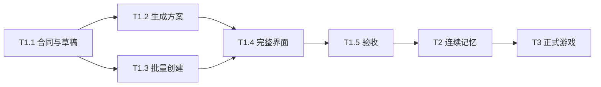

<!--
[INPUT]: 2026-10-01 bobo 会话式团队创建合同、源码与实际验证；旧 T1/T2/T3 完成定义与历史证据。
[OUTPUT]: 两字段团队弹窗/用户名称绑定、首发才创建会话/标题交互、只读回执核对/未知原请求保留/清理 tombstone 的追加交付；标题操作图标 hover/focus-within/菜单保持显示、同色与保留占位的 B5 门禁/17 桌面通过及 Skills 箭头断言修正复跑证据；此前 50 文件/652 模块与 24 个定向桌面/主题截图证据及未执行范围；bobo 首轮 640/18 基线、旧 T1/T2 证据和 T3.1–T3.5 撤销状态。
[POS]: ai-docs/spec/9.团队创建助手/08-实施步骤与交付清单.md。
[PROTOCOL]: 一旦本文件变化，必须同步更新 Header，并上浮检查所属目录 .folder.md；仅凭真实证据更新完成状态。
-->
# 实施步骤与交付清单

当前产品合同（2026-10-01）见 [15 bobo 核心助手与会话式团队创建](./15-bobo核心助手与会话式团队创建.md)。旧 T1 团队草稿、模型/用途预设、方案编辑与可选群界面已被取代，以下 T1 首版实施步骤和成绩保留历史语境；原子文件/事务/恢复以及 T2 记忆不变量继续适用。

本轮唯一进度：B0–B3 保存核心助手首轮已完成的基线，弹窗/首发会话追加由 B4 单独记录；当前标题图标微调由 B5 记录，不能把此前 640/18 或 652/24 成绩计为 B5 通过。

| 切片 | 实际状态 | 证据 / 待验证 |
| --- | --- | --- |
| B0 核心身份与分层记忆 | 实现及离线/真实 SDK/桌面验证通过 | 核心身份 5 项、核心会话 5 项；桌面覆盖改名、多会话和三层记忆，仍沿用来源/范围/生命周期边界 |
| B1 需求入口与核心会话 | 实现及新 Electron 8 场景通过 | 单需求入口、立即会话跳转、默认群、稳定受理回执、错误保留与两类重启不重放 |
| B2 真实团队工具与原子发布 | 实现及真实 SDK 离线协议/模块/桌面通过 | 核心工具闭环、原子默认群、原工作去重；文件暂停时及时停止并等待实际退出，所有原发布/恢复测试保留 |
| B3 综合交付 | 完整技术门禁和 18 个定向桌面场景通过 | 49 文件/640 模块测试、类型/UI规则/构建、新团队 8 场景及既有兼容 10 场景通过；整个 Electron 集合与真实商业模型质量本轮未执行，不借用旧 T1 成绩 |
| B4 团队弹窗与首发会话/列表交互追加 | 实现、技术门禁及 24 个定向 Electron/主题截图复核通过 | 加号内两字段团队弹窗/用户名称绑定、去除系统助手标签、标题更多/compose、首发非空消息原子创建/无空记录、小箭头/整行顺滑折叠；只读回执核对/未知保留原请求跨关闭与设置、清理 tombstone/旧 key 拒绝和未提交空目录安全清理。50 文件/652 模块通过，最后未知提交门禁调整后核心 11 项再次通过；typecheck/lint:ui/build/bddgen/diff-check 通过。定向桌面 24 项使用独立输出完整重跑 exit 0；主题窄窗键盘 1 场等待 data-theme/禁用截图动画后单独复跑 exit 0，浅色弹窗与空白聊天截图实际视检通过，整个 Electron 集合与真实商业模型未执行 |
| B5 分组标题操作图标微调 | 实现、技术门禁及 17 个定向 Electron 通过 | 会话、通讯录分类和 Skills 同类标题右侧更多/编辑/加号仅行 hover、键盘 focus-within 或菜单操作期间显示；图标与 label 同色、隐藏保留占位。typecheck/lint:ui/build/bddgen/diff-check 通过；会话/通讯录 14 场、Skills 本机 2 场及原生下载取消后悬停新建 1 场最终通过，空白核心聊天截图实际视检通过。Skills 首跑箭头旧断言失败，按常驻 12px/默认 opacity 0.75/hover 1 合同修正，保留排序/键盘/重启业务断言后单场 7s 重跑 exit 0。本轮未重跑全量模块或整个 Electron，不借用 B4 的 652/24 成绩 |

更新：2026-09-30。已按用户确认将常规 50 人示例改为最多 12 人（T1-v2），追加宿主权威能力说明及真实复验；完成核对补齐实际模块/IPC 文档和生成/结果/错误字段的键盘焦点，以及缺失有效模型时配置入口、当前群改名/移除结果，证据见第 2 组记录。T1.1–T1.5 已完成：完整技术门禁通过，用户明确回复“认可当前方案质量”，当前 v4 七例（含十二人方案保存后的工作区说明修订）人工评审通过。[确认原话与评审对象](evidence/planner-v4-human-review.json) 独立归档，历史失败与原始输出不改写。本文件是本组唯一进度表；T2 本轮实现/验收见下表，T3 未实施；未执行版本发布。

后续追加：通讯录空分类、跨分类拖拽与新团队自动分类已按用户要求修改，具体改动和本轮验证见[实施记录文末](../2.已实现功能与代码现状/23-团队创建助手实施.md)。本轮不运行 E2E，原首版桌面成绩保留为历史证据，不冒充新改动已完成桌面验收。

## 1. 开工前

- [x] 阅读本组 00/01/03/04/09 和相关目录地图，核对本轮范围为 T1。
- [x] 检查当前工作树和既有能力，不覆盖其他进行中的改动。
- [x] 核对 Mastra 安装版本与内置结构化输出文档，使用已有模型配置。
- [x] 明确此次要交付哪些 T1 子步骤，固定离线测试样例和故障注入位置。
- [x] 若现有实现已满足某项，记录源码/测试证据并只补差距。

## 2. T1.1：合同、草稿与恢复入口

交付：有版本的草稿、生成/创建记录类型、IPC、校验和持久化；通讯录可以打开/关闭/恢复空草稿，还不开放无后端的创建按钮。

实施顺序：

1. 新增共享合同与 schema，明确模型输出禁止字段和用户可编辑字段。
2. 实现草稿创建/保存/读取、一个未结束草稿约束和请求去重。
3. 接线通讯录自己的详情标签与未保存守卫。
4. 支持重启读取草稿，旧数据没有新集合也能启动。

退出条件：草稿重启不丢，版本竞争不会覆盖，未确认时 agents/conversations 集合没有新增对象；旧创建入口和跨页面标签行为通过回归。

## 3. T1.2：内置团队设计助手

交付：所选模型可生成可编辑方案；失败/停止/过期结果明确。

1. 专用无工具 Agent + 固定 plannerVersion/schemaVersion。
2. 连接解析、共享容量、请求 ID、期限、两次调用上限及已知/未知用量。
3. 成功/需要调整判别输出、结构/语义校验和一次有界修复。
4. draftVersion/generationId/inputHash 守卫，停止后和旧请求的结果不能覆盖。
5. 接通生成中、失败、手工编辑、成员增删和重新生成交互。

退出条件：写作/简单助手/角色群/越界输入的离线协议场景通过；没有工具调用、员工创建和凭据泄露；重启不重发生成。真实模型质量留到 T1.5 评审，不用离线 fixture 宣称质量可靠。

## 4. T1.3：批量创建与恢复

交付：全部员工/可选群一次发布，支持明确继续和放弃清理。

1. 复用员工定义校验，增加无发布副作用的配置/工作区准备能力。
2. 事务受理冻结方案，预分配成员与群 ID。
3. 受管暂存、操作归属、hash、移动日志和配置复核。
4. 事务提交全部对象+回执，提交后批量安装内存和发变更。
5. 启动核对、显式 resume/cancel、清理失败保留与备份互斥。

退出条件：04 的断点矩阵全部覆盖；重复确认和回应丢失不重复对象；文件冲突不覆盖用户文件；数据库已提交但内存安装中断可完整恢复。

不能以“正常情况下创建成功”替代断点验收。本切片不依赖真实模型，可用经过校验的测试草稿调用真实宿主/SQLite/文件系统路径。

## 5. T1.4：完整通讯录体验与旧功能兼容

交付：01/10 定义的输入、方案、进度、结果和恢复入口全部可用。

1. 模型配置缺失/变化提示，最终提交与最新已保存草稿绑定。
2. 有群/无群两种结果，成员详情、私聊、群聊导航。
3. 群目的和协作建议展示/编辑，以及有来源的调用上下文投影。
4. 同名提示、头像预设、字段错误、窄窗和键盘可达。
5. 旧员工创建、选人建群、分类/排序和页面隔离回归。

退出条件：真实 Electron 中从输入到使用跑通；“先各自介绍”不创建 Work；创建本身没有新成员调用/欢迎词；群和私聊关联同一 agentId。

## 6. T1.5：验收与首版发布说明

执行 09 的 T1 必测项、现有相关回归、类型/UI规则/构建及 Electron BDD。固定真实模型、样例、预算和评审标准后，显式执行生成质量评估并保留失败。

至少完成两个实际演示：四人写作团队并进入群交流；只创建成员并私聊。另展示狼人杀请求得到“玩家群 + 未支持规则说明”，不把它记录成整局游戏测试。

记录创建耗时、生成调用/已知与未知用量、用户修改点、创建失败与恢复结果。未完成真实模型评审时，只能宣称离线实现/流程验收完成，T1 最终状态仍待评审。

## 7. 依赖顺序

先让数据和事务可验证，再把界面接起来。T1.2 和 T1.3 的接口稳定后可独立开发，但本图不要求创建额外开发代理或同时修改同一文件。

## 8. 后续阶段

2026-09-30 文档修订：用户确认同一员工拥有统一记忆，普通新经历默认可在该员工的相关聊天里接续，不再要求每次显式关联。产品合同见 [05](./05-员工身份与连续记忆.md)，数据/调用/生命周期与验收见 [13](./13-T2员工统一记忆修改方案.md)。这一文档修订为实施前记录；当前切片状态以第 9 节为准。

T2 按以下依赖顺序推进，每片完成后留下真实记录：

1. **T2.1 合同与迁移**：冻结新字段/IPC 语义、员工与来源版本、事务和回执；验证旧数据不扩权。
2. **T2.2 增量记忆**：自动归属、候选提取/纠正、范围继承、去重、来源与维护预算。
3. **T2.3 统一召回**：私聊/群聊共用选择入口，立即接续的短期证据、实际请求与文件投影、发布版本检查。
4. **T2.4 生命周期**：到期、归档、忘记、防重新提取、来源失效、空闲维护、中断/恢复。
5. **T2.5 管理体验**：统一记忆页、来源/范围/状态、编辑/固定/忘记、保守的旧条目升级与页面草稿。
6. **T2.6 综合验收**：执行 13 的 UM01–UM20，完成真实模型双向接续、并发、删除/撤权、真实进程中断和恢复验证。

前置合同中的范围、删除和预算保护不能等到后续切片才生效；各切片退出条件见 13。单片离线验证不等于已可对外宣称完整连续记忆。

T3：先补齐含主持、女巫和局内私聊的规则合同，再用无模型输入实现规则和 PlayerView，随后接结构化行动、公开发言与预算，最后跑完整局。06 中原无女巫/仅暂停采访方案已标明待修订，不按旧假设直接实施。

两者均不阻塞 T1 上线；若用户调整顺序，更新本表及完成口径，不把后续能力偷偷塞进 T1。

## 9. 唯一进度表

| 切片 | 状态 | 实现与验证证据 | 仍未完成 |
| --- | --- | --- | --- |
| T1.1 | 已完成 | [实现与真实验证](../2.已实现功能与代码现状/23-团队创建助手实施.md) | 无 |
| T1.2 | 已完成 | [真实 SDK/生成编辑验收](../2.已实现功能与代码现状/23-团队创建助手实施.md) | 无，真实模型质量已由 T1.5 验收 |
| T1.3 | 已完成 | [文件/事务/强制退出验证](../2.已实现功能与代码现状/23-团队创建助手实施.md) | 无 |
| T1.4 | 已完成 | [真实桌面创建与交流](../2.已实现功能与代码现状/23-团队创建助手实施.md) | 无，完整回归已由 T1.5 验收 |
| T1.5 | 已完成 | [逐片记录/矩阵/实际截图/首版说明](../2.已实现功能与代码现状/23-团队创建助手实施.md) · [真实模型评审通过](12-T1真实模型待评审.md) · [用户确认](evidence/planner-v4-human-review.json) | 无；实现与验收完成，未发布版本 |
| T2.1 | 已完成 | [合同/原子仓库/保守迁移与真实验证](../2.已实现功能与代码现状/26-员工统一记忆实施.md) | 无；综合证据见 T2.6 |
| T2.2 | 已完成 | [实现和真实验证记录](../2.已实现功能与代码现状/26-员工统一记忆实施.md) | 无实现余项；综合证据/范围外失败见 T2.6，不宣称 T3 |
| T2.3 | 已完成 | [实现和真实验证记录](../2.已实现功能与代码现状/26-员工统一记忆实施.md) | 无实现余项；综合证据/范围外失败见 T2.6，不宣称 T3 |
| T2.4 | 已完成 | [实现和真实验证记录](../2.已实现功能与代码现状/26-员工统一记忆实施.md) | 无实现余项；综合证据/范围外失败见 T2.6，不宣称 T3 |
| T2.5 | 已完成 | [实现和真实验证记录](../2.已实现功能与代码现状/26-员工统一记忆实施.md) | 无实现余项；综合证据/范围外失败见 T2.6，不宣称 T3 |
| T2.6 | 实现及本轮验收完成 | [UM 矩阵/真实三批/中断与回归记录](../2.已实现功能与代码现状/26-员工统一记忆实施.md) | 全量桌面存在基线菜单/布局失败，未计通过；到期回答的历史断言偏差单列，模型样本未取得用户质量认可；T3 未实施 |
| T3.1 | 已撤销 | [历史与撤销记录](../2.已实现功能与代码现状/27-正式狼人杀实施.md) | 用户要求正常对话；专用游戏实现已删除，不继续该方案 |
| T3.2 | 已撤销 | [历史与撤销记录](../2.已实现功能与代码现状/27-正式狼人杀实施.md) | 用户要求正常对话；专用游戏实现已删除，不继续该方案 |
| T3.3 | 已撤销 | [历史与撤销记录](../2.已实现功能与代码现状/27-正式狼人杀实施.md) | 用户要求正常对话；专用游戏实现已删除，不继续该方案 |
| T3.4 | 已撤销 | [历史与撤销记录](../2.已实现功能与代码现状/27-正式狼人杀实施.md) | 用户要求正常对话；专用游戏实现已删除，不继续该方案 |
| T3.5 | 已撤销 | [历史与撤销记录](../2.已实现功能与代码现状/27-正式狼人杀实施.md) | 用户要求正常对话；专用游戏实现已删除，不继续该方案 |

## 10. 每次交付记录内容

在第 2 组新建或延续对应实现记录，写清：切片和范围、实际改动、数据迁移、测试命令/结果、模型/样例/预算版本、真实截图或日志、失败/未验证项、剩余限制。这里回链记录，不复制容易过时的测试数量。

完成一片后同步实现 → Header → 目录地图 → 本组状态和相关导航。产品 UI 和发布说明只展示已经通过验收的能力。

2026-10-01 追加：用户明确要求撤销这轮 T3，保持正常对话。专用游戏代码/面板/规则/测试/评估入口已删除，T1/T2 和原有通讯录/工作区/聊天数据保留。14/27/evidence/t3 仅作为历史与撤销记录，不能作为继续实施授权。
