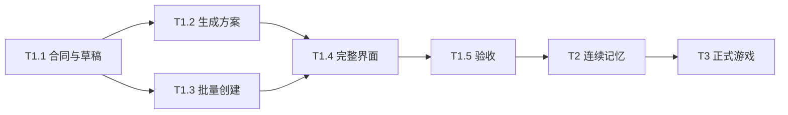

<!--
[INPUT]: T1 完成定义、源码映射、数据一致性与后续记忆/游戏目标。
[OUTPUT]: 可逐项执行的开发切片、依赖、交付证据要求及唯一进度表。
[POS]: ai-docs/spec/9.团队创建助手/08-实施步骤与交付清单.md。
[PROTOCOL]: 一旦本文件变化，必须同步更新 Header，并上浮检查所属目录 .folder.md；仅凭真实证据更新完成状态。
-->
# 实施步骤与交付清单

更新：2026-09-30。当前仅文档完成，以下实现项全部待办。本文件是本组唯一进度表；其他篇章描述合同，不重复保存测试成绩。

## 1. 开工前

- [ ] 阅读本组 00/01/03/04/09 和相关目录地图，核对本轮范围为 T1。
- [ ] 检查当前工作树和既有能力，不覆盖其他进行中的改动。
- [ ] 核对 Mastra 安装版本与内置结构化输出文档，使用已有模型配置。
- [ ] 明确此次要交付哪些 T1 子步骤，固定离线测试样例和故障注入位置。
- [ ] 若现有实现已满足某项，记录源码/测试证据并只补差距。

## 2. T1.1：合同、草稿与恢复入口

交付：有版本的草稿、生成/创建记录类型、IPC、校验和持久化；通讯录可以打开/关闭/恢复空草稿，还不开放无后端的创建按钮。

实施顺序：

1. 新增共享合同与 schema，明确模型输出禁止字段和用户可编辑字段。
2. 实现草稿创建/保存/读取、一个未结束草稿约束和请求去重。
3. 接线通讯录自己的详情标签与未保存守卫。
4. 支持重启读取草稿，旧数据没有新集合也能启动。

退出条件：草稿重启不丢，版本竞争不会覆盖，未确认时 agents/conversations 集合没有新增对象；旧创建入口和跨页面标签行为通过回归。

## 3. T1.2：内置团队设计助手

交付：所选模型可生成可编辑方案；失败/停止/过期结果明确。

1. 专用无工具 Agent + 固定 plannerVersion/schemaVersion。
2. 连接解析、共享容量、请求 ID、期限、两次调用上限及已知/未知用量。
3. 成功/需要调整判别输出、结构/语义校验和一次有界修复。
4. draftVersion/generationId/inputHash 守卫，停止后和旧请求的结果不能覆盖。
5. 接通生成中、失败、手工编辑、成员增删和重新生成交互。

退出条件：写作/简单助手/角色群/越界输入的离线协议场景通过；没有工具调用、员工创建和凭据泄露；重启不重发生成。真实模型质量留到 T1.5 评审，不用离线 fixture 宣称质量可靠。

## 4. T1.3：批量创建与恢复

交付：全部员工/可选群一次发布，支持明确继续和放弃清理。

1. 复用员工定义校验，增加无发布副作用的配置/工作区准备能力。
2. 事务受理冻结方案，预分配成员与群 ID。
3. 受管暂存、操作归属、hash、移动日志和配置复核。
4. 事务提交全部对象+回执，提交后批量安装内存和发变更。
5. 启动核对、显式 resume/cancel、清理失败保留与备份互斥。

退出条件：04 的断点矩阵全部覆盖；重复确认和回应丢失不重复对象；文件冲突不覆盖用户文件；数据库已提交但内存安装中断可完整恢复。

不能以“正常情况下创建成功”替代断点验收。本切片不依赖真实模型，可用经过校验的测试草稿调用真实宿主/SQLite/文件系统路径。

## 5. T1.4：完整通讯录体验与旧功能兼容

交付：01/10 定义的输入、方案、进度、结果和恢复入口全部可用。

1. 模型配置缺失/变化提示，最终提交与最新已保存草稿绑定。
2. 有群/无群两种结果，成员详情、私聊、群聊导航。
3. 群目的和协作建议展示/编辑，以及有来源的调用上下文投影。
4. 同名提示、头像预设、字段错误、窄窗和键盘可达。
5. 旧员工创建、选人建群、分类/排序和页面隔离回归。

退出条件：真实 Electron 中从输入到使用跑通；“先各自介绍”不创建 Work；创建本身没有新成员调用/欢迎词；群和私聊关联同一 agentId。

## 6. T1.5：验收与首版发布说明

执行 09 的 T1 必测项、现有相关回归、类型/UI规则/构建及 Electron BDD。固定真实模型、样例、预算和评审标准后，显式执行生成质量评估并保留失败。

至少完成两个实际演示：四人写作团队并进入群交流；只创建成员并私聊。另展示狼人杀请求得到“玩家群 + 未支持规则说明”，不把它记录成整局游戏测试。

记录创建耗时、生成调用/已知与未知用量、用户修改点、创建失败与恢复结果。未完成真实模型评审时，只能宣称离线实现/流程验收完成，T1 最终状态仍待评审。

## 7. 依赖顺序

先让数据和事务可验证，再把界面接起来。T1.2 和 T1.3 的接口稳定后可独立开发，但本图不要求创建额外开发代理或同时修改同一文件。

## 8. 后续阶段

T2：先写用途/来源迁移与失效规则，再实现显式跨会话关联和偏好保存，最后检验实际模型上下文不越界。范围以 05 为准。

T3：先用无模型输入实现固定游戏规则和 PlayerView，再接玩家结构化行动、公开发言、暂停采访与预算；最后用真实模型跑完整局。范围以 06 为准。

两者均不阻塞 T1 上线；若用户调整顺序，更新本表及完成口径，不把后续能力偷偷塞进 T1。

## 9. 唯一进度表

| 切片 | 状态 | 实现与验证证据 | 仍未完成 |
| --- | --- | --- | --- |
| T1.1 | 待实施 | 无 | 合同、草稿与恢复入口 |
| T1.2 | 待实施 | 无 | 生成、校验、预算和取消 |
| T1.3 | 待实施 | 无 | 批量发布、文件/事务断点 |
| T1.4 | 待实施 | 无 | 完整界面与旧功能回归 |
| T1.5 | 待实施 | 无 | 真实模型质量和首版验收 |
| T2 | 待实施 | 无 | 可控的跨会话经历连续 |
| T3 | 后续实施 | 无 | 正式游戏与暂停采访 |

## 10. 每次交付记录内容

在第 2 组新建或延续对应实现记录，写清：切片和范围、实际改动、数据迁移、测试命令/结果、模型/样例/预算版本、真实截图或日志、失败/未验证项、剩余限制。这里回链记录，不复制容易过时的测试数量。

完成一片后同步实现 → Header → 目录地图 → 本组状态和相关导航。产品 UI 和发布说明只展示已经通过验收的能力。
