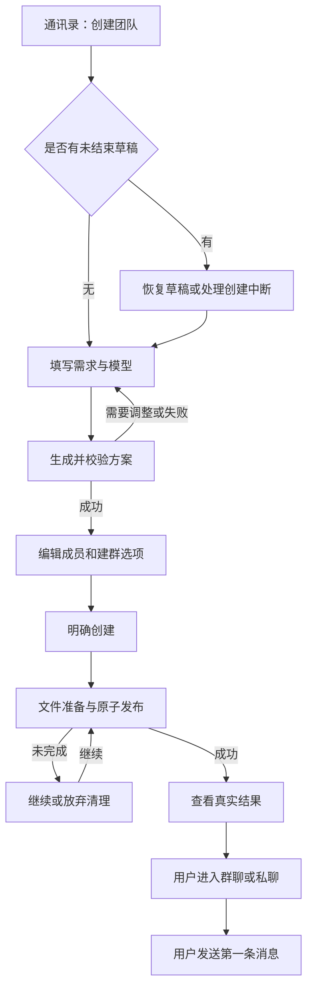
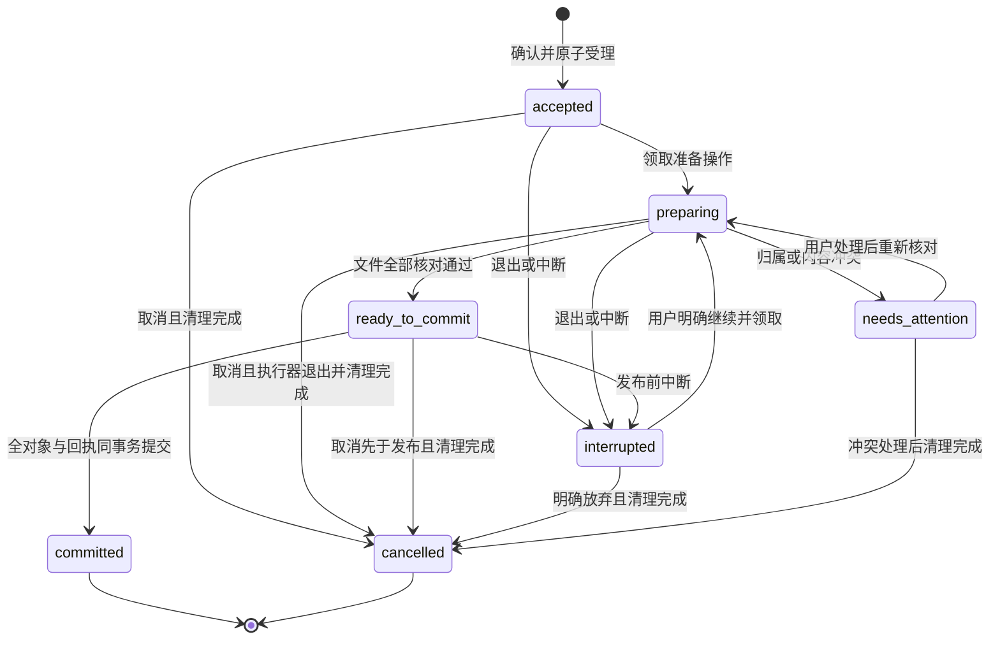

<!--
[INPUT]: 通讯录现有 UI、独立详情标签与团队创建用户流程。
[OUTPUT]: 可伴随实施使用的四个界面线框、流程/状态图和视觉交互规则。
[POS]: ai-docs/spec/9.团队创建助手/10-界面线框与状态图.md。
[PROTOCOL]: 一旦本文件变化，必须同步更新 Header，并上浮检查所属目录 .folder.md；交互调整同步 01。
-->
# 界面线框与状态图

状态：设计规格，非运行截图。采用可维护的文字线框与 Mermaid 图；不据此宣称像素视觉已获确认。实现复用当前通讯录、右侧详情工作区、共享表单和全局主题。

## 1. 输入界面

```text
通讯录列表                    通讯录所属的详情标签
┌──────────────────┐         ┌──────────────────────────────────────┐
│ 通讯录        ＋  │         │ 创建团队                          ×  │
│  搜索联系人      │         ├──────────────────────────────────────┤
│  群聊            │         │ 你希望这支团队做什么？               │
│  联系人          │         │ ┌──────────────────────────────────┐ │
│                  │         │ │ 帮我创建一个科技公众号写作团队…   │ │
│ ＋菜单           │         │ └──────────────────────────────────┘ │
│ · 创建团队       │         │ 写作团队   产品讨论组   角色玩家      │
│ · 新建员工       │         │                                      │
│ · 新建群聊       │         │ 模型连接 [选择已有连接          ▾]   │
│                  │         │ 模型     [使用连接默认模型      ▾]   │
│                  │         │ ☑ 同时创建群聊                       │
│                  │         │ 生成方案会调用所选模型。             │
│                  │         │                         [生成方案]   │
└──────────────────┘         └──────────────────────────────────────┘
```

示例入口填入输入框，不立即调用。模型控件沿用实际现有选择/输入能力，不承诺所有服务都提供模型目录。当前无可用配置时，控件下显示“先配置模型”，草稿保留。

## 2. 方案界面

```text
┌──────────────────────────────────────────────────────────────┐
│ 创建团队                                                 ×  │
├──────────────────────────────────────────────────────────────┤
│ [科技写作组________________]                       已保存     │
│ 团队用途 [为科技公众号选题、整理材料和撰写文章____________]  │
│ 假设：面向普通读者；主要使用你提供的材料。                    │
│                                                              │
│ 头像  阿策       选题与读者定位                 [展开] [移除] │
│ 头像  小研       资料整理与核对                 [展开] [移除] │
│ 头像  阿文       初稿与修改                     [收起] [移除] │
│       名称 [阿文________]                                    │
│       职责 [根据确定的方向完成初稿________________________]  │
│       工作规则/性格 [表达自然，事实不明时标记待核对………]     │
│ 头像  小审       审稿与建议                     [展开] [移除] │
│ [+ 添加成员]                                                │
│                                                              │
│ 协作建议 [先确定读者与提纲，再撰写和审稿__________________]  │
│ 待配置能力：实时网页检索。当前可以使用已有文本材料。          │
│ ☑ 同时创建群聊    群名称 [科技写作组____________________]   │
│ 模型：所选连接 / 实际模型名                                  │
│ 创建后由你发送第一条消息。                                   │
│ [返回需求] [重新生成]               [创建 4 位员工和群聊]    │
└──────────────────────────────────────────────────────────────┘
```

使用现有头像预设，不在创建中增加图像生成等待。成员卡按方案顺序排列，长规则折叠后仍保留内容。能力说明只反映真实缺口，不显示虚假的“全部工具已就绪”徽章。

## 3. 创建中与失败

```text
正在创建你的团队

✓ 已确认成员配置
… 正在准备成员工作区
  保存员工与群聊

暂未完成，成员会在全部创建成功后出现。
[收起]
```

不展示拍脑袋的百分比。阶段状态来自真实日志，不能在前端按计时器推进。收起保持后台操作；放弃创建从明确操作菜单进入。

```text
创建中断，尚未完成
小研的工作区准备失败。已保留本次方案和创建进度。

[继续创建] [放弃并清理] [查看详情]
```

若结果是路径冲突或清理失败，替换为对应文案和动作；不能把所有失败都写成“网络有问题”。详细诊断可包含可定位文件，但主流程不要求用户理解事务、hash 或操作 ID。

## 4. 成功结果

```text
科技写作组已创建

4 位员工：阿策 · 小研 · 阿文 · 小审
群聊：科技写作组

每位成员都有独立工作区，也可以单独联系。
当前记忆按员工基础资料和各自会话保存。

[进入群聊]  [查看成员]
                                  [创建另一套]
```

不自动跳转、不发送欢迎词。无群时改为“4 位员工已创建”，主动作“查看成员”，附“选择成员建群”。不把“已创建”写成“写作任务已完成”。

## 5. 用户流程图



恢复入口若绑定已受理操作，直接进入操作状态页，不回到可编辑表单；图中的“恢复草稿或处理创建中断”包含这两个分支。

## 6. 创建状态图



取消处理中仍保留当前状态与取消门禁；清理未完成时进入 needs_attention/显示 CLEANUP_REQUIRED，不提前到 cancelled。committed 之后无“继续创建”转换。

## 7. 布局和无障碍

- 复用现有语义颜色、字体、Card/Input/Button/SelectField 和图标；不引入新颜色函数或另一套 UI 主题。
- 列表/详情宽度遵循现有可调分栏；窄宽度下表单单列，成员规则可折叠，底部动作允许换行。
- 标签属于通讯录；跨页面不显示、不操作另一页的创建草稿。
- 生成结果完成后把焦点移到方案标题/摘要；校验失败聚焦首个错误字段。
- 生成/创建状态用可访问状态文本播报，按钮忙态防连点，但宿主仍有幂等保护。
- 停止、放弃、重生成覆盖编辑这几种动作含义不同，不混用“取消”一个词。

实现后补浅/深色、窄窗、错误和成功的真实截图，附对应 BDD 证据；不要用本线框代替运行验收。
